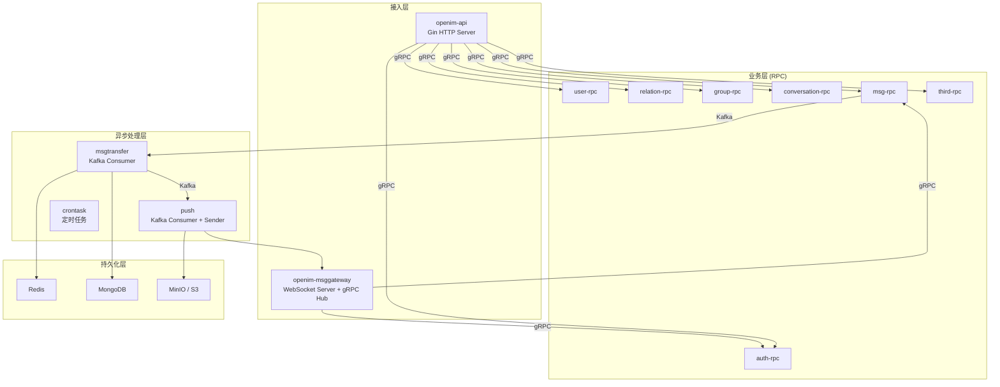
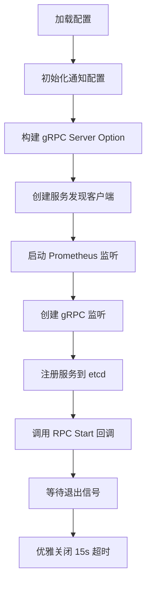
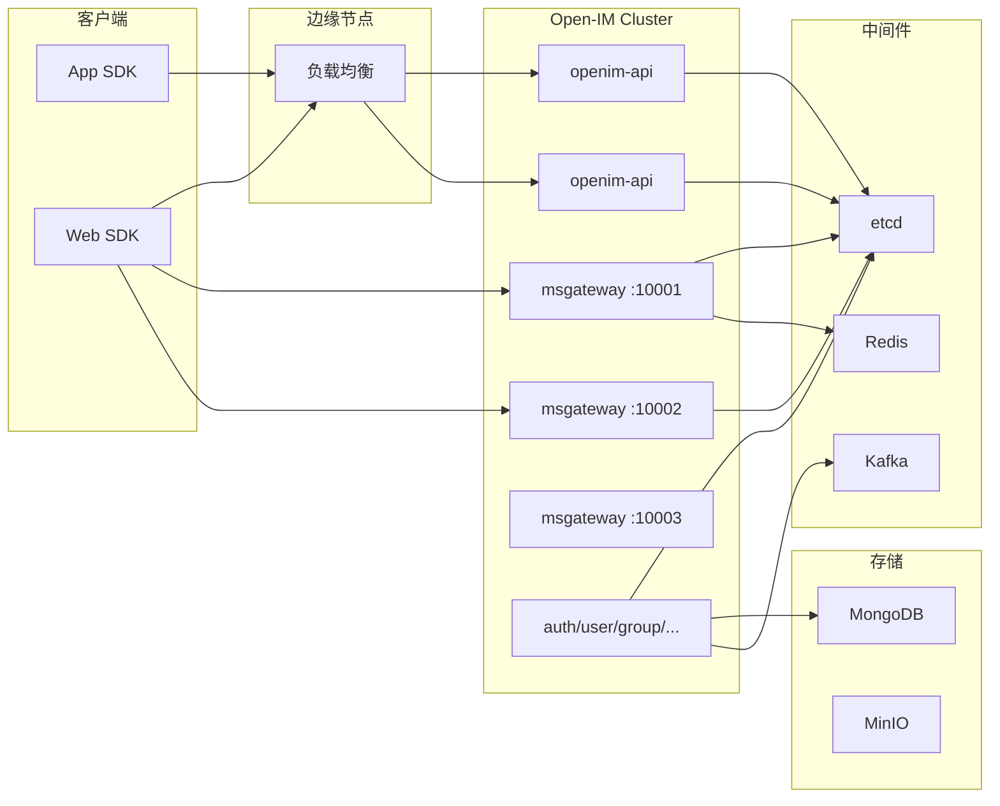

# 第一章：整体架构与模块划分

## 1. 分层架构

Open-IM-Server 采用四层微服务架构，从上到下依次为：**接入层 → 业务层 → 异步处理层 → 持久化层**。层间通过 gRPC（同步）和 Kafka（异步）通信。



### 1.1 接入层职责

**API 与 RPC 分离**是核心设计决策。API 层作为统一入口，仅做协议转换、参数校验和 Token 鉴权，所有业务逻辑委托给 RPC 服务。这使得 API 层可以水平扩展而不影响业务，也方便接入不同的客户端协议（HTTP、gRPC-Web 等）。

| 组件 | 协议 | 入口 | 核心职责 |
|------|------|------|----------|
| openim-api | HTTP (Gin) | `cmd/openim-api/` | REST API 路由分发、Token 解析、限流、Prometheus 指标 |
| openim-msggateway | WebSocket / gRPC | `cmd/openim-msggateway/` | 长连接维持、消息上行转发、消息下行推送、多端登录管控 |

### 1.2 启动方式

项目支持两种部署模式：

**单进程模式** — 所有服务在一个 Go 进程内启动，适合开发和中小部署：

```go
// cmd/main.go
startFn := []func() error{
    rpcStart,
    apiStart,
    msgGatewayStart,
    pushStart,
    msgTransferStart,
    cronStart,
}
```

**独立部署模式** — 每个服务单独编译为二进制，通过 etcd 服务发现互相通信，适合大规模生产部署：

```bash
./openim-api --config config/openim-api.yml
./openim-rpc --config config/openim-rpc-msg.yml
./openim-msggateway --config config/openim-msggateway.yml
```

### 1.3 服务发现框架

使用 `pkg/common/startrpc/` 提供的泛型函数 `Start[T any]()` 统一所有 RPC 服务的启动流程：

1. 初始化通知配置
2. 构建 gRPC Server Option（日志、错误转换、参数校验、panic 捕获）
3. 可选：熔断器（SRE 算法）、限流器（BBR 自适应限流）
4. 创建服务发现客户端（etcd 或 standalone）
5. 启动 Prometheus HTTP 监听
6. 注册 gRPC 服务到服务发现
7. 调用 RPC 模块的 Start 回调注册具体服务

关键结构体 `grpcServiceRegistrar` 确保延迟初始化 gRPC 服务器——只有第一个服务注册时才创建监听。

## 2. 模块划分

### 2.1 RPC 微服务（`internal/rpc/`）

| 服务 | 目录 | 实现文件 | 核心职责 |
|------|------|----------|----------|
| **auth-rpc** | `internal/rpc/auth/` | `auth.go` | Token 发放、Token 解析与验证、权限校验 |
| **user-rpc** | `internal/rpc/user/` | `user.go`, `online.go` | 用户 CRUD、在线状态管理、用户配置（消息接收选项） |
| **relation-rpc** | `internal/rpc/relation/` | `friend.go`, `black.go` | 好友添加/删除、好友申请审批、黑名单管理 |
| **group-rpc** | `internal/rpc/group/` | `group.go` | 群组 CRUD、成员管理、禁言、加群审批 |
| **msg-rpc** | `internal/rpc/msg/` | `server.go`, `send.go`, `revoke.go` | 消息发送、撤回、已读回执、序列号管理 |
| **conversation-rpc** | `internal/rpc/conversation/` | `conversation.go` | 会话 CRUD、未读计数、已读同步 |
| **third-rpc** | `internal/rpc/third/` | `third.go`, `s3.go`, `log.go` | 文件上传/下载、日志上报、对象存储 |
| **incrversion-rpc** | `internal/rpc/incrversion/` | `option.go` | 增量版本管理（数据同步） |

### 2.2 网关与服务组件

| 组件 | 目录 | 双端口设计 |
|------|------|-----------|
| **openim-msggateway** | `internal/msggateway/` | WebSocket 端口（面向客户端）+ gRPC 端口（接收推送请求） |
| **openim-msgtransfer** | `internal/msgtransfer/` | Kafka 消费者（订阅 toRedis / toMongo 两个 topic） |
| **openim-push** | `internal/push/` | Kafka 消费者（订阅 toPush）+ gRPC 调用 MsgGateway |

### 2.3 公共库（`pkg/`）

| 包 | 用途 |
|----|------|
| `pkg/common/startrpc/` | 统一 RPC 服务启动框架，含熔断器和限流器 |
| `pkg/rpcli/` | 所有 RPC 服务的客户端封装（gRPC 连接管理） |
| `pkg/rpccache/` | 本地缓存层，减少跨 RPC 调用 |
| `pkg/notification/` | 通知系统：发送系统通知消息 |
| `pkg/msgprocessor/` | 消息选项解析、会话 ID 生成 |
| `pkg/common/storage/` | MongoDB 数据库操作封装 |
| `pkg/mqbuild/` | Kafka 生产者和消费者构建工具 |

## 3. 统一启动框架

`pkg/common/startrpc/start.go` 中的 `Start[T any]()` 是 RPC 服务的总入口，其核心流程如下：



gRPC 中间件链：

| 中间件 | 文件 | 功能 |
|--------|------|------|
| `MetadataContext` | — | 从 gRPC metadata 提取 operationID 等上下文 |
| `ErrorConvert` | — | 将内部错误码转为 gRPC 状态码 |
| `Logger` | — | 请求日志记录 |
| `RequestValidate` | — | 参数校验 |
| `PanicCapture` | — | panic 恢复 |
| 熔断器 | `circuitbreaker.go` | SRE 算法（`maxRequests=5`, `interval=10s`） |
| 限流器 | `ratelimit.go` | BBR 自适应限流（`cpuThreshold=900`, `minWindowMs=500ms`） |

## 4. 部署拓扑



## 5. 核心代码索引

| 想了解什么 | 看哪个文件 |
|-----------|-----------|
| 服务启动入口 | `cmd/main.go` |
| RPC 启动框架 | `pkg/common/startrpc/start.go` |
| API 路由注册 | `internal/api/router.go` |
| 配置结构定义 | `config/share.yml` |
| 熔断器实现 | `pkg/common/startrpc/circuitbreaker.go` |
| 限流器实现 | `pkg/common/startrpc/ratelimit.go` |
| 服务发现注册 | `pkg/common/discovery/` |
| 错误码定义 | `pkg/common/servererrs/` |
