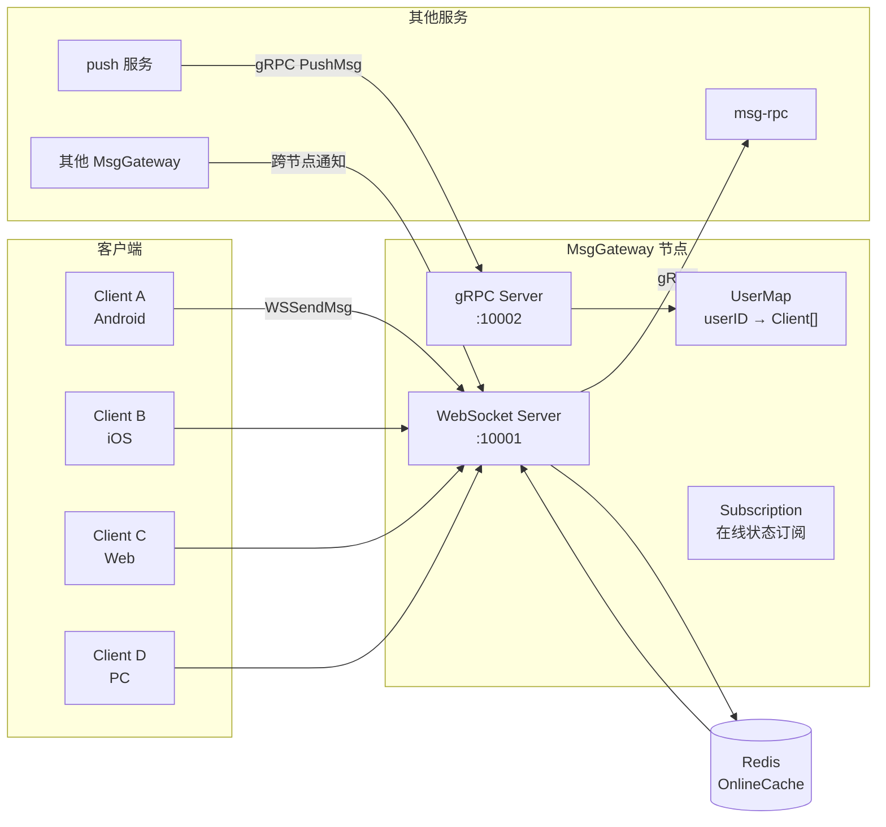
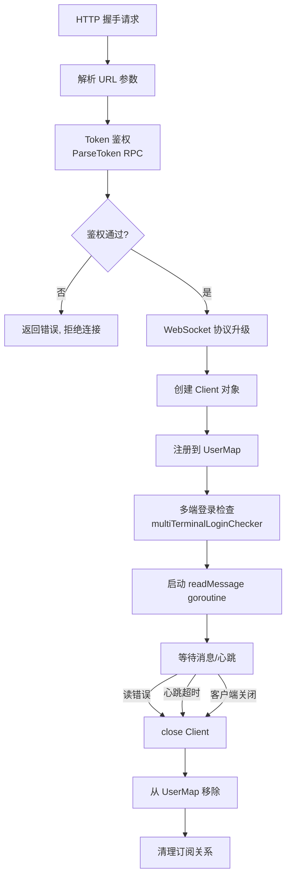

# 第二章：长连接管理与消息推送

> 对应源码目录：`internal/msggateway/` + `internal/push/`

MsgGateway 是 Open-IM-Server 中**唯一保持长连接的组件**，承担两个核心角色：
- **WebSocket Server**（面向客户端）：维持百万级长连接，处理上行请求（发送消息、拉取历史）、下行推送（新消息通知、踢人）
- **gRPC Server**（面向服务端）：接收 Push 服务的批量推送请求，将消息推送到本地节点的客户端



## 1. 连接生命周期

一个 WebSocket 连接从建立到断开的完整流程：



### 1.1 握手与鉴权

入口：`ws_server.go:491` `wsHandler()`

```
1. newContext(w, r)          — 从 HTTP 请求提取上下文
2. 检查连接数上限           — onlineUserConnNum < wsMaxConnNum
3. ParseEssentialArgs()     — 解析 URL query 或 v 参数 (base64 + JSON)
   ├─ token                 — JWT Token
   ├─ userID                — 用户 ID
   ├─ platformID            — 平台 ID (Android/iOS/Windows/Web...)
   ├─ compression           — 是否启用压缩 (gzip)
   ├─ background            — 是否后台模式
   └─ sdkVersion             — SDK 版本
4. authClient.ParseToken()  — 调用 auth-rpc 验证 Token 合法性
5. validateRespWithRequest()— 确认 token 中的 userID/platformID 与请求一致
6. websocket.Upgrade()      — HTTP → WebSocket 协议升级
7. ResetClient()            — 从 sync.Pool 获取并初始化 Client
8. registerChan <- client   — 将 Client 送入注册通道
9. go client.readMessage()  — 启动读消息 goroutine
```

**参数传递方式**：由于 IM SDK 通常无法直接在 WebSocket 握手时附加自定义 Header，参数有两种传递方式：
- URL query 参数：`ws://host:port?token=xxx&userID=yyy&...`
- `v` 参数（base64 编码的 JSON）：适用于参数较多的场景

### 1.2 Client 结构

`client.go:63` 中的核心结构体：

```go
type Client struct {
    conn           ClientConn       // 底层连接（WebSocket 实现）
    PlatformID     int              // 平台标识
    UserID         string           // 用户 ID
    IsBackground   bool             // 是否后台运行
    Encoder        Encoder          // 编码器：JSON 或 Gob
    ctx            *UserConnContext  // 连接上下文
    hbCtx, hbCancel                // 心跳上下文（用于超时控制）
    subUserIDs     map[string]struct{} // 订阅的其他用户 ID 列表
    closed         atomic.Bool      // 是否已关闭
}
```

关键设计：
- **`client.conn` 是接口** (`ClientConn`)，目前只有 `WebSocketClientConn` 实现，为未来支持其他传输协议预留
- **`sync.Pool` 复用 Client 对象**，减少高并发下的 GC 压力
- **平台感知**：`PlatformID` 影响推送策略（iOS 后台连接不推送，走 APNs）、多端互踢逻辑

### 1.3 心跳机制

两种心跳机制共存：

**WebSocket 协议层心跳**（`client_conn.go`）：

| 参数 | 值 | 说明 |
|------|-----|------|
| Ping 周期 | 27s | `pongWait * 9 / 10`，仅 Web 平台由服务端主动发 Ping |
| Pong 超时 | 30s | 超过未收到 Pong 认为连接断开 |
| Read Deadline | 30s | 每次收到 Pong 后刷新 |

**应用层心跳**（`client_conn.go:175`）：

客户端发送 `{"type":"ping"}`，服务端回复 `{"type":"pong"}`。这种方式适用于不能正确处理 WebSocket Ping/Pong 的客户端环境。

## 2. 用户连接映射 (UserMap)

`user_map.go` 实现了用户 ID 到多连接的一对多映射：

```go
type userMap struct {
    users map[string]*UserPlatform  // key: userID
}

type UserPlatform struct {
    Clients       []*Client          // 同一用户的所有连接
    PlatformMap   map[int32][]*Client // key: platformID
    AddTime       time.Time          // 首次连接时间
    UpdateTime    time.Time          // 最近变更时间
}
```

核心操作：

| 操作 | 函数 | 复杂度 | 说明 |
|------|------|--------|------|
| 添加连接 | `Set(userID, client)` | O(1) | 追加到 `Clients` 和 `PlatformMap` |
| 获取所有连接 | `GetAll(userID)` | O(1) | 返回用户在该节点的所有连接 |
| 获取某平台连接 | `Get(userID, platformID)` | O(1) | 按平台筛选 |
| 删除连接 | `DeleteClients(userID, clients)` | O(n) | 从 `Clients` 和 `PlatformMap` 中移除 |
| 获取状态变更 | `UserState()` | — | 返回 channel，监听连接变更事件 |

`UserState()` 返回的 channel 是连接生命周期管理的核心纽带——`ChangeOnlineStatus` 协程通过它感知连接建立和断开，从而更新 Redis 在线缓存和触发跨节点通知。

## 3. 多端登录策略

`multiTerminalLoginChecker()` 位于 `ws_server.go:333`，由配置 `Share.MultiLogin.Policy` 控制：

| 策略常量 | 值 | 行为描述 |
|----------|-----|----------|
| `DefalutNotKick` | 0 | 不踢任何已有连接，所有端共存 |
| `PCAndOther` | 1 | PC 端（Windows/macOS/Linux）之间不互踢；非 PC 端所有终端互踢（PC 除外） |
| `AllLoginButSameTermKick` | 2 | 同终端类型互踢；同一 token 不踢，不同 token 踢旧连接 |
| `AllLoginButSameClassKick` | 3 | 同终端类别互踢（如所有移动端 Android+iOS 互踢） |

### 3.1 跨节点踢人

当新连接触发多端登录检查时，不仅检查本节点的已有连接，还通过服务发现获取所有 MsgGateway 节点，跨节点踢人：

```
sendUserOnlineInfoToOtherNode()
  │
  ├─ 获取服务发现中所有 MsgGateway 实例列表
  ├─ 过滤出非自身的节点
  └─ 并发调用每个节点的 gRPC MultiTerminalLoginCheck()
       └─ 远程节点检查本地是否已有同用户连接
            └─ 有则调用 multiTerminalLoginChecker 触发踢人
```

### 3.2 同 Token 保护

`checkSameTokenFunc()` 确保使用同一 token 的连接不会被互踢。这解决了跨节点重连场景下的关键问题——客户端从一个节点断开后连接到另一节点，不会因为多端登录策略而被踢掉。

## 4. 消息在线推送

### 4.1 推送入口

Push 服务消费 Kafka `toPush` topic，对每条消息：

```
ConsumerHandler.HandleMs2PsChat()
  │
  ├─ 单聊/通知 → Push2User()
  │    ├─ webhookBeforeOnlinePush()
  │    ├─ GetConnsAndOnlinePush()
  │    │    └─ DefaultAllNode.GetConnsAndOnlinePush()
  │    │         ├─ 遍历所有 MsgGateway 节点
  │    │         └─ 并发调用 SuperGroupOnlineBatchPushOneMsg gRPC
  │    ├─ GetOnlinePushFailedUserIDs()   — 筛选在线推送失败的用户
  │    └─ offlinePushMsg()              — 走 FCM/APNs 离线推送
  │
  └─ 群聊 → Push2Group()
       ├─ webhookBeforeGroupOnlinePush()
       ├─ groupMessagesHandler()        — 处理退群/踢人/解散等特殊通知
       ├─ GetConnsAndOnlinePush()
       └─ filterGroupMessageOfflinePush() — 过滤群聊免打扰用户
```

### 4.2 节点内推送

MsgGateway 节点收到 gRPC 推送请求后：

```
Server.SuperGroupOnlineBatchPushOneMsg(req)
  │
  ├─ 对于 req.PushToUserIDs 中的每个 userID:
  │    └─ pushToUser(userID, msgData)
  │         ├─ LongConnServer.GetUserAllCons(userID)  — 获取本地所有连接
  │         └─ 遍历每个 Client:
  │              ├─ 如果 client.IsBackground && iOS → 跳过在线推送
  │              ├─ client.PushMessage(msgData)
  │              └─ 记录 OnlinePush = true (仅 iOS/Android)
  │
  └─ 收集所有推送结果，返回 gRPC 响应
```

**推送决策**（`GetOnlinePushFailedUserIDs`，`onlinepusher.go:122`）：
- 排除发送者自身
- iOS/Android 平台：`OnlinePush == true` 视为在线推送成功，否则走离线
- 其他平台（PC/Web）：`OnlinePush` 不参与判定，由其他逻辑决定

### 4.3 推送并发模型

使用 `memamq.MemoryQueue` 实现异步并发推送：

```go
// hub_server.go 中
s.queue.Push(ctx, &msgQueue{
    userID:  userID,
    msgData: msgData,
})
```

`MemoryQueue` 是一个**无锁内存队列**，多个 worker goroutine 并发消费。默认配置：
- Worker 数：16
- 缓冲区：2MB
- 每个 worker 独立处理一条用户推送

## 5. 跨节点同步

### 5.1 在线状态同步

当客户端的连接状态发生变化（上线/下线），MsgGateway 通过以下机制同步到其他节点：

**在线缓存**（`rpccache.OnlineCache`，基于 Redis）：
- 用户上线时写入：`HSET online_cache:{userID} {platformID} {nodeAddr}`
- 用户下线时删除
- 其他节点通过读取 OnlineCache 查询用户的在线节点分布

**跨节点通知**（`sendUserOnlineInfoToOtherNode`）：
- 新连接建立时，通知所有 MsgGateway 节点
- 用于多端登录检查
- 其他节点无该用户的连接，则忽略

### 5.2 在线状态订阅

`subscription.go` 实现了一套在线状态订阅机制：

```go
type Subscription struct {
    userIDs map[string]*subClient  // key: 被订阅的 userID
}

type subClient struct {
    clients map[string]*Client     // key: client remoteAddr
}
```

客户端通过 `WSSendMsg` 协议中的 `WsSubUserOnlineStatus`（2005）请求发起订阅：

```
Sub(subscribeUserID, unSubscribeUserID)
  ├─ 建立 userID → Client 的映射
  └─ 反向建立 Client → userID 的映射
```

当被订阅用户的在线状态变化时，Push 服务从 Kafka 消费到在线状态变更通知，`subscriberUserOnlineStatusChanges()` 回调被触发：

```
1. OnlineCache 检测到用户状态变化
2. ws.clients.RecvSubChange() 检查本地是否有该用户的连接
3. 向所有订阅了该用户状态的其他客户端推送状态变更
```

### 5.3 连接断开处理

```
client.close()
  │
  ├─ 标记 closed = true
  ├─ 关闭底层连接 (conn.Close())
  ├─ 取消心跳上下文 (hbCancel)
  └─ longConnServer.UnRegister(client)
       └─ 异步进入 unregisterClient()
            ├─ ws.clients.DeleteClients() — 从 UserMap 移除
            ├─ onlineUserConnNum--
            ├─ onlineUserNum-- (如果用户无其他连接)
            └─ ws.subscription.DelClient(client) — 清理订阅
```

## 6. 协议常量

`constant.go` 定义了消息网关的请求标识：

| 标识 | 值 | 方向 | 功能 |
|------|-----|------|------|
| `WSGetNewestSeq` | 1001 | 客户端→服务端 | 获取会话最新序列号 |
| `WSPullMsgBySeqList` | 1002 | 客户端→服务端 | 按序列号列表拉取消息 |
| `WSSendMsg` | 1003 | 客户端→服务端 | 发送消息 |
| `WSSendSignalMsg` | 1004 | 客户端→服务端 | 发送信令消息（音视频等） |
| `WSPullMsg` | 1005 | 客户端→服务端 | 拉取消息（按时间范围） |
| `WSGetConvMaxReadSeq` | 1006 | 客户端→服务端 | 获取会话已读最大序列号 |
| `WsPullConvLastMessage` | 1007 | 客户端→服务端 | 拉取会话最后一条消息 |
| `WSPushMsg` | 2001 | 服务端→客户端 | 推送新消息 |
| `WSKickOnlineMsg` | 2002 | 服务端→客户端 | 踢用户下线 |
| `WsLogoutMsg` | 2003 | 客户端→服务端 | 用户登出 |
| `WsSetBackgroundStatus` | 2004 | 客户端→服务端 | 设置前后台状态 |
| `WsSubUserOnlineStatus` | 2005 | 客户端→服务端 | 订阅用户在线状态 |

## 7. 核心代码索引

| 想了解什么 | 看哪个文件 |
|-----------|-----------|
| MsgGateway 启动流程 | `internal/msggateway/init.go` |
| WsServer 核心结构 | `internal/msggateway/ws_server.go` |
| WebSocket 握手流程 | `internal/msggateway/ws_server.go:491` |
| 多端登录策略 | `internal/msggateway/ws_server.go:333` |
| Client 连接对象 | `internal/msggateway/client.go` |
| 连接层抽象 | `internal/msggateway/client_conn.go` |
| 用户连接映射 | `internal/msggateway/user_map.go` |
| gRPC Hub Server | `internal/msggateway/hub_server.go` |
| 消息处理分发 | `internal/msggateway/message_handler.go` |
| 在线状态订阅 | `internal/msggateway/subscription.go` |
| 在线状态变更 | `internal/msggateway/online.go` |
| 协议常量 | `internal/msggateway/constant.go` |
| Push 服务推送逻辑 | `internal/push/push_handler.go` |
| 在线推送器 | `internal/push/onlinepusher.go` |
