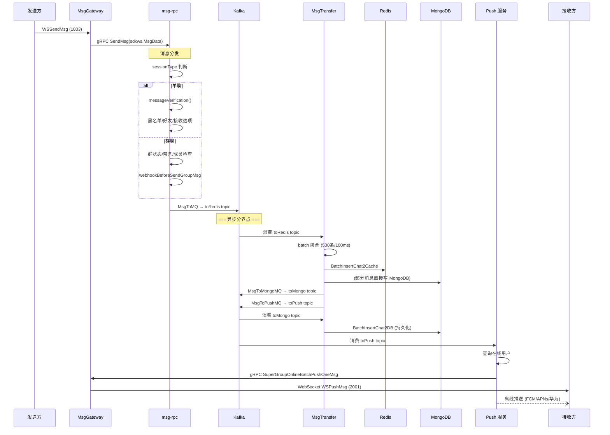
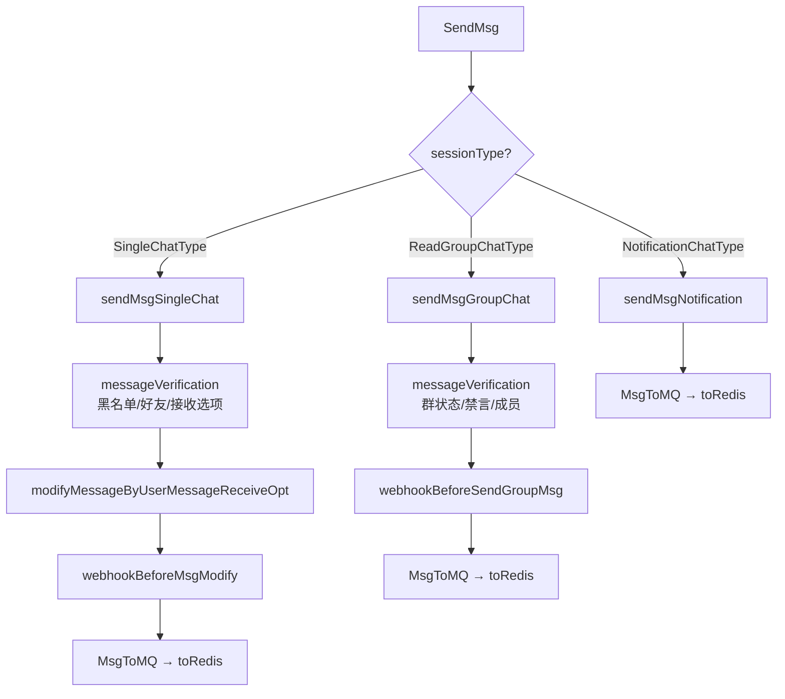
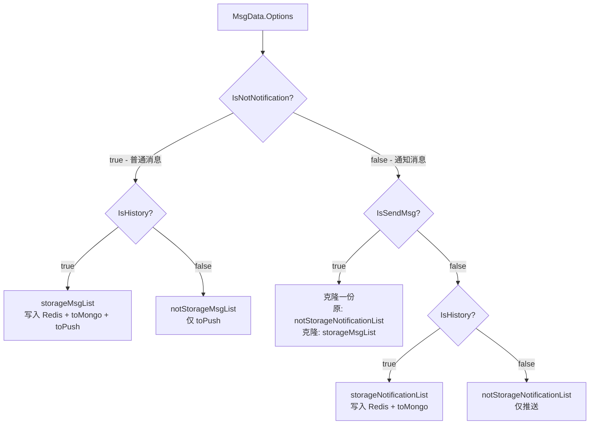
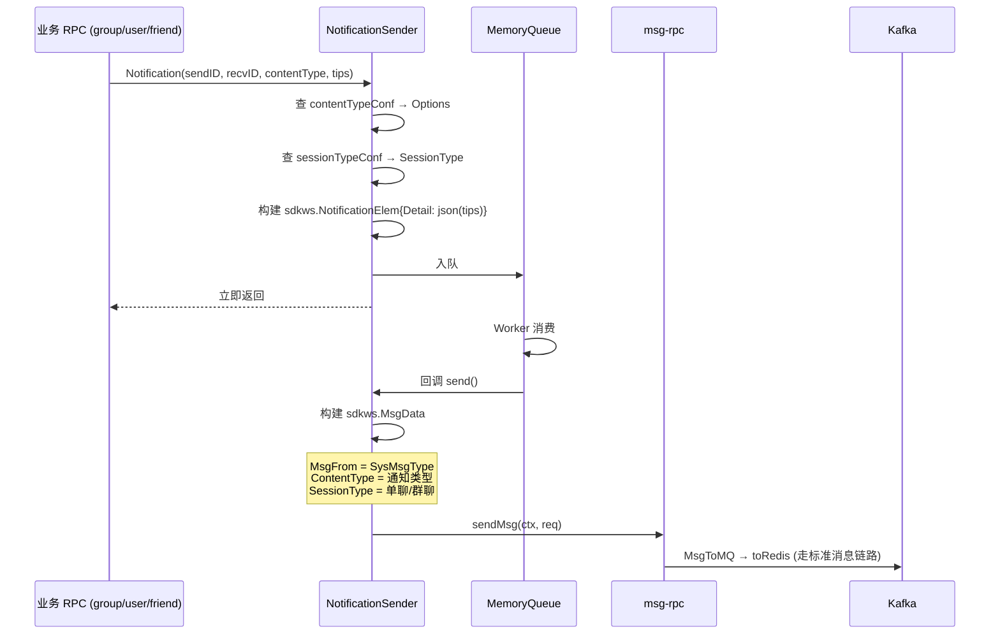

# 第三章：通知机制与消息流转

> 对应源码目录：`pkg/notification/` + `internal/rpc/msg/` + `internal/msgtransfer/`

本章聚焦消息从发送到投递的完整链路，以及系统通知的分发机制。这是 Open-IM-Server **最核心的数据通路**。

## 1. 消息发送链路



### 1.1 消息分发 (`internal/rpc/msg/send.go`)

`msgServer.SendMsg()` 根据消息的 `SessionType` 分发：



**单聊校验链** (`messageVerification`)：
1. 检查是否在黑名单中
2. 检查好友关系（可配置是否需要好友才能发消息）
3. 检查接收方消息接收选项（`UserMessageReceiveOpt`）：允许所有人 / 仅好友 / 拒绝所有人
4. 检查是否需要智能打码（`modifyMessageByUserMessageReceiveOpt`）

**群聊校验链**：
1. 检查群组状态（正常/解散）
2. 检查发送者是否在群中
3. 检查是否群禁言或成员被禁言
4. 检查 @ 权限（@所有人需要管理员权限）

### 1.2 消息写入 Kafka

所有经过校验的消息最终调用 `MsgToMQ()` 写入 Kafka `toRedis` topic：

```go
// internal/rpc/msg/send.go
func (m *msgServer) MsgToMQ(ctx context.Context, msgData *sdkws.MsgData) error {
    msgData.MsgID = util.GetMsgID()
    msgData.CreateTime = time.Now().UnixMilli()
    // 编码为 protobuf
    data, _ := proto.Marshal(msgData)
    // 写入 Kafka
    return m.producer.SendMessage(ctx, &mqmsginfo.MsgDBModel{
        Topic:        "toRedis",
        Key:          msgData.MsgID,
        Value:        data,
        // ...
    })
}
```

关键设计：**消息写入 Kafka 后立即返回给客户端，后续处理完全异步**。这保证了消息发送的极低延迟——客户端感知到的延迟仅包含 `gRPC 调用 + Kafka 写入`。

## 2. 消息转储 (MsgTransfer)

`internal/msgtransfer/` 是消息链路的中枢，消费 Kafka 消息并分发到 Redis 缓存、MongoDB 持久化和 Push 推送。

### 2.1 Kafka 主题拓扑

| Topic | 生产者 | 消费者 | 用途 |
|-------|--------|--------|------|
| `toRedis` | msg-rpc | msgtransfer | 原始消息转储入口 |
| `toMongo` | msgtransfer | msgtransfer | 消息持久化到 MongoDB |
| `toPush` | msgtransfer | push 服务 | 推送消息到在线/离线用户 |
| `toOfflinePush` | push 服务 | push 服务 | 异步离线推送 |

### 2.2 批处理机制

`OnlineHistoryRedisConsumerHandler` 使用 `batcher.Batcher` 实现高效的批量消费：

```go
// online_history_msg_handler.go
type OnlineHistoryRedisConsumerHandler struct {
    redisMessageBatches *batcher.Batcher[ConsumerMessage]
}
```

`batcher.Batcher` 参数：

| 参数 | 值 | 说明 |
|------|-----|------|
| 批大小 | 500 | 积累到 500 条触发一次处理 |
| 最大间隔 | 100ms | 即使不满 500 条，每 100ms 也触发一次 |
| 工作线程 | 50 | 并发处理多个 batch |
| Sharding | hash(key) % worker | 保证相同 key 的消息顺序处理 |

### 2.3 消息分类

`categorizeMessageLists()` 根据消息的 Options 将消息分为 4 类：



分类依据（Options 中的位标记）：

| Option | 含义 | 影响 |
|--------|------|------|
| `IsSendMsg` | 是否作为"发送消息"处理 | 决定是否存储到会话消息列表 |
| `IsHistory` | 是否进入历史消息 | 决定是否持久化到 MongoDB |
| `IsNotNotification` | 是否为普通消息（非通知） | 决定消息分类路径 |
| `IsPersistent` | 是否持久化 | 决定是否写入 MongoDB |
| `IsOfflinePush` | 是否离线推送 | 决定是否写入 toPush topic |
| `IsUnreadCount` | 是否计入未读计数 | 决定是否更新未读数 |
| `IsConversationUpdate` | 是否触发会话更新 | 决定是否更新会话最近消息 |

### 2.4 Redis 写入

`BatchInsertChat2Cache()` 是 Redis 写入的核心操作：

1. **最新消息列表**：使用 List 结构存储，`RPUSH conv:{convID}:msgs msgData`
2. **消息序列号索引**：使用 ZSet 结构，`ZADD conv:{convID}:seq {seq} {msgID}`
3. **限制列表长度**：`LTRIM conv:{convID}:msgs -100 -1`（仅保留最近 100 条）
4. **设置已读序列号**：处理 `HasReadReceipt` 类型的消息

### 2.5 MongoDB 持久化

`BatchInsertChat2DB()` 在 `OnlineHistoryMongoConsumerHandler` 中消费 `toMongo` topic 后执行：

1. **消息文档**：每个消息存储为 MongoDB 中的一个 document
2. **分片键**：使用 `conversationID` 作为分片键
3. **TTL 索引**：`msg.CreateTime` 上设置 TTL 索引，过期自动删除
4. **二级索引**：`userID + conversationID + seq` 复合索引，支持按用户/会话/序列号高效查询

## 3. 系统通知系统

### 3.1 NotificationSender 结构

`pkg/notification/msg.go:129` 定义了系统的通知发送器：

```go
type NotificationSender struct {
    contentTypeConf map[int32]config.NotificationConfig  // 通知类型 → 配置
    sessionTypeConf map[int32]int32                       // 通知类型 → 会话类型
    sendMsg         func(ctx, *SendMsgReq) (*SendMsgResp, error)  // 实际发消息的函数
    getUserInfo     func(ctx, userID) (*sdkws.UserInfo, error)
    queue           *memamq.MemoryQueue  // 异步发送队列
}
```

通知发送是**完全异步**的——`Notification()` 方法将消息入队后立即返回，不会阻塞业务逻辑。

### 3.2 通知发送流程



**通知消息的 Options 设置**：
- 通知消息的 Options 由 `contentTypeConf` 中的 `NotificationConfig` 控制
- 不同通知类型可以有不同的 `IsSendMsg`、`IsHistory`、`IsOfflinePush` 等设置
- 例如：群禁言通知 `IsHistory=true`，但加群申请通知 `IsHistory=false`

### 3.3 通知类型完整列表

#### 群组通知（19 种）

| 通知类型 | 说明 | 会话类型 |
|----------|------|----------|
| `GroupCreated` | 群创建成功 | 群聊 |
| `GroupInfoSet` | 群信息变更 | 群聊 |
| `JoinGroupApplication` | 加群申请 | 单聊（管理员接收） |
| `MemberQuit` | 成员退群 | 群聊 |
| `GroupApplicationAccepted` | 加群申请通过 | 群聊 |
| `GroupApplicationRejected` | 加群申请拒绝 | 单聊 |
| `GroupOwnerTransferred` | 群主转让 | 群聊 |
| `MemberKicked` | 成员被踢 | 群聊 |
| `MemberInvited` | 成员被邀请 | 群聊 |
| `MemberEnter` | 成员进入（无需验证的群） | 群聊 |
| `GroupDismissed` | 群解散 | 群聊 |
| `GroupMuted` / `GroupCancelMuted` | 群禁言/取消 | 群聊 |
| `GroupMemberMuted` / `GroupMemberCancelMuted` | 成员禁言/取消 | 群聊 |
| `GroupMemberInfoSet` | 群成员信息变更 | 群聊 |
| `GroupMemberSetToAdmin` / `GroupMemberSetToOrdinaryUser` | 管理员设置/取消 | 群聊 |
| `GroupInfoSetAnnouncement` | 群公告变更 | 群聊 |
| `GroupInfoSetName` | 群名称变更 | 群聊 |

#### 用户通知（2 种）

| 通知类型 | 说明 | 会话类型 |
|----------|------|----------|
| `UserInfoUpdated` | 用户信息更新 | 单聊（通知好友） |
| `UserStatusChange` | 用户在线状态变更 | 单聊 |

#### 好友通知（10 种）

| 通知类型 | 说明 | 会话类型 |
|----------|------|----------|
| `FriendApplication` | 好友申请 | 单聊 |
| `FriendApplicationApproved` | 好友申请通过 | 单聊 |
| `FriendApplicationRejected` | 好友申请拒绝 | 单聊 |
| `FriendAdded` | 添加好友 | 单聊 |
| `FriendDeleted` | 删除好友 | 单聊 |
| `FriendRemarkSet` | 好友备注设置 | 单聊 |
| `BlackAdded` / `BlackDeleted` | 黑名单添加/移除 | 单聊 |
| `FriendInfoUpdated` / `FriendsInfoUpdate` | 好友信息变更 | 单聊 |

#### 会话通知（3 种）

| 通知类型 | 说明 | 会话类型 |
|----------|------|----------|
| `ConversationChange` | 会话变更 | 单聊 |
| `ConversationUnread` | 未读计数变更 | 单聊 |
| `ConversationPrivateChat` | 私聊设置变更 | 单聊 |

#### 消息通知（3 种）

| 通知类型 | 说明 | 会话类型 |
|----------|------|----------|
| `MsgRevoke` | 消息撤回 | 原消息会话类型 |
| `HasReadReceipt` | 已读回执 | 单聊 |
| `DeleteMsgsNotification` | 删除消息通知 | 原消息会话类型 |

### 3.4 关键设计决策

**通知走标准消息链路**：系统通知不是独立的分发渠道，而是通过 `NotificationSender.sendMsg()` 构造为标准的 `sdkws.MsgData`，进入消息的完整链路（Kafka → MsgTransfer → Push → MsgGateway）。这意味着：
- 通知消息同样有序列号、可被拉取历史
- 通知消息触发会话更新
- 通知消息走 Webhook 回调
- 通知消息可被离线推送

**内存队列解耦**：`NotificationSender` 内部使用 `memamq.MemoryQueue` 异步发送通知，避免业务 RPC 等待通知发送完成。默认 16 个 worker，2MB 缓冲区。

## 4. 核心代码索引

| 想了解什么 | 看哪个文件 |
|-----------|-----------|
| 消息发送入口 | `internal/rpc/msg/send.go` |
| 消息分发逻辑 | `internal/rpc/msg/send.go:sendMsgSingleChat/sendMsgGroupChat` |
| 消息序列号管理 | `internal/rpc/msg/seq.go` |
| 消息撤回逻辑 | `internal/rpc/msg/revoke.go` |
| 已读回执处理 | `internal/rpc/msg/as_read.go` |
| 消息写入 Kafka | `internal/rpc/msg/send.go:MsgToMQ` |
| Kafka 批处理消费 | `internal/msgtransfer/online_history_msg_handler.go` |
| 消息分类逻辑 | `internal/msgtransfer/online_history_msg_handler.go:categorizeMessageLists` |
| Redis 缓存写入 | `pkg/common/storage/` (BatchInsertChat2Cache) |
| MongoDB 持久化 | `internal/msgtransfer/online_msg_to_mongo_handler.go` |
| NotificationSender | `pkg/notification/msg.go` |
| 通知类型配置 | `pkg/notification/msg.go:newContentTypeConf` |
| 消息选项定义 | `pkg/msgprocessor/options.go` |
| 会话 ID 生成 | `pkg/msgprocessor/conversation.go` |
