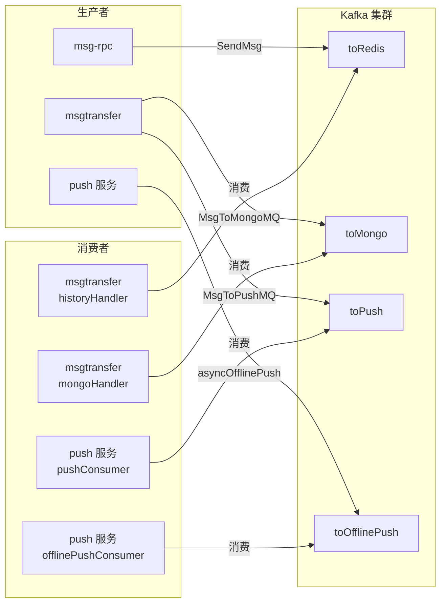
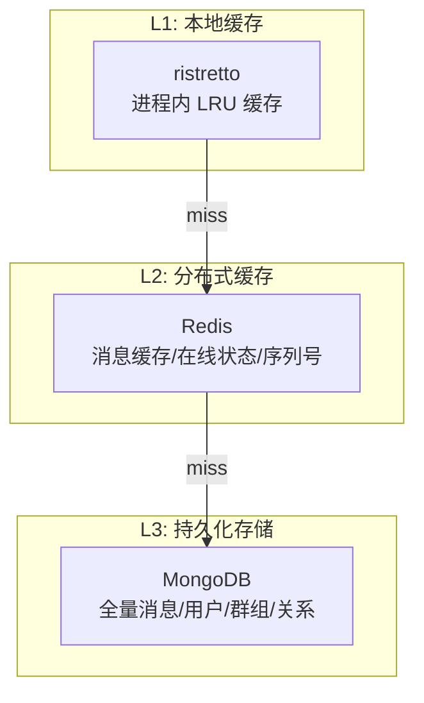

# 第四章：各模块深入分析

本章深入分析 Open-IM-Server 各核心模块的内部实现，包括 API 层路由、RPC 服务细节、MsgGateway 协议处理、MsgTransfer Kafka 拓扑、Push 服务推送通道，以及关键的设计模式和工程实践。

## 1. API 层详解 (`internal/api/`)

### 1.1 路由注册

`router.go` 使用 Gin 框架注册路由，每个业务模块一个路由组：

```go
func Start(config *Config, client discovery.SvcDiscoveryRegistry, server grpc.ServiceRegistrar) {
    r := gin.New()
    r.Use(cors.Default(), ginzip.GinZipMiddleware(), ginprometheus.Prometheus())
    
    // 白名单路由（不鉴权）
    r.POST("/auth/get_admin_token", authRouter)
    
    // Token 解析中间件组
    api := r.Group("", GinParseToken())
    api.POST("/user/*path", userRouter)
    api.POST("/friend/*path", friendRouter)
    api.POST("/group/*path", groupRouter)
    api.POST("/msg/*path", msgRouter)
    api.POST("/conversation/*path", conversationRouter)
    api.POST("/third/*path", thirdRouter)
    api.POST("/auth/*path", authRouter)
    
    r.Run(":10002")
}
```

路由前缀映射：

| 前缀 | 模块 | 示例 |
|------|------|------|
| `/auth/` | 认证 | 注册、登录、Token 刷新 |
| `/user/` | 用户 | 资料查询/更新、在线状态 |
| `/friend/` | 好友 | 申请/审批/删除/黑名单 |
| `/group/` | 群组 | CRUD/成员管理/禁言 |
| `/msg/` | 消息 | 发送/撤回/历史拉取/已读 |
| `/conversation/` | 会话 | 列表/未读/置顶/删除 |
| `/third/` | 第三方 | 文件上传/日志上传 |
| `/statistics/` | 统计 | 运营数据统计 |
| `/jssdk/` | JS-SDK | Web SDK 专用接口 |
| `/config/` | 配置管理 | 运行时配置查询 |


### 1.2 API Handler 模式

每个 API Handler 遵循固定模式：

1. 从 Gin Context 提取参数
2. 从 Gin Context 获取 Token 解析后的用户信息
3. 从服务发现获取对应 RPC 服务的 gRPC 连接
4. 调用 RPC Client 的对应方法
5. 返回 gRPC 响应作为 HTTP JSON 响应

```go
// internal/api/user.go 示例模式
func GetUsersInfo(c *gin.Context) {
    // 1. 参数绑定
    var req userPb.GetUsersInfoReq
    if err := c.BindJSON(&req); err != nil { ... }
    
    // 2. 获取用户信息 (Token 解析结果)
    userID := c.GetString("userID")
    
    // 3. 获取 RPC 连接
    client := rpcli.NewUserClient(discovery.GetConn("user-rpc"))
    
    // 4. RPC 调用并返回
    resp, err := client.GetUsersInfo(ctx, &req)
    c.JSON(http.StatusOK, gin.H{"data": resp})
}
```

## 2. RPC 服务详解

### 2.1 msg-rpc 消息服务 (`internal/rpc/msg/`)

消息服务是最复杂、文件最多的 RPC 服务：

| 文件 | 功能 |
|------|------|
| `server.go` | msgServer 结构体定义、消息拦截器链 |
| `send.go` | 消息发送核心逻辑（单聊/群聊/通知） |
| `revoke.go` | 消息撤回逻辑、撤回时长检查 |
| `seq.go` | 序列号生成器（Redis incr） |
| `clear.go` | 消息清理（删除会话消息） |
| `delete.go` | 单条消息删除 |
| `as_read.go` | 已读回执处理 |
| `filter.go` | 消息过滤（敏感词等） |
| `msg_status.go` | 消息状态管理 |
| `notification.go` | 消息通知（撤回/删除通知） |
| `callback.go` | Webhook 回调 |
| `statistics.go` | 消息统计 |
| `sync_msg.go` | 消息同步（多端） |

**消息拦截器链** (`MessageInterceptorChain`)：
```
WebhookBefore → 权限校验 → 消息发送 → WebhookAfter
```

每个拦截器可以修改 `MsgData` 或在发送前后执行逻辑。

### 2.2 auth-rpc 认证服务

提供 Token 全生命周期管理：

| 接口 | 功能 |
|------|------|
| `UserRegister` | 用户注册，返回 Token |
| `GetAdminToken` | 管理员 Token 获取 |
| `ParseToken` | Token 解析验证 |
| `ForceLogout` | 强制登出 |

Token 结构：JWT，包含 `userID`、`platformID`、`expireAt` 等信息。

### 2.3 relation-rpc 好友关系

| 接口 | 功能 |
|------|------|
| `FriendRequest` | 发送好友申请 |
| `FriendResponse` | 审批好友申请 |
| `DeleteFriend` | 删除好友 |
| `GetFriendsList` | 获取好友列表 |
| `AddBlack` / `RemoveBlack` | 黑名单管理 |

每个操作都通过 `NotificationSender` 发送对应类型的系统通知。

### 2.4 conversation-rpc 会话管理

会话是 Open-IM 的核心抽象——每个聊天窗口对应一个会话：

```go
type Conversation struct {
    OwnerUserID          string     // 会话所有者
    ConversationID       string     // 会话 ID
    ConversationType     int32      // 单聊/群聊/通知
    UserID               string     // 对方用户 ID（单聊）
    GroupID              string     // 群 ID（群聊）
    LatestMsg            string     // 最近一条消息
    LatestMsgSendTime    int64      // 最近消息时间
    UnreadCount          int32      // 未读计数
    DraftText            string     // 草稿
    IsPinned             bool       // 是否置顶
    // ...
}
```

会话 ID 生成规则（`pkg/msgprocessor/conversation.go`）：
- 单聊：`si_{sendID}_{recvID}`（两 ID 排序后拼接）
- 写群组：`g_{groupID}`
- 读群组（超级群）：`sg_{groupID}`
- 通知单聊：`n_{sendID}_{recvID}`
- 通知群聊：`sn_{sendID}_{recvID}`

## 3. MsgGateway 协议处理

`message_handler.go:102` 定义了 `MessageHandler` 接口，将 WebSocket 上行请求转换为对应的 gRPC 调用：

| 请求标识 | 处理方法 | 转换的 gRPC 调用 |
|----------|----------|------------------|
| 1001 (GetNewestSeq) | `handlerGetNewestSeq` | conversation-rpc `GetConversationMaxSeq` |
| 1002 (PullMsgBySeqList) | `handlerPullMsgBySeqList` | msg-rpc `PullMsgBySeqList` |
| 1003 (SendMsg) | `handlerSendMsg` | msg-rpc `SendMsg` |
| 1004 (SendSignalMsg) | `handlerSendSignalMsg` | msg-rpc `SendSignalMsg` |
| 1005 (PullMsg) | `handlerPullMsg` | msg-rpc `PullMsg` |
| 1006 (GetConvMaxReadSeq) | `handlerGetConvMaxReadSeq` | msg-rpc相关 |
| 2001 (PushMsg) | 服务端主动推送 | 走 gRPC hub 推送通道 |

`GrpcHandler` 是 `MessageHandler` 的唯一实现，它持有所有 msg-rpc 的 gRPC 客户端连接。

## 4. MsgTransfer Kafka 拓扑



**消费 Group 配置**：

| 消费者 | Group ID | 分区分配策略 | 并发 |
|--------|----------|-------------|------|
| historyHandler | `history` | Range | 50 workers |
| mongoHandler | `mongo` | Range | 50 workers |
| pushConsumer | `push` | Range | 16 workers |
| offlinePushConsumer | `offline_push` | Range | 8 workers |

## 5. Push 服务推送通道

`internal/push/` 中的 `offlinePusher` 是一个接口：

```go
type OfflinePusher interface {
    Push(ctx context.Context, userID string, msg *sdkws.MsgData) error
}
```

目前支持的实现：

| 推送通道 | 适用平台 | 实现文件 |
|----------|----------|----------|
| FCM | Android (Google Play 服务) | `pkg/offlinepush/fcm.go` |
| APNs | iOS / macOS | `pkg/offlinepush/apns.go` |
| 华为推送 | Android (华为设备) | `pkg/offlinepush/hms.go` |
| 自定义回调 | 自建推送通道 | Webhook 回调实现 |

离线推送触发条件：

```
OnlinePush == false (iOS/Android 在线推送未成功)
    && OfflinePushInfo.Ex != "" (有离线推送扩展字段)
    && 用户未在免打扰列表
    && 非发送者自身
```

## 6. 缓存策略

### 6.1 三级缓存架构



### 6.2 rpccache 层

`pkg/rpccache/` 为每个 RPC 领域提供了本地缓存包装：

| 缓存 | 缓存内容 | TTL |
|------|----------|-----|
| `UserLocalCache` | 用户信息、用户配置 | 5min |
| `FriendLocalCache` | 好友关系、黑名单 | 5min |
| `GroupLocalCache` | 群信息、群成员、禁言状态 | 5min |
| `ConversationLocalCache` | 会话信息 | 5min |
| `OnlineCache` (Redis) | 用户在线状态 | 实时 |

缓存刷新策略：
- **写穿透**：业务操作后主动删除本地缓存键
- **TTL 过期**：即使没被主动删除，最差 5 分钟后自动失效
- **Redis 缓存**：消息相关（最新消息列表）通过 Kafka 异步更新

## 7. 关键设计模式总结

### 7.1 启动框架泛型

`pkg/common/startrpc/start.go` 使用 Go 1.18+ 泛型提供统一启动入口：

```go
func Start[T any](
    ctx context.Context,
    config *T,
    watchServiceNames []string,
    rpcFn func(*Config, discovery.SvcDiscoveryRegistry, grpc.ServiceRegistrar) error,
) error
```

`T` 是配置结构体的类型参数，通过反射自动提取 `MaxRequestBody`、`Share` 等子配置。

### 7.2 内存队列异步解耦

系统中多处使用 `memamq.MemoryQueue` 实现异步处理：

| 使用位置 | 用途 | 效果 |
|----------|------|------|
| `pkg/notification/` | 异步发送系统通知 | 业务 RPC 不阻塞等待通知发送 |
| `internal/msggateway/hub_server.go` | 异步推送消息给用户 | 批量推送不阻塞单个推送失败 |
| `internal/msgtransfer/` | 异步消费 Kafka | 使用 batcher 批量处理 |

### 7.3 消息选项位标记

`pkg/msgprocessor/options.go` 使用 map 作为位标记容器：

```go
type Options map[string]bool

const (
    IsNotNotification        = "IsNotNotification"
    IsSendMsg                = "IsSendMsg"
    IsHistory                = "IsHistory"
    IsPersistent             = "IsPersistent"
    IsOfflinePush            = "IsOfflinePush"
    IsUnreadCount            = "IsUnreadCount"
    IsConversationUpdate     = "IsConversationUpdate"
    IsSenderSync             = "IsSenderSync"
    IsNotPrivate             = "IsNotPrivate"
    IsSenderConversationUpdate = "IsSenderConversationUpdate"
    IsReactionFromCache      = "IsReactionFromCache"
)
```

每个标志控制消息在转储链路中的一个处理维度。相比位掩码，map 方式更易于扩展和理解。

### 7.4 熔断与限流

熔断器（`circuitbreaker.go`）基于 **Google SRE 算法**：

| 参数 | 默认值 |
|------|--------|
| `maxRequests` | 5（半开后最大请求数） |
| `interval` | 10s（统计窗口） |
| `timeout` | 10s（熔断->半开超时） |

限流器（`ratelimit.go`）基于 **BBR（Bottleneck Bandwidth and Round-trip）算法**：

| 参数 | 默认值 |
|------|--------|
| `cpuThreshold` | 900（CPU 使用率阈值 90%） |
| `minWindowMs` | 500ms（最小采样窗口） |
| `maxPct` | 10000（最大通过百分比） |

## 8. 核心代码索引

| 想了解什么 | 看哪个文件 |
|-----------|-----------|
| API 路由注册 | `internal/api/router.go` |
| msg-rpc 消息服务 | `internal/rpc/msg/server.go` |
| 会话 ID 生成 | `pkg/msgprocessor/conversation.go` |
| 消息选项定义 | `pkg/msgprocessor/options.go` |
| 本地缓存包装 | `pkg/rpccache/` |
| 离线推送接口 | `pkg/offlinepush/` |
| Kafka 消费者构建 | `pkg/mqbuild/` |
| 数据库操作封装 | `pkg/common/storage/` |
| 错误码定义 | `pkg/common/servererrs/` |
| Webhook 回调 | `pkg/common/webhook/` |
| 熔断器实现 | `pkg/common/startrpc/circuitbreaker.go` |
| 限流器实现 | `pkg/common/startrpc/ratelimit.go` |
