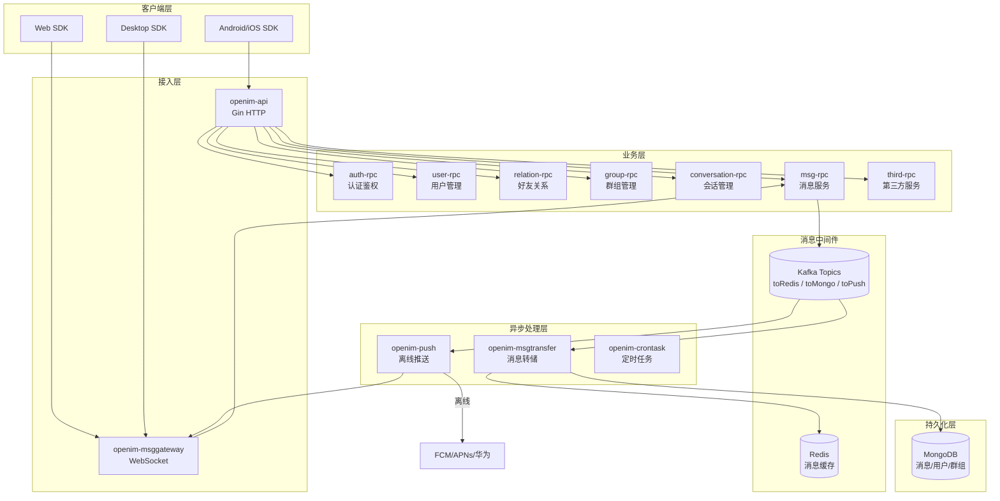
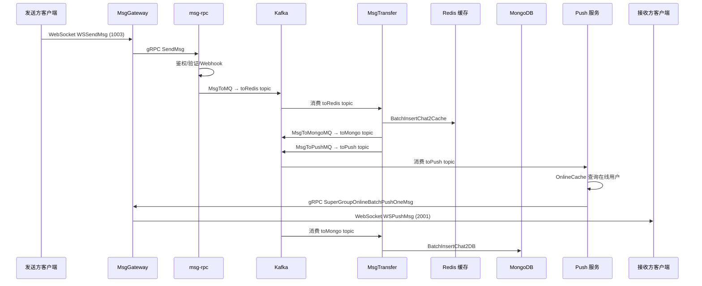

# Open-IM-Server — 开源即时通讯服务器深度分析

> **GitHub:** [https://github.com/openimsdk/open-im-server](https://github.com/openimsdk/open-im-server)
> **版本:** v3.8+

## 第一部分：快速概览

### 这是什么

Open-IM-Server 是一个开源即时通讯服务器，由 Go 语言实现，采用微服务架构。它提供完整 IM 能力：用户管理、好友关系、群组管理、消息收发、离线推送、多端登录等。项目定位为 IM 基础设施，不包含 UI，开发者通过 SDK 集成到自己的应用中。

### 解决的痛点

开发 IM 功能面临的高复杂度问题：

- **长连接管理**：数百万并发 WebSocket 连接的维护、心跳、多端同步
- **消息可靠性**：消息不丢不重、有序、离线存储、多端同步
- **在线推送**：实时性要求高，在线走 WebSocket、离线走 APNs/FCM/华为推送
- **微服务拆分**：业务模块独立部署和扩展，服务发现、熔断、限流
- **多端登录策略**：PC/手机/Web 同端互踢、同类互踢等策略可配置

### 核心能力清单

| 能力 | 说明 |
|------|------|
| **即时消息** | 单聊、群聊、@消息、引用回复、消息撤回、已读回执 |
| **群组管理** | 创建/解散/转让、成员管理、禁言、加群审批、@所有人 |
| **好友关系** | 添加/删除好友、黑名单、好友备注、好友申请 |
| **用户系统** | 注册登录、Token 鉴权、在线状态、用户资料 |
| **多端登录** | 4 种策略：不互踢、PC 与其他端、同端互踢、同类互踢 |
| **离线推送** | FCM、APNs、华为推送、自定义推送通道 |
| **消息存储** | Kafka + Redis + MongoDB 三级存储，支持历史消息拉取 |
| **Webhook** | 消息发送前后、群组变更、好友变更等事件回调 |
| **REST API** | Gin 框架实现的 HTTP API 层，作为统一入口 |

### 技术栈一览

| 层面 | 技术 |
|------|------|
| **语言** | Go 1.25 |
| **HTTP 框架** | Gin |
| **RPC 框架** | gRPC + Protobuf |
| **WebSocket** | Gorilla WebSocket |
| **主存储** | MongoDB |
| **缓存** | Redis + 本地缓存 (ristretto) |
| **消息队列** | Kafka (IBM/sarama) |
| **服务发现** | etcd / standalone 模式 |
| **对象存储** | MinIO / AWS S3 |
| **监控** | Prometheus + Grafana |
| **鉴权** | JWT |
| **构建** | Mage + GoReleaser |

## 第二部分：架构深读

### 架构总览

### 服务模块列表

| 服务 | 功能职责 | 内部目录 |
|------|----------|----------|
| **openim-api** | HTTP API 网关，Token 鉴权 + 路由分发 + 参数校验 | `internal/api/` |
| **openim-rpc-\*** | 8 个 gRPC 微服务：auth/user/relation/group/msg/conversation/third/incrversion | `internal/rpc/` |
| **openim-msggateway** | WebSocket 长连接管理，消息在线推送，连接踢出 | `internal/msggateway/` |
| **openim-msgtransfer** | 消费 Kafka，消息写入 Redis 缓存 + MongoDB 持久化 | `internal/msgtransfer/` |
| **openim-push** | 在线/离线消息推送，对接第三方推送通道 | `internal/push/` |
| **openim-crontask** | 定时任务（数据清理、统计等） | `internal/tools/cron/` |

### 消息流转核心链路

### 章节导航

- [第一章：整体架构与模块划分](01-architecture-overview.md)
- [第二章：长连接管理与消息推送](02-connection-management.md)
- [第三章：通知机制与消息流转](03-notification-system.md)
- [第四章：各模块深入分析](04-module-breakdown.md)
