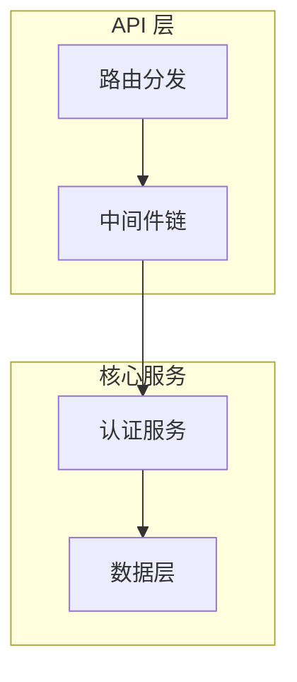

# OSS Insights

开源项目深度解读专栏。每个项目从架构设计、实现思路、技术亮点等维度进行分析，记录学习过程中的理解与思考。

## 定位

不追求面面俱到的文档翻译或使用教程，而是聚焦于**技术层面的解构与提炼**：

- 这个项目解决了什么根本问题
- 架构如何组织，为什么这样设计
- 核心模块的实现思路与关键代码
- 有哪些值得借鉴的设计模式与工程实践
- 与同类项目相比的优劣势

## 分析框架

对一个开源项目的解读通常覆盖以下维度。并非每个项目都需要全部覆盖，根据项目特点选择侧重点：

| 维度 | 关注点 |
|------|--------|
| **项目概览** | 定位、解决的问题、适用场景、同类定位 |
| **架构设计** | 整体架构图、模块划分、数据流、启动流程 |
| **认证与安全** | 认证方式、权限模型、安全机制、加密方案 |
| **核心实现** | 关键模块的实现思路、算法、数据结构 |
| **存储与数据** | 数据模型、存储选型、持久化策略 |
| **设计与模式** | 使用了哪些设计模式、代码组织方式、接口抽象 |
| **部署与可观测** | 部署方式、配置管理、日志、监控、优雅关闭 |
| **测试与质量** | 测试策略、覆盖率、代码生成、CI/CD |
| **社区与生态** | 贡献活跃度、文档质量、版本迭代、周边工具 |
| **同类对比** | 与同领域项目的功能、性能、复杂度对比 |

## 文档规范

### 文档结构

分为两层：**目录索引页**（模块 README） + **项目解读页**（项目 README）。

#### 目录索引页（如 `auth/README.md`）

```markdown
# 认证授权

本目录收录认证授权领域的开源项目解读。

| 项目 | 语言 | 说明 | 仓库 |
|------|------|------|------|
| [项目名](项目目录/) | 语言 | 一句话说明 | [GitHub](链接) |
```

- 每个模块目录下必须有一个 `README.md` 作为索引
- 表格列固定为：项目、语言、说明、仓库

#### 项目解读页（如 `auth/tinyauth/README.md`）

每篇解读按**编号章节**组织，必须包含的两个核心章节：

| 章节 | 内容 | 必选 |
|------|------|------|
| **第一部分：快速概览** | 是什么、解决什么痛点、适用场景、核心能力表、技术栈一览 | ✅ |
| **第二部分：架构深读** | 架构总览图、启动流程、核心请求链路、模块职责划分 | ✅ |
| **第三部分起** | 按项目特点深入：核心实现 / 设计模式 / 部署 / 同类对比 | 可选 |

第三部分及之后的章节，根据项目特点自由选题，但每个部分应有明确主题，不堆砌碎片信息。

### 图表规范

优先使用 **Mermaid** 图表。GitHub 和 VS Code 均原生渲染 ` ```mermaid ` 代码块，无需额外工具。

| 图表类型 | Mermaid 类型 | 使用场景 |
|---------|-------------|---------|
| 架构总览 | `graph TB` / `graph LR` | 模块层次、整体架构 |
| 流程图 | `graph TB` | 启动流程、请求链路、程序步骤 |
| 时序图 | `sequenceDiagram` | 模块间交互、请求时序 |
| 状态图 | `stateDiagram-v2` | 状态流转、生命周期 |

示例 — 一个简单的 Mermaid 架构图：



绘图原则：

- 不追求面面俱到 — 抓关键链路，标注核心数据流方向
- 图保持在合理大小（15 个节点以内），太复杂的图不如拆成多个
- 对于线性流程（如启动流程），可直接使用列表式 ASCII 图（15 行以内），可读性更好

### 写作规范

| 规范 | 要求 |
|------|------|
| **正文语言** | 中文为主，技术术语保留英文原文（如 ForwardAuth、JWT、SQLite、BaaS） |
| **代码块** | 标注语言标识：`go`、`ts`、`yaml`、`dockerfile`、`sql` |
| **代码引用** | 标注文件路径和行号，如 `internal/app.go:12` |
| **ASCII 架构图** | 仅用于简单线性流程（≤15 行），复杂图使用 Mermaid |
| **列表格式** | 统一使用 `-` 作为无序列表标记 |

### 内容质量规范

每篇解读应满足以下最低要求：

- [ ] **核心能力清单** — 用表格列出项目的关键能力与说明
- [ ] **技术栈一览** — 用表格列出各层面使用的技术
- [ ] **架构总览图** — Mermaid 图展示模块划分
- [ ] **启动流程或请求链路** — 核心流程至少有一条
- [ ] **关键代码引用** — 至少 2 处带路径/行号的代码引用
- [ ] **项目根因** — 说清楚这个项目解决什么根本问题

### 分类索引维护

添加新项目时需同步三步：

1. 创建 `模块名/项目名/README.md`
2. 更新 `模块名/README.md` 索引表
3. 若模块不存在，在根 `README.md` 添加新分类

### 状态标记

- 未完成的章节使用 `[WIP]` 前缀，如 `[WIP] 第三部分：核心实现详解`
- 内容中不确定或待补充的部分使用 `TODO` 标记

## 分类索引

### [计费与商业化后端（Billing & Monetization）](billing/)

| 项目 | 语言 | 说明 | 协议 | 仓库 |
|------|------|------|------|------|
| [OpenMeter](billing/openmeter/) | Go | AI 和 DevTool 公司的使用量计量和计费平台，实时计量 + 产品目录 + 订阅管理 + 发票生成 | Apache-2.0 | [GitHub](https://github.com/openmeterio/openmeter) |

### [后台系统与管理平台（Admin）](admin/)

| 项目 | 语言 | 说明 | 协议 | 仓库 |
|------|------|------|------|------|
| [GoAdmin](admin/go-admin/) | Go | 面向 Go 生态的数据管理后台生成框架，声明式 table model + 15 种 Web 框架适配器 + 开箱即用 RBAC | Apache-2.0 | [GitHub](https://github.com/GoAdminGroup/go-admin) |
| [easy-workflow](admin/easy-workflow/) | Go | 面向中国式审批场景的轻量工作流引擎：混合网关 + 会签/自由驳回 + 反射事件 + MySQL 双表归档，可内嵌库或独立 REST | MIT | [GitHub](https://github.com/Bunny3th/easy-workflow) |
| [zero-admin](admin/zero-admin/) | Go | 基于 go-zero 的电商微服务系统：2 网关 + 8 rpc + consumer/job + goctl 代码生成，前台商城（订单/支付）+ 后台管理（RBAC），ES 搜索 + MQ 异步 | Apache-2.0 | [GitHub](https://github.com/feihua/zero-admin) |
| [PocketBase](admin/pocketbase/) | Go | 开源 BaaS 引擎，单二进制集成 SQLite + 认证 + 文件存储 + 实时订阅 | MIT | [GitHub](https://github.com/pocketbase/pocketbase) |

### [问答平台（Q&A）](qanda/)

| 项目 | 语言 | 说明 | 协议 | 仓库 |
|------|------|------|------|------|
| [Apache Answer](qanda/answer/) | Go | 开源 Q&A 知识管理平台，支持社区问答、插件系统、AI 集成 | Apache-2.0 | [GitHub](https://github.com/apache/answer) |

### [DevOps 平台](devops/)

| 项目 | 语言 | 说明 | 协议 | 仓库 |
|------|------|------|------|------|
| [Gitea](devops/gitea/) | Go | 轻量级自托管 DevOps 平台，Git 托管 + Code Review + CI/CD + Package Registry | MIT | [GitHub](https://github.com/go-gitea/gitea) |

### [认证授权（Auth）](auth/)

| 项目 | 语言 | 说明 | 协议 | 仓库 |
|------|------|------|------|------|
| [Authelia](auth/authelia/) | Go | 反向代理伴生认证/授权 SSO 网关，四种反代集成、细粒度访问控制规则、多因子（WebAuthn/TOTP/Duo）、OpenID Certified OIDC、HA（remote DB + Redis） | Apache-2.0 | [GitHub](https://github.com/authelia/authelia) |
| [Tinyauth](auth/tinyauth/) | Go | 最小认证授权服务器，为反向代理提供 ForwardAuth | AGPL-3.0 | [GitHub](https://github.com/tinyauthapp/tinyauth) |
| [ZITADEL](auth/zitadel/) | Go | 企业级 IAM 平台，CQRS + Event Sourcing 架构，OIDC/SAML/SCIM 完整支持 | AGPL-3.0 | [GitHub](https://github.com/zitadel/zitadel) |
| [TOPIAM](auth/topiam/) | Java | 企业级 IAM/IDaaS 平台，支持 OIDC/SAML2/JWT/CAS/表单代填 | AGPL-3.0 | [GitHub](https://github.com/topiam/eiam) |
| [MaxKey](auth/maxkey/) | Java | 企业级 IAM-IDaas 单点登录系统，支持 OAuth2/OIDC/SAML2/CAS/JWT 协议 | Apache-2.0 | [GitHub](https://github.com/dromara/MaxKey) |
| [Keycloak](auth/keycloak/) | Java | IAM 领域标准参考实现，CNCF 孵化，OIDC/SAML2/OAuth2/SCIM/SSF 协议支持，一切皆 Provider 的扩展内核 | Apache-2.0 | [GitHub](https://github.com/keycloak/keycloak) |

### [开源项目知识库（Knowledge）](knowledge/)

| 项目 | 语言 | 说明 | 协议 | 仓库 |
|------|------|------|------|------|
| [Wiki.js](knowledge/wiki/) | Node.js | 现代化 Wiki 引擎，支持 Git 存储、多版本管理、细粒度权限控制 | AGPL-3.0 | [GitHub](https://github.com/requarks/wiki) |
| [Outline](knowledge/outline/) | TypeScript | 团队协作知识库，实时协作编辑，Cancan 式权限继承 | BSL 1.1 | [GitHub](https://github.com/outline/outline) |
| [Starred](knowledge/starred/) | Python | GitHub Stars 转 Awesome 列表 CLI，GraphQL，语言/Topic 双分类 | MIT | [GitHub](https://github.com/maguowei/starred) |
| [GithubStarsManager](knowledge/github-stars-manager/) | TypeScript | AI 驱动的 GitHub Stars 管理平台，语义搜索、Release 跟踪、分类管理 | MIT | [GitHub](https://github.com/AmintaCCCP/GithubStarsManager) |
| [Memos](knowledge/memos/) | Go+TS | 自托管笔记应用，微博式时间线，Proto 驱动 API，双重协议（Connect RPC + gRPC-Gateway），三数据库支持，SSE 实时推送 | MIT | [GitHub](https://github.com/usememos/memos) |

### [AI 产品（AI Product）](ai-agent/)

| 项目 | 语言 | 说明 | 协议 | 仓库 |
|------|------|------|------|------|
| [DeepSeek Harness](ai-agent/deepseek-harness/README.md) | TypeScript（+C11 原生 addon） | DeepSeek 官方开源 Agent Harness（基线 `dsh-v0.2.1-rc.3`，开发者预览）：12 份文档全量重做——没有特权内核（空根 + profile/bundle/patch 层叠、注册即可逆副作用）、会话事件日志即唯一真源并带「不可变世代 + 相邻流式迁移链」、turn/step 事件域分离与 `prepareCall` 两阶段、系统提示词升格为 surface node 0、工具三段把关（guard/approval/spill）、「同一执行世界」成组迁移约束与最终由人裁决的审批、压缩=换投影且无 curated memory、四条外部接入通道（Skill/MCP/ACP/动态扩展）+ Webhook、Typert 生成式双契约与桌面零依赖分发、领域 KV 与真源/派生双策略、部署与远程访问三层边界；另含叙述型架构设计说明与 14 张经真实解析渲染校验的图 | MIT | [GitHub](https://github.com/deepseek-ai/deepseek-harness) |
| [OpenHuman](ai-agent/openhuman/) | Rust+TS | 本地优先 AI 超级助手桌面应用：进程内 Rust 核心（22 域族/85 模块），分脑编排（triage 四分类 + checkpointed tinyagents graph），记忆树+Obsidian/TinyCortex 记忆引擎，per-call 成本与模型路由，approval-gated 工作流，多链钱包 | AGPL-3.0 | [GitHub](https://github.com/tinyhumansai/openhuman) |
| [Lework](ai-agent/Lework/) | Go+TS+Electron | 企业级 AI 工作协作平台（AI 劳动力管理），双进程事件驱动，多 Agent 运行时，Task+Asset 模型，Skill/Tool + MCP/插件，企业级权限/审计 | Apache-2.0 | [GitHub](https://github.com/insmtx/Lework) |
| [OpenWorker](ai-agent/openworker/) | Python+TS+Rust | 开源 AI 同事桌面平台，本地 sidecar 架构，审批门控 Agent 循环，连接器 + MCP + 技能系统 + 上下文压缩 | MIT | [GitHub](https://github.com/andrewyng/openworker) |
| [OpenVort](ai-agent/openvort/) | Python+TS | 开源 AI 员工平台/研发工作流引擎，手写 Agentic Loop，插件化架构 + Slot Protocol，四级 Skill 体系，MCP Server，深度绑定 IM + 项目管理/代码/CI/CD 全流程 | AGPL-3.0 | [GitHub](https://github.com/openvort/openvort) |
| [OpenCode](ai-agent/opencode/) | TypeScript | 开源 AI 编码 Agent，服务化架构（CLI/TUI/Web/Desktop），四轴可组合 LLM 路由，事件溯源 Session V2，Effect-TS 函数式编排 | MIT | [GitHub](https://github.com/anomalyco/opencode) |
| [OpenWork](ai-agent/openwork/) | TypeScript | 开源 AI 工作流分享桌面应用（企业可治理的 Claude Cowork 替代）：MCP 注入面（`search_capabilities`/`execute_capability` 两伞工具 + 动态能力目录）跨 agent 复用同一套技能；OpenCode 引擎运行时 + 单一 `baseUrl` 透明代理；Den 组织控制平面（多服务、worker 状态机 + checkpoint、推理供应）；`den-db` 数据模型；三形态部署 + evals 证据卷轴 | MIT（`ee/` 为 EE License） | [GitHub](https://github.com/different-ai/openwork) |
| [Goose](ai-agent/goose/) | Rust | Linux Foundation AAIF 通用 AI Agent：单主 Agent 循环，统一 Provider trait 接 15+ LLM，自研 MCP client 接 70+ 扩展，SQLite 会话持久化，ACP 协议双向打通，Skill/Recipe 体系，工具权限审批 + prompt 注入扫描 | Apache-2.0 | [GitHub](https://github.com/aaif-goose/goose) |
| [Multica](ai-agent/multica/) | Go+TS | 开源多 Agent 协作工作区（Agent 作一等公民上 board）：issue 驱动 + 纯 SQL 任务状态机，26 种 agent CLI 由用户机器 daemon 驱动（不跑 LLM），ACP/Skill/MCP/插件/渠道/实时 relay，PostgreSQL 445+ 迁移，Compose+Helm 自托管 | Multica License | [GitHub](https://github.com/multica-ai/multica) |
| [OpenBee](ai-agent/openbee/) | Go+TS | 自托管 24/7 数字员工管理平台，对话驱动，多 IM 平台集成，动态引擎路由（Claude/Codex/Pi 运行时切换），多用户 RBAC，49 条 SQLite 迁移 | MIT | [GitHub](https://github.com/theopenbee/openbee) |
| [OpenHands](ai-agent/openhands/) | TypeScript + Electron | 开源开发者控制中心前端：多后端本地/云切换（OpenHands/Claude Code/Codex/ACP），原生 WebSocket 实时会话流（握手 watchdog + 并联保活），Skill 显式 allow-list 装载，MCP 凭据脱敏/健康探测，Automations 自动化编排，Electron 桌面交付（运行时自包含），客户端本地存储读强写弱分层 | MIT | [GitHub](https://github.com/OpenHands/OpenHands) |
| [AionUi](ai-agent/aionui/) | TypeScript + Rust | 开源多 Agent 桌面 Cowork 平台：app-shell 守护外部 aioncore(Rust) 引擎，ACP 收敛几十种 CLI Agent，Team Mode 协作，Cron 24/7 + WebUI 远程 + IM 渠道，MCP 统一管理（前端壳 + 后端大脑双层架构） | Apache-2.0 | [GitHub](https://github.com/iOfficeAI/AionUi) |
| [Tutti](ai-agent/tutti/) | Go + TS (Electron) | 多 AI 智能体实时共享协作空间：loopback daemon + SQLite 真值，Tutti Mode Checkpoint 仲裁多 agent，App Center/Factory 应用生态，Connector 市场 + Agent Extension(ACP) 双边接入，signal-and-reconcile 事件流 | Apache-2.0 | [GitHub](https://github.com/anomalyco/tutti) |
| [Eigent](ai-agent/eigent/) | Python + TS (Electron) | 开源 Cowork Desktop（Multi-Agent Workforce）：CAMEL-AI 多 agent 编排（单 agent/Workforce 三车道路由 + TaskLock 队列/SSE），控制面 server / 行动面 backend 分离，记忆磁盘档案，MCP 双写总线，浏览器/终端工具，Celery 定时自动化 | Apache-2.0 | [GitHub](https://github.com/eigent-ai/eigent) |
| [AgenticSeek](ai-agent/AgenticSeek/) | Python + TS | 100% 本地 Manus 替代品：双模型投票 Agent 路由、Planner 编排、Block 代码块工具协议、记忆压缩、stealth 浏览器自主上网/填表、会话持久化 | GPL-3.0 | [GitHub](https://github.com/Fosowl/agenticSeek) |
| [WeKnora](ai-agent/weknora/) | Go | 企业级 RAG 与知识推理平台：文档导入→语义索引→ReAct Agent 推理→自动生成 Wiki+知识图谱，多源连接器（飞书 wiki/Drive、Notion、语雀、RSS、GitLab、IMA），26 LLM + 7 向量库 + 10 IM 集成，多租户 RBAC + principal（scoped API Key），chunk/Wiki 修订历史与文件夹树，resource_urls 直链，OTel→Langfuse | MIT | [GitHub](https://github.com/Tencent/WeKnora) |
| [RAGFlow](ai-agent/ragflow/) | Go + Python（迁移中） | 开源 RAG 引擎 + Agent 平台（"Quality in, quality out"）：Deep Doc Understanding（OCR/版面/表格/多模态视觉，**in-process native ONNX、仅 CPU**）高保真解析复杂文档，模板式切分；多路召回 + 四级重排 + Grounded 引用的混合检索（ES/Infinity 可切换）；Canvas DSL→eino 运行时 Agent 工作流 + 双向 MCP + 代码沙箱 + 记忆 + 多渠道；**v1.0.0-rc1（预发布 tag）Go 六 mode 单二进制**（Python 栈仍在、迁移中途，`API_PROXY_SCHEME` 未设时默认走 Python，Go-only 是迁移目标），NATS JetStream + Kvrocks，不可逆数据升级（须先在 v0.27.2） | Apache-2.0 | [GitHub](https://github.com/infiniflow/ragflow) |
| [PicoClaw](ai-agent/picoclaw/) | Go | 极致轻量 Go 原生 AI Agent 网关，<10MB 内存跑在 $10 硬件，20+ 通道 30+ LLM，MCP 集成 | MIT | [GitHub](https://github.com/sipeed/picoclaw) |
| [FastGPT](ai-agent/fastgpt/) | TypeScript + Node/Next.js | AI Agent 构建平台（v4.16）：Flow 可视化工作流图即运行时（`dispatchWorkFlow` 边状态 + 迭代队列调度、callbackMap 执行器分派、交互安全点续跑、软中断停止）；知识库 RAG 四段式管道（多源摄取→分块→向量化双写→混合召回 + RRF + rerank）且向量库可拔插；Skill 体系（不可变 ZIP 版本包 + 沙箱注入 SKILL.md）；双向 MCP（客户端 + 独立薄服务端）+ JS/Python 隔离沙箱；MongoDB 文档模型 + Redis(BullMQ/stream) 分层底座 | FastGPT OSL | [GitHub](https://github.com/labring/FastGPT) |
| [Cumora](ai-agent/cumora/) | TypeScript + Electron/iOS/Android | 多 Agent 团队协作聊天（agent 与人类同批一等参与者）：防御式协调（seen-cursor 仲裁 / 事务内 verbatim-dup / hold-token 门控 / 小脑 triage / agenda stall）；双路径大脑 + Computer 统一主机（Cloud turn.ts loop vs BYOA 本地 claude/codex，同一 `/runtime/cli` 协议）；统一事件总线（WS/Redis + email + push + 日历/Yjs/投票）；Postgres 真相 + Redis 协调总线 + `llm_calls` 成本账本 | MIT | [GitHub](https://github.com/yetone/cumora) |
| [Coze Studio](ai-agent/coze-studio/) | Go + React/TS | 字节/扣子开源一站式 AI Agent 开发平台（自托管）：Go 单体 Hertz 承载 agent/workflow/knowledge/plugin/memory 五域，运行时站 CloudWeGo **Eino**（ReAct + compose Graph 编排，四要素折叠为统一 tool），工作流画布（FlowGram）编译成 eino Graph 可流式/中断恢复并被 Agent 复用为 tool，RAG 三层抽象 + 异步索引 + 表格库 NL2SQL，插件系统（manifest+OpenAPI 声明式 + AES + OAuth + 草稿/版本/绑定），gorm/gen + Atlas + 不可变版本快照，docker-compose + Helm 双轨自托管 | Apache-2.0 | [GitHub](https://github.com/coze-dev/coze-studio) |
| [zacp](ai-agent/zacp/) | Go + Vue3 | 基于 ACP 协议的多 Agent Web 网关（"让 CLI Agent 拥有浏览器"）：本地单二进制以 ACP Client 宿主角色拉起多个 CLI Agent，浏览器经 REST/WS 使用；promptGate 三槽并发 + 空闲回收 + unknown-session 自动恢复，WS 订阅集合 + 权限 Web 端确认，SQLite WAL + v1-v6 迁移 + events 瘦身，Web TTY + 前端 embed | AGPL-3.0 | [GitHub](https://github.com/helloxz/zacp) |
| [CompozyOS](ai-agent/compozy/) | Go + TS (React/Electron) | "agent 操作系统"：单二进制 local-first daemon 以 ACP 宿主收养 Claude Code/OpenClaw 等 CLI agent，session/loop/memory/approval/skill 皆 daemon 一等对象；多控制面共享同一 daemon-owned truth，多文件 SQLite + 先持久后广播；含 Gateway 与 Compozy Network；10 篇深度子文档（架构/session/loop/memory/审批/ACP/工具与 Skill/扩展/网关网络/数据模型） | MIT | [GitHub](https://github.com/compozy/compozy) |
| [TripStar](ai-agent/tripstar/) | Python + Vue3 | 多智能体 AI 旅行规划全栈应用（FastAPI + Vue3）：3 个 `SimpleAgent` 经私有文本协议协作；小红书原生签名客户端绕过风控 + SSR 降级 + LLM 提纯三语景点并抽取预约提醒；Google 优先/高德兜底地图调度（失败进程级短路）；带权重记忆库（阈值 + 惰性衰减 + 合并 + TOP-K）；ECharts 知识图谱；进程内任务表 + 原子快照 + WebSocket 快照优先推送；五层 JSON 容错修复链 | GPL-2.0 | [GitHub](https://github.com/1sdv/TripStar) |
| [RoadMan](ai-agent/roadman/) | Python + Vue3 | 多智能体自驾行程规划工作台（FastAPI + LangGraph 1.0 + ARQ/Redis + Vue3）：**语义归模型、硬约束归程序**——22 节点 StateGraph 让语义侧出建议、确定性侧下结论（真实路线 geometry、时间窗、连续驾驶、SOC 电量账本、三餐住宿覆盖、返程闭环）；复核-修复循环最多 3 轮（校验器逐轮放松 + 结构指纹防假重试），耗尽转 best_effort +「出发前提醒」；Skill Registry 统一 27 个 adapter（缓存键含版本、三类降级、审计只存摘要）+ 手写 MCP 客户端接 12306；PlanPatch 两阶段编辑（preview→apply/reject→rollback + 版本备份）；Trip 以 JSON document 为 canonical；ARQ + SSE 渐进推送；Compose 五服务 + 三类评测与 readiness 报告 | GPL-3.0 | [GitHub](https://github.com/pigz2538/RoadMan-Public) |
| [MOVO](ai-agent/movo/) | Python + Vue3 + Node ESM | 基于 DeepSeek Harness 的自托管企业级 Agent 平台（Community Edition）：Python `Protocol` 定义 kernel 契约、DSH 作为锁定 npm 依赖装进独立 Node 宿主（不 fork 内核），`backend` 网络 `internal: true` + 模型/工具调用反向代理 + 900s 短期令牌（凭据不下发），事件双轨（live 直投 + Mongo 有序 durable 投影 + native cursor/stream_seq 双游标、终态不抢跑），企业能力外挂（工具网关/MCP/Skill/Runtime Profile 编译注入面），审批双轨 + 四本审计账 + `main_id` 多租户，12 服务 Compose 自托管 | MOVO Community License（Apache-2.0 + 附加条件） | [GitHub](https://github.com/himovo/movo) |
| [WorkDSH](ai-agent/workdsh/) | TypeScript | 基于 DeepSeek Harness（DSH）的 WorkBuddy 式桌面 Agent 工作台（个人与企业同一套功能代码，两种交付形态）：**上游不可变**——官方 DSH 以精确 pin 版本作为依赖引入（宿主/Web 客户端/会话/Agent 循环/工具管线全不改源码），自有能力全部以插件挂到同一棵 Cordis 插件树上；**载体 + 可写组合 + 业务插件三层切分**——Electron 载体只做入口页、窗口与进程生命周期、管理员部署配置与空间隔离，安装包内 runtime 只读、每个账号一份可写 Profile（`dsh.profile.bundles` 选择 + `cordis.patch.yml` 分层：默认组合/企业补丁/用户安装），升级按 sha256 基线摘要只迁移「仍等于安装包默认值」的条目（缺基线即拒绝启动）；**能力资产修订固定**——专家草稿→校验→不可变修订→preset 编译落盘→`ExecutionBinding` 钉住修订与组合指纹，技能导入走唯一 SKILL.md + 指纹重算 + 原子 rename 发布进官方技能根并按修订租约解析；**资料到交付物**——原件不可变 + 修订链 + 任务级引用钉修订（工具层强制过滤）、项目交付物归属幂等回执、Office 工作副本用租约 + CAS 出可编辑副本并导出；**企业治理**——身份提供方按空间二选一（本地/企业），成员 token 只留 Main 经 32 字节 key + timingSafeEqual 的本机回环桥白名单转发，`tools/pre-execute` 一处挂载会话归属 + 资源授权（fail-closed，拒绝也写审计）；**自有域存储**——复用官方 storage-domain（zod + defineDomain + per-record，无 SQL/迁移/ORM）承载 library/experts/connectors/access/audit/projects/office 等 10 个域；发布边界由唯一清单脚本 + carrier/profile/锚点/插件库存门禁强制（企业插件不进基础安装器） | MIT | [GitHub](https://github.com/techflag/workdsh) |
| [DeepSeek-Reasonix](ai-agent/DeepSeek-Reasonix/) | Go（+TS 桌面壳） | 开源本地优先编码 Agent，四形态（Studio 桌面 / TUI / 本机 HTTP+SSE 服务 / 编辑器 ACP）共用同一个传输无关的会话驱动：**缓存优先的上下文纪律**——系统提示前缀跨轮逐字节稳定（provider 边界效果测试逐字节比对并报出第一个分歧字节）、动态状态骑回合尾部两级装配（control 写进用户消息正文、agent 再追加 `Derived` 消息、`BodyChain` 在首条 `Derived` 处截断）、压缩触发取 `min(窗口×0.85, 经济软上限)` 且折叠是投影级 CAS 事务（转录版本+覆盖哈希+投影版本+generation 四者同时未变才提交、收据显式带 `CacheBreak`、第二次检查点须等一个 tail 量的新封闭历史）；**宿主拥有失败归因**——类型化错误码跨越 model-visible 边界、权限拒绝不是停止条件（回注带 `refusalCode` 的 blocked 结果、循环继续）、就绪性失败不再用隐藏模型消息重试；**判断读结构不读措辞**——shell AST 六类 blocker 与降级顺序、叶子处 `{action,resource,effect}` 裁决且档位只改 `Policy.Mode` 不动规则表（forbid 永远先匹配）、Dynamic Bash 走精确规则硬闸；**三维正交沙箱**——Integrity/Confidentiality/Authority 各有独立探测函数（`IntegrityEnforced` 只回答写）、macOS SBPL 取最后匹配故 authority 排在网络规则之后、Windows 三维皆不强制；**可回退与可恢复**——检查点每用户轮一个、rewind 两段式事务 + 显式覆盖率缺口（bash 副作用记为 `GapBashSideEffect` 而非静默失败）、意图位先于副作用（`Published`/`CommitDigest` 先于 rename、失败事务留在 `committing` 供幂等重试）；**四层扩展**——MCP / Extension Protocol v2 sidecar / 插件包 v2 / Skill 各自解一处冲突约束（Skill 目录骑回合尾部、`owedCatalog` 直接问 registry）、intercept 可 block/replace 而 event 答案被丢弃；**机械化架构门禁**——自研 repolint 28 条规则（layering/layer-order 零债务、struct-state 与 frontend-parity 棘轮按"超出量"计费、豁免表权重守恒且理由必填但门禁从不读）；`CGO_ENABLED=0` 单静态二进制承诺一路穿透到纯 Go SQLite 与 `desktop/go.mod` 嵌套 module | MIT | [GitHub](https://github.com/esengine/DeepSeek-Reasonix) |
| [DeepSeek-Reasonix 项目 Wiki](ai-agent/DeepSeek-Reasonix-wiki/README.md) | Markdown（文档 + 15 张 Mermaid 图） | 面向**不打算读源码的人**的 Reasonix 中文项目 Wiki（11 页 / 1130 行 / 零代码，基线 `v2.37.0` @ `e17ef45e3`）：一条自顶向下的阅读线——本地优先编码 Agent 的定位与 2.x / 1.x 两条版本线，四种使用形态（Studio 桌面 / 终端 / 浏览器 / 编辑器 ACP）共用的唯一传输无关会话控制器与它的驱动子端口，**缓存优先的上下文纪律**（系统提示前缀逐字节稳定、项目指令四作用域去重、记忆钉住与检索、折叠是四项比对的 CAS 提交、回合尾部的欠账式新鲜度），一次用户回合的骨架（两级回合尾部、请求冻结后重试只重放同一份内容、宿主拥有的失败归因、每回合状态重建与两道结构门禁），工具契约与安全边界（说明由代码生成、静态规则表加可覆写档位、shell 语法树六类形状与精确授权硬闸、沙箱三轴中只有写轴可对外探测、Windows 全不强制），会话与数据（五类存储根、一组伴随文件、每轮检查点与两段式回退、可丢弃的 SQLite 投影、格式版本分散无总号），扩展四条路径（MCP 三类能力、带裁决的运行时拦截点与丢事件语义、两阶段安装的插件包、回合块注入的技能），构建与交付（`CGO_ENABLED=0` 单静态二进制与六平台、npm 子包无下载脚本、minisign 与 Windows 双签名、下次启动作证式更新事务），以及工程门禁（自研 28 条规则与只许收紧的棘轮、豁免表、效果测试、门禁自己写下的盲区）；并单列选型硬事实（2.x 会话与配置格式未冻结、需自备模型、Windows 三轴不强制、沙箱读与能力两轴无独立探测、仓库内多处文档与实现不一致） | MIT（同上游，文档） | [GitHub](https://github.com/esengine/DeepSeek-Reasonix) |
| [DeepSeek Harness 项目 Wiki](ai-agent/deepseek-harness-wiki/) | Markdown（文档 + 18 张 Mermaid 图） | 面向**不打算读源码的人**的 DeepSeek Harness 中文项目 Wiki（10 页 / 1584 行 / 几乎零代码，基线 `dsh-v0.2.0-rc.2`）：一条自顶向下的阅读线——**没有特权内核、一切皆插件**的插件树组装与 capability seam，一次对话回合的完整生命周期（step / 提示词组装 / 中断重试），工具体系与安全边界（受控执行管道 + 审批 + Landlock 沙箱 + 结果外溢），会话事件日志与「不可变世代 + 相邻迁移」的格式演进，模型接入抽象，扩展机制（插件 / 技能 / MCP / 子 Agent / 工作流），CLI / Web / 桌面 / SDK / ACP 五种运行形态，仓库结构与质量门禁；并单列选型硬事实（开发者预览且官方明示破坏性变更、未过安全审计不构成安全边界、**官方暂不接受外部 PR**、会话格式不承诺降级） | MIT（同上游，文档） | [GitHub](https://github.com/deepseek-ai/deepseek-harness) |
| [RAGFlow 项目 Wiki](ai-agent/ragflow-wiki/) | Markdown（文档 + 9 张 Mermaid 图 + 1 SVG） | 面向**不打算读源码的人**的 RAGFlow 中文项目 Wiki（11 页 / 838 行 / 几乎零代码，基线 `v1.0.0-rc1` @ `14bb02ee45`）：一条自顶向下的阅读线——项目定位与"Quality in, quality out"的核心主张，**DeepDoc 高保真文档理解**（OCR / 版面 / 表格 / 多模态视觉，in-process native ONNX、仅 CPU）与模板式可解释切分，从上传到可检索的完整摄取流水线（多格式解析 → 切分 → 向量化 → 索引落地），多路召回 + 四级重排 + 三段式引用修复的混合检索与对话生成，Canvas DSL → eino 运行时的 Agent 工作流（含双向 MCP、代码沙箱、记忆、多渠道），NATS JetStream + Kvrocks 驱动的增量同步与数据管道，可拔插存储引擎（MySQL / PostgreSQL、Elasticsearch / Infinity / OpenSearch、MinIO、ClickHouse），docker-compose 与六 mode 单二进制的部署形态，以及 v1.0.0-rc1 的 **Go 迁移中途状态**（Python API / admin / workers 与 Go 侧并存，Go-only 是目标而非现状）；并单列选型硬事实（v1.0.0-rc1 为预发布 tag 且**数据升级不可逆**，必须先在 v0.27.2） | Apache-2.0（同上游，文档） | [GitHub](https://github.com/infiniflow/ragflow) |

### [Agent 基础设施（AI Infra）](ai-infra/)

| 项目 | 语言 | 说明 | 协议 | 仓库 |
|------|------|------|------|------|
| [Mem0](ai-infra/mem0/) | Python+TS | AI Agent 智能记忆层：V3 ADD-only 记忆管线 + 多信号检索（语义+BM25+实体），四类 Provider 插件体系，双模式部署 + MCP，[项目 Wiki](ai-infra/mem0-wiki/README.md) | Apache-2.0 | [GitHub](https://github.com/mem0ai/mem0) |
| [New API](ai-infra/new-api/) | Go+React | 统一 AI API 网关与资产管理：四协议互转独立 relaykit 转换层，40+ 供应商适配器 + 渠道分发，预扣/结算/退款计费，SQLite/MySQL/PG 三库 | AGPL-3.0 | [GitHub](https://github.com/QuantumNous/new-api) |
| [DeepEval](ai-infra/deepeval/) | Python | LLM 评测框架（类似 pytest）：50+ Metric + LLM-as-Judge schema 判官协议，GEval/DAG 双判官，Synthesizer 造数据，@observe 非侵入 OTel 追踪，pytest 插件进 CI | Apache-2.0 | [GitHub](https://github.com/confident-ai/deepeval) |
| [darwin-skill](ai-infra/darwin-skill/) | Markdown(Agent Skill) | Agent Skill 自主优化器：9 维评分 rubric + paired 同-judge 多数决棘轮 + human-in-the-loop 三层守关，基于 autoresearch + 微软 SkillLens/SkillOpt | MIT | [GitHub](https://github.com/alchaincyf/darwin-skill) |
| [Agent Client Protocol](ai-infra/agent-client-protocol/) | Rust | 编辑器⇄编码 Agent 标准化双向 JSON-RPC 协议（Zed 发起）：Rust 类型单一事实源 → schemars 生成 JSON Schema 四件套，三阶段生命周期 + capabilities 双轨演进 + RFD 治理，v1 稳定/v2 草稿 feature 共存 | Apache-2.0 | [GitHub](https://github.com/agentclientprotocol/agent-client-protocol) |
| [zvec-grep](ai-infra/zvec-grep/) | TypeScript | 面向人与 Agent 的本地优先混合检索层（zg）：ripgrep 精确/正则 + zvec FTS 词法 + 向量语义经 RRF 融合为一套接口，tree-sitter 结构感知切分，Model2Vec/ONNX/GGUF/远端四类 Embedding 后端，Direct/Server 双执行形态 + watcher 小时级对账，本地 MCP Server 默认只暴露一个搜索工具 + 六种 Agent 安装器，远端嵌入需显式数据授权 | Apache-2.0 | [GitHub](https://github.com/zvec-ai/zvec-grep) |

### [AI 生成（AIGC）](aigc/)

| 项目 | 语言 | 说明 | 协议 | 仓库 |
|------|------|------|------|------|
| [ComfyUI](aigc/comfyui/) | Python | 模块化 AI 内容生成引擎，节点图工作流，多模态（图像/视频/音频/3D），多策略执行缓存 + VRAM 状态机，API 优先设计 | GPL-3.0 | [GitHub](https://github.com/comfyanonymous/ComfyUI) |
| [DeepWiki-Open](aigc/deepwiki-open/) | Python+TS | 开源代码仓库 Wiki 自动生成平台，Next.js+FastAPI+AdalFlow 编排，9 种 LLM Provider，RAG+Deep Research+Codemap 引用落点 | MIT | [GitHub](https://github.com/AsyncFuncAI/deepwiki-open) |

### [即时通讯（IM）](IM/)

| 项目 | 语言 | 说明 | 协议 | 仓库 |
|------|------|------|------|------|
| [Open-IM-Server](IM/open-im-server/) | Go | 开源 IM 即时通讯服务器，微服务架构，支持 WebSocket 长连接、消息推送、多端登录 | Apache-2.0 | [GitHub](https://github.com/openimsdk/open-im-server) |

### [编程语言](programming-guides/)

| 语言 | 说明 |
|------|------|
| [Go](programming-guides/go/) | Go 语言规范、最佳实践与惯用法指南 |

### [科学计算（Scientific Computing）](scientific-computing/)

| 项目 | 语言 | 说明 | 协议 | 仓库 |
|------|------|------|------|------|
| [Colour 项目 Wiki](scientific-computing/colour-wiki/README.md) | Markdown（文档 + 15 张 Mermaid 图） | 面向**不打算读源码的人**的 Colour（colour-science）中文项目 Wiki（13 页 / 零外部资源，基线 `v0.4.7` @ `a3bfe3496`）：色彩科学算法与标准数据集库的定位与边界，五个基础概念（颜色表示、连续信号、域-范围尺度、自动转换图、数据集注册表），25 个子包的分层与转换主链路，自动转换图与 RGB 色彩空间对象、色适应与色域体积，光谱数据与两条积分路径，12 个外观模型与 CAM16 流程，色差公式与 STRESS，相机/显示特性化与 ACES IDT、IO，色温/CRI/TM-30，色域体积/光谱恢复/光学现象等专门模块，以及工程实践（仅依赖 NumPy、全局尺度状态、CI 与发布）；并单列选型硬事实（无 Array API 兼容、无 JAX/PyTorch 后端、无自动微分） | BSD-3-Clause | [GitHub](https://github.com/colour-science/colour) |

---

> 每个项目目录下有独立的 README 作为项目解读的入口和三方仓库地址。
