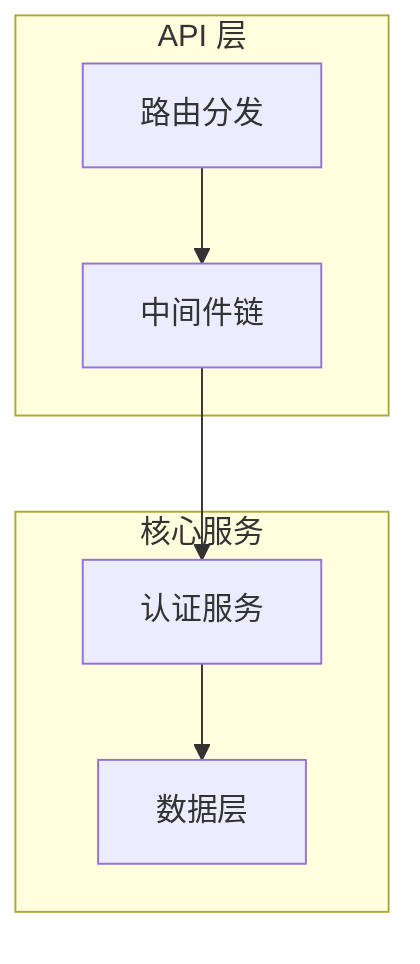

# OSS Insights

开源项目深度解读专栏。每个项目从架构设计、实现思路、技术亮点等维度进行分析，记录学习过程中的理解与思考。

## 定位

不追求面面俱到的文档翻译或使用教程，而是聚焦于**技术层面的解构与提炼**：

- 这个项目解决了什么根本问题
- 架构如何组织，为什么这样设计
- 核心模块的实现思路与关键代码
- 有哪些值得借鉴的设计模式与工程实践
- 与同类项目相比的优劣势

## 分析框架

对一个开源项目的解读通常覆盖以下维度。并非每个项目都需要全部覆盖，根据项目特点选择侧重点：

| 维度 | 关注点 |
|------|--------|
| **项目概览** | 定位、解决的问题、适用场景、同类定位 |
| **架构设计** | 整体架构图、模块划分、数据流、启动流程 |
| **认证与安全** | 认证方式、权限模型、安全机制、加密方案 |
| **核心实现** | 关键模块的实现思路、算法、数据结构 |
| **存储与数据** | 数据模型、存储选型、持久化策略 |
| **设计与模式** | 使用了哪些设计模式、代码组织方式、接口抽象 |
| **部署与可观测** | 部署方式、配置管理、日志、监控、优雅关闭 |
| **测试与质量** | 测试策略、覆盖率、代码生成、CI/CD |
| **社区与生态** | 贡献活跃度、文档质量、版本迭代、周边工具 |
| **同类对比** | 与同领域项目的功能、性能、复杂度对比 |

## 文档规范

### 文档结构

分为两层：**目录索引页**（模块 README） + **项目解读页**（项目 README）。

#### 目录索引页（如 `auth/README.md`）

```markdown
# 认证授权

本目录收录认证授权领域的开源项目解读。

| 项目 | 语言 | 说明 | 仓库 |
|------|------|------|------|
| [项目名](项目目录/) | 语言 | 一句话说明 | [GitHub](链接) |
```

- 每个模块目录下必须有一个 `README.md` 作为索引
- 表格列固定为：项目、语言、说明、仓库

#### 项目解读页（如 `auth/tinyauth/README.md`）

每篇解读按**编号章节**组织，必须包含的两个核心章节：

| 章节 | 内容 | 必选 |
|------|------|------|
| **第一部分：快速概览** | 是什么、解决什么痛点、适用场景、核心能力表、技术栈一览 | ✅ |
| **第二部分：架构深读** | 架构总览图、启动流程、核心请求链路、模块职责划分 | ✅ |
| **第三部分起** | 按项目特点深入：核心实现 / 设计模式 / 部署 / 同类对比 | 可选 |

第三部分及之后的章节，根据项目特点自由选题，但每个部分应有明确主题，不堆砌碎片信息。

### 图表规范

优先使用 **Mermaid** 图表。GitHub 和 VS Code 均原生渲染 ` ```mermaid ` 代码块，无需额外工具。

| 图表类型 | Mermaid 类型 | 使用场景 |
|---------|-------------|---------|
| 架构总览 | `graph TB` / `graph LR` | 模块层次、整体架构 |
| 流程图 | `graph TB` | 启动流程、请求链路、程序步骤 |
| 时序图 | `sequenceDiagram` | 模块间交互、请求时序 |
| 状态图 | `stateDiagram-v2` | 状态流转、生命周期 |

示例 — 一个简单的 Mermaid 架构图：



绘图原则：

- 不追求面面俱到 — 抓关键链路，标注核心数据流方向
- 图保持在合理大小（15 个节点以内），太复杂的图不如拆成多个
- 对于线性流程（如启动流程），可直接使用列表式 ASCII 图（15 行以内），可读性更好

### 写作规范

| 规范 | 要求 |
|------|------|
| **正文语言** | 中文为主，技术术语保留英文原文（如 ForwardAuth、JWT、SQLite、BaaS） |
| **代码块** | 标注语言标识：`go`、`ts`、`yaml`、`dockerfile`、`sql` |
| **代码引用** | 标注文件路径和行号，如 `internal/app.go:12` |
| **ASCII 架构图** | 仅用于简单线性流程（≤15 行），复杂图使用 Mermaid |
| **列表格式** | 统一使用 `-` 作为无序列表标记 |

### 内容质量规范

每篇解读应满足以下最低要求：

- [ ] **核心能力清单** — 用表格列出项目的关键能力与说明
- [ ] **技术栈一览** — 用表格列出各层面使用的技术
- [ ] **架构总览图** — Mermaid 图展示模块划分
- [ ] **启动流程或请求链路** — 核心流程至少有一条
- [ ] **关键代码引用** — 至少 2 处带路径/行号的代码引用
- [ ] **项目根因** — 说清楚这个项目解决什么根本问题

### 分类索引维护

添加新项目时需同步三步：

1. 创建 `模块名/项目名/README.md`
2. 更新 `模块名/README.md` 索引表
3. 若模块不存在，在根 `README.md` 添加新分类

### 状态标记

- 未完成的章节使用 `[WIP]` 前缀，如 `[WIP] 第三部分：核心实现详解`
- 内容中不确定或待补充的部分使用 `TODO` 标记

## 分类索引

### [计费与商业化后端（Billing & Monetization）](billing/)

| 项目 | 语言 | 说明 | 协议 | 仓库 |
|------|------|------|------|------|
| [OpenMeter](billing/openmeter/) | Go | AI 和 DevTool 公司的使用量计量和计费平台，实时计量 + 产品目录 + 订阅管理 + 发票生成 | Apache-2.0 | [GitHub](https://github.com/openmeterio/openmeter) |

### [后台系统与管理平台（Admin）](admin/)

| 项目 | 语言 | 说明 | 协议 | 仓库 |
|------|------|------|------|------|
| [GoAdmin](admin/go-admin/) | Go | 面向 Go 生态的数据管理后台生成框架，声明式 table model + 15 种 Web 框架适配器 + 开箱即用 RBAC | Apache-2.0 | [GitHub](https://github.com/GoAdminGroup/go-admin) |
| [easy-workflow](admin/easy-workflow/) | Go | 面向中国式审批场景的轻量工作流引擎：混合网关 + 会签/自由驳回 + 反射事件 + MySQL 双表归档，可内嵌库或独立 REST | MIT | [GitHub](https://github.com/Bunny3th/easy-workflow) |
| [zero-admin](admin/zero-admin/) | Go | 基于 go-zero 的电商微服务系统：2 网关 + 8 rpc + consumer/job + goctl 代码生成，前台商城（订单/支付）+ 后台管理（RBAC），ES 搜索 + MQ 异步 | Apache-2.0 | [GitHub](https://github.com/feihua/zero-admin) |
| [PocketBase](admin/pocketbase/) | Go | 开源 BaaS 引擎，单二进制集成 SQLite + 认证 + 文件存储 + 实时订阅 | MIT | [GitHub](https://github.com/pocketbase/pocketbase) |

### [社区 / 问答平台（Community）](community/)

| 项目 | 语言 | 说明 | 协议 | 仓库 |
|------|------|------|------|------|
| [Apache Answer](community/answer/) | Go | 开源 Q&A 知识管理平台，支持社区问答、插件系统、AI 集成 | Apache-2.0 | [GitHub](https://github.com/apache/answer) |

### [DevOps 平台](devops/)

| 项目 | 语言 | 说明 | 协议 | 仓库 |
|------|------|------|------|------|
| [Gitea](devops/gitea/) | Go | 轻量级自托管 DevOps 平台，Git 托管 + Code Review + CI/CD + Package Registry | MIT | [GitHub](https://github.com/go-gitea/gitea) |

### [认证授权（Auth）](auth/)

| 项目 | 语言 | 说明 | 协议 | 仓库 |
|------|------|------|------|------|
| [Tinyauth](auth/tinyauth/) | Go | 最小认证授权服务器，为反向代理提供 ForwardAuth | AGPL-3.0 | [GitHub](https://github.com/tinyauthapp/tinyauth) |
| [ZITADEL](auth/zitadel/) | Go | 企业级 IAM 平台，CQRS + Event Sourcing 架构，OIDC/SAML/SCIM 完整支持 | AGPL-3.0 | [GitHub](https://github.com/zitadel/zitadel) |
| [TOPIAM](auth/topiam/) | Java | 企业级 IAM/IDaaS 平台，支持 OIDC/SAML2/JWT/CAS/表单代填 | AGPL-3.0 | [GitHub](https://github.com/topiam/eiam) |
| [MaxKey](auth/maxkey/) | Java | 企业级 IAM-IDaas 单点登录系统，支持 OAuth2/OIDC/SAML2/CAS/JWT 协议 | Apache-2.0 | [GitHub](https://github.com/dromara/MaxKey) |
| [Keycloak](auth/keycloak/) | Java | IAM 领域标准参考实现，CNCF 孵化，OIDC/SAML2/OAuth2 完整协议支持 | Apache-2.0 | [GitHub](https://github.com/keycloak/keycloak) |

### [开源项目知识库（Knowledge）](knowledge/)

| 项目 | 语言 | 说明 | 协议 | 仓库 |
|------|------|------|------|------|
| [Wiki.js](knowledge/wiki/) | Node.js | 现代化 Wiki 引擎，支持 Git 存储、多版本管理、细粒度权限控制 | AGPL-3.0 | [GitHub](https://github.com/requarks/wiki) |
| [Outline](knowledge/outline/) | TypeScript | 团队协作知识库，实时协作编辑，Cancan 式权限继承 | BSL 1.1 | [GitHub](https://github.com/outline/outline) |
| [Starred](knowledge/starred/) | Python | GitHub Stars 转 Awesome 列表 CLI，GraphQL，语言/Topic 双分类 | MIT | [GitHub](https://github.com/maguowei/starred) |
| [GithubStarsManager](knowledge/github-stars-manager/) | TypeScript | AI 驱动的 GitHub Stars 管理平台，语义搜索、Release 跟踪、分类管理 | MIT | [GitHub](https://github.com/AmintaCCCP/GithubStarsManager) |
| [Memos](knowledge/memos/) | Go+TS | 自托管笔记应用，微博式时间线，Proto 驱动 API，双重协议（Connect RPC + gRPC-Gateway），三数据库支持，SSE 实时推送 | MIT | [GitHub](https://github.com/usememos/memos) |

### [AI 产品（AI Product）](ai-product/)

| 项目 | 语言 | 说明 | 协议 | 仓库 |
|------|------|------|------|------|
| [OpenHuman](ai-product/openhuman/) | Rust+TS | 本地优先 AI 超级助手桌面应用：进程内 Rust 核心（22 域族/85 模块），分脑编排（triage 四分类 + checkpointed tinyagents graph），记忆树+Obsidian/TinyCortex 记忆引擎，per-call 成本与模型路由，approval-gated 工作流，多链钱包 | AGPL-3.0 | [GitHub](https://github.com/tinyhumansai/openhuman) |
| [Lework](ai-product/Lework/) | Go+TS+Electron | 企业级 AI 工作协作平台（AI 劳动力管理），双进程事件驱动，多 Agent 运行时，Task+Asset 模型，Skill/Tool + MCP/插件，企业级权限/审计 | Apache-2.0 | [GitHub](https://github.com/insmtx/Lework) |
| [OpenWorker](ai-product/openworker/) | Python+TS+Rust | 开源 AI 同事桌面平台，本地 sidecar 架构，审批门控 Agent 循环，连接器 + MCP + 技能系统 + 上下文压缩 | MIT | [GitHub](https://github.com/andrewyng/openworker) |
| [OpenVort](ai-product/openvort/) | Python+TS | 开源 AI 员工平台/研发工作流引擎，手写 Agentic Loop，插件化架构 + Slot Protocol，四级 Skill 体系，MCP Server，深度绑定 IM + 项目管理/代码/CI/CD 全流程 | AGPL-3.0 | [GitHub](https://github.com/openvort/openvort) |
| [OpenCode](ai-product/opencode/) | TypeScript | 开源 AI 编码 Agent，服务化架构（CLI/TUI/Web/Desktop），四轴可组合 LLM 路由，事件溯源 Session V2，Effect-TS 函数式编排 | MIT | [GitHub](https://github.com/anomalyco/opencode) |
| [Goose](ai-product/goose/) | Rust | Linux Foundation AAIF 通用 AI Agent：单主 Agent 循环，统一 Provider trait 接 15+ LLM，自研 MCP client 接 70+ 扩展，SQLite 会话持久化，ACP 协议双向打通，Skill/Recipe 体系，工具权限审批 + prompt 注入扫描 | Apache-2.0 | [GitHub](https://github.com/aaif-goose/goose) |
| [Multica](ai-product/multica/) | Go+TS | 托管式 AI Agent 协作平台，Agent 作为第一公民的任务管理系统 | Apache-2.0 | [GitHub](https://github.com/multica-ai/multica) |
| [OpenBee](ai-product/openbee/) | Go+TS | 自托管 24/7 数字员工管理平台，对话驱动，多 IM 平台集成，动态引擎路由（Claude/Codex/Pi 运行时切换），多用户 RBAC，49 条 SQLite 迁移 | MIT | [GitHub](https://github.com/theopenbee/openbee) |
| [OpenWork](ai-product/openwork/) | TS+Electron | 开源 AI 工作流分享桌面应用，Claude Cowork/Codex 开源替代；代理运行时 + 单一 baseUrl 透明代理，Den 企业控制平面，Drizzle+MySQL 约 80 表，MCP 两工具契约，多云 Helm 部署 + 证据卷轴 evals | Fair Source | [GitHub](https://github.com/different-ai/openwork) |
| [OpenHands](ai-product/openhands/) | TypeScript + Electron | 开源开发者控制中心前端：多后端本地/云切换（OpenHands/Claude Code/Codex/ACP），原生 WebSocket 实时会话流，Automations 自动化编排，Electron 桌面交付（内置 uv/node 运行时栈），manifest 安全收纳层，客户端本地存储分层 | MIT | [GitHub](https://github.com/OpenHands/OpenHands) |
| [AionUi](ai-product/aionui/) | TypeScript + Rust | 开源多 Agent 桌面 Cowork 平台：app-shell 守护外部 aioncore(Rust) 引擎，ACP 收敛几十种 CLI Agent，Team Mode 协作，Cron 24/7 + WebUI 远程 + IM 渠道，MCP 统一管理（前端壳 + 后端大脑双层架构） | Apache-2.0 | [GitHub](https://github.com/iOfficeAI/AionUi) |
| [Tutti](ai-product/tutti/) | Go + TS (Electron) | 多 AI 智能体实时共享协作空间：loopback daemon + SQLite 真值，Tutti Mode Checkpoint 仲裁多 agent，App Center/Factory 应用生态，Connector 市场 + Agent Extension(ACP) 双边接入，signal-and-reconcile 事件流 | Apache-2.0 | [GitHub](https://github.com/anomalyco/tutti) |
| [Eigent](ai-product/eigent/) | Python + TS (Electron) | 开源 Cowork Desktop（Multi-Agent Workforce）：CAMEL-AI 多 agent 编排（单 agent/Workforce 三车道路由 + TaskLock 队列/SSE），控制面 server / 行动面 backend 分离，记忆磁盘档案，MCP 双写总线，浏览器/终端工具，Celery 定时自动化 | Apache-2.0 | [GitHub](https://github.com/eigent-ai/eigent) |
| [AgenticSeek](ai-product/AgenticSeek/) | Python + TS | 100% 本地 Manus 替代品：双模型投票 Agent 路由、Planner 编排、Block 代码块工具协议、记忆压缩、stealth 浏览器自主上网/填表、会话持久化 | GPL-3.0 | [GitHub](https://github.com/Fosowl/agenticSeek) |
| [PicoClaw](ai-product/picoclaw/) | Go | 极致轻量 Go 原生 AI Agent 网关，<10MB 内存跑在 $10 硬件，20+ 通道 30+ LLM，MCP 集成 | MIT | [GitHub](https://github.com/sipeed/picoclaw) |

### [Agent 基础设施（AI Infra）](ai-infra/)

| 项目 | 语言 | 说明 | 协议 | 仓库 |
|------|------|------|------|------|
| [Mem0](ai-infra/mem0/) | Python+TS | AI Agent 智能记忆层：V3 ADD-only 记忆管线 + 多信号检索（语义+BM25+实体），四类 Provider 插件体系，双模式部署 + MCP | Apache-2.0 | [GitHub](https://github.com/mem0ai/mem0) |
| [New API](ai-infra/new-api/) | Go | 统一 AI API 网关，聚合 40+ AI 供应商，提供统一接口、计费、权限管理 | AGPL-3.0 | [GitHub](https://github.com/QuantumNous/new-api) |
| [WeKnora](ai-infra/weknora/) | Go | 企业级 RAG 与知识推理框架，集成 Agent、Wiki 模式、多租户 RBAC | MIT | [GitHub](https://github.com/Tencent/WeKnora) |

### [AI 生成（AIGC）](aigc/)

| 项目 | 语言 | 说明 | 协议 | 仓库 |
|------|------|------|------|------|
| [ComfyUI](aigc/comfyui/) | Python | 模块化 AI 内容生成引擎，节点图工作流，多模态（图像/视频/音频/3D），多策略执行缓存 + VRAM 状态机，API 优先设计 | GPL-3.0 | [GitHub](https://github.com/comfyanonymous/ComfyUI) |
| [DeepWiki-Open](aigc/deepwiki-open/) | Python+TS | 开源代码仓库 Wiki 自动生成平台，Next.js+FastAPI+AdalFlow 编排，9 种 LLM Provider，RAG+Deep Research+Codemap 引用落点 | MIT | [GitHub](https://github.com/AsyncFuncAI/deepwiki-open) |
| [Canvas2](aigc/canvas2/) | JS + React + PostgreSQL | 面向花型/图案设计的 AI 生图 SaaS：多租户 UIN 身份模型，计费积分（订单状态机 + 幂等账本 + 批次 FEFO），多渠道生图抽象（RunningHub/CFAPP→ComfyUI），18 迁移数据模型 | 私有 | 本地 /Users/morehao/Documents/works/yangu/muting/canvas2 |

### [即时通讯（IM）](IM/)

| 项目 | 语言 | 说明 | 协议 | 仓库 |
|------|------|------|------|------|
| [Open-IM-Server](IM/open-im-server/) | Go | 开源 IM 即时通讯服务器，微服务架构，支持 WebSocket 长连接、消息推送、多端登录 | Apache-2.0 | [GitHub](https://github.com/openimsdk/open-im-server) |

### [编程语言](languages/)

| 语言 | 说明 |
|------|------|
| [Go](languages/go/) | Go 语言规范、最佳实践与惯用法指南 |

---

> 每个项目目录下有独立的 README 作为项目解读的入口和三方仓库地址。
