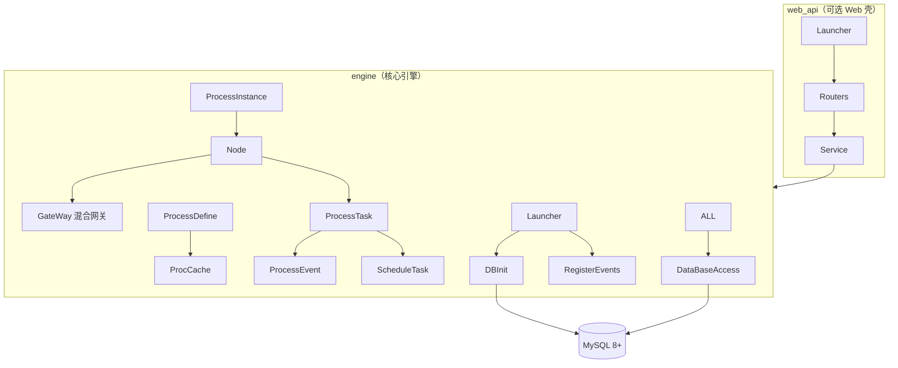
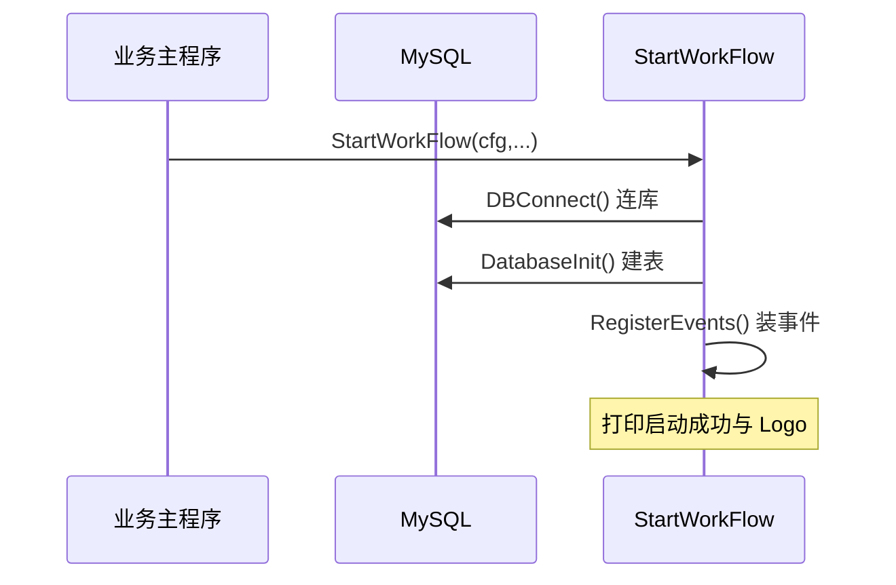

# easy-workflow

> 面向「中国式审批需求」的轻量级纯 Go 工作流引擎，作者「兔老三」。可以直接 `import` 到 Go 工程内嵌使用，也可以作为独立的 Web API Server 运行。

## 快速概览

**一句话根因：** 把 Activiti 等主流 BPM 引擎在会签、自由驳回、混合网关、事件回调等真实复杂审批场景下的高使用成本与「水土不服」，收敛成一套纯 Go、门槛低、可内嵌亦可独立部署的引擎。作者在 README 里明言这是「去年为了解决实际需求，对比了几个开源go工作流，觉得都不满意而自己上手写的」[README.md:113-113]()。
<!-- snippet: 这个项目是去年为了解决实际需求，对比了几个开源go工作流，觉得都不满意而自己上手写的。 -->

> 说明：[`README.md:113`]() 指源仓库（easy-workflow）根目录 README 第 113 行，非本解读页。

**痛点：**
- Java 系 Activiti/flowable 重、上手成本高，需要 DB schema + 表引擎 + XML 建模，且并行/排他/包含三种网关割裂，复杂流程建模难。
- 真实中国式审批需要的能力——会签、自由驳回到任意上游、直接提交到上一个驳回我的节点、跨节点的飞线跳转——在传统引擎里要么不支持，要么实现繁琐。
- Go 生态缺少一个「自带系统表、开箱即用」的轻量工作流引擎。

**适用场景：** OA 审批、B2B 单据流转、需要内嵌工作流能力的 SaaS 业务系统，以及想在 Go 里快速获得一个带 REST API 的审批引擎的场景。

### 核心能力清单

| 能力 | 说明 |
|------|------|
| 流程定义 | JSON 定义流程（Node 数组），保存即自动升级版本号并归档旧版 |
| 混合网关 | 一个 `HybridGateway` 覆盖 Activiti 的排他/并行/包含三种网关语义 |
| 会签 / 或签 | 节点级 `IsCosigned` 区分，全部通过才通过 / 一人通过即通过 |
| 自由驳回 | `TaskFreeRejectToUpstreamNode` 驳回到流程定义中任意上游节点 |
| 直接提交到驳回者 | `DirectlyToWhoRejectedMe` 任务通过时直接回到上一个驳回自己的节点 |
| 事件系统 | 节点开始/结束、任务结束、流程撤销四类事件，基于 Go 反射动态挂载 |
| 计划任务 | 内存任务池，周期/定时执行自定义 `func() error` |
| 双表归档 | 每张运行表配一张历史表，流程结束事务批量迁移 |
| REST API | Gin + Swagger，thin 封装引擎能力 |

### 技术栈一览

| 层 | 选型 |
|----|------|
| 语言 | Go 1.19+（`go.mod` 声明 `go 1.19`）[go.mod:3-3]() |
<!-- snippet: go 1.19 -->
| DB / ORM | MySQL 8.0+（依赖 CTE）/ GORM + `gorm.io/driver/mysql` [go.mod:10-11]() |
<!-- snippet:	gorm.io/driver/mysql v1.5.1
	gorm.io/gorm v1.25.2 -->
| Web | Gin + swaggo/gin-swagger |
| 事件 | Go `reflect` |

## 架构深读

engine 是纯函数式核心，web_api 是薄 HTTP 壳，database 只放 GORM 表结构，model 只放领域结构体，职责隔离清晰。

### 启动流程

引擎启动即完成「连库 → 建表 → 注册事件」三件事，全部在 `StartWorkFlow` 内串联：

`StartWorkFlow` 按固定顺序执行连接、初始化、事件注册 [workflow/engine/Launcher.go:14-24]()；事件参数校验不在注册时做，而在流程真正开始、`VerifyEvents` 校验事件签名时兜底 [workflow/engine/ProcessEvent.go:92-94]()。
<!-- snippet: 	//配置数据库连接选项
	DBConnConfigurator()

	//数据库连接
	err := DBConnect()
	if err != nil {
		log.Fatalln("easy workflow 数据库连接失败，错误:", err)
	}

	//初始化数据库表
	err = DatabaseInitialize() -->
<!-- snippet: 	//验证流程事件(目前只有撤销事件)
	for _, event := range process.RevokeEvents {
		if e, ok := EventPool[event]; !ok { -->

### 模块职责映射（目录树）

| 目录/文件 | 职责 |
|-----------|------|
| `workflow/engine/` | 核心引擎：节点处理、网关、任务流转、事件、计划任务、DB 访问 |
| `workflow/database/` | GORM 表结构（10 表）+ 时间类型 |
| `workflow/model/` | 领域结构体（Node/Process/Gateway/Task/Instance/Variable/Action） |
| `workflow/web_api/` | 可选 REST 层（Gin 路由 + service 桩） |
| `example/` | 完整可运行示例（流程定义/事件/计划任务） |

## 核心模块导读

| 模块 | 一句话定位 | 深读 |
|------|-----------|------|
| 引擎核心 | 节点模型、混合网关、任务流转与会签、自由驳回 | [`engine-core.md`](engine-core.md) |
| 事件与计划任务 | 反射事件池 + 内存计划任务池 | [`event-schedule.md`](event-schedule.md) |
| 数据模型 | 运行/历史双表 + JSON 流程定义 + 归档策略 | [`data-model.md`](data-model.md) |

## 子文档索引

- [`engine-core.md`](engine-core.md) — 节点模型、混合网关、任务流转与会签、自由驳回与直接提交
- [`event-schedule.md`](event-schedule.md) — 反射事件机制与计划任务
- [`data-model.md`](data-model.md) — 数据模型五要素（双表设计、存储选型、演进、读写路径）

## 同类定位对比

| 引擎 | 语言 | 门槛 | 网关 | 会签/驳回 | 部署形态 |
|------|------|------|------|-----------|----------|
| **easy-workflow** | Go | 低，自带表 | 混合网关 1 种 | 原生支持，含自由驳回/直接提交 | 可内嵌库 + Web API 双形态 |
| Activiti / flowable | Java | 高，机箱 + XML | 排他/并行/包含 3 种 | 需配监听器 | 独立引擎 |
| snakeflow | Go | 中 | 图定义 | 基础 | 库 |
| temporal | Go | 高 | 纯编排 | 无审批语义 | 独立服务 |
| xxl-job（对比计划任务） | Java | 中 | - | - | 集群调度 |

> **差异点：** easy-workflow 把「网关、会签、驳回、事件」这些审批高频语义做成一等公民并给 REST，而多数 Go 编排框架（如 Temporal）更偏原始 DAG 控制流，审批语义需自行叠加。

## 设计亮点

- **开始节点「任务化」**：把开始节点同时当成一个特殊任务节点，流程一旦开始就自动通过，省去 Activiti 里「判断是否开始节点再手动结束」的样板代码，更贴近人类思维 [workflow/model/Node.go:32-32]()。
<!-- snippet: 3、所以，我设计的流程引擎中，确实包含开始节点，但这个开始节点同时也是一个特殊的任务节点，流程一旦开始，这个节点就自动通过。 -->
- **驳回可追溯**：任务表用 `PrevNodeID` + `BatchCode` 记录「实际审批时的上一个已处理节点与批次」，配合 `TaskNextNode` 的两步判断解决跨节点跳转后再次驳回的归属问题 [workflow/engine/ProcessTask.go:585-587]()。
<!-- snippet: 		var PrevNodeID string

		//上一个节点是否做了驳回 -->
- **事件 Go 原生接入**：用 `reflect` 把「事件方法的 struct」挂进事件池，方法名即事件名，业务无需实现接口或注册回调，天然贴合 Go [workflow/engine/ProcessEvent.go:27-29]()。
<!-- snippet: 		m := StructType.Method(i)
		var method = method{Struct, m}
		EventPool[m.Name] = method -->

## 不足 / 风险

- **强绑定 MySQL 8+**：大量原生 SQL 依赖 CTE（`WITH ... UNION ALL` 合并运行表与历史表，见 [workflow/engine/ProcessInstance.go:223-228]()），无法平滑切换 PostgreSQL/SQLite。
<!-- snippet: 	sql:="WITH tmp_procinst AS\n" +
		"(SELECT id,proc_id,proc_version,business_id,starter,current_node_id,\n" +
		"create_time,`status`\n" +
		"FROM proc_inst \n" +
		"WHERE id=?\n" +
		"UNION ALL\n" + -->
- **并发与单点**：进程内缓存（`ProcCache`）+ 内存事件池/计划任务池，多实例水平扩容需自行处理缓存一致性与任务幂等。
- **流程定义无 schema 校验**：代码注释明确留了 TODO「检查解析后的 node 结构，比如是否只有一个开始和结束节点」[workflow/engine/ProcessDefine.go:20-20]()，坏定义可能在运行时才暴露。
<!-- snippet: //todo:这里要写一个func，检查解析后的node结构，比如是否只有一个开始和结束节点 -->

## 可借鉴的设计

1. **运行表 + 历史表双表 + 事务批量归档**：读、改只在运行表，流程结束时 `INSERT...SELECT` 迁移到历史表再删除，天然控制台账表膨胀，读侧用 CTE `UNION ALL` 对读完整体透明（见 [`data-model.md`](data-model.md)）。
2. **节点驱动的"任务即流程推进"模型**：`TaskPass/Reject` 内部在节点内任务全部完成时才 `ProcessNode` 推进到下一节点，把「会签收集 + 自动流转」收敛进单一路径（[`engine-core.md`](engine-core.md)）。
3. **方法名即事件的反射挂载**：零接口、零注册代码侵入，业务 struct 只要方法签名对得上就能被引擎调用，适合追求「接入成本低」的工具库。

## 项目规模

| 指标 | 数值 |
|------|------|
| workflow 核心（excl. example/docs） | ~4400 行 |
| 全仓（含 example） | ~4800 行 |
| SQL 表 | 10 张（5 运行 + 5 历史） |
| 端点 | 约 14 个 REST |

## 总结

easy-workflow 的价值不在「编排能力有多强」，而在把**中国式审批的高频语义**（会签、自由驳回、直接提交到驳回者、混合网关、事件回调）做成了 Go 里用法最直白的一套：JSON 定义流程，`instanceStart` 启动，`taskPass/taskReject` 审批，事件用反射一挂即用，数据用双表免维护。它用最小的结构换取「开箱即用」，代价是向后只认 MySQL 8+ 与近进程内扩展——这两点恰好和它「轻量、可内嵌」定位自洽。对想在 Go 里快速落地 OA/单据审批、又不想被重 BPM 引擎束缚的团队，是值得直接研究的一张蓝本。
