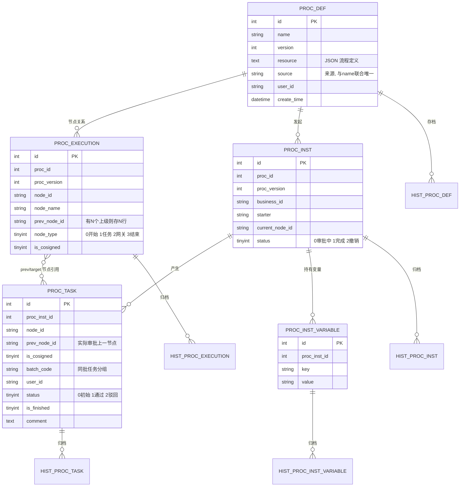
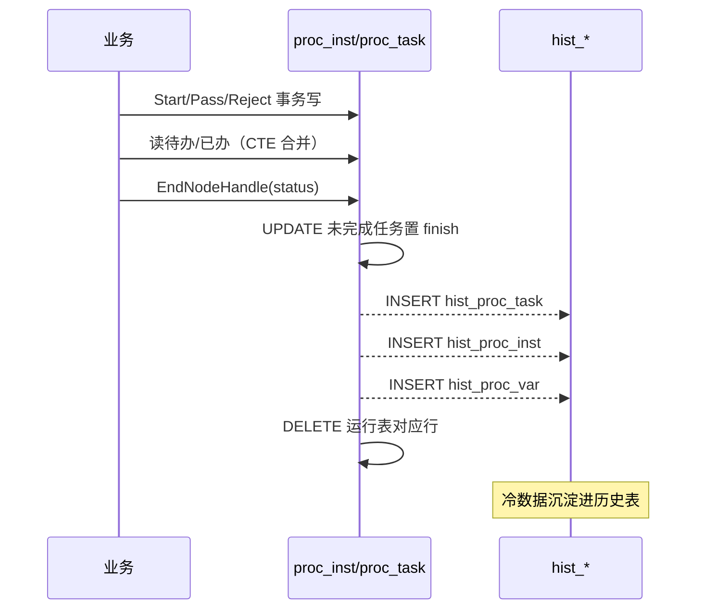

# 数据模型：双表归档 + JSON 流程定义

本篇按数据模型五要素拆解 easy-workflow 的存储设计——它如何用 5 组「运行表 + 历史表」承载审批数据，以及为何这样设计。

## 实体关系总览

引擎把数据切成三个天然分组，每组一张运行表配一张历史表（[workflow/database/tables.go:4-4]()，建表见 [workflow/engine/DataBaseInitialize.go:6-6]()）：
<!-- snippet: type ProcDef struct { -->
<!-- snippet: func DatabaseInitialize() error { -->

- **定义组**：`proc_def`（流程定义）+ `proc_execution`（节点执行关系）+ 各自历史表
- **实例组**：`proc_inst`（实例）+ `proc_inst_variable`（实例变量）+ 各自历史表
- **任务组**：`proc_task`（任务）+ 各自历史表

## 存储选型与理由

- **关系型 + 显式 CTE 查询**。所有关键读路径（合并表、逆推上游、孤儿判断）都用手写 SQL；`ExecSQL` 是统一封装——`Result==nil` 走 `DB.Exec`，否则 `DB.Raw().Scan()` [workflow/engine/DataBaseAccess.go:70-70]()。这带来直接 SQL 控制力，代价是强绑定 MySQL 8+ 的 CTE。
<!-- snippet: func ExecSQL(SQL string, Result interface{}, Params ...interface{}) (interface{}, error) { -->
- **为什么历史表 + 运行表分离**而不是单表加状态字段：让**热数据（审批中）与冷数据（已归档）物理隔离**，运行表常驻小、索引高效，历史表专门承担台账膨胀。引擎在流程结束时用事务批量 `INSERT...SELECT` 迁移再删除，读侧用 `WITH tmp UNION ALL` 对读完整体透明（见「读写路径」）。
- **大量冗余字段「偷懒」式冗余**：`proc_task` 里存 `proc_id`/`business_id`/`starter`/`proc_inst_create_time`，注释原话「冗余字段,偷懒用」[workflow/database/tables.go:71-71]()。这是因为任务按用户查询（待办/已办）需高频独立访问，冗余避免每查一次都 join 实例表。
<!-- snippet: 	ProcInstCreateTime LocalTime `gorm:"column:proc_inst_create_time;type:DATETIME NOT NULL;comment:流程实例创建时间,冗余字段,偷懒用"` -->

## 核心表设计

### proc_def — 流程定义 [workflow/database/tables.go:4-12]()
<!-- snippet: type ProcDef struct {
	ID        int       `gorm:"primaryKey;column:id;type:INT UNSIGNED NOT NULL AUTO_INCREMENT;comment:流程ID"`
	Name      string    `gorm:"column:name;type:VARCHAR(250) NOT NULL;comment:流程名字;uniqueIndex:uix_name_source"`
	Version   int       `gorm:"column:version;type:INT UNSIGNED NOT NULL DEFAULT 1;default:1;comment:版本号"`
	Resource  string    `gorm:"column:resource;type:TEXT NOT NULL;comment:流程定义模板"`
	UserID    string    `gorm:"column:user_id;type:VARCHAR(250) NOT NULL;comment:创建者ID"`
	Source    string    `gorm:"column:source;type:VARCHAR(250) NOT NULL;uniqueIndex:uix_name_source;comment:来源(引擎可能被多个系统、组件等使用，这里记下从哪个来源创建的流程);"`
	CreatTime LocalTime `gorm:"column:create_time;type:DATETIME DEFAULT NOW();default:NOW();comment:创建时间"`
} -->

保存 JSON 流程定义、**name+source 联合唯一**并带版本号，`source` 用于区分「同一引擎服务多个系统/组件」。

| 字段 | 类型 | 约束 | 说明 |
|------|------|------|------|
| id | INT UNSIGNED | PK 自增 | 流程 ID |
| name | VARCHAR(250) | NOT NULL, uniqueIndex(uix_name_source) | 流程名 |
| version | INT UNSIGNED | NOT NULL DEFAULT 1 | 版本号，重保存自增 |
| resource | TEXT | NOT NULL | JSON 流程定义模板（Node 数组） |
| user_id | VARCHAR(250) | NOT NULL | 创建者 ID |
| source | VARCHAR(250) | NOT NULL, uniqueIndex(uix_name_source) | 来源（多系统用同一引擎） |
| create_time | DATETIME | DEFAULT NOW() | 创建时间 |

### proc_execution — 节点执行关系 [workflow/database/tables.go:99-99]()
<!-- snippet: type ProcExecution struct { -->

把 Node 数组「展平」进表：一个节点有多个上级时存多行（`prev_node_id` 不同），以适配反查上游。建表数据由 `nodes2Execution` 生成 [workflow/engine/ProcessDefine.go:113-113]()。
<!-- snippet: func nodes2Execution(ProcID int, ProcVersion int, nodes []Node) []database.ProcExecution { -->

| 字段 | 类型 | 约束 | 说明 |
|------|------|------|------|
| id | INT UNSIGNED | PK 自增 | |
| proc_id | INT UNSIGNED | index | 流程 ID |
| proc_version | INT UNSIGNED | | 版本号 |
| node_id | VARCHAR(250) | | 节点 ID |
| node_name | VARCHAR(250) | | 节点名 |
| prev_node_id | VARCHAR(250) | DEFAULT NULL | 上级节点 ID，多个上级存多行 |
| node_type | TINYINT | | 0 开始 1 任务 2 网关 3 结束 |
| is_cosigned | TINYINT | | 是否会签 |

### proc_inst — 流程实例 [workflow/database/tables.go:31-31]()
<!-- snippet: type ProcInst struct { -->

记录一次实际运行的快照，`status` 是三态（0 审批中 / 1 完成 / 2 撤销）。

| 字段 | 类型 | 约束 | 说明 |
|------|------|------|------|
| id | INT UNSIGNED | PK 自增 | 实例 ID |
| proc_id | INT | index(ix_proc_id) | 流程 ID |
| proc_version | INT UNSIGNED | | 发起时的版本号（快照） |
| business_id | VARCHAR(250) | DEFAULT NULL | 业务单据 ID |
| starter | VARCHAR(250) | index(ix_starter) | 发起人用户 ID |
| current_node_id | VARCHAR(250) | NOT NULL | 当前节点 ID，随流转更新 |
| status | TINYINT | DEFAULT 0 | 0 审批中 1 完成 2 撤销 |

### proc_task — 任务 [workflow/database/tables.go:56-56]()
<!-- snippet: type ProcTask struct { -->

审批的最小单元。`batch_code` 同批分组（会签收集 / 一人驳回全驳回的判据），`prev_node_id` 是**实际审批的上一个已处理节点**（区别于 flow 定义上游）。

| 字段 | 类型 | 约束 | 说明 |
|------|------|------|------|
| id | INT UNSIGNED | PK 自增 | 任务 ID |
| proc_inst_id | INT UNSIGNED | index | 所属实例（冗余若干字段） |
| node_id | VARCHAR(250) | | 节点 ID |
| node_name | VARCHAR(250) | | 节点名 |
| prev_node_id | VARCHAR(250) | DEFAULT NULL | 实际审批上一已处理节点 |
| is_cosigned | TINYINT | DEFAULT 0 | 0 或签 1 会签 |
| batch_code | VARCHAR(50) | index(ix_batch_code) | 批次码，节点分派一坯一组 |
| user_id | VARCHAR(250) | index(ix_user_id) | 分配用户 |
| status | TINYINT | DEFAULT 0 | 0 初始 1 通过 2 驳回 |
| is_finished | TINYINT | DEFAULT 0 | 0 未完成 1 完成（含系统自动置完成） |
| comment | TEXT | DEFAULT NULL | 审批备注 |
| finished_time | DATETIME | index | 处理时间 |

### proc_inst_variable — 实例变量 [workflow/database/tables.go:125-125]()
<!-- snippet: type ProcInstVariable struct { -->

KV 存储流程上下文（如审批人变量 `$starter`），网关表达式据此求值。

| 字段 | 类型 | 约束 | 说明 |
|------|------|------|------|
| id | INT UNSIGNED | PK 自增 | |
| proc_inst_id | INT UNSIGNED | index | 所属实例 |
| key | VARCHAR(250) | NOT NULL | 变量 key |
| value | VARCHAR(250) | NOT NULL | 变量 value |

## Schema 演进策略

- **建表 = AutoMigrate，零迁移工具**。`DatabaseInitialize` 用 GORM `AutoMigrate` 顺序建 10 张表 [workflow/engine/DataBaseInitialize.go:6-6]()，每次启动都会对齐 schema——适合嵌入式引擎「我用 gorm 管表、你只管连上就能用」的接入体验，但**缺少版本化迁移**，列变更靠 `AutoMigrate` 增量对齐、破坏性变更需人工 DDL。
<!-- snippet: func DatabaseInitialize() error { -->
- **流程定义的演进靠版本号 + 历史表**。重新保存同名同源流程即 `ProcDef.Version+1`，并把旧版 `proc_def`/`proc_execution` 移入历史表再写入新版 [workflow/engine/ProcessDefine.go:44-44]()。实例自带 `proc_version` 快照，保证历史实例按当时定义运行，不被新定义影响。
<!-- snippet: 		//需要将老版本移到历史表中 -->
- `value` 定为 `VARCHAR(250)`，复杂变量需要业务自行 JSON 序列化 [workflow/database/tables.go:129-129]()，是「够用优先」的简化。
<!-- snippet: 	Value      string `gorm:"column:value;type:VARCHAR(250) NOT NULL;comment:变量value"` -->

## 读写路径

写入沿「定义启动 → 实例推进 → 任务完成 → 结束归档」，读取把热/冷表经 CTE 合并成单视图。归档集中在 `EndNodeHandle` [workflow/engine/ProcessNode.go:82-82]()：
<!-- snippet: func EndNodeHandle(ProcessInstanceID int, Status int) error { -->

归档按固定顺序迁移 task → inst → variable，最后删运行表对应数据，全部在同一 `tx` 事务内保证原子性 [workflow/engine/ProcessNode.go:82-82]()。读取侧则用 `WITH tmp UNION ALL` 把两条路并成单查询——例如 `GetInstanceInfo` [workflow/engine/ProcessInstance.go:223-223]()、`GetTaskFinishedList` [workflow/engine/ProcessTask.go:310-310]() 都先并集再 `LEFT JOIN proc_def`。
<!-- snippet: func EndNodeHandle(ProcessInstanceID int, Status int) error { -->
<!-- snippet: 	sql:="WITH tmp_procinst AS\n" + -->
<!-- snippet: 	sql := "WITH tmp_task AS\n" + -->

## 与全局的关联

这套「运行/历史双表 + 冗余 + CTE 合并读」直接支撑了 README 里「开箱即用、自带台账免维护」的定位：引擎替你承担了历史表管理与跨界查询，业务只关心 `taskPass`/`taskReject` 那一两个调用（见 [`README.md`](README.md) 概览）；而它们赖以工作的 `batch_code`/`prev_node_id` 正是 [`engine-core.md`](engine-core.md) 里会签与自由驳回两个核心特性的数据基础。
