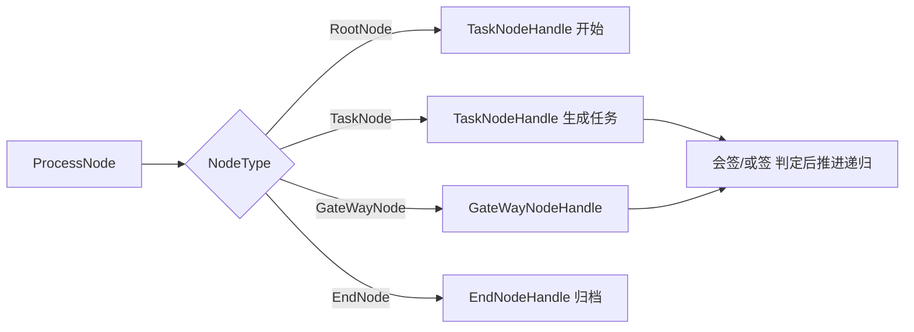
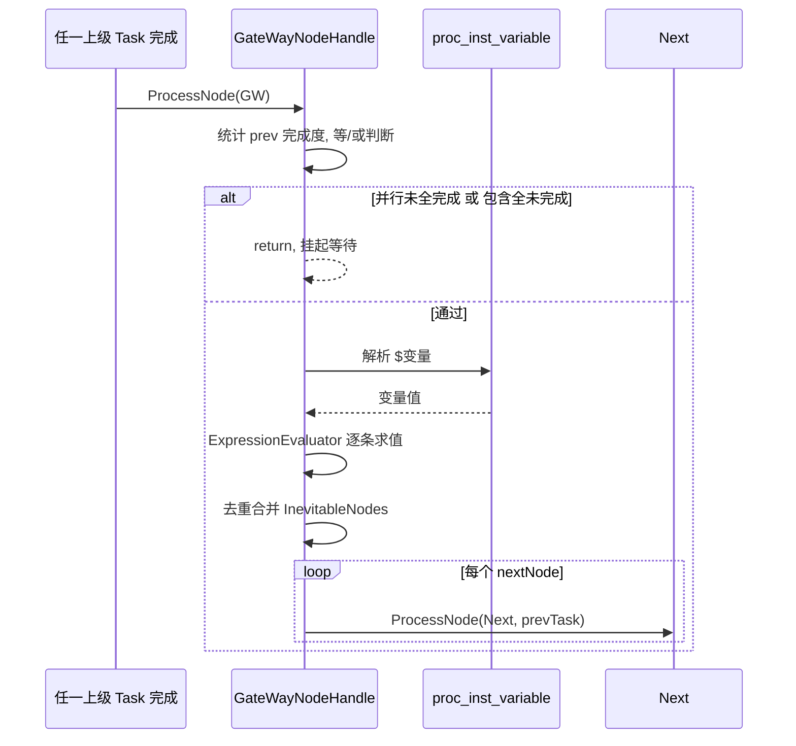
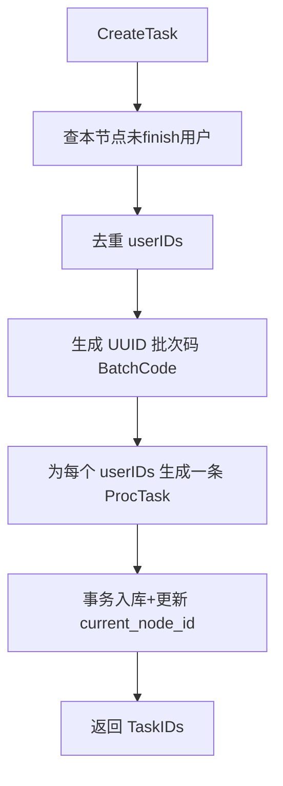
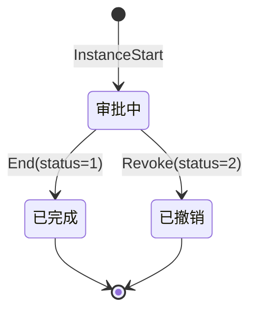

# 引擎核心：节点模型、混合网关与任务流转

本篇深入 easy-workflow 的引擎核心——它如何用一套极简模型表达复杂审批流，以及关键流转为何那样设计。

## 节点模型：四类节点 + 开始节点任务化

引擎只有四类节点（`NodeType`），歧义大幅收敛 [workflow/model/Node.go:5-6]()：

```go
const (
	RootNode    NodeType = 0 //开始(根)节点
	TaskNode    NodeType = 1 //任务节点
	GateWayNode NodeType = 2 //混合网关
	EndNode     NodeType = 3 //结束节点
)
```

和 Activiti 最核心的差异是**开始节点的语义**：README 作者在注释里坦言，Activiti 的开始节点不是任务节点，流程启动后还需写事件判断「是不是开始节点」再手动结束，既不直观也易忘 [workflow/model/Node.go:30-30]()。因此本引擎把开始节点设计成**一个特殊的任务节点**——流程一开始它自动通过，再自动推向下一个节点 [workflow/model/Node.go:32-32]()；同时它也是能承载会签逻辑的普通任务节点，只是节点处理时被强制收敛到单用户、非会签（见下）。
<!-- snippet: 按照activiti的流程图设计一个请假流程是这样的：开始节点-->开始请假(任务节点)。用过activiti的都知道，流程开始之后“开始请假”节点并不会自动结束，一般 -->
<!-- snippet: 3、所以，我设计的流程引擎中，确实包含开始节点，但这个开始节点同时也是一个特殊的任务节点，流程一旦开始，这个节点就自动通过。 -->

结束节点则承担「防呆」职责：明确声明一个结束节点，避免分支多时最后一个任务节点漏设导致流程卡死 [workflow/model/Node.go:36-36]()。结束节点只处理开始事件、不处理结束事件，因为结束节点只做归档，不涉及任务/路径分配 [workflow/model/Node.go:39-39]()。
<!-- snippet: 所以，明确的设置一个结束节点，也是一种防呆设计。 -->
<!-- snippet: 1、结束节点只处理StartEvents，不处理EndEvents。因为结束节点只是把数据库表中流程数据做归档，不涉及到任务分配、节点路径分配等，所以没有必要再做结束事件处理。 -->

`Node` 结构体用一个类型承载全部语义：处理人 `UserIDs`/`Roles`、网关配置 `GWConfig`、会签标记 `IsCosigned`、以及三段事件 `NodeStartEvents`/`NodeEndEvents`/`TaskFinishEvents` [workflow/model/Node.go:12-12]()。角色之所以必须用开始事件解析，是因为引擎本身无法预知「主管」角色下有哪些用户——`Roles` 只是占位，真正要由开始事件把角色解析成的用户 ID 补进 `UserIDs` [workflow/model/Node.go:18-18]()。
<!-- snippet: type Node struct { -->
<!-- snippet: 	Roles                []string      //节点处理角色数组。注意，因为系统无法预先知道角色中存在多少用户，所以必须用StartEvents解析角色，将角色中的用户加到UserIDs中 -->

处理节点时按类型分发到不同处理函数 [workflow/engine/ProcessNode.go:12-12]()：
<!-- snippet: func ProcessNode(ProcessInstanceID int, CurrentNode *Node, PrevNode Node) error { -->



> `ProcessNode` 从任务节点完成后递归进入，携 `PrevNode`。网关递归时故意**不把它自己当 prev 传**，而是传它的上一任务节点——否则 `task1-gw1-gw2-task2` 中到 `task2` 时永远找不到 `task1` [workflow/engine/ProcessNode.go:262-262]()。
<!-- snippet: 节点定义是task1-gw1-gw2-task2，如果在gw1处理的最后，ProcessNode的PrevNode传gw1本身，那么task2就永远找不到task1了 -->

## 混合网关：一种网关覆盖三种语义

Gateway 模型本身很小 [workflow/model/Gateway.go:4-4]()：
<!-- snippet: type HybridGateway struct { -->

```go
type HybridGateway struct {
	Conditions         []Condition //条件判断节点
	InevitableNodes    []string    //必然执行的节点
	WaitForAllPrevNode int         //0:包含 1:并行
}
```

`HybridGateway` 用一个开关 `WaitForAllPrevNode` 覆盖三种 Activiti 网关 [workflow/model/Gateway.go:7-7]()：
<!-- snippet: 	WaitForAllPrevNode int         //0:等于包含网关，只要上级节点有一个完成，就可以往下走   1:等于并行网关，必须要上级节点全部完成才能往下走 -->

- **并行（=1）**：必须所有上级节点都 finished 才向下走。
- **包含（=0）**：只要有一个上级节点 finished 就能向下走。
- **排他（经条件）**：多个 `Condition` 求值后满足者才进 `nextNodeIDs`。

`GateWayNodeHandle` 先统计所有上级节点完成度做「等/或」判断，未满足条件直接返回、挂起等后续 [workflow/engine/ProcessNode.go:190-211]()：
<!-- snippet: 	//--------------------首先，混合节点需要确认所有的上级节点都处理完，才能做下一步-------------------- -->

```text
统计 allPrev 完成数
├─ 并行模式 且 未全完成 → return（等待）
├─ 包含模式 且 一个都没完成 → return（等待）
└─ 通过 → 计算条件表达式 → 产出 nextNodeIDs → 逐个 ProcessNode
```

条件表达式是 `$变量` 风格，运行时用正则提取变量、替换为流程变量值（`[workflow/engine/ProcessNode.go:218-218]()`），再做布尔求值；命中即把对应 `NodeID` 收集进 `conditionNodeIDs`，最后与 `InevitableNodes` 去重合并成真正要处理的节点 [workflow/engine/ProcessNode.go:245-245]()。
<!-- snippet: 		reg := regexp.MustCompile(`[$]\w+`) -->
<!-- snippet: 	nextNodeIDs := MakeUnique(conditionNodeIDs, CurrentNode.GWConfig.InevitableNodes) -->



## 任务流转：会签 / 或签 / 批次

任务生成的关键约束是**同一节点同一人不要出多个未完成任务**。`CreateTask` 先查出本节点下未 finish 的用户、去掉他们、再去重，保证重入节点不重复派发 [workflow/engine/ProcessTask.go:20-20]()。注释用 `A-B-(C|D)` 的返工场景解释了为何必须去重：C 驳回到 B、B 重提后会再次生成 D 节点任务，若 D 的张三旧任务未结束，就不能再造 D2 [workflow/engine/ProcessTask.go:22-22]()。
<!-- snippet: 		1、目前流程已到节点C、D -->
<!-- snippet: 		3、但假设D节点中处理人张三原有任务D1尚未审批，又来一个同样节点的任务D2，岂不是尴尬？（第1遍是B初次提交后的任务，第2遍是B再次提交后重新生成的任务） -->

每个节点会生成**一个批次**（`BatchCode`，用 `SELECT UUID()` 生成）[workflow/engine/ProcessTask.go:64-65]()，同一节点同批的用户任务是同一批次——这是会签收集和「一人驳回即全驳回」的分组依据。
<!-- snippet: 	//生成批次码
	var BatchCode string -->



`TaskPass`/`TaskReject` 都收敛进 `processTask`（两个状态 + 一个可选「直接提交」标志）[workflow/engine/ProcessTask.go:126-126]()。它先做前置校验（是否已处理、Directly 与会签/无上级/上级是否驳回、起始节点不可驳回）[workflow/engine/ProcessTask.go:160-160]()，再 `taskSubmit` 落库，随后按「任务结束事件 → 计算下一节点 → 节点结束事件 → 推进 ProcessNode」的顺序执行 [workflow/engine/ProcessTask.go:204-245]()。**若后续事件或推进出错，调用 `taskRevoke` 回滚任务到初始态避免死任务** [workflow/engine/ProcessTask.go:687-694]()。
<!-- snippet: func TaskPass(TaskID int, Comment string, VariableJson string, DirectlyToWhoRejectedMe bool) error { -->
<!-- snippet: 		//会签节点无法使用此功能，因为会签节点没有“统一意志” -->
<!-- snippet: 	err = RunNodeEvents(CurrentNode.TaskFinishEvents, taskInfo.TaskID, &CurrentNode, PrevNode) -->
<!-- snippet: func taskRevoke(TaskID int) error { -->

### 会签 / 或签判定

> 会签：全部通过才通过，一人驳回即驳回；或签：一人通过即通过，一人驳回即驳回 [workflow/model/Node.go:45-45]()。
<!-- snippet: 会签节点：全部通过才能通过，一人驳回即驳回 -->

`TaskNodeStatus` 用原生 SQL 一次性统计同批次任务的通过/驳回/总数 [workflow/engine/ProcessTask.go:615-615]()。
<!-- snippet: func TaskNodeStatus(TaskID int) (int, int, int, error) { -->

```text
TotalTask, TotalPassed, TotalRejected
└─ 或签: 任一人通过 → 本节点所有任务自动 finish
└─ 会签: 需 TotalTask == TotalPassed 才通过；任一人驳回 → 全驳回
```

`taskSubmit` 里据此做批处理：或签一人通过 或 任一人驳回时，把**同一 BatchCode** 的任务全部置 finish——这就是「一人驳回，其他人无需再处理」的实现 [workflow/engine/ProcessTask.go:662-662]()。
<!-- snippet: 	if (TaskInfo.IsCosigned == 0 && Status == 1) || Status == 2 { -->

## 驳回的归属：两步判断解决跨节点跳转

普通驳回「回到哪」看似简单，但在自由驳回和直接提交同时存在时会变得很微妙。`TaskNextNode` 在驳回分支的处理 [workflow/engine/ProcessTask.go:572-572]()：
<!-- snippet: 	//----------------------------------接下来判断在驳回的情况下，应该到哪个节点---------------------------------- -->

- 若本任务上一节点**没做过驳回**（正常流经），直接回 `taskInfo.PrevNodeID`。
- 若上一节点是**驳回**放下来的，则用 `TaskUpstreamNodeList` 递归逆推流程定义里的「上一个节点」。

注释里给了关键案例 [workflow/engine/ProcessTask.go:575-575]()：E 直接驳回到 A，A 用 Directly 提交回 E，E 再驳回时想驳回到 A 而不是流程定义里的 D——这时用实际 `PrevNodeID`（正是 A）；但若 E 正常驳回 D 后 D 再驳回，D 的 prev 是 E，驳回去就错了，所以分两步判定。`prevNodeID` 存的是「实际审批时的上一已处理节点」，与 `proc_execution` 里流程定义结构的上游节点区分明确 [workflow/database/tables.go:64-64]()。
<!-- snippet: 			# 注意，由于有自由驳回与DirectlyReturnToWhoRejectedMe(简称DR)两个能跨节点的功能，这里需要做比较复杂的判断 -->
<!-- snippet: 	PrevNodeID         string    `gorm:"column:prev_node_id;type:VARCHAR(250) DEFAULT NULL;default:NULL;comment:上个处理节点ID,注意这里和execution中的上一个节点不一样，这里是实际审批处理时上个已处理节点的ID"` -->

## 自由驳回与直接提交

**自由驳回** `TaskFreeRejectToUpstreamNode` 允许驳回到任意上游，会签/或签都能用（因为会签任一人驳回即算驳回，其他人已无机会操作）[workflow/engine/ProcessTask.go:467-467]()；校验起始节点不可驳回后，直接 `taskSubmit(驳回)` 再 `ProcessNode` 到目标节点。
<!-- snippet: func TaskFreeRejectToUpstreamNode(TaskID int, NodeID string, Comment string, VariableJson string) error { -->

**直接提交** `DirectlyToWhoRejectedMe` 只在「非会签 + 有上级 + 上一节点确实驳回过」时可用 [workflow/engine/ProcessTask.go:159-159]()，通过时直接取任务的 `PrevNodeID` 作为下一节点，跳过中间主管复审 [workflow/engine/ProcessTask.go:213-214]()。会签节点被禁用，因为会签节点没有「统一意志」，两人一个普通通过一个直接提交会产生分歧 [workflow/engine/ProcessTask.go:116-119]()。
<!-- snippet: 	if option.Status == 1 && option.DirectlyToWhoRejectedMe { -->
<!-- snippet: 	if option.Status == 1 && option.DirectlyToWhoRejectedMe {
		NextNode, err = GetInstanceNode(taskInfo.ProcInstID, taskInfo.PrevNodeID) -->
<!-- snippet: 	//此时使用DirectlyToWhoRejectedMe，A直接提交到上次驳回他的E，皆大欢喜 -->

为降低前端负担，引擎提供 `WhatCanIDo` 一次性返回某任务当前能执行的所有动作（能否通过/驳回/自由驳回/直接提交/撤销），前端无需挨个按钮试错 [workflow/engine/ProcessTask.go:753-753]()。
<!-- snippet: func WhatCanIDo(TaskID int) (TaskAction, error) { -->

## 流程实例生命周期

以 `InstanceStart` 为锚 [workflow/engine/ProcessInstance.go:116-116]()：先 `instanceInit` 解析缓存与开始节点、建实例与变量、解析发起人 [workflow/engine/ProcessInstance.go:35-35]()，随后处理开始节点让它自动通过；若开始节点处理失败，会把已建的实例/变量/任务清理掉再返回错误 [workflow/engine/ProcessInstance.go:128-128]()。撤销则收敛为 `InstanceRevoke` 执行撤销事件后调用 `EndNodeHandle` 归档 [workflow/engine/ProcessInstance.go:142-142]()。
<!-- snippet: func InstanceStart(ProcessID int, BusinessID string, Comment string, VariablesJson string) (int, error) { -->
<!-- snippet: func instanceInit(ProcessID int, BusinessID string, VariableJson string) (int, Node, error) { -->
<!-- snippet: 		DB.Where("id=?",InstanceID).Delete(database.ProcInst{}) -->
<!-- snippet: func InstanceRevoke(ProcessInstanceID int, Force bool,RevokeUserID string) error { -->



流程定义的节点被缓存在 `ProcCache`（`map[ProcID]ProcNodes`）避免反复解析 JSON [workflow/engine/ProcessInstance.go:14-14]()，保存新版本后会主动删缓存 [workflow/engine/ProcessDefine.go:106-107]()。
<!-- snippet: var ProcCache = make(map[int]ProcNodes) -->
<!-- snippet: 	//移除cache中对应流程ID的内容(如果有)
	delete(ProcCache, ProcID) -->
