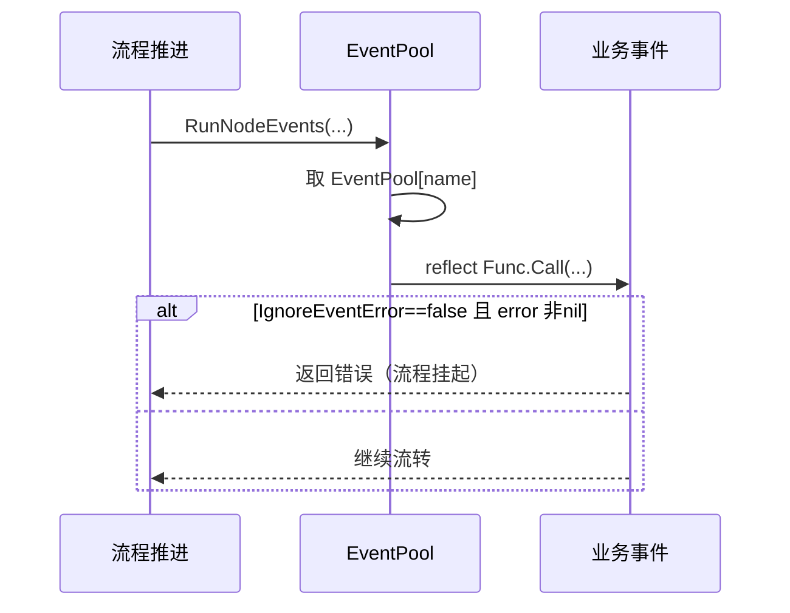
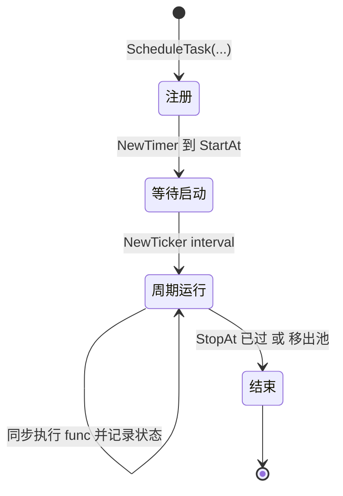

# 事件与计划任务：反射挂载的扩展机制

本篇深入 easy-workflow 的扩展机制——事件（Event）与计划任务（ScheduleTask）。它们是引擎把「不可预知的业务行为」留白给使用者的两个钩子：事件在内（审批过程回调），计划任务在外（定时执行自定义动作）。

## 事件系统：方法名即事件名

事件池用「方法名 → (struct, Method)」的 map 存储 [workflow/engine/ProcessEvent.go:9-9]()：
<!-- snippet: type method struct { -->

```go
type method struct {
	S interface{}    //method所在的struct，这是函数执行的第一个参数
	M reflect.Method //方法
}
var EventPool = make(map[string]method)
```

注册时用 `reflect` 遍历 struct 的全部方法，**方法名就是事件名**，直接进池 [workflow/engine/ProcessEvent.go:22-31]()。其中关键三行即「按方法名取到 reflect.Method 再写入 EventPool」[workflow/engine/ProcessEvent.go:27-29]()：
<!-- snippet: func RegisterEvents(Struct any) {
	StructValue := reflect.ValueOf(Struct)
	StructType := StructValue.Type()

	for i := 0; i < StructType.NumMethod(); i++ {
		m := StructType.Method(i)
		var method = method{Struct, m}
		EventPool[m.Name] = method
	}
} -->
<!-- snippet: 		m := StructType.Method(i)
		var method = method{Struct, m}
		EventPool[m.Name] = method -->

```go
for i := 0; i < StructType.NumMethod(); i++ {
	m := StructType.Method(i)
	var method = method{Struct, m}
	EventPool[m.Name] = method
}
```

这种「方法名即事件」的反射挂载极简：业务无需实现接口、无需逐个注册回调，只要往 `StartWorkFlow(..., &MyEvent{})` 塞一个 struct 指针即可。代价是**注册期不做签名校验**——此刻不知道方法是节点事件还是流程事件，校验被推迟到流程真正运行时由 `VerifyEvents` 兜底 [workflow/engine/ProcessEvent.go:85-85]()。
<!-- snippet: func VerifyEvents(ProcessID int, Nodes ProcNodes) error { -->

### 四类事件的两套签名

事件被分为「节点事件」（`RunNodeEvents`）与「流程事件」（`RunProcEvents`）两类，各有专属签名：

| 事件 | 签名（反射校验） | 触发时机 |
|------|-----------------|----------|
| 节点开始 | `func(*struct, int, *Node, Node) error` | 进入节点时 [workflow/engine/ProcessNode.go:14-14]() |
| 节点结束 | 同上 | 节点内所有任务完成、推进前 [workflow/engine/ProcessTask.go:237-237]() |
| 任务结束 | `func(*struct, int, *Node, Node) error` | 每个任务提交后 [workflow/engine/ProcessTask.go:204-204]() |
| 流程撤销 | `func(*struct, int, string) error` | 撤销时 [workflow/engine/ProcessInstance.go:170-170]() |

节点事件的 `int` 是 ProcessInstanceID、`*Node` 是当前节点、`Node` 是上一节点；任务结束事件的 `int` 是 TaskID。`verifyNodeEventParameters` / `verifyProcEventParameters` 用反射逐一核对参数个数、类型、返回值是否 `error` [workflow/engine/ProcessEvent.go:35-35]()。
<!-- snippet: func verifyProcEventParameters(m reflect.Method) error { -->

调用侧的关键点是**前三个参数如何拼** [workflow/engine/ProcessEvent.go:139-139]()：`reflect.ValueOf(event.S)` 把 struct 指针作为第一个参数塞进 `Func.Call`，于是事件方法天然拿到接收者，业务回调就像普通方法一样写。执行后根据 `IgnoreEventError` 决定是否把非 nil 的 error 冒泡 [workflow/engine/ProcessEvent.go:150-150]()——事件出错默认会挡住流程继续，这是「事件可能改变流程行为」语境下的默认安全策略。
<!-- snippet: 		arg := []reflect.Value{ -->
<!-- snippet: 		if IgnoreEventError == false { -->



## 容错策略：IgnoreEventError

是否忽略事件错误可全局开关。作者在 README 里说明：**事件出错可能导致流程无法运行，设为 true 则忽略事件出错让流程继续** [README.md:88-88]()。这是一个「用全局开关换简单」的取舍——没有按事件粒度的容错配置，但换来启动参数极简。事件池与开关都在 `StartWorkFlow` 时装载 [workflow/engine/Launcher.go:29-30]()。
<!-- snippet: ignoreEventError：在事件执行时，是否忽略其报错。事件出错可能导致流程无法运行,此选项设置为true，则忽略事件出错，让流程继续 -->
<!-- snippet: 	//是否忽略事件错误
	IgnoreEventError = ignoreEventError -->

## 计划任务：内存任务池 + Timer/Ticker

计划任务是独立于流程的定时执行机制，用内存 map 存任务运行状态 [workflow/engine/ScheduleTask.go:11-11]()：
<!-- snippet: var ScheduledTaskPool = make(map[string]*ScheduledTask) -->

```go
type ScheduledTask struct {
	StartAt        time.Time
	StopAt         time.Time
	IntervalSecond int64
	Func           func() error
	LastRunTime    time.Time
	LastResult     string
	LastDuration   time.Duration
}
```

注册时先校验「未重复登记 / StopAt 未过 / 间隔≥1 秒 / 起止顺序」，通过则入池并启动 [workflow/engine/ScheduleTask.go:37-37]()。运行循环先 `time.NewTimer` 等到 StartAt，再用 `time.NewTicker` 按间隔周期触发 [workflow/engine/ScheduleTask.go:100-100]()；每轮检查任务是否还在池中、是否已过 StopAt，触发时同步执行 `task.Func()` [workflow/engine/ScheduleTask.go:136-136]()。
<!-- snippet: func ScheduleTask(TaskName string, StartAt time.Time, StopAt time.Time, IntervalSecond int64, Func func() error) error { -->
<!-- snippet: 	timer := time.NewTimer(waitDuration) -->
<!-- snippet: 		//运行任务 这里不再使用协程。 -->

> **刻意不用 goroutine 串行执行**：注释解释了原因——若任务间隔 2 秒但上次运行耗时 10 秒，再用协程会前一个没结束后一个又启动，造成不可控的性能消耗与竞争 [workflow/engine/ScheduleTask.go:137-137]()。
<!-- snippet: 	//考虑一个情况:任务间隔2秒，但是A协程运行时间长达10秒，2秒后B又开始跑，这样前面还没结束后面就开始，会造成大量的性能消耗与不可控情况 -->



## 与「事件」的协作示例

README 用示例展示了事件与计划任务的组合用例：节点开始事件解析角色、任务完成事件改变会签行为（把 3 人全通过改成 2 人通过）、计划任务让特定用户的任务自动完成 [README.md:39-39]()。这印证了引擎的设计取向——**事件用于改变「谁能审/怎么审」，计划任务用于改变「何时审/是否自动审」**，两者共同把审批调度权交回业务。
<!-- snippet: 在示例代码中，使用任务完成事件改变了会签节点的行为，使原本需要3人全部通过的节点变成只要2人通过。 -->
