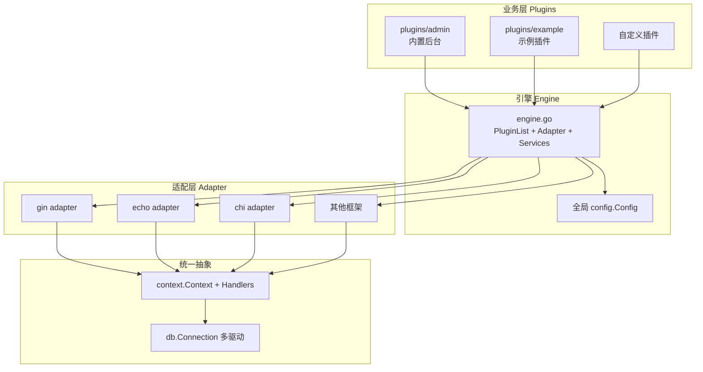
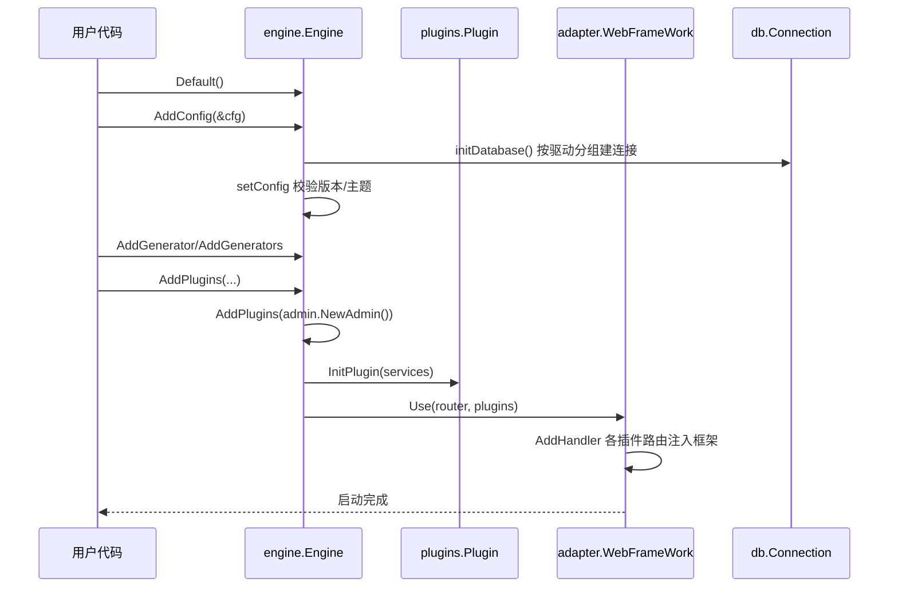

# GoAdmin — 面向 Go 生态的数据管理后台生成框架

> 项目地址：[GoAdminGroup/go-admin](https://github.com/GoAdminGroup/go-admin) | 协议：Apache-2.0 | 语言：Go 1.22+

> 全局概览见本页；分关注面深读：[`architecture.md`](architecture.md)（多框架适配器）· [`table-model.md`](table-model.md)（声明式 CRUD）· [`auth-rbac.md`](auth-rbac.md)（认证与权限）· [`data-model.md`](data-model.md)（数据模型与 RBAC 表设计）。

## 子文档索引

- [`architecture.md`](architecture.md) — 多 Web 框架适配器机制与统一 Context 抽象
- [`table-model.md`](table-model.md) — 声明式 table model：一套配置生成完整 CRUD 的核心理念
- [`auth-rbac.md`](auth-rbac.md) — Cookie/Session 认证 + URL+Method 级 RBAC 权限模型
- [`data-model.md`](data-model.md) — `goadmin_*` 系统表设计、多库方言迁移与读写路径

## 第一部分：快速概览

### 是什么

GoAdmin 是一个**面向 Go 生态的数据管理后台（Admin Panel）生成工具**。官方定位原话是："the missing golang data admin panel builder tool" 即"Go 生态缺失的那个数据后台面板构建器"。它借鉴 PHP 世界成熟的 `laravel-admin` 模式（README 明确标注 Inspired by [laravel-admin](https://github.com/z-song/laravel-admin)），让开发者免手写管理后台的增删改查、表单、权限，而通过**声明式地描述一张业务表**来自动生成完整后台。

### 解决什么根本问题

在 PHP / Python（Laravel、Django）生态里，"声明一张表 → 自动生成可视化后台"已是成熟范式，但 **Go 生态一直缺少等价物**。开发者临时搭一个后台往往要重复劳动：

- 每个业务表都要手写增删改查的 Handler + 路由 + 模板 + 权限控制，样板代码膨胀
- 后台前端（表格、表单、图表、弹窗）与后端强耦合，难以换 Web 框架
- 无开箱即用的 RBAC 权限系统，安全体系要自己搭

GoAdmin 把这一整套**抽象成"声明式 table model + 插件 + Web 框架适配器"**三层，让"十分钟产出一个可用后台"成为可能，同时不绑架你已选定的 Web 框架。

### 适用场景

- 需要一个快速、内部可用的数据管理后台，不想手写 CRUD
- 已有的 Go 服务（gin / echo / chi / iris / beego / fiber 等）想挂一个管理面板而不重写路由层
- 需要开箱即用的 RBAC 权限后台（用户 / 角色 / 权限 / 菜单）
- 想要插件化组织多个独立后台模块（如 admin + 业务插件）

### 核心能力清单

| 能力 | 说明 |
|------|------|
| **声明式 Table 模型** | 用链式 API 描述一个表的列表/表单/详情/新增，自动生成增删改查与页面 |
| **15 种 Web 框架适配器** | gin / echo / chi / iris / beego / fiber / gorilla / nethttp / gf / gf2 / buffalo / fasthttp / gear 等，切换底层框架不改业务代码 |
| **开箱即用 RBAC** | 用户 - 角色 - 权限 - 菜单四级模型，URL+Method 级细粒度权限校验 |
| **可视化后台 UI** | 内置 adminlte、sword 主题，表格 / 图表 / 表单 / 弹窗组件化 |
| **插件系统** | 可插拔的业务模块，支持 Go `plugin` 动态加载与在线插件市场 |
| **多数据库支持** | MySQL / PostgreSQL / SQLite / MSSQL / OceanBase，统一 `db.Connection` 抽象 |
| **字段级自定义** | 每个字段可配置排序、筛选、编辑控件、显示格式化、权限可见性 |
| **配置多格式** | 支持 JSON / YAML / INI 三种格式读配置 |

### 技术栈一览

| 层级 | 技术 |
|------|------|
| 语言 | Go 1.22+（module `github.com/GoAdminGroup/go-admin`） |
| 数据库驱动 | mysql / postgresql / sqlite / mssql / oceanbase（`database/sql` 之上自封装） |
| Web 框架（自身） | 不绑定任何框架，通过 `adapter` 适配 gin/echo/chi/iris 等 |
| 认证 | Cookie Session（存 `goadmin_session` 表）+ bcrypt 密码哈希 |
| 权限 | URL + HTTP Method 匹配规则（正则 + 参数校验），非 Casbin |
| 前端 | 服务端渲染 + 组件化模板（adminlte / sword 主题，Chart.js） |
| 配置 | 全局 `config.Config`，支持 JSON / YAML / INI |

## 第二部分：架构深读

### 架构总览

```
┌──────────────────────────────────────────────────────────────┐
│                       业务层（插件 Plugin）                      │
│  plugins/admin（内置后台）   plugins/example   [用户自定义插件]    │
│  每个插件：Router + Controller + Table Generator             │
└───────────────┬──────────────────────────────────────────────┘
                │  plugins.Plugin 接口：GetHandler/InitPlugin/...
┌───────────────▼──────────────────────────────────────────────┐
│                       引擎 Engine（engine.go）                 │
│  PluginList + Adapter + Services + config                    │
│  Use()：初始化插件 → 注入路由 → 启动                          │
└───────────────┬──────────────────────────────────────────────┘
                │  adapter.WebFrameWork 接口：Use/Content/AddHandler
┌───────────────▼──────────────────────────────────────────────┐
│                    适配层 Adapter（多框架）                     │
│  gin/echo/chi/iris/beego/... 各自实现，通过空导入 init() 注册    │
└───────────────┬──────────────────────────────────────────────┘
                │  context.Handlers ←→ 框架路由/中间件
┌───────────────▼──────────────────────────────────────────────┐
│                   Web 框架（用户选定）：gin / echo / ...        │
└───────────────┬──────────────────────────────────────────────┘
                ▼
        Database（db.Connection 多驱动抽象）
```

对应 Mermaid：



### 启动流程

核心链路是 `engine.Default()` → 配置 → 注册生成器/插件 → `Use(router)` 注入框架，逐阶段可见于 `engine/engine.go`：

1. `engine.Default()` 创建默认 Engine 实例（`engine/engine.go:57-64`）
2. `engine.AddConfig(&cfg)` → `setConfig` 校验版本与主题兼容 → `initDatabase` 按驱动分组初始化连接（`engine/engine.go:140-190`）
3. `AddGenerator / AddGenerators` 注册声明式表格生成器（`engine/engine.go:702-738`）
4. `AddPlugins` 收拢插件（`engine/engine.go:83-94`）
5. `Use(r)` 依次执行 `initSiteSetting` → `initJumpNavButtons` → `initPlugins` 后交给 `Adapter.Use` 注入路由（`engine/engine.go:67-79`）



### 模块职责映射

| 目录 | 职责 |
|------|------|
| `engine/` | 引擎：组装 Adapter、插件、服务，编排初始化流程 |
| `adapter/` | 各 Web 框架的适配器实现（gin/echo/chi/iris…），核心抽象见 [`architecture.md`](architecture.md) |
| `context/` | 框架无关的请求上下文与路由树（含 `trie.go` 路由前缀树） |
| `plugins/` | 插件体系：`admin`（内置后台）、`example`，`plugins.go` 定义 Plugin 接口与注册表 |
| `plugins/admin/models/` | `goadmin_*` 系统表的 Go 模型（user/role/permission/menu/…），见 [`data-model.md`](data-model.md) |
| `plugins/admin/modules/table/` | 声明式 Table 模型与 CRUD 默认实现，见 [`table-model.md`](table-model.md) |
| `modules/auth/` | 认证中间件、Session、权限校验，见 [`auth-rbac.md`](auth-rbac.md) |
| `modules/db/` | `Connection` 接口与 mysql/postgres/sqlite/mssql/oceanbase 驱动 |
| `modules/config/` | 全局配置（多格式读取） |
| `modules/menu/`、`modules/ui/` | 菜单与导航 UI 状态 |
| `template/` | 可视化组件模板（表格、表单、图表、弹窗）与图标、颜色 |
| `data/migrations/` | 按数据库方言分文件的 SQL 建表/迁移脚本 |

## 第三部分：核心模块导读

| 关注面 | 定位 | 子文档 |
|------|------|------|
| 多框架适配 | 解耦 Web 框架，15 种适配器的统一抽象与路由注入 | [`architecture.md`](architecture.md) |
| 声明式 CRUD | 一张表一份 Generator，自动生成列表/表单/详情/增删改查 | [`table-model.md`](table-model.md) |
| 认证与权限 | Cookie/Session 认证、URL+Method 级 RBAC、超管与权限校验 | [`auth-rbac.md`](auth-rbac.md) |
| 数据模型 | `goadmin_*` 系统表关系、多库方言迁移、读写路径 | [`data-model.md`](data-model.md) |

## 第四部分：设计亮点

- **适配器解耦是把"框架"与"后台"彻底分离**：`WebFrameWork` 接口只要求 5 个方法（Name/Use/Content/User/AddHandler），其余靠 `BaseAdapter` 提供可复用骨架（`adapter/adapter.go:31-75`、`77-131`）；每个框架仅需极薄实现，且通过空导入 `init()` 自动注册（如 gin 适配器 `adapter/gin/gin.go` 的 `engine.Register(new(Gin))`），用户只需 blank import 一行即可启用对应框架。
- **统一 Handler 管道**：`context.Handlers` 作为一次请求的处理器链，适配器负责把框架上下文转进 `context.Context` 再执行链（`adapter/gin/gin.go` 的 `AddHandler` 手动拼 URL 参数）。这让认证、日志、响应等中间件逻辑与框架无关。
- **可定制的认证失败回调**：`auth.Invoker` 把"认证失败"和"权限拒绝"做成可替换的 `MiddlewareCallback`，默认实现区分 Pjax/普通 GET 返回不同的 302/403 页面（`modules/auth/middleware.go:39-101`），扩展点清晰。
- **权限即 URL+Method 字符串匹配**：不引入 Casbin，用户权限用 `HttpPath`（支持正则）+ `HttpMethod` + 可校验的 query 参数表达，规则复用模板变量（`{{.AuthId}}`）（`plugins/admin/models/user.go:117-184`），对"后台管理"这类场景足够且简单。

## 第五部分：不足与风险

- **无内置自动迁移**：`data/migrations/` 的 SQL 靠人工手动执行，缺自动化迁移层；用户升级需自行对齐不同数据库方言的 DDL。
- **鉴权模型非标准化**：自定义的 URL 匹配式权限与 Casbin/OPA 等通用模型不互通，深挖复杂授权（如资源级）需自行扩展。
- **大量代码为历史多框架兼容服务**：`go.mod` 同时依赖十余个 Web 框架包，适配器与 `context` 部分代码较厚，维护成本高，对只用单一框架的用户是"额外复杂度"。
- **UI 为服务端渲染模板**：与现代化前后端分离（React/Vue + API）不同，定制化前端体验的灵活性有限。

## 第六部分：可借鉴的设计

- **空导入 + init() 自动注册扩展**：用 `_ "adapter/gin"` 触发适配器注册，避免用户在代码里手写注册表——这是 Go 生态优雅的插件接入惯用法，可迁移到任何"可扩展接入点"。
- **声明式配置驱动 UI 生成**：用一份"字段配置链"（类型 + 排序 + 编辑控件 + 显示函数）声明一张表的完整后台行为，UI 层消费同一份声明自动渲染——把"重复 CRUD"变成"声明 + 复用"。
- **回调式中间件扩展点**：认证失败 / 权限拒绝暴露为可替换回调，框架给默认实现但允许覆盖，比硬编码分支更好维护。
- **统一请求上下文抽象**：`context.Context + Handlers` 屏蔽具体框架差异，让核心逻辑（鉴权、日志、响应）与框架解耦，天然可测。

## 总结

GoAdmin 的根因是填补 **Go 生态缺失的数据后台生成器**，借鉴 laravel-admin 的声明式思路，用「table model 声明 + 插件 + 多框架适配器」三件套交付。它把后台最常见的重复劳动（CRUD、表单、RBAC、菜单）抽象成可配置资产，并以框架无感的方式挂接到任意主流 Go Web 框架上——对"快速要一个体面、安全的管理后台"的场景，这是相当直接的答案；代价则是多框架兼容带来的实现厚度与欠自动化的数据演进。

## 项目规模

| 指标 | 数值 |
|------|------|
| 版本 | v1.2.27（`modules/system/version.go:3`） |
| Go 源文件 | ~295 个 |
| Go 代码行 | ~4.9 万行 |
| 测试文件 | ~43 个 |
| 数据库驱动 | MySQL / PostgreSQL / SQLite / MSSQL / OceanBase |
| Web 框架适配 | 15 种 |
