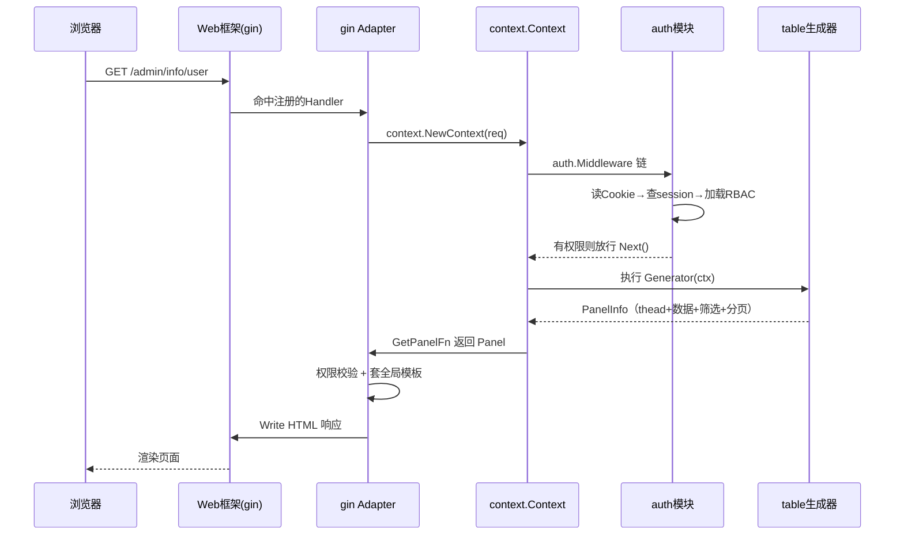

# GoAdmin 架构深读 — 多 Web 框架适配器机制

> 本篇解读 go-admin 最核心的架构决策：**如何让一套后台逻辑无感运行在 15 种主流 Go Web 框架之上**。代码引用基于仓库 `github.com/GoAdminGroup/go-admin` v1.2.27。

## 为什么需要适配器层

go-admin 的定位是"挂在任意 Go Web 框架上的后台"。如果它把路由、上下文、响应绑定到某个具体框架（哪怕是当时最流行的 gin），用户就得为了接一个后台而重写路由体系或用不上的框架。这是 Laravel 这类单框架生态不会遇到的问题（PHP 生态框架统一），但对百花齐放的 Go 生态却是**接入的第一道门槛**。

GoAdmin 的选择：定义一套**框架无关的内置上下文与处理器管道**，再用"适配器"作为框架与该内部抽象的桥。核心权衡是——用一定的适配层厚度换来了"底层框架可随时更换、业务插件完全不感知框架存在"。

## 三要素：插件、引擎、适配器

`plugins/plugins.go:42-54` 的 `Plugin` 接口约束了"一个后台模块长什么样"（提供路由、初始化、表格生成器、元信息），`engine.Engine` 把它们组装起来（`engine/engine.go:47-54` 的 `PluginList` + `Adapter` + `Services`），而 `adapter.WebFrameWork` 接口负责把插件的路由和处理函数注入具体框架。

三者关系：**插件提供路由和处理器 → 引擎持有插件列表 → 适配器把插件路由写入框架路由表**。对应地，`adapter.go:31-75` 的 `WebFrameWork` 接口只要求 5 个核心方法：

- `Name()` — 标识框架
- `Use(app, plugins)` — 把插件批量注入框架引擎
- `Content(ctx, getPanelFn)` — 把一个面板渲染成框架响应
- `User(ctx)` — 从框架上下文拿当前登录用户
- `AddHandler(method, path, handlers)` — 注入单条路由及处理器链

这 5 个方法恰好覆盖了"后台接入一个框架"的全部边界点：**装路由、产响应、取用户、挂页面**。

## BaseAdapter 复用骨架

接口只定义方法，可复用的实现被抽到 `BaseAdapter`（`adapter/adapter.go:77-131`），这样每个框架的适配器只需写"框架特有"的部分。关键复用点：

- `GetUse` — 遍历插件列表，把 `plug.GetHandler()` 里的每条路由按前缀注入框架（`adapter/adapter.go:115-131`）
- `GetContent` — 完整的"面板响应"模板：取 Cookie → 鉴权 → 权限校验 → 执行面板生成回调 → 渲染模板 → 写入响应（`adapter/adapter.go:138-195`）。权限拒绝时渲染 `403` 页，否则执行 `getPanelFn` 并套用全局模板
- `GetUser` — 从 Cookie 解出用户模型（`adapter/adapter.go:103-112`）

框架适配器嵌入 `BaseAdapter` 即获得全套通用逻辑，只需实现协议差异，例如把"框架的 request 转成 GoAdmin 的 context"。

## 一种框架适配器长什么样（以 gin 为例）

命令 `adapter/gin/gin.go` 展示了最小实现的形态：

- **结构体** `Gin` 内嵌 `adapter.BaseAdapter` 并持有一个 `*gin.Engine`
- **自动注册** `init()` 调用 `engine.Register(new(Gin))`——用户只要 **blank import** `_ "github.com/GoAdminGroup/go-admin/adapter/gin"` 就完成了框架绑定，无需手写任何注册代码
- **Use** 直接委托给 `GetUse`，委托注入逻辑
- **AddHandler** 是真正的"桥"：把 GoAdmin 的 `context.Handlers` 转成 gin 中间件闭包，`context.NewContext(c.Request)` 创建内部上下文，再手动把 gin 的路径参数拼进 `RawQuery` 以喂给 GoAdmin 的参数解析

这种"薄适配"意味着**新增一种框架只需写一个文件**，且完全不影响插件和引擎的代码。

## 内部统一上下文 context

`context/context.go` 是适配器与业务之间的"通用语言"。业务代码只见这套抽象，不见具体框架对象。前端框架差异被压缩在适配器层，插件开发者无需关心底层是 gin 还是 echo，这正是解耦的直接收益。

`context/trie.go` 提供一个前缀树（Trie）用于快速路由匹配，是适配器把路由登记为"方法 + 路径 → 处理器链"的底层索引结构。

## 基于适配器的一次请求时序

以"用户访问某列表页"为例，完整链路跨适配器、上下文、认证、表格生成器：

关键点：页面内容由 `table.Generator` 声明式产出（见 [`table-model.md`](table-model.md)），适配器只负责把它变成 HTTP 响应——**业务装配在引擎+插件，框架差异收口在适配器**。

## 设计权衡

| 维度 | 权衡 |
|------|------|
| 框架耦合 | 低：业务与插件零耦合框架，切换框架只改 blank import |
| 实现成本 | 中：需维护 15 个适配器 + 统一上下文，代码随框架数量线性增长 |
| 性能 | 中：多一层上下文转换与手动参数拼装，但对后台场景可忽略 |
| 可维护性 | 中：接口极简（5 方法），新增框架成本低，但框架版本升级需逐个适配 |
| 生态兼容 | 高：gin/echo/chi/iris/beego/fiber/nethttp/gf/buffalo/fasthttp/gear 全覆盖 |

## 可借鉴点

- **用空导入 + init() 完成扩展自动注册**，消除显式注册样板，是 Go 插入式扩展的规范做法
- **接口只留"最小必要方法"，通用实现下沉到底座（BaseAdapter）**，让每种扩展只需写差异部分
- **定义框架无关的内部 Request/Handler 抽象**，让核心鉴权与响应逻辑天然可测、可复用

## 相关引用

- 接口定义：`adapter/adapter.go:31-75`
- 可复用骨架：`adapter/adapter.go:77-131`
- 路由注入：`adapter/adapter.go:115-131`
- 面板响应模板：`adapter/adapter.go:138-195`
- gin 适配器实现：`adapter/gin/gin.go`（`Gin` 结构体、`init()` 注册、`AddHandler`）
- 引擎组装：`engine/engine.go:47-79`
