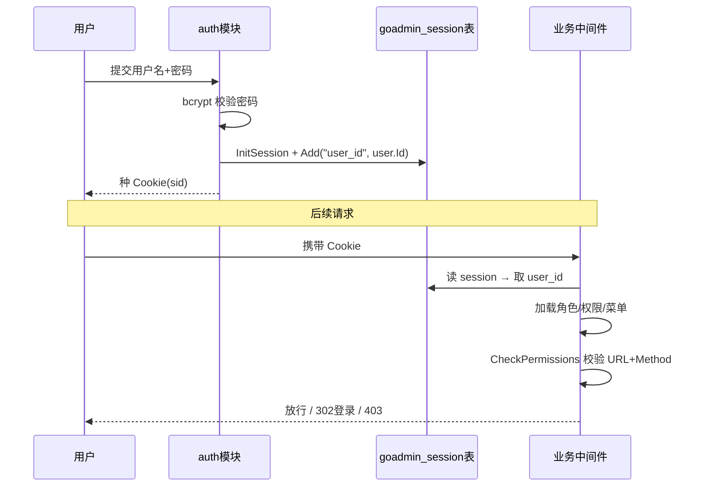
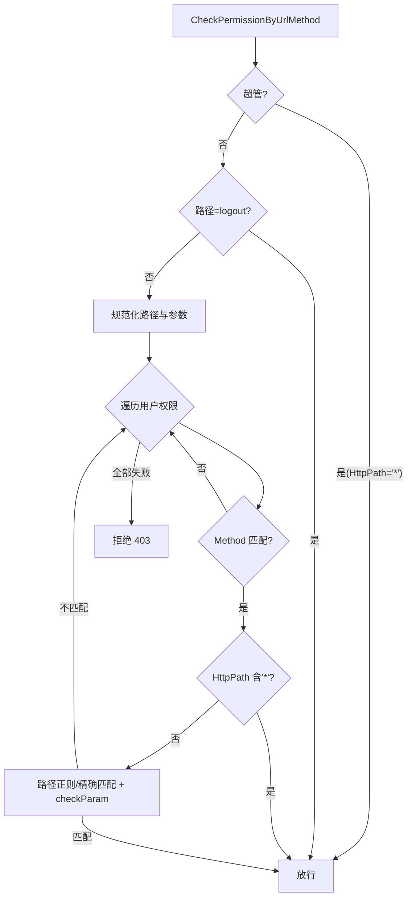

# GoAdmin 认证与权限 — Cookie/Session 认证 + URL+Method 级 RBAC

> 本篇解读 go-admin 的认证与会话、权限模型与请求级鉴权链路。数据表设计见 [`data-model.md`](data-model.md)。代码引用基于仓库 `github.com/GoAdminGroup/go-admin` v1.2.27。

## 认证方式选型

go-admin 采用 **Cookie（Session ID）+ 服务端 Session** 的传统 Web 后台认证，而非 JWT/Token 无状态方案。这是刻意的取舍：

- **场景匹配**：管理后台是浏览器直连的会话式应用，天然适合 Cookie+Session，能支持服务端注销、会话作废等管控
- **存储**：Session 与 CSRF Token 都落在 `goadmin_session` 表（`modules/auth/session.go`），而非内存或独立缓存——对"单机后台"足够，且能跨实例共享（多副本部署时无需 redis）
- **密码**：bcrypt 加盐哈希（`modules/auth/auth.go:46-58`），登录校验用 `bcrypt.CompareHashAndPassword`，成本参数 `bcrypt.DefaultCost`，安全基线合理

## 登录与 Session 流程

登录成功把 `user_id` 写入 Session（Cookie），之后每次请求通过中间件恢复用户：

实现要点：

- `auth.Check` 完成密码校验并加载用户关联数据（`modules/auth/auth.go:28-44`）
- `auth.SetCookie` / `DelCookie` 封装 session 写入/清除（`modules/auth/auth.go:61-80`）
- `auth.Middleware`（`modules/auth/middleware.go:34-36` 回到 `Invoker.Middleware`，`middleware.go:126-149`）是核心鉴权入口：`Filter` 从 session 取 id → 查用户 → 校验权限，任一失败走独立回调

## 可定制的中间件 Invoker

`auth.Invoker`（`modules/auth/middleware.go:26-31`）把"鉴权失败"和"权限拒绝"两个行为做成**可替换回调**（`MiddlewareCallback`），默认实现差异化响应：

- 认证失败：Pjax 请求或非 GET 返回 302 跳登录，否则内联注入一段 `swal` 弹窗脚本提示"登录过期"再跳转（`middleware.go:61-85`）
- 权限拒绝：非 GET 返回 403 JSON，Pjax/GET 渲染 `403` 页面（`middleware.go:87-98`）

这套回调式扩展点，让用户不用改框架就能定制"无权限时怎么反馈"，是本项目值得借鉴的中间件扩展模式。

## RBAC 权限模型

权限不是表级的粗粒度，而是 **URL 路径 + HTTP Method 的字符串规则**：

- Model：`PermissionModel` 的 `HttpMethod []string`（逗号分隔）与 `HttpPath []string`（换行分隔一条权限可含多个路径）（`plugins/admin/models/permission.go:14-20`）
- 角色通过中间表关联权限与菜单（`goadmin_role_permissions`、`goadmin_role_menu`），用户通过 `goadmin_role_users` 关联角色，另有 `goadmin_user_permissions` 直接给用户挂权限
- 校验核心 `UserModel.CheckPermissionByUrlMethod(path, method, formParams)`（`plugins/admin/models/user.go:117-184`）：

校验特性：

- **超管放行**：任一权限 `HttpPath[0]=="*"` 即视为超级管理员（`user.go:85-92`、`121-123`）
- **模板变量参数**：路径与 query 参数支持 `{{.AuthId}}`/`{{.AuthName}}` 占位符替换（`user.go:109-115`、`Template`），实现"只能看/改自己的数据"这类资源隔离
- **正则匹配**：`HttpPath` 条目先精确匹配，再尝试作为正则（`user.go:167-178`）
- **参数校验**：`checkParam` 核对请求 query 与规则定义的参数是否一致，实现"URL 对但参数不对则拒绝"（`user.go:195-222`）

## 数据加载时机

`Filter` 每次请求都会 `GetCurUserByID` → `WithRoles().WithPermissions().WithMenus()`（`modules/auth/middleware.go:212-232`、`plugins/admin/models/user.go:244-358`），后者通过 LeftJoin 中间表一次性把用户的角色、权限、可见菜单查出来填充到 UserModel。这是"每次请求拉全套 RBAC 数据"的简单模型——对它面向的后台规模足够，但高频请求有 N+`多 join` 开销，属可接受取舍。

## 与通用权限模型的对比

| 维度 | go-admin 自定义 RBAC | Casbin/OPA |
|------|--------------------|-----------|
| 模型复杂度 | 低：URL+Method 字符串规则 | 中高：策略/效果/对象通用模型 |
| 适用面 | 后台页面/接口的粗粒度 URL 权限 | 任意资源与动作的强表达 |
| 学习成本 | 低 | 高 |
| 细粒度资源级 | 靠 {{.AuthId}} 模板变量 | 原生支持 |

对"数据管理后台"这一垂直场景，go-admin 的选择在**简单够用**与**不引入重型依赖**之间取了平衡；若需要通用、可审计的策略引擎，则需自接 Casbin 等。

## 相关引用

- 密码哈希 / 校验：`modules/auth/auth.go:28-58`
- Session Cookie：`modules/auth/auth.go:61-80`
- Token/CSRF 服务（存 `goadmin_session` 表）：`modules/auth/auth.go:92-170`
- 鉴权中间件入口：`modules/auth/middleware.go:126-149`
- Invoker 与失败回调：`modules/auth/middleware.go:26-101`
- Filter 数据加载：`modules/auth/middleware.go:153-178`、`212-232`
- 权限模型结构：`plugins/admin/models/permission.go:11-21`
- 权限校验核心：`plugins/admin/models/user.go:117-184`
- RBAC 数据加载：`plugins/admin/models/user.go:244-358`
