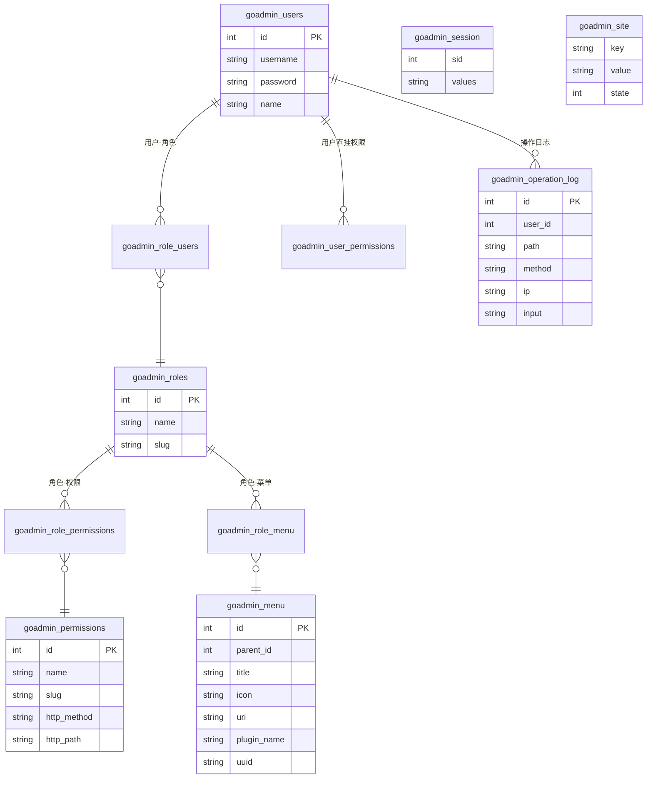
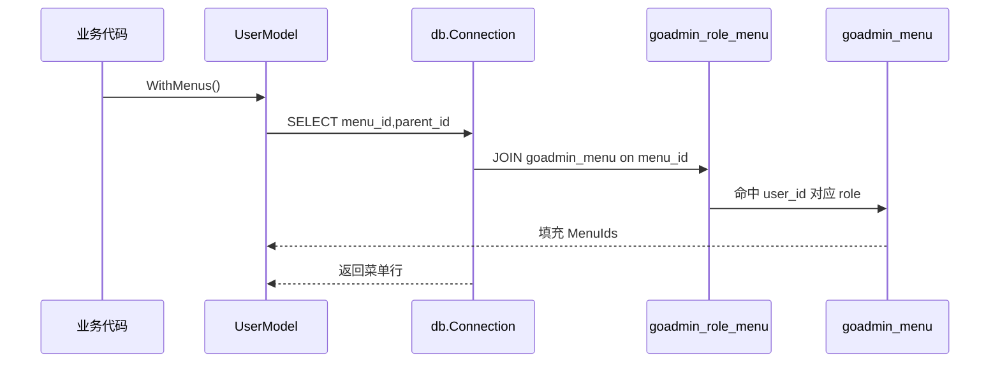
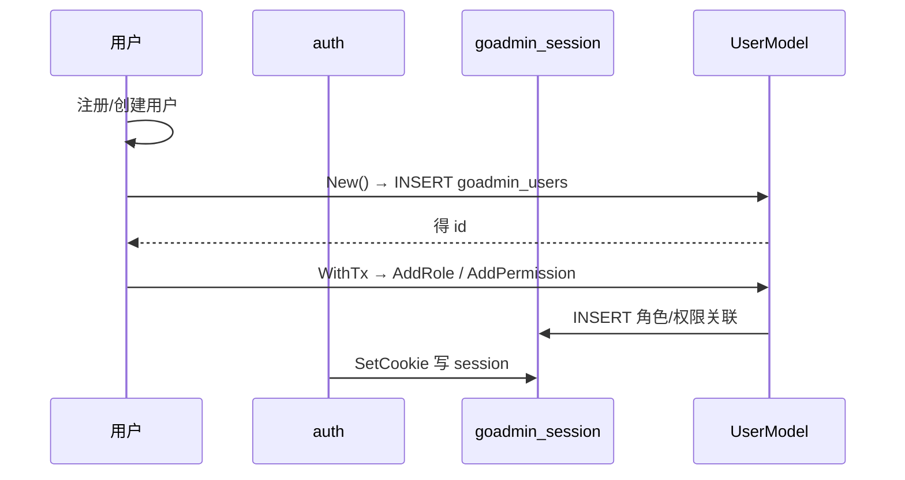

# GoAdmin 数据模型 — goadmin_* 系统表设计与多库方言演进

> 本篇覆盖 go-admin 自身 `goadmin_*` 系统表：存储选型、表关系、核心表字段、Schema 演进与读写路径。权限字段的消费逻辑见 [`auth-rbac.md`](auth-rbac.md)。代码引用基于仓库 `github.com/GoAdminGroup/go-admin` v1.2.27。

## 存储选型与理由

go-admin 作为**库/框架**而非独立部署的应用，对存储的核心诉求是"与用户的业务库共存、让用户自己掌控"。因此它：

- **不做持久化引擎**：不内嵌 SQLite 之外的任何引擎，而是抽象 `db.Connection` 接口（`modules/db/connection.go:30-60`），用 `database/sql` 原生驱动适配 MySQL / PostgreSQL / SQLite / MSSQL / OceanBase。选型理由：后台系统的数据天然是关系型、有强 FK-语义需求和 SQL 事务能力，关系库是默认正确的选择；而"接口抽象 + 多驱动"换来的是**跟随用户现有数据库，而不是再引入一套存储**。
- **系统表固定前缀 `goadmin_`**：与用户业务表命名空间隔离，避免冲突、便于识别与运维。
- **控制权交给用户**：建表脚本作为**资产**交付，而非框架运行时自动 DDL（详见「Schema 演进策略」）。

## 实体关系总览

从官方建表脚本 `plugins/admin/data/mysql/admin.sql` 与迁移脚本 `data/migrations/` 可归纳出系统表的实体关系。注意：**这些表不使用数据库外键**（脚本用 `FOREIGN_KEY_CHECKS=0` 约束关闭），所有关联靠**中间表 + 应用层 JOIN** 表达：

核心关联语义：

- **用户 ↔ 角色**：多对多经 `goadmin_role_users`
- **角色 ↔ 权限**：多对多经 `goadmin_role_permissions`；角色 ↔ 菜单经 `goadmin_role_menu`
- **用户 ↔ 权限**：除经角色间接获得外，还可经 `goadmin_user_permissions` 直挂（权限取并集）
- **Session / Site**：键值对表（K-V），存会话与站点配置

## 核心表设计

每张表的能力沉淀为字段表（来源 `plugins/admin/data/mysql/admin.sql`，并核对 models 实体 `plugins/admin/models/`）。

### goadmin_users — 用户主表

| 字段 | 类型 | 约束 | 说明 |
|------|------|------|------|
| id | int unsigned | PK, AUTO_INCREMENT | 主键 |
| username | varchar(190) | UNIQUE, NOT NULL | 登录名，唯一 |
| password | varchar(80) | NOT NULL | bcrypt 哈希串 |
| name | varchar(255) | NOT NULL | 显示名 |
| avatar | varchar(255) | 可空 | 头像地址 |
| remember_token | varchar(100) | 可空 | 「记住我」令牌 |
| created_at / updated_at | timestamp | 默认 CURRENT_TIMESTAMP | 时间戳 |

来源：`plugins/admin/data/mysql/admin.sql:260-271`；实体：`plugins/admin/models/user.go:20-39`

### goadmin_roles — 角色

| 字段 | 类型 | 约束 | 说明 |
|------|------|------|------|
| id | int unsigned | PK, AUTO_INCREMENT | 主键 |
| name | varchar(50) | UNIQUE, NOT NULL | 显示名，唯一 |
| slug | varchar(50) | NOT NULL | 机器标识，校验时比对 |

来源：`plugins/admin/data/mysql/admin.sql:192-200`；实体：`plugins/admin/models/role.go`

### goadmin_permissions — 权限（URL+Method 规则）

| 字段 | 类型 | 约束 | 说明 |
|------|------|------|------|
| id | int unsigned | PK, AUTO_INCREMENT | 主键 |
| name | varchar(50) | UNIQUE, NOT NULL | 权限名，唯一 |
| slug | varchar(50) | NOT NULL | 机器标识 |
| http_method | varchar(255) | 可空 | 逗号分隔的允许 HTTP 方法；空串=ALL |
| http_path | text | NOT NULL | 换行分隔的 URL 路径，支持正则 |

来源：`plugins/admin/data/mysql/admin.sql:84-94`；实体：`plugins/admin/models/permission.go:11-21`

### goadmin_menu — 后台菜单

| 字段 | 类型 | 约束 | 说明 |
|------|------|------|------|
| id | int unsigned | PK, AUTO_INCREMENT | 主键 |
| parent_id | int unsigned | NOT NULL(默认0) | 父菜单，0=根；自引用 |
| type | tinyint unsigned | 默认0 | 菜单类型 |
| order | int unsigned | 默认0 | 排序 |
| title | varchar(50) | NOT NULL | 标题 |
| icon | varchar(50) | NOT NULL | 图标类 |
| uri | varchar(50) | 默认'' | 跳转地址 |
| header | varchar(150) | 可空 | 分组头 |
| plugin_name | varchar(150) | 迁移新增, NOT NULL(默认'') | 归属插件 |
| uuid | varchar(150) | 迁移新增, NOT NULL(默认'') | 插件菜单唯一标识 |

来源：`plugins/admin/data/mysql/admin.sql:28-40`（基础）+ `data/migrations/admin_2020_08_04_092427_mysql.sql`（`plugin_name`/`uuid` 演进列）

### goadmin_session / goadmin_site — 键值存储

- `goadmin_session`：`sid`(varchar50) + `values`(varchar3000)，存会话与 CSRF token（来源 `admin.sql:219-226`）
- `goadmin_site`：`key` + `value` + `state` + `description`，存站点级键值配置（来源 `data/migrations/admin_2020_04_14_100427_mysql.sql`）

### 中间表

| 表 | 关联 | 关键约束 |
|----|------|---------|
| `goadmin_role_users` | user↔role | `(role_id,user_id)` UNIQUE |
| `goadmin_role_permissions` | role↔permission | `(role_id,permission_id)` UNIQUE |
| `goadmin_user_permissions` | user↔permission | `(user_id,permission_id)` UNIQUE |
| `goadmin_role_menu` | role↔menu | `(role_id,menu_id)` 联合索引 |

来源：`admin.sql:111-119`、`139-147`、`165-173`、`233-241`

### goadmin_operation_log — 操作审计

| 字段 | 类型 | 约束 | 说明 |
|------|------|------|------|
| id | int unsigned | PK, AUTO_INCREMENT | 主键 |
| user_id | int unsigned | NOT NULL + 索引 | 操作者 |
| path | varchar(255) | NOT NULL | 请求路径 |
| method | varchar(10) | NOT NULL | HTTP 方法 |
| ip | varchar(15) | NOT NULL | 来源 IP |
| input | text | NOT NULL | 提交参数快照 |
| created_at / updated_at | timestamp | 默认 | 时间戳 |

来源：`admin.sql:64-75`

## 不建外键的权衡

表关系全部用中间表 + 应用层 JOIN，而非数据库外键，这是**刻意**的：

- **去外键约束**（脚本 `SET FOREIGN_KEY_CHECKS=0`）换来更高的写入性能与解耦——尤其在 `goadmin_*` 与用户业务表可能分库、或需要批量导入/删改的场景下，不受引用完整性拖累
- **代价**：完整性靠应用层保证（如 `AddRole` 先 `CheckRoleId` 再插，`plugins/admin/models/user.go:415-442`），存在数据不一致的潜在风险，属"后台框架"可接受的取舍

## Schema 演进策略

**演进方式 = 用户手动执行的前置 SQL 迁移**，不做自动 DDL。证据链：

- 仓库提供两批迁移脚本，命名含**时间戳前缀 + 按数据库方言分文件**：
  - `data/migrations/admin_2020_04_14_100427_{mysql,postgres,sqlite,ms}.sql` — 初始建表（`goadmin_site` 等）
  - `data/migrations/admin_2020_08_04_092427_{mysql,postgres,sqlite,ms}.sql` — 增量 `ALTER`（给 `goadmin_menu` 加 `plugin_name`/`uuid` 列）
- 这些迁移**不被任何 Go 代码引用**（全仓 grep 无 `migrations` 调用），定位是"交付给用户的 SQL 资产，用户按需在自己的库执行"
- 框架本身不提供自动 migration/version 管理，而是把 `goadmin_*` 表定义固化在 `plugins/admin/data/mysql/admin.sql`、`data/admin.sql` 等初始化脚本，供新环境一次性导入

**设计含义**：对库/框架形态，这意味着**安装/升级的可靠性与用户操作绑定**——优点是透明、无框架隐式改库的惊吓；代价是需要用户对不同方言 DDL 自行对齐、无原子化回滚。

## 读写路径

### 读路径（列表/详情/鉴权）

以"加载某用户的可访问菜单"为例，数据经中间表两次 JOIN 读取：

其它读路径同理：`WithRoles`（user.go:245-263）、`WithPermissions`（user.go:277-318）分别经 `goadmin_role_users`、`goadmin_role_permissions / goadmin_user_permissions` JOIN 出角色与权限。

### 写路径（登录 / 用户创建）

写操作普遍支持 `WithTx(tx)` 事务上下文（如 `user.New`/`AddRole` 使用 `t.WithTx(t.Tx).Table(...).Insert`，`user.go:361-376`、`431-442`），保证跨中间表写入的一致性。

## 全球关联

- 数据经 `db.Connection` 多驱动抽象读写（见顶层 [`README.md`](README.md) 架构），表模型不直接绑 `database/sql`
- 权限表的 `HttpMethod`/`HttpPath` 字段语义与消费逻辑详见 [`auth-rbac.md`](auth-rbac.md) 的 `CheckPermissionByUrlMethod`（`user.go:117-184`）
- `goadmin_session` 同时承担会话与 CSRF token 存储（`modules/auth/auth.go:92-170`）

## 相关引用

- 连接抽象：`modules/db/connection.go:30-60`
- 建表脚本：`plugins/admin/data/mysql/admin.sql`（10 张 `goadmin_*` 表）
- 迁移脚本：`data/migrations/admin_2020_04_14_*.sql`（建表）、`admin_2020_08_04_*.sql`（菜单演进列）
- 实体模型：`plugins/admin/models/{user,role,permission,menu,site,operation_log,base}.go`
- RBAC 数据加载：`plugins/admin/models/user.go:244-358`
- 事务写入：`plugins/admin/models/user.go:361-376`、`415-498`
