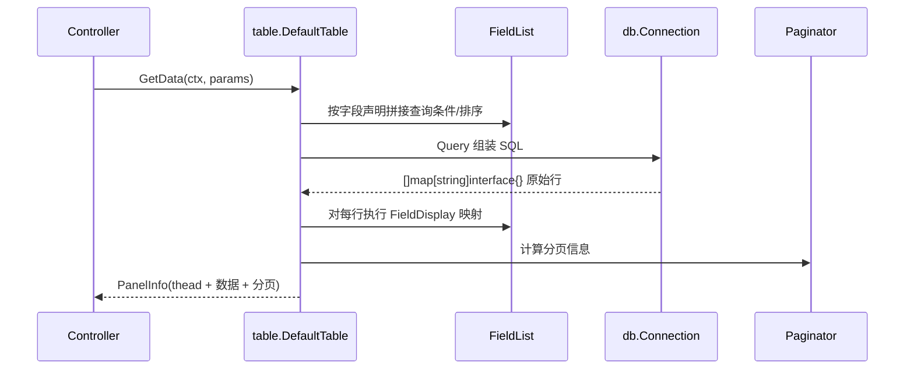

# GoAdmin 核心实现 — 声明式 Table Model（一套配置生成完整 CRUD）

> 本篇解读 go-admin 最核心的价值机制：如何用**一份声明式表描述**自动生成列表页、筛选、详情、表单、增删改查与字段级行为。代码引用基于仓库 `github.com/GoAdminGroup/go-admin` v1.2.27。

## 根因：后台的重复劳动可被"声明"消灭

后台开发 80% 是重复：每个业务表都要写列表接口、表单校验、增删改查 Handler、以及把数据渲染成表格/表单的前端。传统方式是"每个表手写一遍"，样板代码量和出错面随之线性增长。

go-admin 的解法来自 laravel-admin 的启发：**把"一个表的后台行为"抽象成一份可声明、可组合的描述**，框架消费这份声明自动完成 CRUD 与页面渲染。开发者不再写"这个字段怎么增、怎么改、怎么展示"的过程式代码，而是写"这个字段是什么类型、可不可排序、用哪种控件编辑、怎么展示"的声明式配置。

## 三层抽象：Generator → Table → 面板

### Generator 入口

每个业务表对应一个 **Generator 函数**：`func(ctx *context.Context) Table`（`table/table.go:17`）。它接收请求上下文，返回一个 `Table` 对象。所有 Generator 汇总在一个 `GeneratorList`（映射表，`table/table.go:19`），其 `Add/Combine` 支持增量组合注册（`table/table.go:21-43`），这正是"多个插件/模块各自声明自己的表、最后合并"的机制基础。

```go
// 用户侧示例（examples/datamodel/user.go）
func GetUserTable(ctx *context.Context) (userTable table.Table) {
    userTable = table.NewDefaultTable(ctx, table.Config{
        Driver: db.DriverMysql, CanAdd: true, Editable: true,
        Deletable: true, Exportable: true,
        Connection: table.DefaultConnectionName,
        PrimaryKey: table.PrimaryKey{Type: db.Int, Name: table.DefaultPrimaryKeyName},
    })
    info := userTable.GetInfo()
    info.AddField("ID", "id", db.Int).FieldSortable()
    info.AddField("Name", "name", db.Varchar).FieldEditAble(editType.Text).FieldFilterable(...)
    info.AddField("Gender", "gender", db.Tinyint).
        FieldDisplay(func(model types.FieldModel) interface{} { /* 值映射 */ }).
        FieldEditAble(editType.Switch)
    info.SetTable("users").SetTitle("Users")
    // ... 表单、详情、新增表单同理声明
    return userTable
}
```

### Table 接口

`table/table.go:45-75` 定义了 `Table` 接口，收敛"一个后台表"的全部面向：

- **面板视图**：`GetInfo`（列表）、`GetDetail`（详情）、`GetForm`（编辑表单）、`GetNewForm`（新增表单）
- **CRUD 能力开关**：`GetCanAdd / GetEditable / GetDeletable / GetExportable`
- **数据操作**：`GetData`（分页查列表）、`InsertData`、`UpdateData`、`DeleteData`
- **主键**：`GetPrimaryKey`

`BaseTable`（`table/table.go:77-91`）持有这些面板与能力标记，`DefaultTable`（`table/default.go:31-40`）是默认实现——它把接口的每个抽象方法都落地为真实的数据访问 + 渲染逻辑。

### 面板即"视图声明"

`types.InfoPanel`（列表）、`types.FormPanel`（表单）承载字段级配置。每个字段通过链式调用叠加行为：类型映射、排序、筛选、编辑控件、显示格式化、新增/编辑时的禁用策略。前端消费同一份声明渲染表格列、筛选控件、表单控件——**数据语义与 UI 行为收敛在同一份字段声明里**，避免前后端各维护一套字段定义。

## CRUD 数据流

`DefaultTable` 实现了对真实数据库的读写（`table/default.go`）：

- `GetData(ctx, params)`（`table/default.go:111-...`）—— 按分页参数、筛选条件查询数据并组装 `PanelInfo`
- 数据访问统一走 `db.WithDriverAndConnection(...)`（`table/default.go:1124`、`1130`），即所有表都统一落到 `modules/db.Connection` 抽象之上，从而天然支持多数据库

一次"列表页加载"的时序：



字段的 `FieldDisplay` 是"显示层"的钩子：它接收 `types.FieldModel`（含当前值），返回要展示的内容。所有列的值都经此映射，让"枚举值转文案"、"图片地址转 ``"这类高频需求变成一行声明函数。

## 设计权衡

| 维度 | 权衡 |
|------|------|
| 开发效率 | 高：一个表一份声明，CRUD+页面自动生成，十分钟可否掉一个后台 |
| 灵活度 | 中：字段级钩子（Display/EditAble）覆盖大多数定制，但深度定制 UI 仍受限于模板 |
| 学习成本 | 中：需理解"声明式"心智与字段链 API，比直接写 Handler 抽象一层 |
| 与框架耦合 | 低：声明独立于框架，配合适配器机制可跨框架复用 |
| 可观测性 | 中：SQL 由框架拼装，复杂查询需借助 `GetDataFun` 覆盖或扩展 QueryFilter |

## 可迁移的设计

- **用"字段声明"作为前后端单一事实来源**：类型、控件、展示、筛选、权限都在一处配置，杜绝字段定义漂移
- **能力以布尔开关暴露**（CanAdd/Editable/Deletable/Exportable），让"只读表 / 只增表"等变体零成本
- **数据访问收口到统一 Connection 抽象**，表模型不直接碰 `database/sql`，换来跨库可移植

## 相关引用

- Generator 与 GeneratorList：`table/table.go:17-43`
- 层 Table 接口：`table/table.go:45-75`
- BaseTable 结构：`table/table.go:77-91`
- 默认实现 DefaultTable：`table/default.go:31-40`
- 列表查询 GetData：`table/default.go:111-...`
- 统一数据入口 `db.WithDriverAndConnection`：`table/default.go:1124-1130`
- 用户侧声明示例：`examples/datamodel/user.go:20-120`
