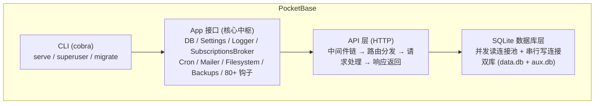
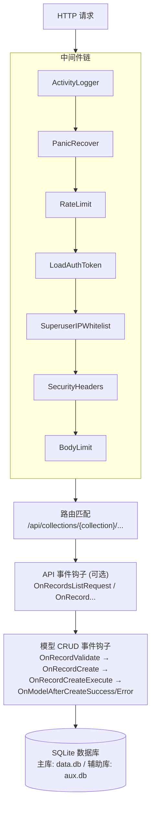

# PocketBase — 开源 BaaS 引擎解读

> **GitHub:** [github.com/pocketbase/pocketbase](https://github.com/pocketbase/pocketbase)

## 第一部分：快速概览

### 这是什么

PocketBase 是一个**开源后端即服务（BaaS）平台**，以单一 Go 二进制文件分发，集成了嵌入式数据库、文件存储、认证系统、实时订阅和管理面板。既可作为独立服务运行，也可作为 Go 框架嵌入自定义应用。

### 解决的痛点

构建一个现代应用的后端通常需要组合多个服务：数据库 + ORM + 认证中间件 + 文件存储 + 实时推送 + 管理后台。PocketBase 将这些全部打包进一个 ~30MB 的单二进制中，无需任何外部依赖（无 CGo、无 Redis、无独立数据库进程）。开发者只需启动一个进程，就获得了一套完整的后端基础设施。

与其类比的是 Firebase，但 PocketBase 是开源自托管的，数据完全由自己控制。

### 适用场景

- 独立开发者快速搭建 MVP 的后端底座
- 内网工具的管理后台（CMS、数据录入系统）
- 移动端/前端应用的无服务器后端
- 需要灵活扩展的 Go 微服务的基础框架
- 学习 Go 后端架构设计的研究项目

### 核心能力清单

| 能力 | 说明 |
|------|------|
| 动态集合系统 | 通过 API 动态创建数据表，无需定义 schema |
| 14 种字段类型 | 文本/数字/布尔/邮箱/URL/日期/文件/关联/JSON/密码/地理坐标等 |
| 五种认证方式 | 密码/OAuth2(28+ Provider)/OTP/MFA/Token 刷新 |
| 文件存储 | 本地文件系统 + S3 兼容双后端，自动缩略图 |
| 实时订阅 | SSE (Server-Sent Events)，基于集合权限的访问控制 |
| 事件钩子系统 | 80+ 生命周期钩子，链式中间件模式 |
| 管理面板 UI | 内嵌 Svelte 构建的 Web 管理界面 |
| 备份与恢复 | .zip 自动打包，支持本地/S3 存储 |
| 插件系统 | JSVM (JavaScript 运行时) + Go 库嵌入 |

### 技术栈一览

| 层面 | 技术 |
|------|------|
| 语言 | Go 1.25+ |
| 数据库 | SQLite (modernc.org/sqlite，纯 Go，无 CGo) |
| HTTP 框架 | 自研路由器 (基于 net/http，非 gin/echo) |
| 前端 | Svelte + Vite (内嵌到二进制) |
| JS 运行时 | goja (纯 Go JS 引擎) |
| 认证 | JWT (golang-jwt)，OAuth2 (自研 Provider 框架) |
| 实时通信 | SSE (Server-Sent Events) |
| 文件存储 | 本地文件系统 + S3 兼容 |
| 模板引擎 | Go `text/template` + 自定义布局系统 |
| 日志 | slog (Go 标准库) |
| 定时任务 | robfig/cron |

---

## 第二部分：架构深读

### 架构总览

PocketBase 的四层架构由 CLI 入口驱动，App 接口作为核心中枢连接 API 层与存储层：



### 核心设计：App 接口即中枢

PocketBase 的架构核心是一个巨大的 `App` 接口，它将所有子系统聚合在一个屋檐下。这种设计既是中心枢纽（Hub），也是扩展点（所有钩子从这里暴露）。

```go
// core/app.go:28

type App interface {
    // --- 生命周期 ---
    Bootstrap() error
    Settings() *Settings
    Logger() *slog.Logger

    // --- 子系统访问 ---
    DB() dbx.Builder              // 主数据库
    ConcurrentDB() dbx.Builder    // 并发读连接
    NonconcurrentDB() dbx.Builder // 串行写连接
    SubscriptionsBroker() *subscriptions.Broker
    NewMailClient() mailer.Mailer
    NewFilesystem() (*filesystem.System, error)
    Cron() *cron.Cron
    Store() *store.Store[string, any]

    // --- 模型 CRUD ---
    Save(model Model) error
    Delete(model Model) error
    RunInTransaction(fn func(txApp App) error) error

    // --- 80+ 事件钩子 ---
    OnServe() *hook.Hook[*ServeEvent]
    OnRecordCreate(tags ...string) *hook.TaggedHook[*RecordEvent]
    OnRecordAuthWithPasswordRequest(tags ...string) *hook.TaggedHook[*RecordAuthWithPasswordRequestEvent]
    // ... 更多 ...
}
```

`BaseApp` 是 `App` 接口的默认实现，内部持有全部钩子实例的字段，每个钩子对应一个 `Hook[T]` 或 `TaggedHook[T]` 字段：

```go
// core/base.go:74

type BaseApp struct {
    // 基础设施
    concurrentDB    dbx.Builder
    nonconcurrentDB dbx.Builder
    store           *store.Store[string, any]
    cron            *cron.Cron
    settings        *Settings
    subscriptionsBroker *subscriptions.Broker

    // 事件钩子 —— 每个钩子是一个字段
    onBootstrap              *hook.Hook[*BootstrapEvent]
    onServe                  *hook.Hook[*ServeEvent]
    onRecordCreate           *hook.Hook[*RecordEvent]
    onModelValidate          *hook.Hook[*ModelEvent]
    onRecordAuthWithPasswordRequest *hook.Hook[*RecordAuthWithPasswordRequestEvent]
    onRealtimeConnectRequest *hook.Hook[*RealtimeConnectRequestEvent]
    // ... 总共 80+ 个钩子字段 ...
}
```

### 请求数据流



### 启动流程

```
CLI (pflag 解析)
  │
  ▼
Bootstrap() 调用
  ├── 加载配置 (Settings)
  ├── 初始化数据库连接 (data.db + aux.db)
  ├── 缓存集合定义 (集合系统预热)
  ├── 注册定时任务 (cron)
  └── 初始化插件 (JSVM / migratecmd 等)
  │
  ▼
OnBootstrap 钩子触发
  │
  ▼
OnServe 钩子触发（路由注册点）
  │
  ▼
ServeHTTP 循环开始
```

---

## 第三部分：动态集合系统

### 三种集合类型

| 类型 | 用途 | 特性 |
|------|------|------|
| `base` | 普通数据表 | 标准 CRUD，自定义字段 |
| `auth` | 用户认证表 | 内置密码/OAuth2/OTP/MFA，邮件验证 |
| `view` | SQL 视图 | 基于查询的只读视图，跨集合聚合 |

### 集合模型

集合的 Go 模型通过组合模式实现：基础字段定义在所有类型之上，认证/视图选项通过类型嵌入附加。

```go
// core/collection_model.go:352

type baseCollection struct {
    BaseModel
    ListRule   *string `db:"listRule" json:"listRule"`
    ViewRule   *string `db:"viewRule" json:"viewRule"`
    CreateRule *string `db:"createRule" json:"createRule"`
    UpdateRule *string `db:"updateRule" json:"updateRule"`
    DeleteRule *string `db:"deleteRule" json:"deleteRule"`
    Name    string     `db:"name" json:"name"`
    Type    string     `db:"type" json:"type"`
    Fields  FieldsList `db:"fields" json:"fields"`
    Indexes types.JSONArray[string] `db:"indexes" json:"indexes"`
    System  bool       `db:"system" json:"system"`
    RawOptions types.JSONRaw `db:"options" json:"-"`
}

type Collection struct {
    baseCollection
    collectionAuthOptions   // auth 类型独有
    collectionViewOptions   // view 类型独有
}
```

这里值得注意的设计：`Collection` 通过类型嵌入组合了两种可选的选项结构体。当集合类型为 `base` 时，这两个嵌入结构体为零值，不产生额外存储开销。

### 14 种字段类型的设计

字段系统采用了**工厂模式 + 接口抽象**。每种字段类型注册到全局 `Fields` map 中：

```go
// core/field.go:63

type FieldFactoryFunc func() Field

var Fields = map[string]FieldFactoryFunc{}

type Field interface {
    Type() string
    ColumnType(app App) string
    PrepareValue(record *Record, raw any) (any, error)
    ValidateValue(ctx context.Context, app App, record *Record) error
    ValidateSettings(ctx context.Context, app App, collection *Collection) error
}
```

每种字段通过 `init()` 自动注册：

```go
// core/field_text.go:18

func init() {
    Fields[FieldTypeText] = func() Field {
        return &TextField{}
    }
}
```

这种设计让新增字段类型只需三步：定义结构体 → 实现 `Field` 接口 → `init()` 注册。核心框架无需修改。

### Record 模型

Record 使用 `store.Store` 作为动态数据的容器，支持任意字段的读写：

```go
// core/record_model.go:39

type Record struct {
    collection       *Collection
    originalData     map[string]any      // 原始加载数据
    data             *store.Store[string, any]  // 当前数据
    expand           *store.Store[string, any]  // 关联展开数据
    BaseModel
    // ...
}
```

`data` 字段本质上是一个类型安全的 `map[string]any`，由集合的字段定义驱动验证和序列化。这种设计使得 Record 能适应任意集合 schema，同时保持类型安全。

---

## 第四部分：认证体系设计

### 五种认证方式

| 方式 | 端点 | 说明 |
|------|------|------|
| 密码认证 | `POST auth-with-password` | 支持自定义 identity 字段（邮箱/用户名等） |
| OAuth2 | `POST auth-with-oauth2` | 28+ 内置 Provider，可自定义 |
| OTP | `POST /request-otp` → `POST auth-with-otp` | 邮箱/短信一次性密码 |
| MFA | 自动启用 | 需 2+ 认证方式，二次验证 |
| Token 刷新 | `POST auth-refresh` | 延长会话有效期 |

### 密码认证核心流程

以密码认证为例，可以看到 PocketBase 的钩子系统如何包裹核心逻辑：

```go
// apis/record_auth_with_password.go:17

func recordAuthWithPassword(e *core.RequestEvent) error {
    collection, err := findAuthCollection(e)
    // ...

    event := new(core.RecordAuthWithPasswordRequestEvent)
    event.RequestEvent = e
    event.Collection = collection
    event.Record = foundRecord
    event.Identity = form.Identity
    event.Password = form.Password

    return e.App.OnRecordAuthWithPasswordRequest().Trigger(event, func(e *core.RecordAuthWithPasswordRequestEvent) error {
        if e.Record == nil || !e.Record.ValidatePassword(e.Password) {
            if e.Record == nil {
                dummyPasswordCheck(e.App, e.Collection)  // 防时序攻击
            }
            return e.BadRequestError("Failed to authenticate.")
        }
        return RecordAuthResponse(e.RequestEvent, e.Record, core.MFAMethodPassword, nil)
    })
}
```

关键设计点：认证逻辑完全包裹在 `OnRecordAuthWithPasswordRequest` 钩子中，开发者可以在认证之前/之后插入自定义逻辑（如 IP 限制、额外验证、安全审计日志）。

### Token 类型

| Token 类型 | 有效期 | 用途 |
|-----------|--------|------|
| Auth Token | 集合级可配 | API 认证 |
| File Token | 3 分钟 | 受保护文件访问 |
| Verification Token | 集合级可配 | 邮箱验证 |
| Password Reset Token | 集合级可配 | 密码重置 |
| Email Change Token | 集合级可配 | 邮箱变更确认 |

### OAuth2 Provider 生态

内置 28+ Provider，分类覆盖科技（Google、GitHub、Microsoft）、社交（Facebook、Discord、Twitch）、开发（GitLab、Gitea、Bitbucket）等。设计上通过 Provider 接口实现扩展：

```
Provider 接口:
  - AuthURL(state, redirectURL) → URL
  - FetchToken(code, redirectURL) → *Token
  - FetchUser(token) → *User
```

实现此接口即可注册任意第三方 OAuth2 服务。

---

## 第五部分：事件钩子系统

PocketBase 最核心的设计之一是其事件钩子系统。它提供了 80+ 钩子，覆盖应用生命周期的每个阶段，采用**泛型链式中间件**模式。

### 钩子架构

```go
// tools/hook/hook.go:54

type Hook[T Resolver] struct {
    handlers []*Handler[T]
    mu       sync.RWMutex
}

func (h *Hook[T]) Bind(handler *Handler[T]) string {
    // 注册处理器，按优先级排序
    sort.SliceStable(h.handlers, func(i, j int) bool {
        return h.handlers[i].Priority < h.handlers[j].Priority
    })
    return handler.Id
}

func (h *Hook[T]) Trigger(event T, oneOffHandlerFuncs ...func(T) error) error {
    handlers := make([]func(T) error, 0, len(h.handlers)+len(oneOffHandlerFuncs))
    for _, handler := range h.handlers {
        handlers = append(handlers, handler.Func)
    }
    handlers = append(handlers, oneOffHandlerFuncs...)

    // 用闭包链构建中间件执行顺序
    for i := len(handlers) - 1; i >= 0; i-- {
        i := i
        old := event.nextFunc()
        event.setNextFunc(func() error {
            event.setNextFunc(old)
            return handlers[i](event)
        })
    }
    return event.Next()
}
```

`Trigger` 的实现非常巧妙：从后向前遍历 handler，通过闭包形成洋葱链。每个 handler 都可以选择调用 `e.Next()` 继续链，或者直接返回中断。

### TaggedHook：按标签过滤

```go
// tools/hook/tagged.go:30

type TaggedHook[T Tagger] struct {
    mainHook[T]
    tags []string
}

func (h *TaggedHook[T]) Bind(handler *Handler[T]) string {
    fn := handler.Func
    handler.Func = func(e T) error {
        if h.CanTriggerOn(e.Tags()) {
            return fn(e)
        }
        return e.Next()  // 不匹配则跳过
    }
    return h.mainHook.Bind(handler)
}
```

`TaggedHook` 是 `Hook` 的装饰器：当注册时指定了标签（如集合名称），只有在事件标签匹配时才执行 handler。这使得开发者可以精确控制钩子的作用范围：

```go
// 仅拦截 "articles" 集合的创建请求
app.OnRecordCreateRequest("articles").BindFunc(func(re *core.RecordRequestEvent) error {
    // 自定义逻辑
    return se.Next()
})
```

### 全部钩子分类

| 分类 | 数量 | 示例 |
|------|------|------|
| 应用生命周期 | 5 | OnBootstrap, OnServe, OnTerminate |
| 模型 CRUD | 42 | OnRecordValidate, OnRecordCreate, OnRecordAfterCreateSuccess |
| API 请求 | 26 | OnRecordsListRequest, OnRecordAuthWithPasswordRequest |
| 邮件 | 6 | OnMailerSend, OnMailerRecordPasswordResetSend |
| 实时 | 3 | OnRealtimeConnectRequest, OnRealtimeMessageSend |
| 设置 | 3 | OnSettingsListRequest, OnSettingsUpdateRequest |
| 文件 | 2 | OnFileDownloadRequest, OnFileTokenRequest |
| 其他 | 2 | OnBatchRequest, OnRecordEnrich |

---

## 第六部分：存储与数据层

### SQLite 纯 Go 实现

PocketBase 使用 `modernc.org/sqlite`，这是一个纯 Go 的 SQLite 实现（无 CGo）。这意味着：

- 交叉编译不需要 C 编译器（`CGO_ENABLED=0`）
- 静态编译单二进制，无需 `libsqlite3.so`
- 在 Alpine Linux、scratch 容器中均可运行

### 双数据库连接池

PocketBase 使用两个数据库文件 + 双连接池的策略：

```
data.db:
  ├── concurrentDB    → 多 goroutine 并发读
  └── nonconcurrentDB → 串行写（SQLite 单写者特性）

aux.db:
  ├── auxConcurrentDB    → 辅助库并发读
  └── auxNonconcurrentDB → 辅助库串行写
```

这种设计的背景：SQLite 本身只允许一个写入者，但允许多个并发读取。PocketBase 将读连接和写连接分离，让读操作不会阻塞写操作，同时利用 SQLite 的 `WAL` 模式获得更好的并发性能。

### SQLITE_BUSY 重试

写冲突时自动重试，减少应用层的处理复杂度（捕获 `SQLITE_BUSY` 错误后指数退避重试）。

### 备份与恢复

备份逻辑将数据库文件和 `pb_data` 目录打包为 `.zip`：

| 操作 | API 端点 |
|------|----------|
| 创建备份 | `POST /api/backups` |
| 恢复备份 | `POST /api/backups/{key}/restore` |
| 上传备份 | `POST /api/backups/upload` |
| 下载备份 | `GET /api/backups/{key}` |
| 删除备份 | `DELETE /api/backups/{key}` |

备份可存储到本地文件系统或 S3，恢复后自动重启进程。

---

## 第七部分：API 层设计

### 中间件系统

API 层的中间件使用了与事件钩子相同的 `Hook[T]` 机制——每个中间件是一个 `Handler`，按 `Priority` 排序后形成链：

```go
// apis/base.go:19

func NewRouter(app core.App) (*router.Router[*core.RequestEvent], error) {
    pbRouter := router.NewRouter(...)

    // 默认中间件链（应用于所有路由）
    pbRouter.Bind(activityLogger())        // 请求日志
    pbRouter.Bind(panicRecover())          // panic 恢复
    pbRouter.Bind(rateLimit())             // 速率限制
    pbRouter.Bind(loadAuthToken())         // JWT 认证提取
    pbRouter.Bind(superuserIPsWhitelist()) // 超级管理员 IP 白名单
    pbRouter.Bind(securityHeaders())       // 安全头
    pbRouter.Bind(BodyLimit(DefaultMaxBodySize))

    // API 路由组
    apiGroup := pbRouter.Group("/api")
    bindSettingsApi(app, apiGroup)
    bindCollectionApi(app, apiGroup)
    bindRecordCrudApi(app, apiGroup)
    bindRecordAuthApi(app, apiGroup)
    // ...
}
```

### REST API 端点一览

| 分组 | 端点 | 认证 | 说明 |
|------|------|------|------|
| 设置 | `/api/settings` | Superuser | 系统配置读写 |
| 集合管理 | `/api/collections` | Superuser | 集合 CRUD + 导入 |
| 记录 CRUD | `/api/collections/{collection}/records` | 规则控制 | 数据记录增删改查 |
| 认证 | `/api/collections/{collection}/auth-*` | 按端点 | 全部 5 种认证方式 |
| 文件 | `/api/files/{collection}/{id}/{filename}` | 规则控制 | 文件上传与下载 |
| 日志 | `/api/logs` | Superuser | 请求日志 |
| 备份 | `/api/backups` | Superuser | 备份管理 |
| 定时任务 | `/api/crons` | Superuser | 任务管理 |
| 实时 | `/api/realtime` | 公开 | SSE 连接 |
| 批量 | `/api/batch` | 按请求 | 批量 API 调用 |
| SQL | `/api/sql` | Superuser | 原始 SQL 查询 |
| 健康检查 | `/api/health` | 公开 | 服务状态 |

### SSE 实时订阅设计

实时订阅基于 Server-Sent Events，相对于 WebSocket，SSE 的优势是：浏览器原生支持、自动重连、单向推送（匹配后端→前端的广播场景）。

```go
// apis/realtime.go:43

func realtimeConnect(e *core.RequestEvent) error {
    rc := http.NewResponseController(e.Response)
    _ = rc.SetWriteDeadline(time.Time{})

    e.Response.Header().Set("Content-Type", "text/event-stream")
    e.Response.Header().Set("Cache-Control", "no-store")
    e.Response.Header().Set("X-Accel-Buffering", "no")

    connectEvent := new(core.RealtimeConnectRequestEvent)
    connectEvent.IdleTimeout = 5 * time.Minute
    connectEvent.MaxTimeout = 30 * time.Minute
    connectEvent.Client = subscriptions.NewDefaultClient()

    return e.App.OnRealtimeConnectRequest().Trigger(connectEvent, func(ce *core.RealtimeConnectRequestEvent) error {
        ce.App.SubscriptionsBroker().Register(ce.Client)
        defer func() {
            e.App.SubscriptionsBroker().Unregister(ce.Client.Id())
        }()

        maxTimer := time.NewTimer(ce.MaxTimeout)
        idleTimer := time.NewTimer(ce.IdleTimeout)

        for {
            select {
            case <-maxTimer.C:
                cancelRequest()        // 30 分钟绝对超时
            case <-idleTimer.C:
                cancelRequest()        // 5 分钟空闲超时
            case msg, ok := <-ce.Client.Channel():
                msg.WriteSSE(e.Response)
            case <-ce.Request.Context().Done():
                return nil
            }
        }
    })
}
```

关键设计：
- **空闲 5 分钟超时 + 最大 30 分钟**的双重超时机制
- 钩子系统允许在连接生命周期中插入自定义逻辑
- 广播时按订阅分块发送，每个客户端独立校验权限

---

## 第八部分：插件与扩展机制

PocketBase 提供三种扩展方式，覆盖不同的定制需求。

### 1. 事件钩子 (Go 原生)

最灵活的扩展方式。在关键生命周期节点插入 Go 代码：

```go
app.OnServe().BindFunc(func(se *core.ServeEvent) error {
    se.Router.GET("/hello", func(re *core.RequestEvent) error {
        return re.String(200, "Hello world!")
    })
    return se.Next()
})

app.OnRecordCreateRequest("articles").BindFunc(func(re *core.RecordRequestEvent) error {
    // 在文章创建前执行自定义逻辑
    return se.Next()
})
```

### 2. JSVM 插件 (JavaScript 运行时)

基于 [goja](https://github.com/dop251/goja) 的 JS 引擎，支持在 `pb_hooks/` 和 `pb_migrations/` 目录放置 `.js` 文件，运行时热加载。

JSVM 插件的核心是**在启动时通过反射动态绑定所有 `App` 接口的 `On*` 方法**到 JS 全局命名空间：

```go
// plugins/jsvm/binds.go:42

func hooksBinds(app core.App, loader *goja.Runtime, executors *vmsPool) {
    appType := reflect.TypeOf(app)
    appValue := reflect.ValueOf(app)

    for i := 0; i < appType.NumMethod(); i++ {
        method := appType.Method(i)
        if !strings.HasPrefix(method.Name, "On") {
            continue
        }

        jsName := method.Name // "OnRecordCreate" → JS 中可直接调用
        loader.Set(jsName, func(callback string, tags ...string) {
            hookInstance := appValue.MethodByName(method.Name).Call(tagsAsValues)[0]
            // 包装 JS 回调为 Go Handler，加入执行池
            hookBindFunc := hookInstance.MethodByName("BindFunc")
            hookBindFunc.Call([]reflect.Value{handler})
        })
    }
}
```

这意味着在 JS 中可以这样写：

```javascript
// pb_hooks/main.js
onRecordCreate('articles', (e) => {
    console.log('New article created:', e.record.getString('title'))
})
```

### 3. Go 框架嵌入

直接导入 PocketBase 作为 Go 库使用：

```go
import "github.com/pocketbase/pocketbase"

func main() {
    app := pocketbase.New()
    // 使用 app.OnServe() / app.OnRecordCreate() 等扩展
    app.Start()
}
```

### 三种方式对比

| 方式 | 语言 | 热加载 | 功能边界 | 适用场景 |
|------|------|--------|----------|----------|
| 事件钩子 | Go | 否 | 全部 API | 需要深度定制的自研项目 |
| JSVM | JavaScript | 是 | 全部 API | 快速迭代、无需重新编译 |
| Go 嵌入 | Go | 否 | 全部 API | PocketBase 作为框架使用 |

---

## 第九部分：设计模式与代码亮点

### 1. 泛型钩子链（Hook[T]）

整个框架的可扩展性基石。Go 1.18 泛型让 `Hook[T]` 成为类型安全的中间件容器，`TaggedHook[T]` 在不改变接口的情况下增加了过滤能力。

`Trigger` 方法的闭包链构建值得反复学习——从后向前包装 handler，形成洋葱模型：

```
handler[0] → handler[1] → handler[2] → ... → Next()
                                       ← ... ←
```

### 2. 字段工厂模式

```go
var Fields = map[string]FieldFactoryFunc{}

func init() {
    Fields[FieldTypeText] = func() Field { return &TextField{} }
}
```

通过全局注册表和 `init()` 自动注册，每种字段类型独立文件，新增字段不需要修改核心逻辑。

### 3. Record 作为动态数据容器

```go
type Record struct {
    data *store.Store[string, any]
}
```

使用 `store.Store`（线程安全的泛型 map）存储字段值，支持任意 schema 的读写。配合字段接口的 `PrepareValue` 和 `ValidateValue`，实现了类型安全和动态类型的统一。

### 4. 双数据库连接池

针对 SQLite 单写者特性的优化：分离读/写连接，并发读不阻塞串行写。写操作在全系统范围内是串行的，但读操作可以并行。

### 5. 无 CGo 依赖

使用 `modernc.org/sqlite` 替代 `mattn/go-sqlite3`，实现纯 Go 的 SQLite 驱动。这是整个项目"单二进制分发"的基石。

### 6. JSVM 反射绑定

```go
appType := reflect.TypeOf(app)
for i := 0; i < appType.NumMethod(); i++ {
    method := appType.Method(i)
    if !strings.HasPrefix(method.Name, "On") {
        continue
    }
    // 将 Go 方法动态绑定到 JS 全局命名空间
}
```

运行时的反射让 JS 钩子无需预编译即可调用任意 `On*` 方法。新增的 Go 钩子自动暴露给 JSVM。

### 7. 配置即代码

设置模型定义即配置结构体，通过 `_params` 表持久化，API 自动生成 CRUD 端点。开发者无需手动维护配置表的 schema。

---

## 第十部分：同类项目对比

| 方面 | PocketBase | Supabase | Appwrite | Parse Server |
|------|-----------|----------|----------|--------------|
| **语言** | Go | 多语言 | 多语言 | Node.js |
| **部署** | 单二进制 | Docker Compose/K8s | Docker | Node 进程 |
| **数据库** | SQLite (内嵌) | PostgreSQL | PostgreSQL | MongoDB |
| **依赖** | 无 | Docker + PostgreSQL | Docker + Redis + PostgreSQL | MongoDB |
| **实时** | SSE | WebSocket + Realtime | WebSocket | Live Queries |
| **文件存储** | 本地/S3 | S3 (需配置) | 本地/S3 | S3 (需配置) |
| **认证** | 密码/OAuth2/OTP/MFA | 密码/OAuth2/Magic Link | 密码/OAuth2/Magic Link | 密码/OAuth2/Social |
| **管理面板** | 内嵌 Svelte | Dashboard 独立部署 | Console 独立部署 | 内嵌 |
| **扩展方式** | Go 钩子/JSVM | Edge Functions | Functions/Webhooks | Cloud Code |
| **离线能力** | 无 | 有 (Client SDK) | 无 | 有 |
| **单二进制** | ✅ | ❌ | ❌ | ❌ |
| **CGo 依赖** | 无 | 有 | 有 | N/A |

**PocketBase 的差异化优势：**

1. **极致简洁** — 单二进制，零外部依赖，下载即用
2. **Go 内嵌** — 同时是 BaaS 产品和 Go 框架，适合作为微服务底座
3. **纯 Go SQLite** — 交叉编译无痛，scratch 容器可运行
4. **事件钩子密度** — 80+ 钩子覆盖极细粒度，定制能力远超同类
5. **JSVM 热加载** — 无需编译即可扩展，适合快速迭代

**PocketBase 的局限性：**

1. **SQLite 扩展性** — 单机写入瓶颈，不适合写密集型大规模场景
2. **无集群支持** — 不支持原生水平扩展，HA 需上层代理
3. **无离线同步** — 与 Supabase 不同，不提供客户端离线数
4. **SDK 生态** — JavaScript/Dart SDK 较成熟，其他语言滞后
5. **搜索能力** — 不支持全文搜索，复杂查询需 SQL API

---

## 第十一部分：总结与评价

PocketBase 是"在约束中做减法"的典范。作者选择了 SQLite、单二进制、无外部依赖这几条"硬约束"，在约束边界内提供了惊人的能力密度。

**最值得学习的设计决策：**

1. **Hook[T] + TaggedHook[T] 的泛型钩子设计** — 用 Go 泛型实现了类型安全的中间件链，80+ 钩子统一框架，是 Go 泛型的最佳实践案例
2. **App 接口即架构** — 整个系统的边界通过一个接口定义，实现了"面向接口编程"的极致表达
3. **字段工厂 + 动态数据** — 工厂模式注册字段类型，`store.Store` 承载数据，在静态语言中实现动态 schema
4. **双连接池 + WAL 模式** — 在 SQLite 的物理约束下做工程优化，而不是换数据库
5. **JSVM 反射绑定** — 用反射将 Go API 动态导出到 JS 运行时，巧妙的"穷人的扩展系统"
6. **目录结构即模块边界** — `core/`、`apis/`、`plugins/`、`tools/` 的分层清晰，每个包的职责明确

PocketBase 的代码库是学习 Go 后端架构设计的优秀教材。它在**简洁性**和**可扩展性**之间取得了罕见的平衡——代码量不大（核心 ~8 万行），但提供了足够丰富的扩展点。对于希望理解"如何用 Go 构建一个可扩展的 Web 服务"的开发者，深入阅读 PocketBase 的源码是极有价值的学习路径。

> **仓库：** [github.com/pocketbase/pocketbase](https://github.com/pocketbase/pocketbase) | **网站：** [pocketbase.io](https://pocketbase.io)

---

*本项目解读目录下后续可扩展各维度的独立分析文档，例如：[钩子系统深度分析](01-hook-system.md)、[动态字段系统设计](02-field-system.md) 等。*
