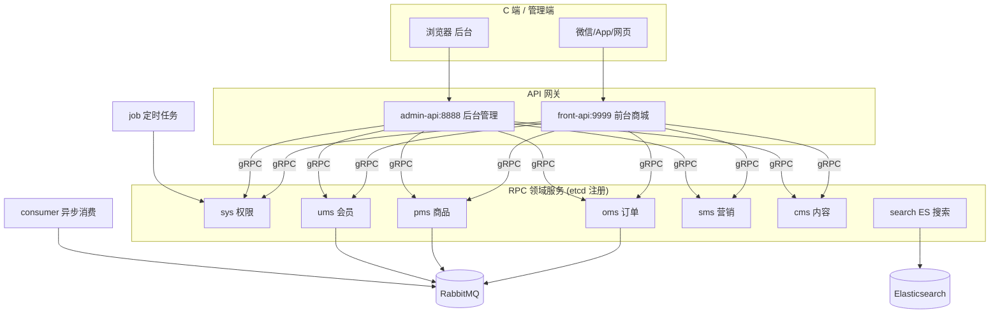
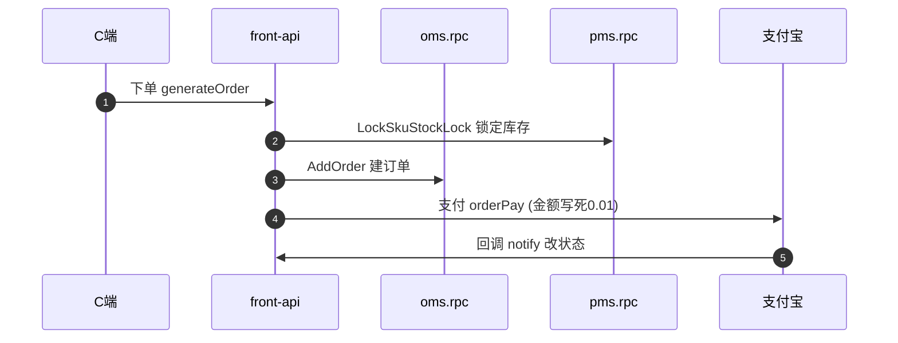

# Zero-Admin — 基于 go-zero 的电商微服务系统

> 项目地址：[feihua/zero-admin](https://github.com/feihua/zero-admin) | 协议：Apache-2.0 | 语言：Go 1.25 + go-zero 1.9.3

> 本解读按 admin 类规格产出（实为"后台管理 + 前台商城"双面电商后端）。全局概览见本页，分关注面深读：[`architecture.md`](architecture.md)（微服务编排与部署）· [`data-model.md`](data-model.md)（存储与数据模型）· [`auth-rbac.md`](auth-rbac.md)（认证与权限）· [`order-payment.md`](order-payment.md)（前台商城订单/支付链路）· [`search-es.md`](search-es.md)（ES 商品搜索）。

## 子文档索引

- [`architecture.md`](architecture.md) — 8 个 rpc + 2 个 api 网关 + consumer/job 的微服务编排、RabbitMQ 异步、gocron 定时与三种部署形态
- [`data-model.md`](data-model.md) — 逻辑分域物理单库的 MySQL 存储、订单/商品/会员/券核心表、跨域无事务的一致性取舍
- [`auth-rbac.md`](auth-rbac.md) — JWT + Redis + 「URL 作为权限点」的声明式 RBAC，含 data_scope 名存实亡的核对
- [`order-payment.md`](order-payment.md) — 前台 front-api 作为编排器，购物车→下单→支付宝支付→状态流转的完整链路与问题
- [`search-es.md`](search-es.md) — search-rpc 独立于业务库的 ES 搜索域，异步 MQ 同步索引与落地断点

## 第一部分：快速概览

### 是什么

Zero-Admin 是一套**基于 go-zero 框架的全栈电商微服务系统**，一套代码同时承载**前台商城**（下单选/支付）与**后台管理**（商品/订单/会员/权限），并用 goctl 代码生成把"从建表 SQL 到可运行的微服务"的成本压到极低。仓库同名并有配套前端（`zero-admin-ui` 管理端、`flutter_mall` App、`zero-pc-web` 网页端）。

### 解决什么根本问题

**根因：电商后端业务域多、脚手架与样板代码重复劳动重，零一个人很难从零搭起一套"前后台分离 + 微服务化 + 代码生成"的可用工程。** Zero-Admin 用 go-zero 把「按业务域拆 RPC + API 网关层 + 独立异步进程 + goctl 单向代码生成」这套范式，沉淀成**一个可复制、可裁剪的电商模板**——开发者在建表 SQL 基础上能快速生成全套后端骨架起步。

### 适用场景

- 想完整学习 go-zero 微服务电商架构（api 层 → rpc 层 → 存储 / MQ / ES 分层）的人
- 需要一个 goctl 驱动的后端脚手架模板，覆盖商品/订单/会员/营销/内容/权限全域的参考实现
- 观摩"一个小团队把 go-zero 微服务、RabbitMQ 延时、gocron 定时、ES 搜索、支付宝支付串起来"的真实工程取舍（含其不完善处）

### 核心能力清单

| 能力 | 实现落点 |
|------|---------|
| 前台商城（首页/购物车/下单/支付宝支付） | `api/front`，详见 [`order-payment.md`](order-payment.md) |
| 后台管理（商品/订单/会员/促销/内容/权限/设置） | `api/admin` + 各 rpc |
| 商品搜索（ES + MQ 异步索引） | `rpc/search`，详见 [`search-es.md`](search-es.md) |
| 认证与 RBAC 权限（URL 级） | `rpc/sys` + admin 中间件，详见 [`auth-rbac.md`](auth-rbac.md) |
| 订单超时自动取消（延时 MQ + 定时兜底） | `consumer` + `job`，详见 [`architecture.md`](architecture.md) |
| 优惠券/秒杀/营销 | `rpc/sms` |
| 代码生成（goctl：api / proto / gorm-gen） | makefile + `goctl-shell.md` |

### 技术栈一览

| 层 | 选型 |
|----|------|
| 微服务框架 | go-zero 1.9.3（rest + gRPC + etcd 服务发现） |
| 代码生成 | goctl + gorm.io/gen（`sql → gen model → 微服务骨架`） |
| 存储 | MySQL（逻辑分域物理单库 `gozero`）、MongoDB（评论/日志/收藏）、Elasticsearch（商品索引） |
| 异步 | RabbitMQ（含 `x-delayed-message` 延时交换） |
| 定时 | gocron v2 |
| 支付 | smartwalle/alipay v3（支付宝 SDK） |
| 序列化 | bytedance/sonic |

## 第二部分：架构深读

### 架构总览

零号电商用一个仓库装了 **2 个 REST 网关 + 8 个 gRPC 领域服务 + consumer(异步) + job(定时)**，共 11+ 个进程：



> 注意：域间是**逻辑分域、物理连同一 MySQL 库** `gozero`（见 [`data-model.md`](data-model.md)），图上"域"更多是代码隔离而非物理隔离。

### 模块职责映射（目录树）

```
zero-admin/
├── api/            REST 网关层（go-zero rest）
│   ├── admin/      后台管理入口（契约 doc/api、svc、handler、logic、middleware）
│   └── front/      前台商城入口（订单/支付/会员编排）
├── rpc/            gRPC 领域服务层（每域一个：cms/oms/pms/sms/search/sys/ums）
│   ├── {域}/proto/      接口契约(.proto)
│   ├── {域}/internal/   config/svc/server/logic（业务真正所在）
│   ├── {域}/gen/        gorm-gen 生成的 model/query（数据访问）
│   └── {域}/{域}client/  goctl 生成的客户端封装
├── consumer/       RabbitMQ 消费者进程（订单事件/ES同步/新手券）
├── job/            gocron 定时任务进程（超时取消/过期券）
├── pkg/            公共库（mq/ 封装、es/ 客户端、errorx、time_util）
└── script/         建表 SQL（6 域）与部署清单（k8s / configmap）
```

### 启动流程 / 主请求链路

**启动**：基础设施（MySQL/Redis/etcd/RabbitMQ+延时插件/ES）→ 各 rpc 注册 etcd → admin-api/front-api 网关 → consumer/job 异步进程。详见 [`architecture.md`](architecture.md)。

**核心请求链路（下单→支付）**：



### 核心模块导读

| 模块 | 职责 | 关系 | 深读 |
|------|------|------|------|
| API 网关（front/admin） | REST + JWT 契约层，编排 rpc | 调用全部 rpc | [`order-payment.md`](order-payment.md) |
| 微服务编排与部署 | 11+ 进程组织、MQ/job 异步、部署形态 | 全局拓扑 | [`architecture.md`](architecture.md) |
| 数据层（MySQL/ES/Mongo） | 电商分域存储与表设计、跨域一致性 | 支撑所有 rpc | [`data-model.md`](data-model.md) |
| 认证与 RBAC | JWT + URL 权限点，前后端鉴权 | rpc/sys + admin 中间件 | [`auth-rbac.md`](auth-rbac.md) |
| 搜索 | ES 商品索引与检索 | pms 生产 + consumer 同步 | [`search-es.md`](search-es.md) |

## 设计亮点与权衡

- **goctl 单向代码生成是架构的核心纪律**：从 `.api`/`.proto`/`.sql` 生成 handler/logic/svc/model，新增业务域 = 写契约 + `make gen`，11 个服务共享一致骨架，业务只写 logic（详见 [`architecture.md`](architecture.md)）。
- **异步解耦意图清晰**：下单 30 分钟延时 MQ（`x-delayed-message`）+ job 定时扫描**双层兜底**超时取消；ES 索引走 MQ 异步同步，把同步链路削薄。
- **跨域一致性是显式妥协**：无分布式事务，靠"锁库存（悲观预留）+ 建单 + 延时补偿"朴素 Saga 变体，作者多处注明 `// todo 暂时没有分布式事务`——这既是可借鉴的省复杂度思路，也是最大的风险债。

## 不足 / 风险

- **核心交易链路多处"半成品"**：下单写空壳订单（金额/明细/地址字段注释）、支付金额写死 "0.01"、`LockSkuStockLock` 的 SQL 占位符与实参数量不匹配疑似必崩——真实交易闭环**并未跑通**，更多是架构示范。
- **README 宣传与实现有出入**："商品搜索/推荐"虽建了 search-rpc，但前台列表实际走 pms MySQL `LIKE` 未接入；`data_scope` 数据权限名存实亡。
- **生产级可靠性缺失**：MQ `auto-ack` 无重投、gocron 单副本无调度锁、明文密码、明文密钥散在配置。
- **跨域多写无事务/无重试/无幂等**，孤儿订单、消息丢失、部分回滚风险客观存在。

## 可借鉴的设计

- **goctl + gorm-gen 的"契约到代码"链路**：把"新增一个微服务/业务群"做到极低门槛——写 `.api`/`.proto`/`sql`，`make gen` 生成全部骨架与数据访问层，业务只写 logic。
- **"锁而不扣"库存 + 延时取消的池化思想**：待支付期先占住库存（`stock-`/`lock_stock+`）、拍卖期后再释放，避免超卖——即使当前实现有 SQL bug，这个模型本身是可迁移的。
- **延时消息 + 定时扫描的双层兜底**：实时期望靠 MQ 延时精确，极端兜底靠定时任务扫描，两种异步可靠性手段互补。
- **订单快照 + 金额多维拆解 + 操作日志**：下单把商品冗余成快照、金额按促销/券/积分/运费/实付分维拆解，为对账与售后留足上下文。

## 总结回扣根因

Zero-Admin 回答的是"**如何在 go-zero 上快速启动一套前后台分离、微服务化的电商后端**"：用 goctl 代码生成消化掉微服务规模带来的模板成本，用按域拆 RPC + MQ/job 异步消化掉业务复杂度。其价值在**架构范式与取舍示范**（逻辑分域数据层、锁而不扣、延时兜底、代码生成纪律），而非一个可直接上生产的成品——README 主打的交易闭环当前仍多处停在注释与桩实现的"半成品"状态，这正是学习者理解其意图与欠账的最佳切片。

## 同类定位对比

| 项目 | 语言/框架 | 定位 | 与 zero-admin 差异 |
|------|-----------|------|---------------------|
| zero-admin | Go / go-zero | 电商微服务 + 代码生成 | 本文项目：全栈电商 + goctl 模板 |
| GoAdmin | Go | 数据管理后台生成框架 | 本文库另有解读；纯后台 CRUD 生成，非电商全链路 |
| go-commerce / mall（Macrohen） | Go / Java | 电商后台模板 | macrozheng/mall 偏 Spring 生态；zero-admin 是 go-zero 侧对标 |
| go-zero 官方 example | Go | 微服务示例 | 官方 toy 示例，无完整电商业务闭环 |

> 说明：zero-admin 与同为后台的 GoAdmin 定位不同——GoAdmin 是"声明式生成后台面板"，zero-admin 是"完整电商微服务后端模板 + 代码生成"；同仓库 `admin/` 下的 [GoAdmin](go-admin/README.md) 与 [easy-workflow](easy-workflow/README.md) 更偏框架/引擎，zero-admin 偏全栈应用模板。
