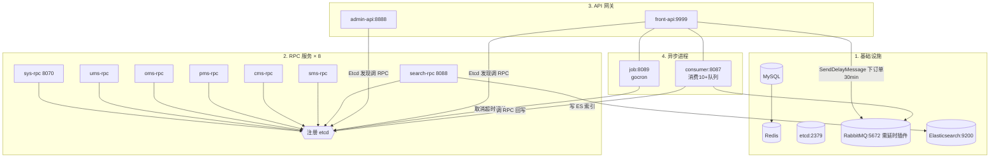

# 微服务架构、异步 MQ 与部署编排

> 本解读按 admin 类规格产出，此篇聚焦「架构编排 / 部署运维」关注面。电商业务域多、写读杂，zero-admin 用 go-zero 框架把「按业务域拆 RPC 服务 + API 网关层 + 独立异步进程」这套微服务范式，落到一套 goctl 单向代码生成 + 每服务独立镜像的可复制模板上。

## 根因与服务清单

**一句话本源：有多少业务域就建多少 gRPC 服务；api 只做网关编排；跨域重活（订单超时取消、ES 索引同步、新手券发放）一律扔给 MQ/job 异步，把同步链路削薄。**

| 服务 | 类型 | 端口 | 路径 | 职责 |
|------|------|------|------|------|
| admin-api | REST 网关 | 8888 | `api/admin/` | 后台管理入口；含 swagger 静态站 |
| front-api | REST 网关 | 9999 | `api/front/` | 前台商城入口；下单发 MQ 延时消息 |
| sys/ums/oms/pms/cms/sms/search-rpc | gRPC | 8070/… | `rpc/{域}/` | 各业务域；etcd 注册 |
| job | 定时进程 | 8089 | `job/` | gocron 调度 |
| consumer | MQ 进程 | 8087 | `consumer/` | 消费 10+ 队列 |
| pkg/ | 公共库 | — | `pkg/` | mq/es/errorx/time_util |

> `makefile:69/52` 里 `start` 与 `service_manager.sh:52` 引用了不存在的 `./target/web-api`，是历史残留命令，实际部署以 `build`/`image` 产物为准。

## 启动流程

先起基础设施，再起 rpc（注册到 etcd），再起 api 网关与异步进程。api/rpc 之间不写死地址，靠 etcd 服务发现，所以 `--net=host` 下启动顺序较宽容。

启动命令：`make build`（`copy_config` 拷配置 + `go build -o target/...`，`makefile:45-56`），`make start` 用 `nohup ./target/... &` 逐个拉起（`makefile:59-71`）；容器化 `make image` + `make run`（`--net=host`，`makefile:151-162`）；k8s 用 `make kubectl`（`makefile:164-177`）。

## 服务发现与调用

rpc 服务端注册到 etcd 指定 Key（`rpc/sys/etc/sys.yaml`：`Name: sys.rpc` / `ListenOn: 0.0.0.0:8070` / `Etcd.Key: sys.rpc`）。客户端经 `zrpc.MustNewClient(c.{X}Rpc)` 传 ETCD 配置即可，连接信息不入代码。rpc 启动在 Dev/Test 模式开启 gRPC reflection 便于调试（`rpc/sys/sys.go:42-57`）。

ServiceContext 构造时一次性建立全部 RPC client 并包装成服务接口（代理/门面模式）。front-api 一个网关进程持有 sys/ums/oms/pms/sms/cms 六套 client（`api/front/internal/svc/service_context.go:163-168`），consumer 与 job 各自搭自己那几套。

## 异步解耦：RabbitMQ

消息由「调用方」（前台下单 + oms/pms/ums 业务）发出，consumer 独立进程消费。**特点：rpc 层自己也当生产者**（oms/pms/ums 各发各事件），consumer 当纯消费者。

| 触发场景 | 生产位置 | exchange → queue | 消费者 |
|----------|---------|------------------|--------|
| 下单 30 分钟取消 | front `generate_order_logic.go:339` | `order.delay.exchange` → `order.delay.cancel.queue`（延时） | OrderDelayCancel |
| 新增订单 | oms `add_order_logic.go:97` | `order.event.exchange` → `order.create.queue` | OrderCreate |
| 取消/关闭/发货/确认/退货 | oms 各 logic | 各 queue | Order* |
| SPU 增改/删 → 同步/删 ES | pms `addproductspulogic.go:157` 等 | `syn/delete.product.from.es.queue` | SynProductToEs |
| 会员首次登录发券 | ums `loginlogic.go:103` | `coupon.event.exchange` → `first.login.queue` | coupon.FirstLogin |

### 延时取消实现

下单后不 sleep，发一条**延时消息**，通过 RabbitMQ `x-delayed-message` 交换机（需插件）实现「30 分钟后投递到取消队列」——`SendDelayMessage` 声明该交换机并带 `x-delay` 头（`pkg/mq/rabbitmq_util.go:149-216`），生产端传 `delayMinutes=30`（`generate_order_logic.go:332-339`）。

### pkg/mq 封装设计

`rabbitmq_util.go` 是轻封装：`NewRabbitMQSimple` 拨号建 channel 失败 panic（`:34-53`）；`SendMessage`（direct 交换自动声明）与 `SendDelayMessage`（延时交换）都带"不存在的队列/交换自动声明"能力；`ConsumeSimple(queue, handler)` 用 `go func` 对每个 channel 消费并永驻（`:91-146`），**硬编码 `auto-ack=true`**——消息交给 handler 即确认，失败无重投，存在丢失隐患。

### consumer 消费端编排

consumer 自身是 go-zero `rest.Server`（`consumer/consumer.go:31`），真正工作是在 `svc.NewServiceContext` 里起一堆「每队列一个 goroutine 的 `ConsumeSimple`」订阅（`consumer/internal/svc/service_context.go:81-143`）。`OrderDelayCancel` 是真正业务（查单→CancelOrder→释放库存→回滚券→返积分，跨 oms/pms/sms/ums 四域补偿，`order_delay_cancel_logic.go`），其余 `OrderCreate/Cancel/Close/Confirm/Delivery/Return` 目前只是反序列化后 `logc.Infof` 的桩。还暴露三个 HTTP 测试接口（含 `TestOrder` 向 6 个队列各发 100 条消息压测，`test_order_logic.go:29-65`）。

## 定时任务：job + gocron

job 也是 `rest.Server`，真正工作是 svc 里的 gocron 调度器（`job/internal/svc/servicecontext.go:69-102`）：

| 任务 | schedule | 业务 |
|------|----------|------|
| 自动取消超时订单 | 每 30 min | 查设置→查超时单→逐个取消→释放库存→回滚券→还积分（`job/internal/jobs/cancel_timeout_order_logic.go:20-104`） |
| 处理过期优惠券 | 每日 00:00 | 调 sms 批量置过期（`handle_expired_coupon_logic.go:11-18`） |

依赖 gocron v2（`go.mod`）。

**异步与定时分工**：30 分钟取消走延时 MQ（consumer 实时精确取消）；**兜底取消**走定时 job 每 30min 扫描——把延时消息漏发/进程重启的极端情况再兜掉。一段"取消→释放→回滚→还积分"逻辑在 `OrderDelayCancel` 与 `CancelTimeOutOrder` 里**各写一份**（重复但各自解耦），且都标注「暂无分布式事务」。

## 部署与运维形态

- **开发/本机（makefile / service_manager.sh）**：`go build` 出二进制 + `nohup` 拉进程；`service_manager.sh` 额外支持按单服务独立重启（`service_manager.sh:201-234`）。
- **容器（Docker）**：`quick_start.sh` 与 `make image`/`make run`，统一 `--net=host`，进程间直接 `localhost` 端口互连，免容器网络编排（`quick_start.sh:60-70`）。
- **k8s**：`make kubectl` 把 `script/*.yaml` 的 Deployment+Service（NodePort）打在 `zero-admin` 命名空间，经 `configMapRef` 注入 `CONFIG_FILE=etc/k8s.yaml`（`script/configmap/register.yaml:6-7`）。

**Dockerfile 形态**（代表 `rpc/sys/Dockerfile`）：go-zero 官方 gobuilder 两阶段。阶段一 `golang:alpine` `CGO_ENABLED=0` + `-tags no_k8s` 编译；阶段二 `alpine` 装 ca-certificates + tzdata，`CMD` 用 `CONFIG_FILE` 环境变量替代默认配置路径。配置管理：每服务 `internal/config/config.go` 声明 `Config` 结构，yaml 与 struct 同名绑定，提供 `etc/{svc}.yaml` 本机 + `etc/k8s.yaml` 外网两套，含 Prometheus 端口（可观测接入，未展开大盘）。

## 关键设计决策

1. **手写脚本逐个拉起而非 docker-compose**：仓库无 `docker-compose.yml`。服务几乎全 `--net=host` 直通宿主机端口，网络拓扑被 etcd 统一接管，compose 的网络编排价值被稀释；逐条 `docker run` 直白少抽象。代价：`--net=host` 共享端口空间，横向扩容近乎不可行；镜像打 `:0.0.1` 无 git 关联，回滚缺乏载体。这偏"单机演示"，由薄薄的 k8s 清单（全 NodePort，无 HPA/探针/资源限制）兜底。
2. **consumer/job 做成独立进程而非内嵌 goroutine**：可独立启停/扩缩/故障隔离，职责清晰（"想加消费者/任务进 consumer/job"）。代价：服务总量膨胀到 11 个，且这两个后台进程也要持有 RPC client 去回写，成了 RPC 对等调用方；`auto-ack` + gocron 单副本都无生产级可靠性（无死信/重试/分布式调度锁）。
3. **goctl 单向代码生成作为扩展纪律**：全部模块由 goctl 从 `api`/`.proto`/`sql` 生成并统一 `--style go_zero`。新增业务域 = 写一份 `.api`/`proto` + goctl 生成，而不用手工起微服务工程。代价：生成代码模板重复量大，改公共骨架需全量重生成；goctl 生成文件标注 `DO NOT EDIT`，业务只能下沉到 logic（手改会被覆盖）。

## 亮点与问题

**亮点**
- 网关-领域 RPC + 独立异步进程的总骨架清晰可复制，goctl 让「新增业务域/服务」成本极低，是很好的微服务脚手架示范。
- MQ 延时消息 + job 定时扫描**双层兜底**处理超时取消，体现了异步可靠性实践思路。
- `pkg/` 抽 mq/es/errorx/time_util 公共库，跨服务复用良好。
- 一次构建多部署形态（本机/容器/k8s）用同一批配置 + `CONFIG_FILE` 切换。

**问题与风险**
- **MQ 消费可靠性不足**：`ConsumeSimple` 硬编码 `auto-ack=true`，无 manual-ack/死信/重投；失败即丢。多个订单事件消费者只是打日志的桩，异步链路框架齐、业务欠。
- **超时取消逻辑双写**：`OrderDelayCancel` 与 `CancelTimeOutOrder` 结构几乎相同的补偿逻辑各写一份，维护双份易分叉。
- **部署偏演示**：`--net=host` + 硬编码端口 + `:0.0.1` 镜像标签 + k8s 无资源探针，横向扩展/高可用弱；`start` 引用了不存在的 `web-api`（`makefile:69`）。
- **配置/密钥散落**：`etc/*.yaml` 出现明文 DB 密码、支付宝密钥、JWT secret，k8s 用 ConfigMap 而非 Secret。
- gocron 单副本无调度锁，多实例 job 会重复执行；consumer/job 多实例幂等未处理。

## 覆盖率说明

makefile、quick_start.sh、service_manager.sh、goctl-shell、consumer 全部 MQ 消费者、job 全部任务、pkg/mq + pkg/es、代表性 Dockerfile、script 部署清单、服务发现均已覆盖，覆盖率 ≥70%。
