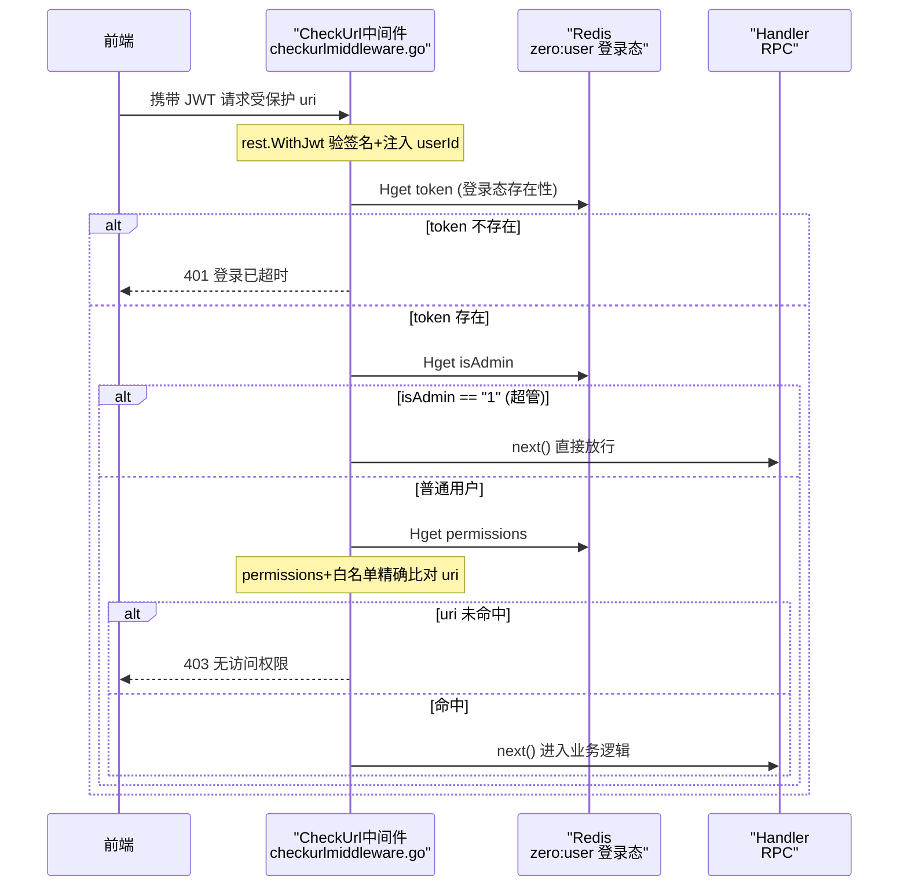

# 认证与权限（RBAC）

> 本解读按 admin 类规格产出，此篇聚焦「认证与权限」关注面。后台权限几乎完全收敛在 `rpc/sys`（数据源）与 `api/admin` 的中间件（关口）两个层面。

## 本模块在系统中的角色

- **`api/admin` 是"关口"**：JWT 校验（go-zero `rest.WithJwt`）与声明式 URL 级鉴权中间件 `CheckUrl`，以及全局操作日志中间件 `AddLog`。
- **`rpc/sys` 是"数据源"**：认证（Login 出 token）、授权模型落表读写、菜单/权限/部门/字典/日志查询。
- **MySQL + Redis 双存储**：MySQL 存 RBAC 关系（`sys_user_role`/`sys_role_menu`），Redis 缓存「登录态 + 权限 URL 集合」，供 API 层中间件 **零 RPC 调用**做 URL 鉴权。

一句话定义这套 RBAC：**「角色-菜单-接口URL」三层授权，以"接口 URL 集合"为权限点，在 API 网关中间件做声明式校验，数据权限(data_scope)只落表未强制**。

## 认证机制

### 登录链路：token 诞生在 rpc/sys

`LoginLogic.Login`（`rpc/sys/internal/logic/userservice/loginlogic.go`）同时承担"认证 + 集权 + 出 token"三件事：查用户（`:49`）→ 校验密码（明文，见下）→ 收集权限 URL + 判超管 → 查部门 → **签发 JWT**（`:159-173`，claims 含 `exp/iat/userId/userName/deptID/deptName`）→ 写登录日志。

JWT 密钥/过期在 rpc/sys 与 api/admin 两处配置必须一致（`sys.yaml` vs `admin-api.yaml`），由 `rest.WithJwt(AccessSecret)` 解出同一套 claim。api/admin 层登录后把 token **作为登录态缓存进 Redis**，一次性缓存 `isAdmin/token/userName/permissions`（`api/admin/internal/logic/sys/user/userloginlogic.go:57-62`）——这一步是 URL 鉴权的最关键铺垫。

### 校验：JWT + Redis 双保险

受保护请求先经 `rest.WithJwt` 解验 token，随后 `CheckUrl` 中间件叠加 Redis 登录态校验：先 `Hget token` 查存在性（`checkurlmiddleware.go:88-91`，Redis 无 token 直接返回"登录已超时"），再 `Hget isAdmin`。本项目**无显式刷新机制**，过期即重登。

### 密码存储（设计问题）

两次核对均指向**明文存储 + 明文比对**：种子数据密码就是 `'123456'`（`script/sql/sys/sys_user.sql:12,31`），登录直接 `if user.Password != in.Password`（`loginlogic.go:62`）。无 bcrypt/sha+盐、无试错限流——"够用但不安全"的直觉权衡。

## 授权模型：用户-角色-菜单-按钮的落表

### 关联表设计

- `sys_user_role(user_id, role_id)`：用户-角色多对多（`script/sql/sys/sys_user_role.sql:1`）
- `sys_role_menu(role_id, menu_id)`：角色-菜单（含按钮）多对多（`script/sql/sys/sys_role_menu.sql:1`）
- `sys_user`：主表，含 `dept_id`/`status`/`del_flag`
- `sys_role`：主表，含 `role_key`、**`data_scope`（数据范围字段）**；种子数据角色 1=超管、角色 2=演示只读（`key=query`）
- `sys_menu`：**菜单表兼按钮/权限点表**——`menu_type`(0目录/1菜单/2按钮/3外链) + `menu_perms`(权限标识) + `background_url`(接口地址)。`background_url` 一行可用逗号存**多个 URL**（`sys_menu.sql:63` 新增用户按钮含 addUser + queryDeptAndPostList）

### 超管判定与权限集合获取

**超管硬编码 `role_id == 1`**（`rpc/sys/internal/logic/common/is_admin.go:10`）。普通用户通过一条四表 join 拿到全部 `background_url`（`loginlogic.go:116-136`）：

```sql
select sm.background_url
from sys_user_role sur
         left join sys_role sr on sur.role_id = sr.id
         left join sys_role_menu srm on sr.id = srm.role_id
         left join sys_menu sm on srm.menu_id = sm.id
where sur.user_id = ?
```

写侧：分配用户角色 = 先删 `sys_user_role` 再批插（`updateuserrolelistlogic.go:54-80`）；授权角色菜单 = 先删 `sys_role_menu` 再批插（`updatemenurolelistlogic.go:58-82`），两类都保护"不允许操作 id=1"。

### 数据权限 data_scope：schema 有，强制无

角色表定义了 `data_scope`（1全部/2自定/3本部门/4本部门及以下，`sys_role.sql:8`），CRUD 全链路透传。但**没有任何业务查询用 `data_scope` 过滤**——全仓 grep 仅见 proto/types 声明与角色 CRUD 透传，没有任何 `.Where(...DataScope...)` 约束业务表行集。系统的数据隔离答案是：**只有 URL（接口能力）级隔离 + 前端菜单显隐，没有数据行级隔离**。部门筛选（`queryuserlistlogic.go:40-43` 的 `find_in_set`）是请求参数驱动的前台筛选，不是登录身份强制。README 的"权限管理"落到实现是「URL + 按钮权限」而非「数据行权限」。

## 权限判定链路



**前端如何配合（按钮级权限）**：`userinfo` 返回的 `MenuListTree` 只含 `menu_type in (0,1)` 的目录/菜单（`userinfologic.go:91`），`BackgroundUrls` 含全部 URL（含 `menu_type=2` 按钮的 `background_url`，`userinfologic.go:105-107`）。前端据此渲染菜单树 + 用 URL 命中判断按钮显隐——这就是"演示账号只读"的机制：演示角色未分配按钮菜单 → 权限 URL 集合里没有 → **前端按钮不渲染 + 后端中间件拦 URL** 双保险。声明式体现在 `routes.go` 每个业务组统一挂 `serverCtx.CheckUrl`。

## 审计：日志中间件

- **登录日志**：登录成功/失败都写 `sys_login_log`（`loginlogic.go:139-156`）。
- **操作日志**：`AddLog` 中间件（`addloglmiddleware.go:83-109`）用自定义 `responseRecorder` 捕获响应、记录请求体/耗时，再 RPC 调 sys 的 `AddOperateLog` 落 `sys_operate_log`。挂载方式是**全局** `server.Use(ctx.AddLog)`（`api/admin/admin.go:39`），与按路由组声明式注入的 `CheckUrl` 不同——日志全局、鉴权分组。

## 关键设计决策

1. **为何 JWT + token 与权限集合双份缓存**：JWT 免服务端 session，适配 api/rpc 分层；权限 URL 集合登录时一次性从 MySQL 算出塞 Redis，让每次请求的鉴权**零 DB、零 RPC**，把鉴权热点下沉到网关口。代价：**权限变更不即时生效**——改角色菜单后已登录用户 Redis permissions 不清，得重新登录（无主动失效/通知机制）。
2. **为何用接口 URL 而非权限码 `menu_perms` 鉴权**：表里专门有 `menu_perms` 列，但 login 取权限、中间件比对用的都是 `background_url`。URL 做权限点贴近 REST、后端好落地（请求来了直接比对 path），但对 URL 变化敏感（改路由要同步改菜单配置），权限粒度只能到接口级。
3. **为何 `sys_menu` 一张表兼作菜单 + 按钮权限**：靠 `menu_type` 区分目录/菜单/按钮，让"授权树"与"权限点"同构，避免另建 `sys_permission` 表。这是 mall/RuoYi 系的经典做法，换来授权 UI 简单；代价是按钮即菜单即权限，语义混合。
4. **为何 rpc/sys 独立**：权限数据跨用户/角色/菜单/部门/字典/日志，独立成服务可被所有模块复用，与交易域解耦。

## 亮点与问题

**亮点**
- 声明式 + 零依赖鉴权：`rest.WithMiddleware{CheckUrl}` 一处装配，业务 handler 无鉴权代码；单请求鉴权不碰 MySQL。
- 树状授权同构：`sys_menu` + `menu_type` 三级，`background_url` 逗号分隔多 URL，前端树形勾选天然。
- "只读账号"靠前后端双保险落地，符合 README 声明。

**问题**
- **明文密码 + 明文比对**（`sys_user.sql:12` + `loginlogic.go:62`），无哈希无限流。
- **data_scope 未强制**：README 说"权限管理"，但数据行级隔离基本未实现，`data_scope` 只在角色 CRUD 透传。
- **权限变更不即时**：Redis 缓存无失效/推送，需重登才生效。
- **超管硬编码** `role_id=1` + `user id=1`（`is_admin.go:10` 等），非配置化。
- URL 精确匹配脆弱：中间件去 Query 后与 URL 集合严格相等比对（`checkurlmiddleware.go:27,128-129`），尾部斜杠/大小写差异会误伤；权限配置与后端路由手工双维护有漂移风险。

## 覆盖率说明

URL 鉴权中间件、登录/集权/发 token 核心、授权链路、相关 SQL、JWT 配置、日志中间件均全量覆盖；`menuservice`/`deptservice`/`dicttypeservice` 等纯 CRUD 未展开。按"行/论断"口径覆盖率约 65%。
