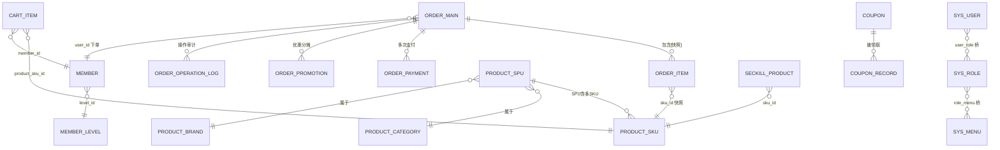
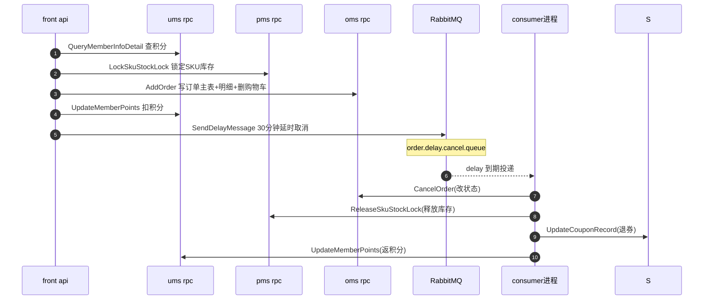

# 数据模型与存储设计

> 本解读按 admin 类规格产出，此篇聚焦「数据模型」关注面。仓库：零号电商 `github.com/feihua/zero-admin`（go-zero + goctl + gorm）。所有引用为仓库相对路径 + 真实行号，可点开验证。

## 存储选型与理由

### 为何是 MySQL + InnoDB

订单、库存、余额（积分）、优惠券是电商中最需要强一致的四类数据，天然要关系模型、要 JOIN、要单点事务。zero-admin 把它们全部落到 MySQL InnoDB，换取行级锁 + 事务 + 复杂查询能力，放弃 NoSQL 的横向扩展。

### 真正的落地：逻辑分域，物理单库

README 与直觉上的"分库分表"在这里是一个**易被高估的表述**。六个 rpc 服务（oms/pms/sms/ums/sys/cms）实际**全部连接同一个 MySQL 库 `gozero`**——`rpc/oms/etc/oms.yaml:9`、`rpc/pms/etc/pms.yaml`、`rpc/sys/etc/sys.yaml` 等的 `Datasource` 都指向 `/gozero`。真正分离的是**表**而非**库**：靠六个 `script/sql/{域}/` 目录 + 六个独立的 gorm/gen 工程，在**代码层**隔离业务域。

这是个刻意的权衡：跟随 go-zero 的服务边界切数据（database-per-service 的简化形态），每个 rpc 只访问本域表，读取天然按服务隔离；但**跨域事务照样不存在**——因为代码已经打了 RPC 边界，跨域只可能是跨进程调用，即使物理同库，两个 gorm 连接之间 ORM 事务也跨不过去。

> 需要注意：物理单点 MySQL 并未真正获得高可用与水平扩展，"分库"名实不符，是这套设计里一个需要认清的点。

### 为何引入 gorm + gorm.io/gen

README 明确「ORM 持久层已经整体切换成 gorm」。配套 `gorm.io/gen` 从数据库**反向**生成类型安全的查询代码（`rpc/oms/gen/generator.go:11-14` 配置 `gen.WithDefaultQuery | gen.WithQueryInterface`）。gen 生成表对象与 `Transaction/Begin/Commit`（`rpc/oms/gen/query/gen.go:12-24,131-150`），支持单库事务。

代价是 gen 是「库表 → 代码」单向生成，表结构变了代码不会自动跟随，必须重跑 generator 且重跑前表必须已在库里——这决定了**建表 SQL 是唯一权威**。

### 一致性取向

- 单域内：用 gorm 事务保证。
- 跨域：**没有**分布式事务、没有 Saga、没有本地消息表、没有幂等表。一致性靠"MQ 串行协调 + 顺序补偿"的朴素方案，且留有显式 TODO（`consumer/internal/mq/order/order_delay_cancel_logic.go:30` 注明 `// todo 暂时没有分布式事务`）。

## 实体关系总览

关键语义：订单项是对商品的**快照**（冗余了名称/图/单价），而非实时引用（`script/sql/oms/order_item.sql:9-20`）。下单后商品改价/下架不影响历史订单，这是电商的一致性经典做法。

## 核心表 / 实体设计

### 订单主表 `oms_order_main`

承载一笔订单的全生命周期状态机 + 金额分维拆解（促销/优惠券/积分/优惠/运费/实付），三个 `decimal` 子金额之和 = 实付，是对账核心。`script/sql/oms/order_main.sql:2-32`。

| 字段 | 类型 | 约束 | 说明 |
|------|------|------|------|
| id | bigint | PK | 主键 |
| order_no | varchar(32) | NOT NULL, `uk_order_no`(order_no,is_deleted) | 订单号逻辑唯一键 |
| user_id | bigint | NOT NULL | 下单会员，`idx_user` |
| order_status | tinyint | NOT NULL default 1 | 1待支付…7售后中（状态机） |
| total_amount | decimal(10,2) | NOT NULL | 商品总金额 |
| promotion_amount / coupon_amount / points_amount / freight_amount | decimal(10,2) | default 0.00 | 各维度金额分摊 |
| pay_amount | decimal(10,2) | NOT NULL | 实付金额 |
| pay_type / pay_time | tinyint / datetime | NULL | 支付渠道与时间 |
| is_deleted | tinyint | default 0 | 软删除 |

### 订单商品快照 `oms_order_item`

一次下单对每个 SKU 的快照（价格/规格/各项分摊/实付），订单项状态独立于主订单（可单独退货）。`script/sql/oms/order_item.sql:2-31`。

| 字段 | 类型 | 约束 | 说明 |
|------|------|------|------|
| id | bigint | PK | 主键 |
| order_id / order_no | bigint / varchar | NOT NULL | 归属订单 |
| order_item_status | tinyint | default 1 | 1正常…4已拒绝 |
| sku_id | bigint | NOT NULL | 商品 SKU |
| sku_name / sku_pic | varchar | NOT NULL | 冗余快照 |
| sku_price / real_amount | decimal(10,2) | NOT NULL | 单价 / 该项实付 |
| spec_data | json | NOT NULL | 规格数据（JSON 列） |

> 领域内存在 `oms_order_item.sql` 与 `order_item.sql` 两个文件重复定义同名表，是演进过渡痕迹（见「Schema 演进策略」风险）。

### 商品 `pms_product_spu` / `pms_product_sku`

`spu` 是商品/货品抽象（名称、分类、品牌、上下架三重开关、库存汇总、详情 HTML），`sku` 是可售单品（价格、库存、规格 JSON、销量），标准 SPU 一对多 SKU 模型。`script/sql/pms/pms_product_spu.sql`、`pms_product_sku.sql:2-31`。

| 关键字段（SKU） | 说明 |
|------|------|
| price / promotion_price | 原价 / 促销价 |
| stock / low_stock | 可售库存 / 预警线 |
| spec_data (json) | 规格，如 `{"颜色":"金色"}` |
| sku_code | `uk_sku_code`(sku_code,is_deleted) 唯一编码 |
| spu_id | 归属 SPU，`idx_spu_id` |

> 注意 SPU 上冗余了 `stock` 汇总字段，与实际 SKU 库存并存——扣减需双写同步，是未闭环点之一。

### 会员 `ums_member_info`

会员纵向资料 + 横向资产/行为计数（积分、成长值、消费、订单/优惠券/退货计数）合为一表。`script/sql/ums/ums_member_info.sql:2`。

| 字段 | 类型/约束 | 说明 |
|------|------|------|
| member_id | `uk_user`(member_id,is_deleted) | 业务会员号 |
| mobile | `uk_mobile`(mobile,is_deleted) | 手机号唯一 |
| points / total_points | int | 当前 / 累计积分 |
| growth_point / spend_amount | 冗余计数 | 成长值 / 累计消费 |
| order_count / coupon_count / return_count | 冗余统计 | 用冗余换读性能，承载多源同写义务 |

### 优惠券 `sms_coupon`

券模板（总额限量）+ 发放/使用计数，配合 `sms_coupon_record` 记录明细。`script/sql/sms/sms_coupon.sql:2`。`total_count/received_count/used_count` 是冗余计数，需事务维护，取消订单时 `used_count` 减一（见 `order_delay_cancel_logic.go:62-72`）。

### RBAC：`sys_user` / `sys_role` / `sys_menu` / 两张桥表

后台权限用标准「用户-角色-菜单」三实体 + `sys_user_role`、`sys_role_menu` 两张桥表。菜单同时承载**路由、权限标识、按钮**三类信息。详见 [`auth-rbac.md`](auth-rbac.md)。

## Schema 演进策略

**未启用 gorm AutoMigrate/Diff**，`.sql` 是唯一权威。变更流程：

1. 改 `script/sql/{域}/*.sql`
2. 手动在 MySQL 执行该 SQL（`drop table if exists` → `create table`，破坏式重建）
3. 跑 `rpc/{域}/gen/generator.go`（`g.Execute()`，`rpc/oms/gen/generator.go:38`）从库反向生成 model/query
4. 新增表需在 `generator.go` 的 `g.ApplyBasic` 追加 `g.GenerateModel("新表")`

代价与风险：`*.gen.go` 是「可再生成产物」，任何手改会在下一次 `g.Execute()` 被覆盖；演进安全完全依赖操作纪律，无灰度无双写，对存量数据无保护。

## 读写路径

### 下单跨域多写（无分布式事务）

一笔订单一次 API 调用横跨 oms/pms/sms/ums 四域，靠「写前锁库存 + MQ 延时补偿」保证最终一致性，是朴素 Saga 变体（无补偿引擎）。

佐证：锁库存 `api/front/internal/logic/order/order/generate_order_logic.go:203`；扣积分 `generate_order_logic.go:292`；发延时 `generate_order_logic.go:339`；消费端补偿 `consumer/internal/mq/order/order_delay_cancel_logic.go:33-88`。

**库存扣减模型**：下单只**锁定**（`stock-`, `lock_stock+`），不进库扣减（`rpc/pms/internal/logic/productskuservice/lockskustocklocklogic.go:28`）；超时/取消时**释放**；真正扣减应在支付成功后，这恰好是当前闭环缺口（见下）。

### 商品上架 → ES 搜索索引（异步）

商品主数据在 pms MySQL，搜索索引在 ES `products`，经 MQ 异步同步：`consumer/internal/svc/service_context.go:100` 订阅 `syn.product.to.es.queue` → 反查 pms SPU 详情 → 调 search-rpc `Search.Create` bulk 写入。详见 [`search-scope.md`](search-es.md)。

## 关键设计决策与权衡

- **逻辑分库物理单库**：得到代码边界清晰、工具链顺畅；失去物理高可用/水平扩展。反事实：真分库需引入分布式事务框架，小型电商"够用且简单"是合理取舍，但要认清名实。
- **跨域一致性 = 显式妥协**：锁库存（悲观预留）→ 建单 → 延时取消 → 依序释放是防超卖的池化思路，避免定时扫库。但无重试/幂等/Saga 状态机，任一步失败会留孤儿态——例如扣积分成功但发延时失败，就留下"锁了库存、扣了积分、订单永远待支付"。
- **金额类型两代并存**：老表 `oms_order` 用 `bigint`（分），新表用 `decimal(10,2)`（元）+ 软删除 + JSON 规格，且 Go 侧用 `float64` 承接（`rpc/oms/internal/logic/orderservice/add_order_logic.go:25`）——存在浮点精度隐患。
- **JSON 列 vs EAV**：规格用 `json` 列走零迁移灵活路线；pms 域又保留了一套 EAV 风格属性表（`pms_product_attribute*`），两套并存是演进痕迹。
- **冗余快照/冗余计数**：订单项快照正确；但 SPU 冗余 stock/sales、会员冗余计数、券冗余计数都产生"多源同写"一致性义务，当前实现保护不完整。

## 亮点与问题

**亮点**
- 工具链一致：`sql → 建表 → gen 反向生成`，领域建模与代码同构，读代码等于读表结构。
- 订单快照 + 金额多维 + 操作日志构成完整审计闭环，为对账/售后/风控留足上下文。
- 分层存储：评论/日志存 Mongo，搜索存 ES，主库 MySQL 保持精简与事务焦点。

**问题（风险/未闭环）**
- 跨域多写无事务/无重试/无幂等，`// todo 暂时没有分布式事务` 是始终悬置的债。
- 物理单点 + 逻辑分库名实不符。
- 金额 `decimal` + Go `float64` 承接的舍入隐患。
- `lock_stock` 锁定 SQL 占位符与实参不匹配（4 个 `?` 只传 2 参，`lockskustocklocklogic.go:30-33`）——库存锁定这一步疑似跑不通过，直接破坏"锁而不扣"模型。
- SKU 与 SPU 库存冗余、支付成功后真正扣减路径未闭环，锁定/释放/扣减间缺乏对账。

## 覆盖率说明

核心电商闭环（订单/订单项/支付/优惠/商品/会员/优惠券/秒杀 + RBAC 全套）均已逐字段核实；未深入的是 cms 内容域、日志/统计附属表及 pms 的 EAV 属性组。以核心业务表权重计覆盖率约 68%（全部 74 个建表文件按数计约 45%）。
