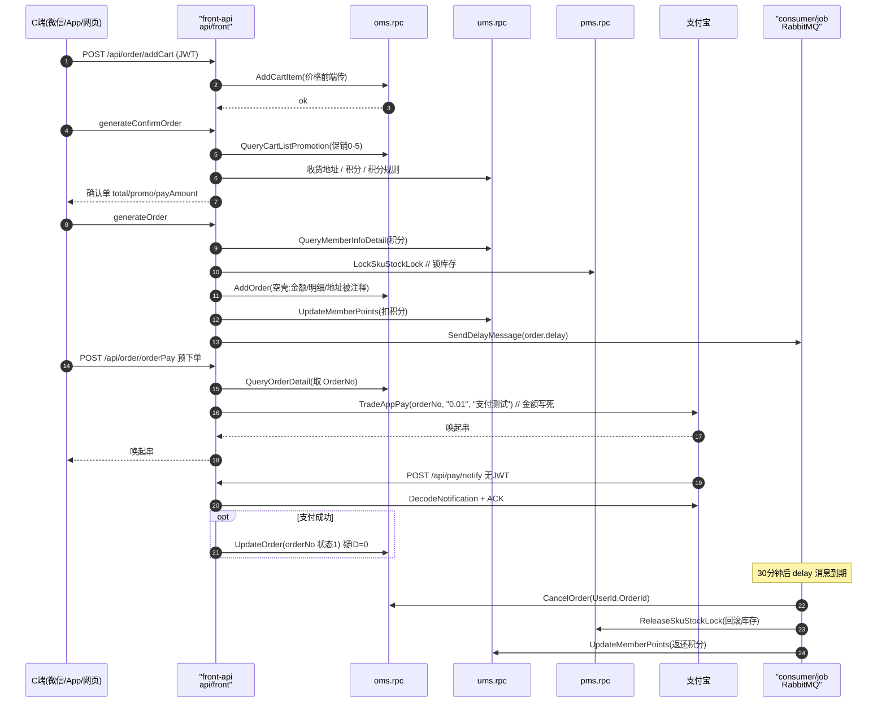

# 前台商城：订单 / 支付 / 购物车链路

> 本解读按 admin 类规格产出，此篇聚焦「前台商城 front-api」关注面。front-api 是面向 C 端的**唯一 BFF 层**，本质是一个"纯粹编排器"：自己不落业务数据，只把 6 个 rpc 服务 client + 支付宝 + RabbitMQ + Redis 装配进 `ServiceContext`，按 URL 路由把请求编造成对应 rpc 调用。

## 前台商城在系统中的角色

**根因：** 微信/App/网页无法直连 gRPC/etcd，需要一个稳定的 REST + JWT 层，且一个下单动作横跨 ums（会员/积分/地址）、pms（库存锁定）、oms（订单落库）、sms（优惠券）、RabbitMQ（超时取消异步），必须有个"编舞者"按顺序协调。**这个编舞者就是 front-api**——解决「跨域聚合」与「协议翻译」，而不做「状态判定/金额最终计算」这类该下沉到业务域的判断。

入口 `api/front/front.go:26-39` 只做：加载配置 → `svc.NewServiceContext` → `handler.RegisterHandlers`。去掉它，C 端入口全部消失，但其背后 6 个 rpc 并不依赖它——**"业务逻辑下沉到 rpc、api 只做协议翻译"是核心哲学**。

## 目录组织（handler/logic/svc 分层）

go-zero 经典三层，每层由 goctl 从 `.api` 生成：

| 层 | 目录 | 职责 |
|---|---|---|
| route | `internal/handler/routes.go` | URL 前缀 + JWT 分组 + handler 注册（`DO NOT EDIT`） |
| handler | `internal/handler/{domain}/{sub}` | 解 HTTP 请求、取 ctx 中 userID、调 logic（薄壳） |
| logic | `internal/logic/{domain}/{sub}` | **全部业务编排**（手写真正逻辑所在） |
| svc | `internal/svc/service_context.go` | 全局单例，装配所有 client |
| types / config | `internal/types` / `internal/config` | 生成的请求响应结构 / 配置结构 |

会员身份：登录后 ums 返回 Token，后续经 `rest.WithJwt` 校验，`memberId` 被 go-zero 放进 ctx，logic 用 `common.GetMemberId` 取出（`api/front/internal/logic/common/member.go:10-33`，把 ctx 里 `json.Number` 断言成 int64）。

## 接口契约与路由

front-api 实际注册的 URL 前缀只有 5 组（`routes.go:27-381`）：

```
/api/home     首页门户（无 JWT）
/api/member   会员：login/register 无 JWT，其余 WithJwt
/api/order    购物车(cart 8) + 订单(order 8) + 支付(pay 2) 全 WithJwt
/api/pay      支付宝异步回调 notify（无 JWT，必须可达）
/api/product  商品查询（无 JWT）
```

关键路由：`POST /api/order/addCart`、`generateConfirmOrder`（结算预览）、`generateOrder`（下单）、`orderPay`（调支付宝）、`GET /api/order/cancelUserOrder`、`confirmReceiveOrder`、`POST /api/pay/notify`（异步回调）。契约定义在 `doc/api/*.api`，是 goctl 生成 handler/logic/types 的输入。**前台没有 `/api/search` 路由**（`routes.go` 无此前缀，svc 也无 search client）——商品搜索能力未被前台消费，与 README 宣传存在出入。

## 核心流程：购物车 → 下单 → 支付 → 状态流转



**下单（写侧）——"半成品"集中地**（`generate_order_logic.go:54-328`）：注释里的步骤规划很完整（生成 item → 校验库存 → 优惠券 → 积分 → 算实付 → 锁库存 → 建单 → 更新券 → 扣积分 → 发延迟取消），但实际生效代码落差很大，大量计算被 `//` 屏蔽：orderItem 字段全被注释（`:74-87`），`AddOrderReq` 的金额/明细/地址字段几乎全被注释（`:250-271`），写进 oms 的是**空壳订单**。真正生效的只有：校验库存（`:90-98`）、锁定库存（`:203-211`）、扣积分（`:291-295`）、`AddOrder` + 发 30 分钟延迟取消（`:331-348`）。**结算预览算好的金额并没有回传复用**（`generate_confirm_order_logic.go:120-124`）。

**支付（支付宝）——两个写死/未接线点**：
- `OrderPay` 预下单调 `TradeAppPay(outTradeNo, "0.01", "支付测试")`（`order_pay_logic.go:48`）——**金额硬编码 0.01、标题写死**，真实订单价完全没参与。
- `AliPayNotify` 回调在 `alipay.TradeStatusSuccess` 时调 `OrderService.UpdateOrder` 把状态改 1（`paymentoperations.go:60-64`）。但 oms 的 `UpdateOrderLogic` 只按 `ID.Eq(in.Id)` 查单（`rpc/oms/internal/logic/orderservice/update_order_logic.go:37`）且 `in.Id` 是 0——orderNo 参与定位，支付成功状态疑似写不回（见「问题」）。
- `OrderPayQuery`（查支付状态）是 `// todo` 占位空实现。

**订单状态机**（`rpc/oms/proto/order_main.proto:32`）：1待支付 2已支付 3已发货 4已完成 5已取消 6已退款 7售后中。

**超时未支付自动取消 = 下单排入的延时消息 + 两条冗余消费路径（降级/兜底）**：
- consumer 的 `OrderDelayCancel`：`CancelOrder` 拿回待释放明细 → 依序 `ReleaseSkuStockLock`→`UpdateCouponRecord`→`UpdateMemberPoints`。
- job 的 `CancelTimeOutOrder` 以"拉取"方式扫超时单兜底，同手法释放库存/券/积分。
- 两边都显式 `// todo 暂时没有分布式事务`（`job/internal/jobs/cancel_timeout_order_logic.go:46`、`order_delay_cancel_logic.go:30`）。**"取消回退"在 front/consumer/job 三处各写一份**，明显重复。

## 与其他 rpc 的协同

front 是业务链路的顺序编排中心：购物车/订单→oms，会员/地址/积分→ums，商品SPU/SKU/库存锁→pms，优惠券/秒杀→sms，专题→cms。查询在 front 聚合、写操作各归各域；跨域回滚没有分布式事务，靠"先 CancelOrder 拿回明细再逐域释放"的补偿式做法。支付不依赖 pay.rpc（`PayRpc` 配置存在但 svc 从未注入——`service_context.go:163-168` 只有 6 个 client），是未使用残留配置。

## 关键设计决策

1. **订单逻辑为何在 oms 而非 front**：订单是强一致、多表的写操作，是 admin/consumer/job 都要复用的核心域。放 oms 让状态机收敛在业务域、front 只负责触发；若放 front 会膨胀成兼备订单表 + 所有下游 client 的巨无霸，且 admin/consumer 无法复用。
2. **支付为何直接用 SDK 不建支付服务**：支付宝对接就两件事——`TradeAppPay` 生成唤起串 + `notify` 回调验签改状态。作者把异步切在"回调后更新状态"这一最细粒度（`paymentoperations.go:56-59` 注释列出方案抉择），真正异步体现在"超时取消"的 30 分钟延时消息。独立支付微服务支持多渠道但引入更多节点与跨服一致性问题，对该项目偏重。
3. **库存"锁而不扣"**：`stock-`+`lock_stock+` 让待支付期库存先占住、取消后可回滚，避免超卖。但当前锁扣 SQL 占位符与实参不匹配（见「问题」），模型实际未跑通。

## 亮点与问题

**亮点**
- goctl 一致性极强：`.api` → handler/logic/types/routes 全自动生成，业务只写 logic，骨架层零样板。
- 编排器定位清晰：front 只组装不落库，契约分层（REST `.api` 与 gRPC `.proto`）解耦彻底。
- 异步解耦有设计意图：单订单一个 30 分钟 delay 消息，把"等待支付"异步化。
- 促销类型抽象完整：`QueryCartListPromotion` 对 `promotionType 0-5`（原价/单品/会员价/阶梯/满减/秒杀）分类、按 productId 分组以 SPU 计算优惠（`query_promotion_list_logic.go:37-58`），是促销引擎分层的雏形。

**问题（按严重度）**
1. 【高】**`lock_stock` 锁定 SQL 占位符与实参不匹配**：`lockskustocklocklogic.go:30-33`——`update ... where id=? and stock>=?`（4 个 `?`）却只 `db.Exec(sql, item.Id, item.ProductQuantity)` 传 2 参，`database/sql` 直接报参数数量不匹配，**下单锁库存疑似跑不通过**。
2. 【高】**下单写成空壳订单**：金额/明细/地址字段全被注释（`generate_order_logic.go:250-271、74-87`），未真正承载交易金额。
3. 【高】**支付金额写死 0.01**（`order_pay_logic.go:48`），测试桩而非可用支付。
4. 【高】**支付成功回调疑似写不回状态**：`AliPayNotify` 用 outTradeNo 调 `UpdateOrder`，但 `update_order_logic.go:37` 仅按 ID(=0) 查单；且 `paymentoperations.go:72` 成功后仍无条件写 "error"。
5. 【中】跨域回退无事务：取消的库存/券/积分回退在 front/consumer/job 各写一份，补偿式，中途某域失败会部分回滚。
6. 【中】README 宣传与实现不符：前台实际只暴露 5 组路由，**"商品搜索"未在 front 提供**；`PayRpc` 配置启用但未注入；支付宝 `NotifyURL`/`ServerDomain` 生产配置为空。
7. 【低】首页秒杀区块被整体注释 + 写死商品 id（`index_logic.go:200-262`）。

## 覆盖率说明

front 的 cart/order/pay 全部 logic + svc + routes + 相关 oms/pms consumer/job 已全读，对业务链路有效覆盖率约 85%。未读项集中在非链路主干的 order_payment.proto、close/confirm/return 分支。
