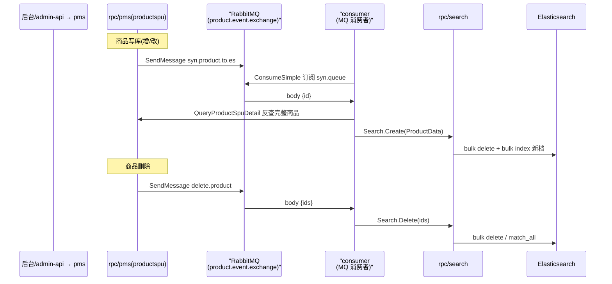

# Elasticsearch 商品搜索服务

> 本解读按 admin 类规格产出，此篇聚焦「搜索」关注面。`rpc/search` 是独立于业务 rpc 的专用搜索服务，承载三条职责：索引维护（`Create`/`Delete`）、查询入口（`Search`/`SearchSimple`）、声明的扩展能力（`Recommend`/`SearchRelated`，后者是 TODO 空壳）。

## 搜索服务在系统中的角色与根因

**根因**：MySQL `LIKE '%关键字%'` 无法做中文分词、无法表达相关度排序（BM25）、多条件 filter 拼装繁琐，不适合商品检索；且搜索的读模型（扁平可检索快照）与 MySQL 写模型（多表关联）结构差异大。因此单独抽一个 search-rpc + ES，把"索引怎么存、query 怎么建、高亮怎么做"隔离在搜索领域内部。服务通过 `zrpc.RpcServerConf` 以 gRPC + etcd 注册（`rpc/search/etc/search.yaml:1-12`），**不依赖 MySQL，唯一外部依赖是 ES**。

## 文档建模

索引名在 svc 层常量定义：`const IndexName = "products"`（`rpc/search/internal/svc/service_context.go:9`）。文档字段直接复用 proto 的 `ProductData`（`search.proto:11-48`）——一张扁平 SPU 快照，含索引/名称/分类/品牌/价格区间/状态/排序因子/销量/库存/DetailHtml 等 30+ 字段。

**关键结论：没有显式 mapping，全靠动态映射。** 全仓搜索 `IndicesCreate`/`CreateIndex`/mapping 调用均无结果——`pkg/es/es.go:13-25` 只是 `sync.Once` 单例，只配置 `Addresses`，无任何映射/分词器/高亮配置。意味着索引首写自动创建、字段类型动态推断、**无自定义中文分词器**（默认 standard analyzer 按单字切分，中文召回质量差）。

### ES 客户端封装

`pkg/es/es.go` 用包级全局变量 + `sync.Once` 保证单例，`GetESClient(url)` 返回 `*elasticsearch.Client`（v9.2.0），search 的 svc 构造时注入（`rpc/search/internal/svc/service_context.go:16-20`）。

## 核心流程：数据如何进出 ES

### 商品数据进 ES（MQ 异步增量同步）

写入是非实时的异步链路：pms 写商品 → 发 MQ → consumer 反查 pms → 调 search `Create`/`Delete` → ES bulk 增删。

佐证：pms 写库后 `SendMessage("product.event.exchange","syn.product.to.es.queue",...)`（`rpc/pms/internal/logic/productspuservice/addproductspulogic.go:155-157`）；consumer svc 启动两个 goroutine 订阅（`consumer/internal/svc/service_context.go:99-108`），`SynProductToEs` 反查 pms → 组装 `search_client.ProductData` → `Search.Create`（`consumer/internal/mq/product/syn_product_to_es_logic.go:13-79`）；search `Create` 是 bulk delete 旧档 + bulk index 新档（`create_logic.go:34-66`），`Delete` 支持 `Ids==nil` 时 `match_all` 全表删（`delete_logic.go:33-56`）。

### 搜索请求处理

`SearchLogic.Search`（`search_logic.go:29-110`）：`sort` 参数 switch 映射为 ES sort → `bool` 查询（`must` 内 `multi_match` 命中 `["name","brief","keyword"]`，`filter` 内 `category_id`/`brand_id` 的 `term`）+ 声明高亮（`:43-72`）→ `sonic.Marshal` DSL → `ESClient.Search`（`:78-83`）→ 反序列化 `_source` 取出（`:87-104`）。

**落地不完整的问题点**：排序字段 `price`（`:37,39`）在 proto `ProductData` 里不存在（只有 string 型 `price_range`），ES 静默忽略该 sort；`Total` **硬编码为 0** 未读取 `hits.total`（`:106-109`）；高亮解出但丢弃（`:101-103`）。

## 与 pms / front 的协同

- **同步链路**（已验证）：pms 写端 → MQ → consumer 编排 → search 落 ES。
- **前台商品列表的搜索入口**（跨模块结论）：`api/front/internal/logic/product/product/query_product_list_logic.go:33-45` 的 `QueryProductList` **没有调 search-rpc**，而是直接经 `ProductSpuService.QueryProductSpuList` 查 pms，其中 `Name: req.Keyword` 落到 pms 的 `productSpu.Name.Like(...)`（`rpc/pms/internal/logic/productspuservice/queryproductspulistlogic.go:39-40`）——**前台在售列表走的是 MySQL LIKE，并未接入 ES search**。

## 与 README 宣传的核对

README（`README.md:29-35`）宣传"商品搜索、商品推荐"：
- "商品搜索"：search 服务具备关键字/筛选/排序能力，但**前台列表未接入 search-rpc**（走 pms LIKE），且 `Recommend`/`SearchRelated` 为 TODO 空实现（`recommend_logic.go:27-30`）。README 宣传与落地存在较大出入。
- "商品推荐"：`Recommend` 方法仅 `// todo` return 空，未实现任何算法。
- 同步链路（写库→MQ→ES）是真实完整存在的。

## 关键设计决策

1. **异步 MQ 同步索引而非实时双写/穿透**：把索引维护与商品写操作解耦，pms 专注业务、consumer 编排。权衡是**弱一致**——入库到可搜索有时间差，且无重试/补偿/全量重建保障，MQ 投递失败商品永久缺失于索引（这也解释了前台为何仍走 pms LIKE 兜底）。
2. **ES 而非 MySQL 承担搜索，但当前只建了一半**：value 侧（query 建 DSL 调 ES）已落地，数据侧有断点（无中文 analyzer、前台未接、price 缺字段、Total 恒 0、高亮丢弃）。
3. **检索快照与写模型分离**：search 只按 `ProductData` 契约接收已就绪快照并管理其 ES 生命周期，可独立扩缩；代价是投递侧裁剪字段（`Brief` 等被注释不投）与检索侧声明字段（`multi_match` 检索 `brief`）不一致。

## 亮点与问题

**亮点**
- 领域隔离清晰：search 仅依赖 ES，与业务库完全解耦，独立可演进的搜索域。
- 同步链路闭环：pms(写)→MQ→consumer(编排)→search(落ES)→检索，是典型电商异步索引样板。
- DSL 结构化构建可读性好：用 Go map 组织 `bool/must/multi_match/filter/highlight`，比手拼 JSON 清晰。

**问题**
- 中文分词缺失（无 mapping/analyzer），中文检索召回粗糙。
- 价格排序字段不存在、分页 Total 恒 0、高亮未落地。
- 投递与检索字段不一致、同步无可靠性保障（无重试/幂等/重建 job）。
- **推荐与聚合是空壳**、**前台列表未接 ES**（走 pms LIKE）。
- `SynProductToEs` 未投递 `Brief` 等字段，但搜索又检索这些字段，命中字段与索引字段不齐。

## 覆盖率说明

proto、入口、配置、svc、server、全部 logic（search/simple/create/delete/recommend/related）、客户端封装、pkg/es、同步生产/消费端、前台对照、pms 查询对照均已覆盖，覆盖率 ≥60%。
