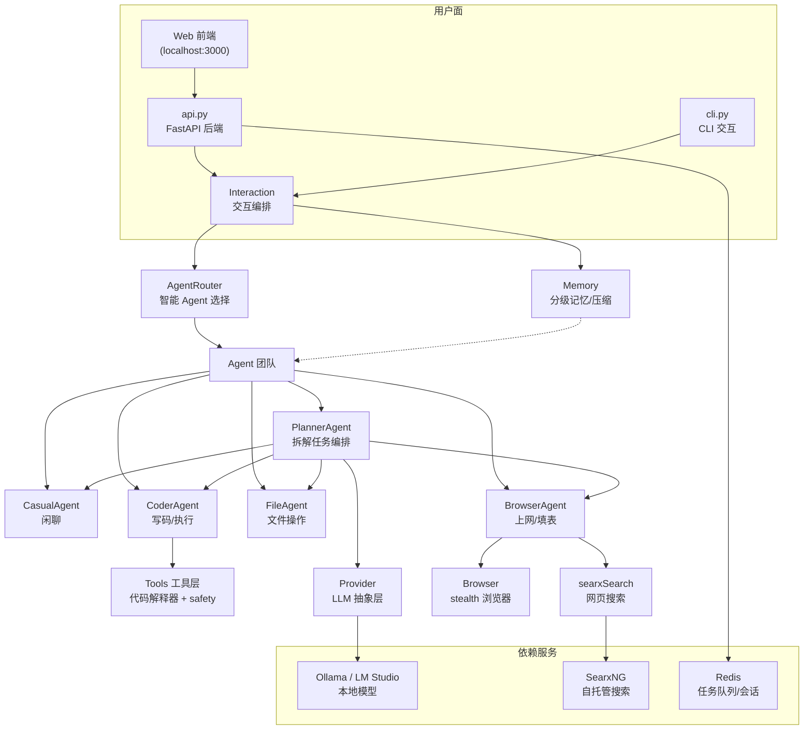
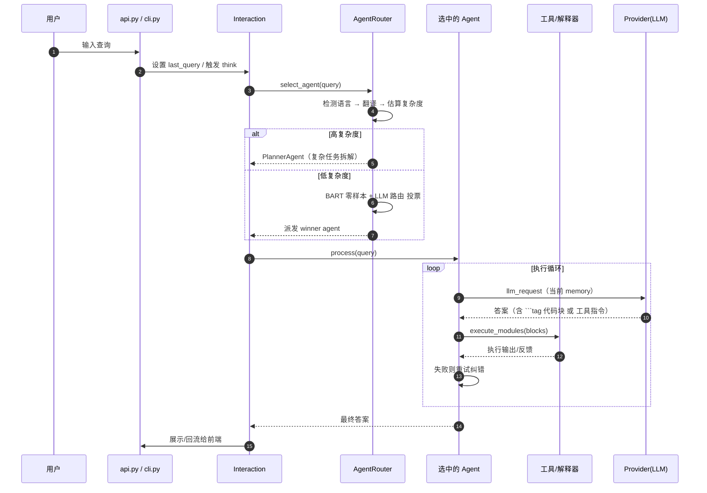

# AgenticSeek：100% 本地、可自主上网的 Manus 替代品

> 本解读按 **agent** 类规格产出（多智能体 + 浏览器自动化 + 代码执行 + 记忆 + MCP），叠加通用默认规格。

## 根因

AgenticSeek 要解决的根本问题是：**Manus 这类"全能 AI 智能体"能力强大，但依赖云端、数据上云、按量计费，个人用户无法掌控也不愿承担隐私与成本。** 它把一套能"自己上网、自己写码、自己规划多步任务"的 agent 系统，做成 **100% 本地运行**——LLM 推理、上网浏览、代码执行、语音全都落在用户自己的硬件上，`is_local=True` 时连一行请求都不出本机（[README.md:9-9]() 自述为 "a 100% local alternative to Manus AI"）。它是一套 **prompt 编排 + 工具执行** 的 agent 运行时，而非训练出来的模型。

## 概览

AgenticSeek 是一个语音可用的本地 AI 助手：用户一句话，它内部会分配最合适的子 agent（写码/上网/文件/闲聊/规划），让子 agent 自主调用工具（执行 Python/C/Go/Java/Bash、搜索网页、驱动浏览器填表、读写文件），并把复杂任务拆成多步计划逐个执行。默认部署形态是 **FastAPI 后端 + Web 前端 + RabbitMQ/Celery 风格的 Redis 队列 + SearxNG 搜索 + Ollama/LM Studio 本地模型**，Docker Compose 一键拉起。

| 核心能力 | 说明 |
|---------|------|
| 本地与隐私 | `is_local=True` 时 LLM、STT、TTS、搜索、代码执行全部在本机，无云依赖 |
| 自主上网 | BrowserAgent 用 stealth 浏览器自动搜索、翻页、收集信息、填表单，累了还会总结 |
| 自主写码 | CoderAgent 编写并执行 Python/C/Go/Java/Bash 代码，失败自动纠错重试 |
| 智能 Agent 选择 | 零样本分类 + 本地 LLM 路由双模型投票决定派发哪个 agent（[sources/router.py:370-370]()）|
| 复杂任务规划 | PlannerAgent 把大目标拆成带依赖的 JSON 计划，逐个分配 agent 执行并动态更新（[sources/agents/planner_agent.py:150-150]()）|
| 语音交互 | TTS 朗读 + STT 语音输入（唤醒词 + 确认短语），CLI 模式可用 |

### 技术栈一览

| 层 | 技术 |
|----|------|
| 语言 | Python 3.10 |
| 后端框架 | FastAPI + uvicorn（[api.py:49-49]()）|
| LLM 接入 | httpx / openai 客户端库 / ollama 客户端，抽象出 `Provider`（[sources/llm_provider.py:17-17]()）|
| 浏览器自动化 | selenium + undetected-chromedriver + selenium_stealth（[sources/browser.py:13-13]()）|
| 记忆压缩模型 | transformers，`pszemraj/led-base-book-summary`（[sources/memory.py:73-73]()）|
| 路由模型 | transformers zero-shot + `AdaptiveClassifier`（本地 LLM 路由，[sources/router.py:41-41]()）|
| 消息队列 | Redis（Celery broker，[api.py:51-51]()）|
| 搜索引擎 | SearxNG（自托管元搜索，docker 服务）|
| 前端 | 独立 Web 应用（`frontend/`，Next.js 风格）|
| 部署 | Docker Compose + Dockerfile.backend |

## 架构



### 模块职责映射

```
sources/
├── router.py            # Agent 选择：BART 零样本 + LLM 路由双模型投票、few-shot、复杂度估算
├── interaction.py       # 交互编排：选 agent、推记忆、STT/TTS、会话恢复
├── agents/
│   ├── agent.py         # Agent 抽象基类：memory、llm_request、execute_modules 块执行循环
│   ├── casual_agent.py  # 闲聊 agent
│   ├── code_agent.py    # 代码 agent（自动纠错）
│   ├── file_agent.py    # 文件操作 agent
│   ├── browser_agent.py # 网页检索/导航/填表 agent
│   ├── planner_agent.py # 任务规划与多 agent 编排
│   └── mcp_agent.py     # MCP 接入（[WIP] 未完成）
├── memory.py            # 会话记忆、压缩、会话持久化
├── llm_provider.py      # LLM Provider 抽象（本地 + 云 API）
├── browser.py           # stealth 浏览器封装、填表、安全脚本注入
├── workspace.py         # 工作区与运行时目录隔离、路径逃逸防护
├── tools/               # 工具层：各语言解释器、搜索、文件查找、safety 黑名单、MCP finder
└── schemas.py           # Query 请求/响应、executorResult 模型
api.py                   # FastAPI 入口，可部署为 Web 后端
```

### 请求链路（一次对话的完整流程）



## 核心模块导读

| 模块 | 职责 | 深读 |
|------|------|------|
| 记忆系统 | 会话记忆、模型级压缩、会话保存/恢复 | [`memory-system.md`](memory-system.md) |
| Agent 路由 | 双模型投票选择子 agent、few-shot 分类 | [`agent-router.md`](agent-router.md) |
| 工具与代码执行 | Block 执行协议、多语言解释器、命令安全黑名单 | [`tool-execution.md`](tool-execution.md) |
| Planner 编排 | 复杂任务拆解、agent 间的数据传递与动态改计划 | [`planner-orchestration.md`](planner-orchestration.md) |
| 网页自动化 | stealth 浏览器、搜索-导航-填表循环、反检测 | [`web-automation.md`](web-automation.md) |
| LLM Provider 抽象 | 本地/云多提供商统一接入、异常包装 | 并入 README 架构节 |

## 同类定位对比

| 维度 | AgenticSeek | OpenHuman / OpenWorker | Manus |
|------|-------------|------------------------|-------|
| 运行方式 | **纯本地**（`is_local=True` 全在本机）| 本地桌面 + 异地执行 | 云端 SaaS |
| 数据隐私 | 最高（可选完全不出本机）| 高 | 低（数据上云）|
| AGI 能力上限 | 受本地模型（Deepseek-R1 等）限制 | 依赖本地模型 | 云端大模型更强 |
| 扩展协议 | MCP（[WIP]）、自定义工具 | MCP 成熟 | 私有协议 |
| 成本 | 零 API 费（本地）/ 可选 API | 低 | 按量计费 |
| 该项目特色 | 双模型投票路由 + stealth 上网 + LLM 驱动的动态改计划 | / | 一体化托管 |

AgenticSeek 的核心差异化在于**极致的本地化 + 把"上网"和"动态规划"这两个 Agent 最贵的点用纯 prompt 编排实现**，而非与云端大模型拼硬能力。

## 设计亮点

- **成本极低的智能路由**：先 BART 零样本分类（免费小模型）判断大类，再用本地 LLM 路由做第二投票，按置信度归一化加权决出 winner（[sources/router.py:370-370]()），避免每个请求都动用昂贵主模型。
- **工具即"代码块"**：LLM 输出 `\`\`\`python` 这类 tag 块，抽象 `Tools.load_exec_block` 统一抽取并交给对应解释器执行（[sources/tools/tools.py:150-150]()），一个协议支撑了写码、搜索、文件、MCP 全部工具，无需复杂 function-calling schema。
- **动态改计划的自愈式编排**：Planner 不一次性把计划写死，而是每执行一步用 LLM 判断成败、只改后续步骤（[sources/agents/planner_agent.py:184-184]()），允许失败后追加恢复任务。
- **工作区隔离 + 路径逃逸防护**：agent 只能读写 `WORK_DIR`，`resolve_workspace_path` 用 realpath + commonpath 拒绝 `../` 逃逸（[sources/workspace.py:71-71]()）；同时命令黑名单拦掉 `rm`/`chmod` 等危险指令（[sources/tools/safety.py:5-5]()）。
- **超长文本的模型级压缩**：超过预估上下文阈值就用摘要模型压到 `ideal_ctx` 以内（[sources/memory.py:257-257]()），把"上下文爆炸"这件 agent 常事用本地小模型兜住。

## 不足与风险

- **MCP 生态基本不可用**：`mcp_agent.py` 源码里明确注释 "an active work in progress, not functional yet"（[sources/agents/mcp_agent.py:9-9]()），目前只是查找 MCP 服务器（Smithery registry），尚无实际 tool 调用执行。
- **本地模型能力是天花板**：README 自承 14B 以下模型频繁幻觉、planner 易失败（[README.md:732-732]()），"能上网能写码"的上限受硬件而非架构限制。
- **安全性偏薄**：`/query` 未认证，且 CoderAgent 在本机执行 shell；[api.py:310-310]() 打印的安全警告直白说明"把它暴露到网络等同把远程代码执行交出去"，默认只绑 127.0.0.1。
- **路由合理性依赖 few-shot 与提示**：`router.py` 用两条巨型硬编码 few-shot 列表（约百条）引导分类（[sources/router.py:74-74]()），改语言/新增 agent 需同步维护，且 README 自己也承认"agent routing system might not always allocate the right agent"（[README.md:353-353]()）。

## 可借鉴的设计

1. **"主模型省着用、路由用便宜模型"的分层**：用零样本小模型 + 二次投票做任务分发，把贵模型开销压到最低，适合个人预算敏感场景。
2. **工具协议统一为代码块 tag**：把 function-calling 简化为 `\`\`\`工具名` 包裹块 + `load_exec_block` 解析，一套机制覆盖代码/搜索/文件/MCP，极大降低 agent 与工具集成的复杂度。
3. **动态再规划而非一次性计划**：多步任务执行一步、让 LLM 按结果只改后续步骤，比固定 DAG 更能容忍真实环境中的失败。
4. **命令白名单 + 黑名单 + 工作区隔离三层防护**：即使 agent 失控，也被限制在独立目录和危险命令黑名单之内。
5. **预估上下文 + 摘要模型压缩**：按模型名估算上下文窗口（`get_ideal_ctx`），超限才压缩，把摘要开销降到不需要时才发生。

## 总结

AgenticSeek 用一套**"路由分流 + 多子 agent + 工具块执行 + 动态规划"**的纯编排方案，在个人硬件上复刻了云端 Agent 的核心体验，直指根因——给不想上云、不想付费、想保留数据自主权的用户一个本地版的"全能 AI 助手"。它的启发不在并行度或多 Agent 通信的复杂度，而在于**用巧妙的 prompt 编排与便宜的本地小模型，把每个成本点（路由、记忆、规划）都压到了最低**，是"本地优先 Agent"路线的务实范本。

## 子文档一览

- [`agent-router.md`](agent-router.md) — Agent 选择与双模型投票路由
- [`planner-orchestration.md`](planner-orchestration.md) — 复杂任务拆解与多 Agent 动态编排
- [`tool-execution.md`](tool-execution.md) — Block 执行协议、多语言解释器与命令安全
- [`memory-system.md`](memory-system.md) — 会话记忆、压缩与会话恢复
- [`web-automation.md`](web-automation.md) — stealth 浏览器与自主上网/填表
