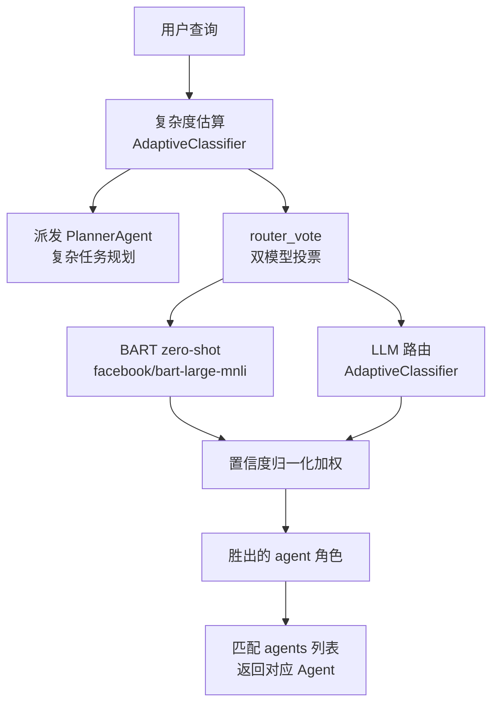

# Agent 路由系统：双模型投票，让「派发哪个 agent」变便宜

## 背景

多智能体系统的第一步就是**该把这条用户请求派给谁**。AgenticSeek 有 5 个子 agent（闲聊、写码、文件、上网、规划），若每个请求都让主模型判断归属，既贵又慢。路由系统的目标是用**远低于主模型的开销**，稳定地完成任务分类。

## 设计：两条分类轴

`AgentRouter` 用一个请求同时算 **两个维度**，再决定去向（`sources/router.py:23-32`）：

- **任务类型（role）**：从 `[talk, coding, files, web, mcp]` 中选出最匹配的 agent 角色。
- **复杂度（complexity）**：判断该任务是 `LOW`（单步、直接做）还是 `HIGH`（需拆解、多步）。



## 核心：双模型投票（`router_vote`）

路由的关键决策在 `router_vote`，它把 **BART 零样本分类** 和 **专用 LLM 路由** 的置信度归一化后加权比大小，取高者（`sources/router.py:370-390`）：

```python
        result_bart = self.pipelines['bart'](text, labels)
        result_llm_router = self.llm_router(text)
        bart, confidence_bart = result_bart['labels'][0], result_bart['scores'][0]
        llm_router, confidence_llm_router = result_llm_router[0], result_llm_router[1]
        final_score_bart = confidence_bart / (confidence_bart + confidence_llm_router)
        final_score_llm = confidence_llm_router / (confidence_bart + confidence_llm_router)
```
<!-- snippet: 从 `sources/router.py:381-386` 原样复制 -->

```python
        return bart if final_score_bart > final_score_llm else llm_router
```
<!-- snippet: 从 `sources/router.py:390` 原样复制 -->

这个结构透露了几个务实取舍：

- **两个模型互补**：BART 是通用零样本（可对任意 `labels` 即时分类，无需训练），免费、快但偏浅；LLM 路由是专为任务分类上下文微调过的 `AdaptiveClassifier`，理解更语义化。二者并投，弱化了单一模型的偶发误判。
- **置信度归一化成权重**：不是"各投一票打平"，而是把各自置信度按 `confidence/(a+b)` 归一化，谁的相对置信度更高谁赢。这一招让"某个模型特别有把握"时能压倒另一个，而非平分秋色。

```
[sources/router.py:370-390]() 双模型按归一化置信度加权决出 winner
```

## Few-shot：不给模型训练，给冷启动的引导

`AdaptiveClassifier.predict` 本身不擅长开箱即用，所以 `AgentRouter` 在初始化时**注入两条大型 few-shot 列表**——一条用于任务分类（`learn_few_shots_tasks`），一条用于复杂度估算（`learn_few_shots_complexity`），每条都有上百句示例（`sources/router.py:203-211`）：

```python
    def learn_few_shots_tasks(self) -> None:
        """
        Few shot learning for tasks classification.
        Use the built in add_examples method of the Adaptive_classifier.
        """
        few_shots = [
```
<!-- snippet: 从 `sources/router.py:203-208` 原样复制 -->

路由在初始化时向 `talk_classifier` 注入上百条任务分类示例、向 `complexity_classifier` 注入复杂度和任务两类（`sources/router.py:201` 与 `sources/router.py:357`），避免训练开销。

```
[sources/router.py:203-211]() few-shot 注入引导分类，避免训练开销
[sources/router.py:208-216]() 任务分类示例（coding/web/talk）
```

## 复杂度先决：省钱的关键开关

在真正投票**之前**，`select_agent` 先算复杂度，`HIGH` 就直接短路到 PlannerAgent，根本不做 role 投票（`sources/router.py:452-459`）：

```python
        complexity = self.estimate_complexity(text)
        if complexity == "HIGH":
            pretty_print(f"Complex task detected, routing to planner agent.", color="info")
            return self.find_planner_agent()
```
<!-- snippet: 从 `sources/router.py:456-459` 原样复制 -->

`estimate_complexity` 同样用 `AdaptiveClassifier`，并把置信度 <0.5 的判为 `HIGH`（保守起见宁可多拆）——（`sources/router.py:401-426`）。这个"先门控、再细分"的两级设计，避免了对复杂任务先做无谓的 role 分类。

## 多语言的前置归一化

投票前 `select_agent` 会先 `detect_language` → 抽取首句 → `translate` 成英文统一处理（`sources/router.py:452-454`），保证模型用同一种语言做分类，减少非英文输入的分类漂移：

```python
        lang = self.lang_analysis.detect_language(text)
        text = self.find_first_sentence(text)
        text = self.lang_analysis.translate(text, lang)
```
<!-- snippet: 从 `sources/router.py:452-454` 原样复制 -->

`find_first_sentence` 只取首行作为分类输入（`sources/router.py:392-399`），也是成本与稳定性的平衡——长请求没必要整段喂给路由。

```
[sources/router.py:452-454]() 多语言先归一化到英文再分类
```

## 权衡与局限

- **优点**：两级门控 + 双模型投票让路由在预算上非常"抠"，主模型基本不参与分发。
- **局限**：两个 few-shot 巨型列表硬编码在源码（`router.py:74-197` 复杂度 + `208-353` 任务分类），新增 agent 角色 / 改提示语需要同步维护；README 也承认"routing system might not always allocate the right agent"（`README.md:353`）。路由本身是启发式，不是保证正确性的强约束。
