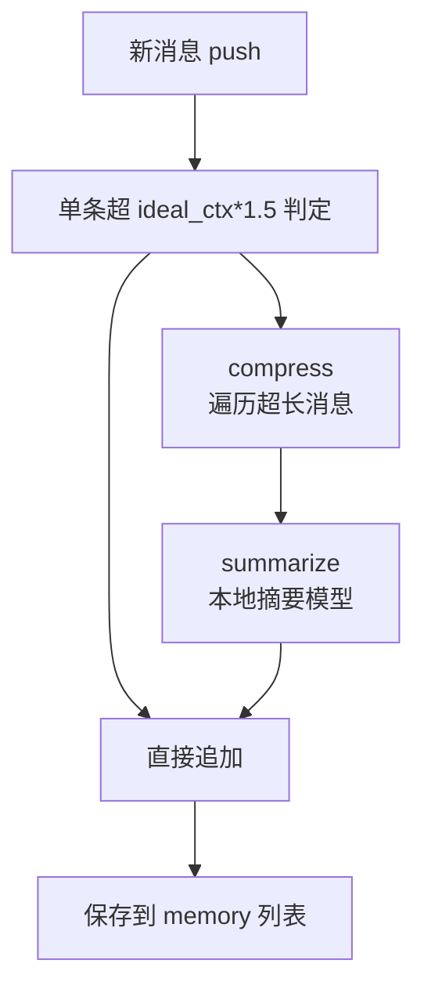
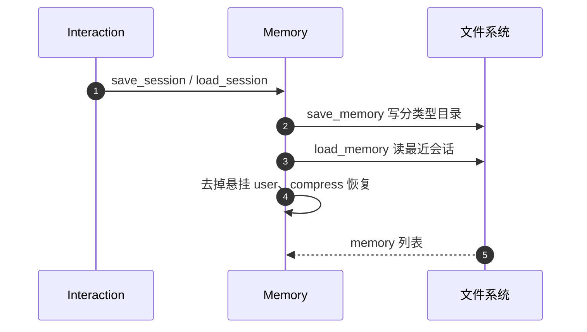

# 记忆系统：用「本地摘要小模型」兜住上下文爆炸

## 定位

Agent 的对话记忆是一种「会话级上下文」——`Memory` 维护一个 `[{role, content, time, model_used}, ...]` 的对话列表，每次 LLM 推理都读它（`sources/agents/agent.py:172-178`）。核心挑战是**长对话会撑爆本地模型的上下文窗口**，而本地模型上下文又有限。AgenticSeek 的答案很务实：**先估算模型上下文，超了就用一个专门的摘要模型压缩历史**。

## 会话结构：带元数据的手写对话

`Memory` 不是向量库，而是普通列表，只往上追加 `role/content/time/model_used`（`sources/memory.py:159-174`）：

```python
    def push(self, role: str, content: str) -> int:
        """Push a message to the memory."""
        ideal_ctx = self.get_ideal_ctx(self.model_provider)
        if ideal_ctx is not None:
            if self.memory_compression and len(content) > ideal_ctx * 1.5:
                self.logger.info(f"Compressing memory: Content {len(content)} > {ideal_ctx} model context.")
                self.compress()
        curr_idx = len(self.memory)
        ...
        if config["MAIN"]["provider_name"] == "openrouter":
            self.memory.append({'role': role, 'content': content})
        else:
            self.memory.append({'role': role, 'content': content, 'time': time_str, 'model_used': self.model_provider})
        return curr_idx-1
```
<!-- snippet: 从 `sources/memory.py:159-174` 原样复制（节选） -->

> **设计观点**：不用向量检索，是因为这个项目的记忆是**对话式、顺序敏感**的——给出完整上下文给 LLM 即可，不需要"回忆哪条最相关"。用列表换极简的实现和零检索开销；代价是记忆会无限增长，必须靠压缩兜底。

```
[sources/memory.py:159-174]() push 追加消息并触发压缩判定
[sources/agents/agent.py:172-178]() llm_request 读 memory 作为上下文
```

## 上下文估算：不硬编码，按模型名算

`get_ideal_ctx` 从模型名里提取参数量（`14b` → 14），再用一个经验公式估算上下文窗口，取 2 的幂对齐（`sources/memory.py:47-68`）：

```python
        model_size = extract_number_before_b(model_name)
        if not model_size:
            return None
        base_size = 7  # Base model size in billions
        base_context = 4096  # Base context size in tokens
        scaling_factor = 1.5  # Approximate scaling factor for context size growth
        context_size = int(base_context * (model_size / base_size) ** scaling_factor)
        context_size = 2 ** round(math.log2(context_size))
```

```
[sources/memory.py:55-68]() 按模型参数量估算上下文窗口
```

这是一个**启发式而非真实取参**——不出自模型卡片的精确 ctx，而是"大模型≈更长上下文"的粗糙映射。够用且免去开发者逐个填 ctx，但换模型时可能误估（偏小会导致提前压缩）。

## 压缩：专用摘要模型（`compress` / `summarize`）

真正的记忆管理在 `compress`：遍历非 system 消息，把超 1024 字符的用摘要模型压短（`sources/memory.py:236-247`）：

```python
        for i in range(len(self.memory)):
            if self.memory[i]['role'] == 'system':
                continue
            if len(self.memory[i]['content']) > 1024:
                self.memory[i]['content'] = self.summarize(self.memory[i]['content'])
```
<!-- snippet: 从 `sources/memory.py:243-247` 原样复制 -->

`summarize` 用本地序列到序列模型 `pszemraj/led-base-book-summary`（`sources/memory.py:73-74` 下载），beam search 生成摘要，长度取一半到两倍 min_length 之间（`sources/memory.py:204-233`）：

```python
        input_text = "summarize: " + text
        inputs = self.tokenizer(input_text, return_tensors="pt", max_length=512, truncation=True)
        summary_ids = self.model.generate(
            inputs['input_ids'],
            max_length=max_length,
            min_length=min_length,
            length_penalty=1.0,
            num_beams=4,
            early_stopping=True)
```
<!-- snippet: 从 `sources/memory.py:219-228` 原样复制 -->

> **设计观点**：**为什么用摘要模型而不是丢弃旧消息/裁剪**？因为 agent 后续步骤可能依赖早前细节，粗暴截断会丢关键约束；而"压缩语义"比"按 token 数切"保留了更多信息。代价是要额外加载一个 ~500M 的本地模型，且压缩自身的计算有开销。

`push` 里还有一层**惰性触发**：只有单条内容超过 `ideal_ctx * 1.5` 才压缩（`sources/memory.py:163-165`），避免每个请求都跑摘要。另有 `compress_text_to_max_ctx` 把任意超长文本（如网页正文）循环压缩进窗口（`sources/memory.py:257-271`）。



```
[sources/memory.py:236-247]() compress 压缩超长消息
[sources/memory.py:204-233]() summarize 摘要生成
[sources/memory.py:257-271]() compress_text_to_max_ctx 压缩任意文本进窗口
[sources/memory.py:163-165]() 惰性触发压缩
```

## 会话持久化：保存与恢复

记忆能跨会话存活。`save_memory` 把整条对话 JSON 写到 `内存目录/conversations/<agent_type>/memory_<时间戳>.txt`（`sources/memory.py:81-94`）；`load_memory` 则找回最近一次会话并按 agent 类型恢复、压缩（`sources/memory.py:135-153`）：

```python
        filename = self.find_last_session_path(save_path)
        if filename is None:
            ...
            return
        path = os.path.join(save_path, filename)
        self.memory = self.load_json_file(path)
        if self.memory[-1]['role'] == 'user':
            self.memory.pop()
        self.compress()
```
<!-- snippet: 从 `sources/memory.py:144-152` 原样复制 -->

按 `agent_type` 分目录存储（`sources/memory.py:86-90`），让不同 agent（casual/coder/browser...）各自维持独立会话；恢复经 `Interaction.load_last_session` 在整个 agent 团队上统一触发（`sources/interaction.py:184-194`）。



```
[sources/memory.py:81-94]() 会话保存到分类型目录
[sources/memory.py:135-153]() 会话恢复 + 压缩
[sources/interaction.py:184-194]() 团队级会话恢复/保存
[sources/memory.py:86-90]() 按 agent 类型分目录
```

## 权衡与局限

- **优点**：记忆即列表 + 摘要把实现做到极简，无向量检索依赖；惰性触发 + 估算窗口让压缩只在必要时发生。
- **局限**：`led-base-book-summary` 是通用摘要模型，对代码/多轮复杂推理的压缩保真度有限（压缩后可能丢关键代码细节）；估算上下文是粗糙启发式；恢复时直接 `compress()` 会把历史全压一遍（`sources/memory.py:152`），大会话会卡一下。这套"压缩而非分层检索"适合上下文有限、追求简单的本地场景。
