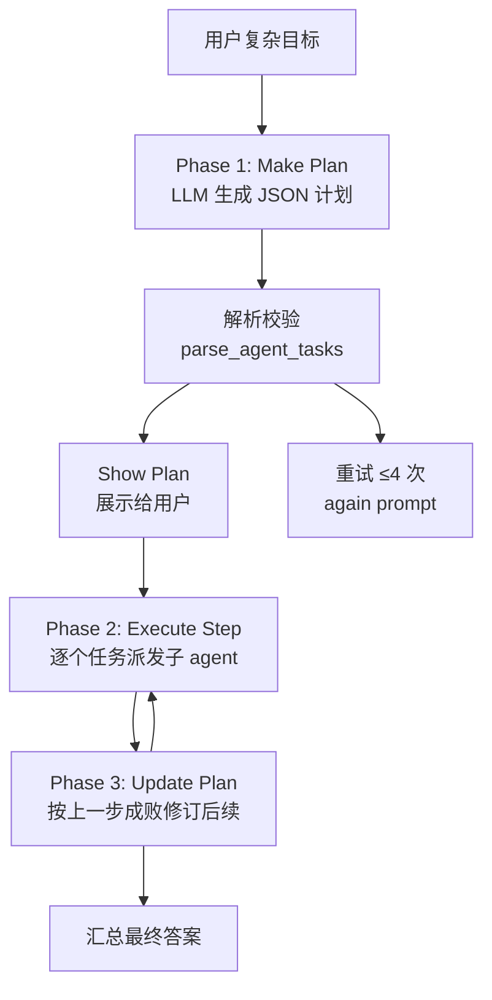
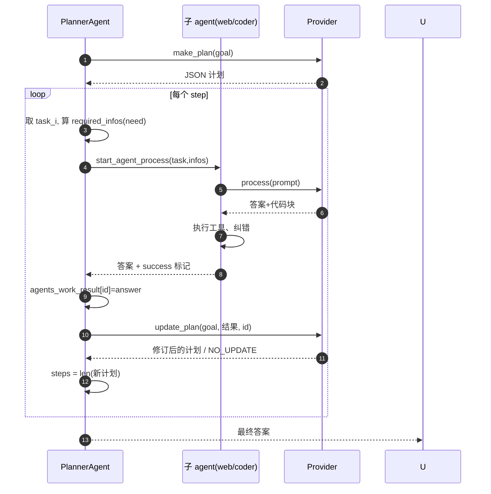

# Planner 编排：把大目标拆成可执行、可自愈的多 Agent 流水线

## 定位

当一个请求被路由判定为**复杂任务**时，交给 `PlannerAgent`。它不做单步回答，而是把用户的大目标**拆成一个有依赖关系的步骤计划**，逐步分发给手下的子 agent（coder/file/web/casual）执行，并根据每步的成败**动态修订后续计划**——这是一个 "Plan → Execute → Re-plan" 的运行循环，而非一次性 DAG。

## 三阶段结构



## Phase 1：LLM 生成结构化计划（`make_plan`）

Planner 把目标喂给 LLM，要求它输出 `\`\`\`json` 包裹的计划，每条任务带 `agent`/`id`/`task`/`need` 字段（`sources/agents/planner_agent.py:162-182`）：

```python
        while not ok:
            if retries >= max_retries:
                pretty_print(f"Failed to make a plan after {max_retries} attempts. Giving up.", color="failure")
                self.logger.warning(f"make_plan exceeded max retries ({max_retries}).")
                return []
            animate_thinking("Thinking...", color="status")
            self.memory.push('user', prompt)
            answer, reasoning = await self.llm_request()
            if "NO_UPDATE" in answer:
                return []
            agents_tasks = self.parse_agent_tasks(answer)
            if agents_tasks == []:
                self.show_plan(agents_tasks, answer)
```
<!-- snippet: 从 `sources/agents/planner_agent.py:162-177` 原样复制 -->

计划不是自由文本，而是**有约束的 JSON schema**，靠 `parse_agent_tasks` 严格校验：必须含 `plan` 数组、每条有 `agent`/`id`/`task`，`agent` 必须是已知子 agent 名，`need`（可选）用于声明前置依赖（`sources/agents/planner_agent.py:63-108`）。解析失败就重试并明确要求 LLM "add a plan within ```json"（`planner_agent.py:175`）。

```
[sources/agents/planner_agent.py:162-177]() make_plan 带回退的生成循环
[sources/agents/planner_agent.py:63-108]() 计划 JSON 的严格校验
```

**设计取舍**：用**结构化 JSON 计划**而非函数调用或自由文本，让"计划"本身可被程序校验、可被后续 LLM 增量改写——这是"可再规划"的前提。代价是 LLM 输出未必总是合法 JSON，所以需要重试与冗长的失败提示。

## Phase 2：按依赖逐个子 agent 执行（`process`）



`process` 用一个 while 循环推动整条流水线：每步先算该任务声明的 `need` 依赖在前置 agent 结果里的交集（`get_work_result_agent`，`sources/agents/planner_agent.py:257-260`），再启动对应子 agent（`sources/agents/planner_agent.py:282-301`）：

```python
        while i < steps and not self.stop:
            task_name, task = agents_tasks[i][0], agents_tasks[i][1]
            ...
            if agents_work_result is not None:
                required_infos = self.get_work_result_agent(task.get('need', []), agents_work_result)
            ...
            answer, success = await self.start_agent_process(task, required_infos)
            ...
            agents_work_result[task['id']] = answer
            agents_tasks = await self.update_plan(goal, agents_tasks, agents_work_result, task['id'], success)
            steps = len(agents_tasks)
            i += 1
```
<!-- snippet: 从 `sources/agents/planner_agent.py:282-301` 原样复制（节选了中间注释行） -->

> 上段为两段不连续的代码行拼接，作示意图而非精确指纹；精确实现见下方 update_plan 段。

**依赖传递**：任务通过 `need: ["1","2"]` 声明它需要哪些前置 task 的输出，Planner 从 `agents_work_result` 里挑出对应结果拼进 prompt（`planner_agent.py:110-132` 的 `make_prompt`），实现 agent 间信息接力。

```
[sources/agents/planner_agent.py:257-260]() need 依赖解析
[sources/agents/planner_agent.py:282-301]() 主执行循环
[sources/agents/planner_agent.py:110-132]() 跨 agent 信息拼接进 prompt
```

## Phase 3：动态再规划（`update_plan`）

这是最有设计含金量的部分。每一步执行后，Planner 都会问 LLM：**这一步是成功还是失败？是否需要调整后续**（`sources/agents/planner_agent.py:184-230`）：

```python
        next_task = f"Next task is: {agents_tasks[int(id)][0]}." if int(id) < len(agents_tasks) else "No next task."
        update_prompt = f"""
        ...
        The last agent working on task: {id}, did the following work:
        {last_agent_work}
        ...
        If agent work was good: answer "NO_UPDATE"
        If agent work is leading to failure: update the plan.
        If a task failed add a task to try again or recover from failure.
        ...
        Do not change past tasks. Change next tasks.
        """
```
<!-- snippet: 从 `sources/agents/planner_agent.py:205` + `:208-222` 节选（update_prompt 模板） -->

关键约束是**"Do not change past tasks. Change next tasks."**——已完成的步骤不可改动，只允许修订后续，通过 `id_int == len(agents_tasks)` 判定是否最后一步来决定是否追加恢复任务（`planner_agent.py:202`）。若 LLM 判成功则返回 `NO_UPDATE`，循环无需重写计划（`planner_agent.py:207` 注释掉的那段正说明曾考虑"仅在失败时改计划"，现改为每步都评估）。

```
[sources/agents/planner_agent.py:184-230]() update_plan 动态再规划
[sources/agents/planner_agent.py:202-207]() 末尾判定 + NO_UPDATE 短路
```

## 权衡与局限

- **优点**：把"长任务的自愈"实现在 prompt 层面——LLM 既是计划者又是评审者，失败可自动追加恢复任务，无需硬编码重试路径。
- **局限**：每一步都对同一条 LLM 链路做一次完整推理（生成+评估），复杂任务 token 消耗线性叠加；且"改后续计划"依赖 LLM 遵守 "don't change past tasks" 约束，能力弱的小模型容易破坏已定计划。README 也提示 14B 以下模型 planner 易失败（`README.md:732`）。
