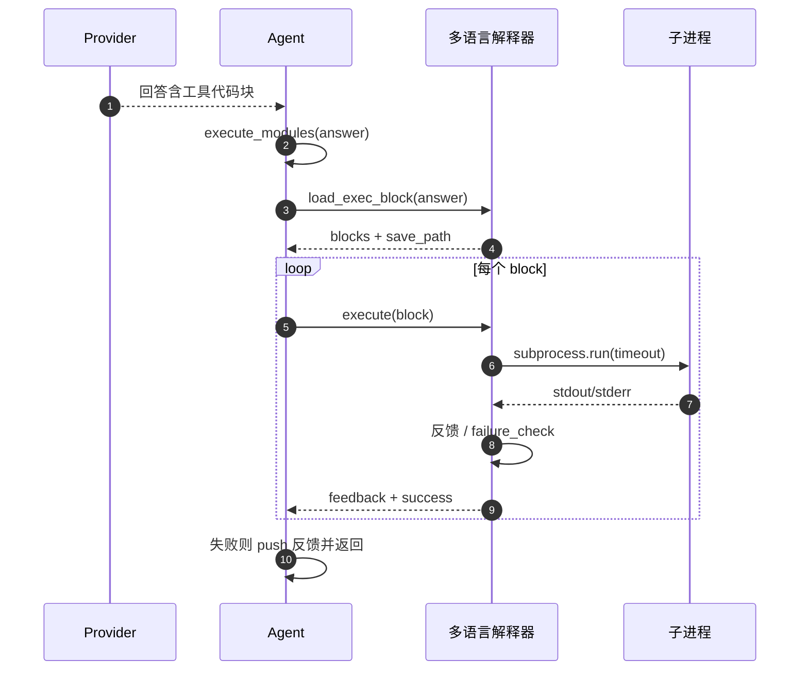

# 工具与代码执行：一个 Block 协议撑起整个工具层

## 思想：把"调用工具"做成"解析代码块"

AgenticSeek **不采用传统 function-calling schema**，而是用极简的**代码块（Block）协议**：LLM 在回答里写 `\`\`\`工具名` 包裹的文本，工具层统一解析并按 tag 分发执行。这个设计让"执行 Python"、"搜索网页"、"查文件"、"调 MCP" 全部走同一条通道（`sources/tools/tools.py:1-18` 的 docstring 直说了这个约定）。

## Block 解析：`load_exec_block`

`Tools.load_exec_block` 扫描 LLM 文本，抽出所有 `\`\`\`<tag>` 到 `\`\`\`` 的块，识别可选的保存路径（块首行 `xxx:path`），返回块列表 + 保存路径（`sources/tools/tools.py:150-200`）：

```python
        assert self.tag != "undefined", "Tag not defined"
        start_tag = f'```{self.tag}'
        end_tag = '```'
        code_blocks = []
        ...
        if start_tag not in llm_text:
            return None, None
        while True:
            start_pos = llm_text.find(start_tag, start_index)
            if start_pos == -1:
                break
            ...
            if ':' in content.split('\n')[0]:
                save_path = content.split('\n')[0].split(':')[1]
                content = content[content.find('\n')+1:]
            ...
            code_blocks.append(content)
            start_index = end_pos + len(end_tag)
```
<!-- snippet: 从 `sources/tools/tools.py:161-198` 原样复制（保留关键行） -->

每个具体工具继承 `Tools` 并声明自己的 `tag`（如 `PyInterpreter.tag="python"`，`sources/tools/tools.py:24`）。这样同一套解析逻辑，`\`\`\`python` 交给 Python 解释器、`\`\`\`web_search` 交给搜索工具。

```
[sources/tools/tools.py:161-198]() Block 解析与保存路径识别
[sources/tools/tools.py:24-24]() tag 驱动的工具分发
```

## 执行循环：`execute_modules`

`Agent.execute_modules` 是工具调用的中枢——遍历 agent 挂载的所有工具，逐个让它们解析、执行、判定成败并记录到 `blocks_result`（`sources/agents/agent.py:255-285`）：

```python
        for name, tool in self.tools.items():
            feedback = ""
            blocks, save_path = tool.load_exec_block(answer)
            if blocks != None:
                pretty_print(f"Executing {len(blocks)} {name} blocks...", color="status")
                for block in blocks:
                    ...
                    output = tool.execute([block])
                    feedback = tool.interpreter_feedback(output)
                    success = not tool.execution_failure_check(output)
                    self.blocks_result.append(executorResult(block, feedback, success, name))
                    if not success:
                        self.success = False
                        self.memory.push('user', feedback)
                        return False, feedback
                    ...
```
<!-- snippet: 从 `sources/agents/agent.py:266-281` 原样复制（节选） -->

执行结果以 `executorResult`（block + feedback + success + tool_type）记录（`sources/schemas.py:44-77`），既能回写 memory 让 LLM 看到反馈、也能序列化给后端返回。失败直接短路返回。



```
[sources/agents/agent.py:266-281]() 工具遍历执行与失败短路
[sources/schemas.py:44-77]() 执行结果 executorResult 模型
```

## 多语言解释器：一个模板，派生所有语言

写码能力来自 `CoderAgent` 挂载的 5 个解释器 + 文件查找（`sources/agents/code_agent.py:21-28`）：

```python
        self.tools = {
            "bash": BashInterpreter(),
            "python": PyInterpreter(),
            "c": CInterpreter(),
            "go": GoInterpreter(),
            "java": JavaInterpreter(),
            "file_finder": FileFinder()
        }
```
<!-- snippet: 从 `sources/agents/code_agent.py:21-28` 原样复制 -->

每个解释器都复用 `Tools` 基类的解析，自己只实现三件事：`execute`（怎么跑）、`execution_failure_check`（怎么判败）、`interpreter_feedback`（怎么反馈给 LLM）。以 `PyInterpreter.execute` 为例——在隔离子进程里跑、带 timeout、拒绝交互式代码（`sources/tools/PyInterpreter.py:43-77`）：

```python
        try:
            result = subprocess.run(
                [sys.executable, "-c", code],
                cwd=self.work_dir,
                capture_output=True,
                text=True,
                timeout=timeout
            )
        except subprocess.TimeoutExpired:
            return f"code execution failed: timed out after {timeout} seconds."
```
<!-- snippet: 从 `sources/tools/PyInterpreter.py:59-69` 原样复制（节选） -->

三个值得注意的健壮性细节：

- **拒绝交互代码**：`refuse_interactive_code` 用正则拦住 `curses`/`input()`，因为无头沙箱没有终端，提前拒绝比让 agent 反复重试更有效（`sources/tools/PyInterpreter.py:28-41`）。
- **超时兜底**：子进程 timeout，防失控代码冻结后端（`PyInterpreter.py:64-72`）。
- **失败模式识别**：`execution_failure_check` 用一组正则（traceback/exception/syntax/segmentation...）判败（`PyInterpreter.py:89-111`），喂给 agent 决定是否纠错重来。

```
[sources/agents/code_agent.py:21-28]() CoderAgent 挂载的工具
[sources/tools/PyInterpreter.py:43-77]() Python 子进程执行 + timeout
[sources/tools/PyInterpreter.py:28-41]() 拒绝交互代码
[sources/tools/PyInterpreter.py:89-111]() 失败模式识别
[sources/tools/PyInterpreter.py:59-69]() subprocess + cwd=work_dir + timeout
```

## 安全边界：命令黑名单 + 工作区隔离

工具层有两道防线。一是 `safety.py` 的危险命令黑名单——Unix/Windows 各一份（`rm`、`dd`、`chmod`、`git` 等，`sources/tools/safety.py:5-68`），判断时**按 basename 归一化 token**，使 `/bin/rm`、`./rm` 都能命中裸 `rm`；多 token 条目（如 `chkdsk /f`）需所有部分都在 token 集合里才命中（`sources/tools/safety.py:85-100`）：

```python
    norm_tokens = {os.path.basename(t) for t in _tokenize(cmd)}
    bag = unsafe_commands_windows if sys.platform.startswith("win") else unsafe_commands_unix
    for entry in bag:
        parts = {os.path.basename(p) for p in entry.split()}
        if parts and parts.issubset(norm_tokens):
            return True
    return False
```
<!-- snippet: 从 `sources/tools/safety.py:94-100` 原样复制 -->

二是工作区隔离——`workspace.py` 强制所有 agent 文件读写落在 `WORK_DIR`，`resolve_workspace_path` 用 `realpath` + `commonpath` 拒绝 `../` 逃逸（`sources/workspace.py:71-93`），确保即使代码失控也出不了沙箱目录。

```
[sources/tools/safety.py:94-100]() basename 归一化的命令黑名单判定
[sources/workspace.py:71-93]() 工作区路径逃逸防护
```

## 权衡与局限

- **优点**：Block 协议把工具集成成本降到极低——新工具只需继承 `Tools` + 定义 tag + 实现三个方法；无需维护 function schema 或 Tool 注册表。
- **局限**：代码块解析对 LLM 输出格式敏感（非合法块会静默漏掉或解析错）；`execution_failure_check` 靠正则猜测失败，误判会误导 agent 的纠错方向；且 Python 执行本质是"任代码在本机运行"，隔离靠的是目录+黑名单而非真正的沙箱（`api.py:310` 安全警告也点明远程执行风险）。
