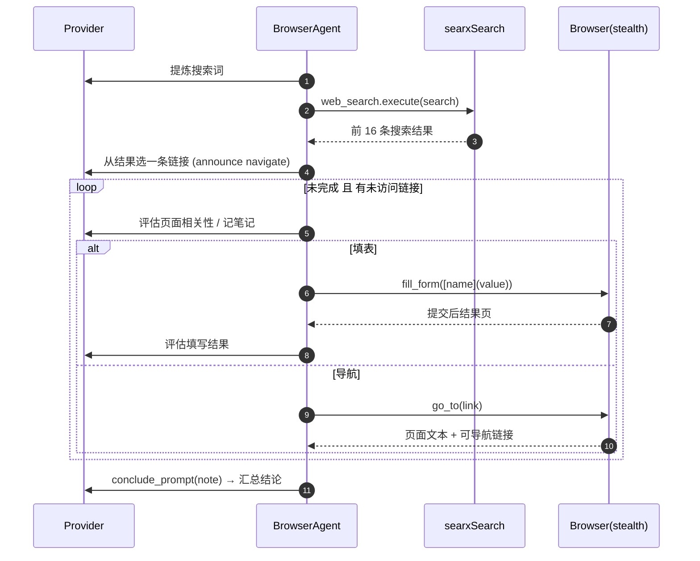

# 网页自动化：stealth 浏览器 + LLM 驱动的「搜索-导航-填表」循环

## 定位

"自主上网"是 AgenticSeek 最核心的卖点。它分两层：**BrowserAgent**（策略层，决定搜什么、去哪里、填什么、何时收手）和 **Browser**（执行层，stealth 浏览器封装，负责真把动作做出来）。二者用一段段 prompt 驱动 LLM 决策，而非脚本硬编码。

## 反检测：让浏览器"看起来像人"

本地上网会遇到反爬/验证码。`create_driver` 用 `undetected-chromedriver` + `selenium_stealth` + 随机 UA + 指纹补丁来降低被检测概率（`sources/browser.py:271-282`）：

```python
    if stealth_mode:
        driver = create_undetected_chromedriver(service, chrome_options)
        user_agent = get_random_user_agent()
        stealth(driver,
            languages=["en-US", "en"],
            vendor=user_agent["vendor"],
            platform="Win64" if "windows" in user_agent["ua"].lower() else "MacIntel" if "mac" in user_agent["ua"].lower() else "Linux x86_64",
            webgl_vendor="Intel Inc.",
            renderer="Intel Iris OpenGL Engine",
            fix_hairline=True,
        )
        return driver
```
<!-- snippet: 从 `sources/browser.py:271-282` 原样复制 -->

还叠加了 `patch_browser_fingerprint` 注入 `spoofing.js`（`sources/browser.py:342-344`）、导航后 `human_scroll` 做类人随机滚动（`sources/browser.py:333-340`）、以及声明式隐藏 `navigator.webdriver`（`sources/browser.py:257`）。可选安装 nopecha 验证码扩展（`sources/browser.py:317-323`）。

```
[sources/browser.py:271-282]() stealth 融合（uc + selenium_stealth + 随机 UA）
[sources/browser.py:342-344]() 指纹 JS 注入
[sources/browser.py:333-340]() 类人随机滚动
[sources/browser.py:257-257]() 隐藏 webdriver 标记
```

## BrowserAgent 主循环：感知 → 决策 → 行动 → 收尾

`BrowserAgent.process` 用一个 while 循环驱动整个上网过程（`sources/browser.py` 不在，核心在 `sources/agents/browser_agent.py:358-445`）：



核心状态机是「决策」与「动作」交替：LLM 看页面文本判断相关度、该记笔记还是该导航/填表（`make_navigation_prompt`，`sources/agents/browser_agent.py:92-178`），Browser 负责真正执行。关键动作包括 `REQUEST_EXIT`（收手）、`GO_BACK`（回退）、`FORM_FILLED`（表单已填）、`NAVIGATE`（前进）（`sources/agents/browser_agent.py:15-21`）。

```
[sources/agents/browser_agent.py:15-21]() Action 枚举（退出/回退/填表/导航）
[sources/agents/browser_agent.py:92-178]() 导航决策 prompt 模板
[sources/agents/browser_agent.py:358-445]() process 上网主循环
```

## 导航执行：`go_to` 的健壮性

`Browser.go_to` 不只是 `driver.get`，而是带随机延时、等绕过反爬页、注入安全脚本、类人滚动的完整导航（`sources/browser.py:346-367`）：

```python
    def go_to(self, url:str) -> bool:
        time.sleep(random.uniform(0.4, 2.5))
        try:
            initial_handles = self.driver.window_handles
            self.driver.get(url)
            time.sleep(random.uniform(0.01, 0.3))
            try:
                wait = WebDriverWait(self.driver, timeout=10)
                wait.until(
                    lambda driver: (
                        not any(keyword in driver.page_source.lower() for keyword in ["checking your browser", "captcha"])
                    ),
                    message="stuck on 'checking browser' or verification screen"
                )
            except TimeoutException:
                ...
            self.apply_web_safety()
            ...
            self.human_scroll()
            ...
            return True
```
<!-- snippet: 从 `sources/browser.py:346-367` 原样复制（节选） -->

它还会等页面脱离 "checking your browser"/"captcha" 检测页后才继续，超时就告警但不中断（`sources/browser.py:353-362`）。

```
[sources/browser.py:346-367]() 带等待与安全注入的导航
[sources/browser.py:815-815]() apply_web_safety 注入安全脚本
```

## 智能填表：把 `[name](value)` 变成真实操作

Agent 与页面的表单交互协议是 `[input_name](value)` 字符串，`Browser.fill_form` 负责解析并落成真实 Selenium 操作（`sources/browser.py:752-769`），底层 `fill_form_inputs` 按输入框名查找 XPath、区分 select/textarea/file/checkbox/radio 等类型分别处理（`sources/browser.py:682-747`）：

```python
        for input_str in input_list:
            match = re.match(r'\[(.*?)\]\((.*?)\)', input_str)
            if not match:
                ...
                continue
            name, value = match.groups()
            ...
            xpath = self.find_input_xpath_by_name(inputs, name)
            ...
            tag_name = (element.tag_name or "").lower()
            if tag_name == "select":
                select = Select(element)
                select.select_by_visible_text(value)
            elif tag_name == "textarea":
                element.clear()
                element.send_keys(value)
            elif input_type == "file":
                element.send_keys(value)
            ...
```
<!-- snippet: 从 `sources/browser.py:689-746` 原样复制（节选） -->

填完后 `tick_all_checkboxes` + `find_and_click_submission` + `wait_for_submission_outcome` 完成提交并探测结果（`sources/browser.py:752-769`）。整套用正则 + Selenium 封装把"LLM 想填表单"翻译成可执行动作，README 也承认该能力仍 experimental、可能失败（`README.md:347`）。

```
[sources/browser.py:752-769]() fill_form 完整流程（填值+提交+探测）
[sources/browser.py:682-747]() 按类型区分的输入填充
```

## 权衡与局限

- **优点**：把"自主上网"拆成 prompt 驱动的决策 + 反检测执行，只需一个通用网页获取通道，不需要为每个网站写专用爬虫；stealth 手段提升了真实站点上的可用性。
- **局限**：这种"通用导航"对结构复杂/强交互的页面（SPA、需要登录态、验证码）仍脆弱；反检测与内容提取都是黑盒启发，失败时 `go_to` 只告警不隔离，可能让 agent 在错误页打转；表单填写对 DOM 结构依赖高（靠 input name 定位 XPath），README 明确标注为实验性（`README.md:347`）。
