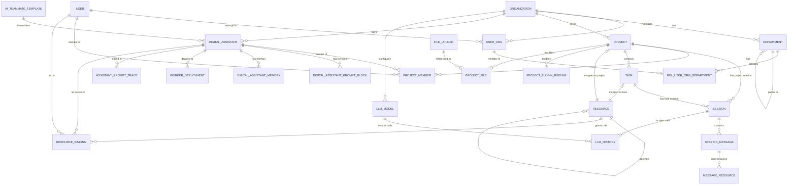
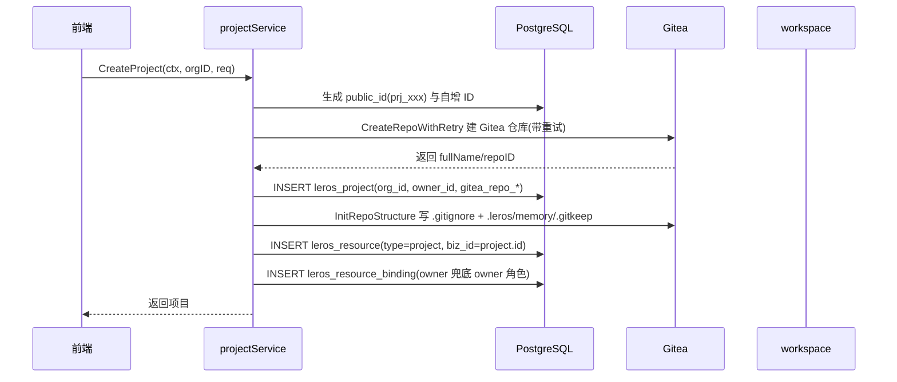
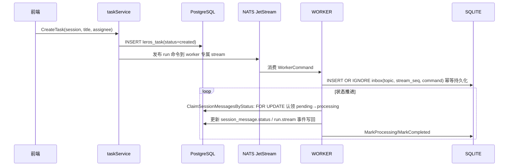
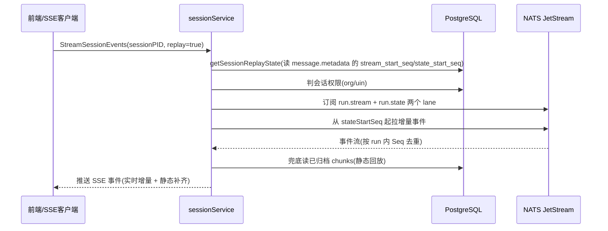
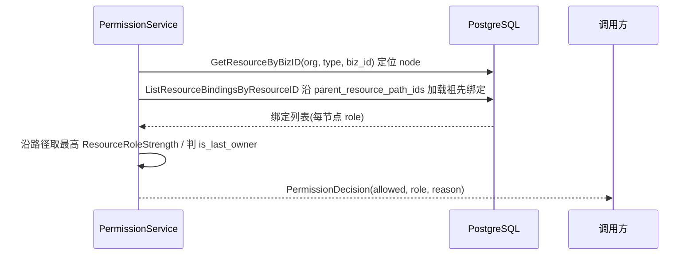

# 数据模型与存储

> 本关注面解读 Lework（backend）的数据模型与存储设计。覆盖核心表结构、存储选型理由、Schema 演进策略与读写路径。遵循「ER 图 + 每表字段表 + 选型权衡 + 演进 + 读写路径」五要素成文，以「Why>What」为中心，避免写成纯字段清单。

## 数据模型在项目中的角色

Lework 把 AI 从"聊天工具"重构为"可长期协同工作的团队成员"。它的设计哲学反复强调三条铁律：**"DB 才是状态"、"内存不是状态"、"Replayable System（可回放）"**。把状态系统性外置到数据库，正是数据模型存在的根本原因——会话中间态、AI 队友人设、任务执行进度、LLM 调用链路、权限关系，每一类都必须落库，才能保证任意时刻崩溃重启都能恢复、刷新页面后能完整回放发生过的事。

数据模型在此不只是一套 CRUD 支撑，而是三层职责叠加：

- **业务主实体层**：用户/组织/部门、项目/任务/会话、AI 队友/技能/插件、统一资源权限树。这些是 PostgreSQL 主库的关系表，构成"长期事实"。
- **执行中间态层**：worker 本地的 SQLite inbox 与 provider 会话绑定，只关心"这条命令消费到哪、provider 会话断在哪"，本质是"崩溃恢复的进度指针"，不是业务事实。
- **沉淀层**：项目级 Git 仓库里的 `.leros/memory/` 与 `artifacts/` 目录，记录 AI 队友的工作记忆与产出物，让"记忆"以版本化、可 diff、跟代码共存。

本关注面根因：**为了长期协同 + 可回放 + 崩溃可恢复，把状态分别外置到强一致 PostgreSQL（业务事实）、SQLite（worker 本地续跑）、Git（记忆沉淀）这三层存储，并用 GORM AutoMigrate + 手动补偿迁移保证结构随代码演进。**

## 存储选型与理由

Lework 不是"只用一个 DB"，而是围绕"状态分层"把三类存储拼成一张谱：业务事实讲强一致 ⇒ PostgreSQL；worker 执行进度讲"快速、本地、崩溃续跑" ⇒ SQLite；AI 记忆与产出讲"可版本化、可 diff、跟代码走" ⇒ Git。

| 存储 | 承载 | 选型理由（权衡） | 不选的代价 |
|------|------|------------------|-----------|
| PostgreSQL 17 | 全部业务主实体（user/org/project/task/session/digital_assistant/plugin/resource 等） | ① JSONB 兜住"对象-关系混合"（message 的 chunks/artifacts/usage 都塞 JSONB，省嵌套表）；② `bigint[]` 原生支持资源路径 ID 数组，是权限树继承的关键；③ 部分唯一索引 `WHERE deleted_at IS NULL` 让软删可复用唯一键；④ 事务 + `FOR UPDATE` 行锁支撑消息原子认领 | 换 NoSQL 则无法表达 project↔task↔session 强关联与跨表权限查询 |
| SQLite（worker 本地） | `worker_run_inbox` + `provider_session_bindings` | ① 零配置单文件、跟 worker 进程一起部署；② WAL 模式 + `SetMaxOpenConns(1)` 保证本地简单可靠；③ 只存"消费进度"与"provider 会话映射"，非业务事实、无需中心化一致性；④ at-least-once 崩溃恢复的物理载体 | 若 inbox 也放 PG，则 worker 断网/慢网下无法本地续跑，且把高频状态写塞进中心库放大耦合 |
| Git（Gitea） | 每个项目仓库的 `.gitignore` + `.leros/memory/`（工作记忆）+ `uploads/`（用户上传，明确排除） | ① 记忆与产出跟项目代码同仓库版本化，天然可 diff、可审计、可协作；② 用户上传文件经 `.gitignore` 明确排除、不走 Git，走对象存储 | 不适合做高频结构化查询，故只沉淀"文档/记忆形"数据 |

最值得展开的权衡是 **主业务态放 PG、执行中间态放 SQLite**。两者边界清晰但互补：PG 里存"下一次打开页面还能看到的真相"（会话、消息、任务状态）；SQLite 里存"这一秒 worker 处理到哪"（某条 NATS `stream_seq` 是否已消费、断在哪个 provider 会话）。前者要跨服务共享、要支持复杂查询，所以用中心化强一致 PG；后者只属于单一 worker 进程自己，多写一笔 PG 就多一次网络往返、多一刻断网风险，所以落本地文件。这直接呼应"内存不是状态"——worker 进程崩溃，内存运行态会丢，但 SQLite 记录的进度与 PG 里的事实都在，重启即可续跑或回放。

SQLite inbox 表用 `INSERT OR IGNORE ... UNIQUE(topic, stream_seq)` 实现幂等落盘、`GetNonTerminal` 在重启时重新派发未完成记录，正是"at-least-once 崩溃恢复"的实现：[`backend/internal/worker/command/run/inbox/inbox.go:92-108`]()、[`backend/internal/worker/command/run/inbox/inbox.go:190-199`]()。

而为什么用 **GORM AutoMigrate 而非 SQL 迁移**，是工程实用主义的选择：项目正处"模型高频演进"的 MVP 阶段，几十张表不断加字段、改列名。AutoMigrate 让"表结构跟着 model struct 的 gorm tag 走"，代价是只能做"加列/加表/加索引"这种加法迁移，**不会删列、不会重命名列**——这段限制在 `database.go` 顶部注释里被坦然声明：[`backend/internal/infra/db/database.go:27-29`]()。因此项目并不是"只用 AutoMigrate"，而是补了一层手写幂等的反向清理与补偿逻辑。这正是下一节 Schema 演进策略的主角。

## 实体关系总览

以一个组织（Organization）为根，向下分叉出"身份/协作"与"执行/产物"两条主干，再被"统一资源权限树"横切，最后以"AI 队友"串联起人设、部署与 LLM 调用。

关系图中几个关键设计点：

1. **真正的"租户/成员边界"不在 project_member，而在独立的一张 Resource + ResourceBinding 权限树**。`ProjectMember` 是历史表达，新权限模型把 project/task/file/artifact 统一成 `Resource` 节点，把"谁属于哪个项目"落到 `ResourceBinding`。`ListProjectIDsByUser` 正是 join resource_binding 取用户可访问项目：[`backend/internal/infra/db/project_dao.go:96-108`]()。
2. **AI 队友被三张"装饰表"扩展**：`digital_assistant_prompt_block`（人设分层）、`digital_assistant_memory`（长期记忆）、`assistant_prompt_trace`（注入追踪），注释全部指向 "future retrieval-augmented persona"，即人设是"分层可组合 + 带溯源"，不是一个大字符串：[`backend/types/digital_assistant_evolution.go:31-50`]()。
3. **会话是多态容器**：`Session` 用 `type ∈ {chat, task, project}` 同时承载三类上下文，靠 `project_id`/`task_id` 可空组合唯一索引 `uni_session_project_task` 约束 scope。

## 核心表设计

下方按"身份组织 → 项目执行 → 会话 → AI 队友与部署 → 插件/技能 → 权限资源树 → 可观测性"分组，每张核心表一个字段表。所有表均内嵌 `gorm.Model`，即共享公共列 `id`(PK)、`created_at`、`updated_at`、`deleted_at`（软删），字段表只列业务列。所有表名统一 `leros_` 前缀，集中定义在 `tables.go`：[`backend/types/tables.go:8-103`]()。

### 身份与组织

#### User — 用户（`backend/types/user.go:12-26`）

用户是身份层主体，`ExternalID` 对接 identity-platform 账户体系，`PublicID` 为对外暴露标识。

| 字段 | 类型 | 约束 | 说明 |
|------|------|------|------|
| id | bigserial | PK（gorm.Model） | 自增主键 |
| external_id | bigint | index | identity-platform User.ID，与外部账户体系对账 |
| public_id | varchar(64) | uniqueIndex, not null, default '' | 用户公开 ID |
| password | varchar(255) | — | 本地认证用（哈希存储） |
| name | varchar(255) | — | 姓名 |
| email | varchar(255) | — | 邮箱 |
| phone | varchar(32) | uniqueIndex | 手机号，唯一 |
| avatar_url | varchar(500) | — | 头像 |

#### Organization — 组织（`backend/types/organization.go:9-27`）

系统顶级租户实体，`Code` 唯一作业务代码，`ExternalCompanyID` 对接外部公司体系。

| 字段 | 类型 | 约束 | 说明 |
|------|------|------|------|
| id | bigserial | PK | 自增主键 |
| external_company_id | bigint | index | identity-platform Company.ID |
| public_id | varchar(64) | uniqueIndex, not null, default '' | 组织公开 ID |
| type | varchar(50) | default 'company' | company/team/project |
| code | varchar(255) | unique_index, not null | 组织代码（唯一） |
| name | varchar(255) | not null | 组织名称 |
| status | varchar(20) | default 'active' | active/inactive |
| description | varchar(256) | — | 描述 |
| logo | varchar(256) | — | Logo URL |
| address | varchar(256) | — | 联系地址 |
| website | varchar(256) | — | 官网 |
| created_by_uin | bigint | default 0 | 创建者 Uin |

#### UserOrg — 用户组织关联（`backend/types/user_org.go:9-20`）

多对多中间表，一个用户可属多组织。复合唯一索引 `uni_user_org_member`(user_id, org_id)。

| 字段 | 类型 | 约束 | 说明 |
|------|------|------|------|
| id | bigserial | PK | 自增主键 |
| external_uin | bigint | index | identity-platform UIN.ID |
| user_id | bigint | not null, index, uniqueIndex(uni_user_org_member) | 用户 ID |
| org_id | bigint | not null, index, uniqueIndex(uni_user_org_member) | 组织 ID |
| is_default | boolean | default false | 是否默认组织 |

#### Department — 部门（`backend/types/department.go:6-41`）

组织的树形部门。关键设计：`ParentIDs` 用 **jsonb 存祖先 ID 链**（根到直接父部门），配合 `BuildDepartmentParentIDs` 在插入时拼接，换来"一条 SQL 判断某部门是否在祖先链上"，避免递归 CTE。

| 字段 | 类型 | 约束 | 说明 |
|------|------|------|------|
| id | bigserial | PK | 自增主键 |
| name | varchar(100) | not null, uniqueIndex(uni_dept_org_name, composite:org_id) | 同组织内唯一 |
| parent_id | bigint | not null default 0, index(idx_dept_org_parent) | 父部门 ID，0=顶层 |
| parent_ids | jsonb | — | 祖先 ID 链（根→直接父） |
| sort | bigint | not null default 0 | 同级排序 |
| org_id | bigint | not null default 0, index, uniqueIndex(uni_dept_org_name, composite:name) | 所属组织 |

#### MemberDepartment — 成员部门关联（`backend/types/rel_user_org_department.go:6-18`）

表名 `rel_user_org_department`，`is_primary` 标记主部门。

| 字段 | 类型 | 约束 | 说明 |
|------|------|------|------|
| id | bigserial | PK | 自增主键 |
| uin | bigint | not null, index | 组织成员 Uin |
| org_id | bigint | not null | 组织 ID |
| department_id | bigint | not null, index | 部门 ID |
| is_primary | boolean | not null default false | 是否主部门 |

### 项目与执行

#### Project — 项目（`backend/types/project.go:16-55`）

长期工作的核心容器，通过 `GiteaRepo*` 三字段绑定一个 Git 工作区仓库，是"记忆沉淀进 Git"的挂载点；`metadata`(ObjectMetadata) 以 JSONB 存标签/桶/对象存储 key 等扩展。

| 字段 | 类型 | 约束 | 说明 |
|------|------|------|------|
| id | bigserial | PK | 自增主键 |
| public_id | varchar(255) | not null, uniqueIndex | `prj_xxx` 唯一标识 |
| org_id | integer | not null, index | 所属组织 |
| owner_id | integer | not null, index | 创建者用户 ID |
| name | varchar(255) | not null | 项目名称 |
| description | text | — | 描述 |
| objective | text | — | 项目目标 |
| status | varchar(50) | not null default 'active', index | active/paused/completed/archived |
| gitea_repo_full_name | varchar(255) | — | gitea 仓库全名 org/repo |
| gitea_repo_id | bigint | — | gitea 内部仓库 ID |
| gitea_default_branch | varchar(128) | default 'main' | 默认分支 |
| metadata | jsonb | — | ObjectMetadata（tags/type/bucket/key/extra） |

`ObjectMetadata` 实现 `Scan`/`Value` 接口读写 JSONB：[`backend/types/project.go:77-93`]()。

#### ProjectMember — 项目成员（`backend/types/project.go:98-122`）

关联项目与成员（用户或 AI 队友）。这是**旧**的成员表达；新权限体系已迁至 ResourceBinding（见下文），此表保留作历史与"系统默认绑定"标记。

| 字段 | 类型 | 约束 | 说明 |
|------|------|------|------|
| id | bigserial | PK | 自增主键 |
| project_id | bigint | not null, index | 关联项目 |
| member_id | bigint | not null, index | 成员 ID（用户或助手） |
| member_type | varchar(50) | not null default 'user' | user/assistant |
| member_role | varchar(50) | not null default 'member' | owner/admin/member/viewer |
| is_default | boolean | not null default false | 系统默认绑定 AI 队友不可移除 |
| joined_at | timestamp | not null default CURRENT_TIMESTAMP | 加入时间 |

#### Task — 任务（`backend/types/task.go:13-37`）

项目内最小执行单元，由 AI 队友执行；状态机贯穿 created → in_progress → pending_approval → completed/failed/cancelled。

| 字段 | 类型 | 约束 | 说明 |
|------|------|------|------|
| id | bigserial | PK | 自增主键 |
| public_id | varchar(255) | not null, uniqueIndex | 唯一标识 |
| org_id | integer | not null, index | 所属组织 |
| owner_id | integer | not null, index | 创建者 |
| project_id | bigint | not null, index | 所属项目 |
| session_id | bigint | index | 关联会话（可空） |
| task_type | varchar(16) | not null default 'general', index | general/cron |
| assignee_id | bigint | index | 指派的 AI 队友 |
| title | varchar(500) | not null | 标题 |
| description | text | — | 描述 |
| status | varchar(50) | not null default 'created', index | created/pending_assignment/in_progress/pending_approval/completed/failed/cancelled/paused |
| deadline | timestamp | index | 截止时间 |
| metadata | jsonb | — | ObjectMetadata |
### 会话与消息（Replayable 的核心载体）

#### Session — 会话（`backend/types/session.go:73-124`）

多态上下文容器。`SessionType` ∈ {chat, task, project}；`project_id` + `task_id` 可空组合唯一索引保 scope 唯一；`allocated_assistant_id` 记录"分配的数字员工"，`message_count`/`last_message_at` 为反规范化计数。

| 字段 | 类型 | 约束 | 说明 |
|------|------|------|------|
| id | bigserial | PK | 自增主键 |
| public_id | varchar(255) | not null, uniqueIndex | `sess_xxx` |
| type | varchar(50) | not null | chat/task/project |
| uin | bigint | default 0, index | 关联用户，0=不关联 |
| org_id | integer | not null default 0, index | 所属组织 |
| assistant_id | bigint | default 0, index | 关联 AI 队友 |
| allocated_assistant_id | bigint | default 0, index | 分配的数字员工 |
| task_id | bigint | uniqueIndex(uni_session_project_task) | 关联任务（scope=task） |
| project_id | bigint | uniqueIndex(uni_session_project_task) | 关联项目（scope=project） |
| status | varchar(50) | not null default 'active' | active/paused/ended/expired |
| title | varchar(500) | — | 标题 |
| title_manually_set | boolean | not null default false | 用户是否手动改标题 |
| metadata | jsonb | — | ObjectMetadata |
| message_count | integer | default 0 | 消息计数 |
| last_message_at | timestamp | — | 最后消息时间 |
| expired_at | timestamp | index | 过期时间 |

#### SessionMessage — 会话消息（`backend/types/session.go:127-183`）

**Replayable System 的落地载体**：`chunks`(JSONB) 存运行期流式事件快照（`MessageChunk`），是 SSE 回放的持久化备份；`artifacts`/`attachments` 存产物与附件引用；`sequence` 单调递增作排序与幂等键；`run_id`/`assistant_id` 关联具体 agent run 与 AI 队友；`metadata` 里藏 `reply_to_message_ids` 与 `response_stream_start_seq`（回放锚点）。

| 字段 | 类型 | 约束 | 说明 |
|------|------|------|------|
| id | bigserial | PK | 自增主键 |
| session_id | bigint | not null, index | FK → Session.ID |
| role | varchar(50) | not null | user/assistant/system/tool |
| content | text | not null | 正文 |
| error_msg | text | — | 错误详情 |
| message_type | varchar(50) | default 'text' | text/image/code/file |
| status | varchar(50) | default 'complete' | pending/processing/completed/failed/cancelled |
| chunks | jsonb | — | MessageChunkSlice（运行时事件快照，回放用） |
| artifacts | jsonb | — | MessageArtifactSlice（产物引用） |
| attachments | jsonb | — | MessageAttachmentSlice（附件引用） |
| metadata | jsonb | — | 含 reply_to_message_ids / response_stream_start_seq |
| usage | jsonb | — | MessageUsage（token 用量） |
| sequence | bigint | not null, index | 消息序号（排序/幂等） |
| timestamp | bigint | — | Unix 毫秒 |
| sender_uin | bigint | default 0 | 真人发言时的发送者 |
| sender_name | varchar(255) | default '' | 发送者名 |
| run_id | varchar(255) | default '' | 关联的 agent run ID |
| assistant_id | bigint | default 0, index | AI 回复时填充 |

流式片段 `MessageChunk`（含 `seq`/`type`/`payload`/`assistant_id`）归档行内 JSONB，前端可离线重放渲染、不必再拉 NATS：[`backend/types/session.go:194-202`]()。`chunks` 的落库写入发生在 worker 完成回复时：[`backend/internal/service/session_service.go:1475-1477`]()。会话消息的读取（按 sequence 分页）与原子认领见读写路径一节。

#### MessageResource — 消息资源用量（`backend/types/message_resource.go:6-23`）

记录某条消息调用了哪些 skill/MCP/tool，是"可观测 AI 行为"的明细表（独立于权限树里的 `resource`）。

| 字段 | 类型 | 约束 | 说明 |
|------|------|------|------|
| id | bigserial | PK | 自增主键 |
| resource_id | varchar(255) | not null, index | 资源 DB 主键 |
| message_id | bigint | not null, index | FK → session_message.id |
| session_id | bigint | not null, index | FK → session.id |
| org_id | integer | not null default 0, index | 租户隔离 |
| uin | bigint | default 0, index | 用户隔离 |
| resource_type | varchar(50) | not null, index | skill/MCP/tool |
| resource_key | varchar(255) | not null, index | {source}:{skill_id} 复合键 |
| resource_name | varchar(255) | not null | 显示名 |
| invoke_type | varchar(50) | not null | slash_command/mention/auto |
| seq | integer | not null default 0 | 消息内顺序 |

### AI 队友与部署

#### DigitalAssistant — 数字助手（`backend/types/digital_assistant.go:11-48`）

组织内 AI 队友身份，`system_prompt` 常驻人设主文本，`expertise` 擅长领域以 JSONB 数组存，`source` 记创建来源。

| 字段 | 类型 | 约束 | 说明 |
|------|------|------|------|
| id | bigserial | PK | 自增主键 |
| public_id | varchar(255) | not null, uniqueIndex | 组织内唯一（系统助手用 `assistant_default_` 前缀） |
| org_id | integer | not null, index | 所属组织 |
| owner_id | integer | not null, index | 拥有者 |
| name | varchar(255) | not null | 名称 |
| role_name | varchar(255) | — | 对外角色名 |
| description | text | — | 描述 |
| avatar | varchar(500) | — | 头像 |
| status | varchar(50) | not null | active/inactive/paused/error |
| version | integer | default 0 | 配置版本号 |
| system_prompt | text | — | 系统提示词 |
| expertise | jsonb | — | 擅长领域 SkillStringList |
| template_id | integer | index | 来源模板 |
| source | varchar(32) | not null default 'custom', index | 创建来源 |

#### 人设分层与记忆 — 三张装饰表（`backend/types/digital_assistant_evolution.go:6-80`）

`DigitalAssistantPromptBlock`、`DigitalAssistantMemory`、`AssistantPromptTrace` 构成可演进的 AI 队友人设系统：

**PromptBlock（分层人设块）** `[backend/types/digital_assistant_evolution.go:6-23]()`：`assistant_id` + `block_type`（identity/capability/boundary/style/example）+ `priority` 排序 + `enabled` 开关 + `version`，供"按层选中后注入"。

**Memory（长期记忆）** `[backend/types/digital_assistant_evolution.go:31-50]()`：`memory_type`（preference/experience/template/fact/rule）+ `confidence` 置信度 + `source_type`/`source_id` 溯源 + `embedding_id` 预留向量库标识，供"检索增强人设"。

**AssistantPromptTrace（注入溯源）** `[backend/types/digital_assistant_evolution.go:58-75]()`：记录每次组装时注入了哪些 block/memory 的 ID + `prompt_hash`，让"这次回复的人设来源"可审计（存 hash 而非全文，节省存储）。

#### AITeammateTemplate — 队友模板（`backend/types/ai_teammate_template.go:6-42`）

Marketplace 式预设队友档案，创建时 `system_prompt` 复制进 `DigitalAssistant.SystemPrompt`。

| 字段 | 类型 | 约束 | 说明 |
|------|------|------|------|
| id | bigserial | PK | 自增主键 |
| code | varchar(128) | not null, uniqueIndex | 全局唯一业务标识 |
| name | varchar(255) | not null | 显示名 |
| description | text | — | 摘要 |
| avatar | varchar(500) | — | 头像 |
| provider | varchar(100) | — | 档案来源 |
| system_prompt | text | not null | 复制进助手的提示词 |
| expertise | jsonb | — | 领域标签 |
| category | varchar(100) | not null, index | 市场分类 |
| tags | jsonb | — | 检索标签 |
| sort_order | integer | not null default 0, index | 市场排序 |
| use_count | bigint | not null default 0 | 成功创建计数 |
| recommend_count | bigint | not null default 0 | 曝光计数 |
| status | varchar(32) | not null default 'active', index | 上下架 |
| is_system | boolean | not null default true | 平台内置 |

#### WorkerDeployment — 队友↔worker 部署绑定（`backend/types/worker_deployment.go:20-39`）

把 AI 队友绑定到一个组织级 worker 运行时；`uniqueIndex:idx_worker_deploy_org_worker`(org_id, worker_id) 保证每 worker 每组织一个部署；`bootstrap_token_hash` 存注册令牌哈希，`last_reconciled_at` 支持 reconcile 循环。

| 字段 | 类型 | 约束 | 说明 |
|------|------|------|------|
| id | bigserial | PK | 自增主键 |
| public_id | varchar(255) | not null default '', uniqueIndex | `wrk_xxx` |
| org_id | bigint | not null, index, uniqueIndex(org_worker) | 所属组织 |
| digital_assistant_id | bigint | not null, uniqueIndex | 绑定的 AI 队友 |
| worker_id | bigint | not null, uniqueIndex(org_worker) | worker |
| deployment_name | varchar(255) | not null, uniqueIndex | 部署名 |
| namespace | varchar(255) | not null default '' | 命名空间 |
| status | varchar(50) | not null default 'pending', index | pending/provisioning/ready/failed/stopped |
| bootstrap_token_hash | varchar(64) | not null default '' | 注册令牌哈希 |
| workspace_path | varchar(1000) | not null default '' | worker 工作区路径 |
| last_error | text | — | 最近错误 |
| last_started_at | timestamp | index | 最近启动时间 |
| last_reconciled_at | timestamp | index | 最近 reconcile 时间 |

### 插件族 — 技能/插件（`backend/types/plugin.go:54-137`）

插件分四层：`Plugin`（组织/系统 scope 的身份）+ `PluginRevision`（不可变发布包）+ `PluginRevisionContent`（一对一内容快照）+ `ProjectPluginBinding`（项目启用）+ `PluginMarketplaceItem`（系统目录）。

`Plugin` 用 `OwnerScope`(organization/system) + CHECK 约束 `(owner_scope='organization' AND org_id>0) OR (owner_scope='system' AND org_id=0)` 表达"同一份插件既能被组织拥有、也能进系统目录"：[`backend/types/plugin.go:57-69`]()。

| 字段 | 类型 | 约束 | 说明 |
|------|------|------|------|
| Plugin.id | bigserial | PK | 自增主键 |
| Plugin.public_id | varchar(255) | not null（唯一索引在 createPluginIndexes 统一建） | 唯一标识 |
| Plugin.owner_scope | varchar(32) | not null default 'organization', index, check | organization/system |
| Plugin.org_id | bigint | not null | 拥有组织（system=0） |
| Plugin.code | varchar(128) | not null | 编码 |
| Plugin.kind | varchar(32) | not null | 类别 |
| Plugin.name / description | varchar(255)/text | — | 展示 |
| Plugin.status | varchar(32) | not null default 'active' | active/archived |
| Plugin.origin | varchar(32) | not null default 'org' | 来源 |
| Plugin.current_revision | integer | not null default 0 | 当前修订号 |
| Plugin.created_by / updated_by | bigint | not null | 审计 |
| PluginRevision.revision | integer | not null | 修订号 |
| PluginRevision.definition | jsonb | not null default '{}' | 完整包定义（skill-content/v1） |
| PluginRevision.source_plugin_revision_id | bigint | index | 派生来源（fork 出一版） |
| PluginRevisionContent.entrypoint_path / entrypoint_content | varchar(1000)/text | not null | 入口文件 |
| PluginRevisionContent.file_index | jsonb | not null default '[]' | path/sha256/size 文件索引 |
| ProjectPluginBinding.project_id + plugin_id | bigint | not null, unique(ux_project_plugin_active) | 项目启用插件 |
| ProjectPluginBinding.config | jsonb | not null default '{}' | 项目级插件配置 |
| PluginMarketplaceItem.source_type + source_ref | varchar(32)/(1000) | not null, unique | 系统目录来源 |
| PluginMarketplaceItem.verified | boolean | not null default false | 可靠性标记 |

`PluginRevision.definition` 以 jsonb 存不可变包定义（`PluginRevisionContentSchemaSkillV1 = "skill-content/v1"`）：[`backend/types/plugin_revision_content.go:12-14`]()。`PluginRevisionContent` 用 `uniqueIndex:ux_plugin_revision_content_revision` 保证与 revision 一对一：[`backend/types/plugin_revision_content.go:58-67`]()。插件相关唯一索引不足的部分，在迁移里用显式 `CREATE UNIQUE INDEX IF NOT EXISTS` 补建（见演进策略一节）。

#### MCPChannel — MCP 渠道（`backend/types/mcp_channel.go:127-144`）

系统内置连接器模板，`auth_config` 用 JSONB 存 schema 驱动的授权定义（form/oauth/managed），**不存用户凭证**（`bindings` 只做 value key → 运行时目标映射）。

| 字段 | 类型 | 约束 | 说明 |
|------|------|------|------|
| id | bigserial | PK | 自增主键 |
| channel | varchar(64) | not null, uniqueIndex | 渠道标识（如 corekg） |
| name | varchar(255) | not null | 显示名 |
| description | text | — | 描述 |
| skill_code | varchar(128) | not null default '' | 关联技能 |
| transport | varchar(32) | not null default '' | 传输层 |
| url | varchar(2000) | not null default '' | 端点 |
| headers | jsonb | not null default '{}' | 非敏感固定头 |
| auth_type | varchar(32) | not null default 'none' | none/form/oauth/managed |
| auth_config | jsonb | not null default '{}' | 授权 schema |
| status | varchar(32) | not null default 'active', index | active/inactive |

### 统一权限资源树

#### Resource — 权限资源节点（`backend/types/resource.go:87-107`）

统一权限模型的树节点。`type ∈ {project, file, artifact, task}`，`biz_id` 指向业务对象 ID；`parent_resource_id` + `parent_resource_path_ids`(bigint[]) 表达树与祖先路径；`ux_leros_resource_active_biz` 用部分唯一索引保证"同一 org+type+biz_id 只有一个未删资源"。`ResourcePathIDs` 通过 `Scan`/`Value` 读写 PostgreSQL `bigint[]`：[`backend/types/resource.go:30-84`]()。

| 字段 | 类型 | 约束 | 说明 |
|------|------|------|------|
| id | bigserial | PK | 自增主键 |
| org_id | bigint | not null, index, uniqueIndex(active_biz, where deleted_at IS NULL) | 租户隔离 |
| uin | bigint | not null default 0, index | 创建者（非权限来源） |
| type | varchar(50) | not null, index, uniqueIndex(active_biz, where deleted_at IS NULL) | project/file/artifact/task |
| biz_id | bigint | not null, uniqueIndex(active_biz, where deleted_at IS NULL) | 业务对象内部 ID |
| parent_resource_id | bigint | index | 父资源节点（继承） |
| parent_resource_path_ids | bigint[] | not null default '{}' | 祖先资源 ID 路径 |

`type` 的值域收敛为 project/file/artifact/task，常量集中定义：[`backend/types/resource.go:15-24`]()。

#### ResourceBinding — 身份↔资源角色绑定（`backend/types/resource_binding.go:31-72`）

授权主体（Uin 或 AssistantID 互斥）在资源上的角色。用两个部分唯一索引 `ux_leros_resource_binding_uin`（`WHERE ... uin>0`）与 `ux_leros_resource_binding_assistant`（`WHERE ... assistant_id IS NOT NULL`）分别约束"每用户每资源一绑定"、"每助手每资源一绑定"；通过 `fmt.Sprintf` 的部分唯一索引可利用软删复用唯一键：[`backend/types/resource_binding.go:37-41`]()。`ResourceRoleStrength` 定义角色强度（owner=3>admin=2>member=1），供跨资源层继承时取最高角色：[`backend/types/resource_binding.go:22-27`]()。

| 字段 | 类型 | 约束 | 说明 |
|------|------|------|------|
| id | bigserial | PK | 自增主键 |
| org_id | bigint | not null, index(org_uin + org_assistant) | 冗余组织字段，快速过滤/防跨租户 |
| uin | bigint | index, uniqueIndex(分支 where uin>0) | 用户主体（与助手互斥） |
| assistant_id | bigint | uniqueIndex(分支 where assistant_id IS NOT NULL) | 助手主体 |
| resource_id | bigint | not null, index, uniqueIndex 前置列 | 绑定的资源 |
| resource_role | varchar(50) | not null | owner/admin/member |

`Validate` 强制 uin 与 assistant_id 至少其一非零、角色合法：[`backend/types/resource_binding.go:61-72`]()。

### 可观测性与操作审计

#### LLMModel — LLM 模型配置（`backend/types/llm_model.go:29-108`）

以"可直接调用的模型配置"为管理单元，一张表承载供应商/模型/凭证/默认参数。`api_key_encrypted` 存密钥密文、`api_key_masked` 存脱敏值供展示。`idx_llm_model_org_default` 用部分唯一索引保证每组织只有一个 `is_default=true` 的活跃模型。

| 字段 | 类型 | 约束 | 说明 |
|------|------|------|------|
| id | bigserial | PK | 自增主键 |
| org_id | integer | not null, index, unique(org_code), unique(default where is_default=true AND deleted_at IS NULL) | 所属组织 |
| code | varchar(128) | not null, unique(org_code) | 组织内唯一编码 |
| name / description | varchar(255)/text | — | 展示 |
| provider | varchar(64) | not null, index | openai/anthropic/deepseek/... |
| model | varchar(255) | not null | 实际模型名 |
| base_url | varchar(500) | — | API 基础地址 |
| base_url_has_v1 | boolean | default true | 是否含 /v1 前缀 |
| api_key_encrypted | text | — | API Key 密文（需解密） |
| api_key_masked | varchar(128) | — | 脱敏展示值 |
| max_tokens / temperature / timeout_sec | int/decimal/int | default 4096/0.7/120 | 默认参数 |
| status | varchar(32) | not null default 'active', index | active/inactive |
| is_default | boolean | default false, index | 组织默认模型 |
| is_system | boolean | default false | 系统内置 |
| config | jsonb | — | LLMModelConfig 扩展 |

`LLMModelConfig` 为 `map[string]interface{}` 并实现 `Scan`/`Value`：[`backend/types/llm_model.go:79-108`]()。

#### LLMHistory — LLM 调用记录（`backend/types/llm_history.go:13-93`）

每次 LLM 调用的完整记录，供用量统计、成本分析与链路追踪。为了"Replayable"，把一次调用的输入(`input`)、输出(`output`)也整段落库（text），配合各维度精确索引与反规范化冗余字段（org_id/project_id/session_id/message_id/assistant_id/uin 全冗余），牺牲写放大换取一条 SQL 出报表。它从旧表 `llm_call_record` 更名而来（见演进策略）。

| 字段 | 类型 | 约束 | 说明 |
|------|------|------|------|
| id | bigserial | PK | 自增主键 |
| org_id | integer | not null, index(org_started desc) | 租户隔离 |
| model_id | integer | index(model) | 关联 LLMModel |
| provider / model_name / model_provider | varchar | not null | 供应商与模型 |
| entry_protocol | varchar(32) | — | openai_chat/anthropic_messages/... |
| is_stream | boolean | default false | 是否流式 |
| input_tokens / output_tokens / total_tokens | integer | default 0 | token 用量 |
| latency_ms | bigint | default 0 | 耗时 ms |
| prompt_tokens / cache_hit_tokens / cache_miss_tokens | bigint | default 0 | 大整数用量 |
| status_code / success / status | int/bool/varchar | default 0/false/'' | 调用结果 |
| message | text | — | 失败信息 |
| caller_type | varchar(64) | not null, index | worker/api/skill |
| req_id / trace_id | varchar | — | 链路标识 |
| retry_times | bigint | default 1 | 重试次数 |
| input_len / output_len / input_truncated / output_truncated | int/bool | default 0/false | 长度与截断 |
| client_ip | varchar(64) | default '' | 客户端 IP |
| project_id / session_id / message_id / assistant_id / uin | integer | not null default 0, index | 冗余的调用上下文定位 |
| input / output | text | — | 完整输入/输出 |
| started_at / finished_at | timestamp | started_at index(org_started desc) | 起止时间 |

#### Event — 通用事件表（`backend/types/event.go:13-28`）

通用事件仓储（webhook/github/gitlab），`payload` 以 JSONB 存任意负载，供渠道事件落地。它的 `Actor`/`Target`/`TraceID` 是把"谁在何时对什么做了何事"落到可查询行的骨架。

| 字段 | 类型 | 约束 | 说明 |
|------|------|------|------|
| id | bigserial | PK | 自增主键 |
| message_id | (string 隐式列) | — | 消息唯一标识 |
| trace_id | (string) | — | 分布式追踪 ID |
| source | (string) | — | 事件来源 |
| type | (string) | — | 建议用 EventType（github/gitlab/webhook） |
| action | (string) | — | 建议用 EventAction |
| actor / target | (string) | — | 触发者 / 目标 |
| payload | jsonb | — | 事件负载 |
| timestamp | bigint | — | 事件时间戳 |

#### ProjectActivity — 项目操作动态（`backend/types/project_activity.go:32-46`）

项目内成员/AI 队友/技能/MCP 变更的审计流，`payload`(jsonb) 存差异明细、`request_id` 部分唯一索引防重复投递。它把"项目配置变化"变成可回放的操作日志。

| 字段 | 类型 | 约束 | 说明 |
|------|------|------|------|
| id | bigserial(gorm primaryKey) | PK | 主键 |
| project_id | varchar(255) | not null, index(project_time, project_operator_time) | 项目标识 |
| operator_id | varchar(64) | not null, index(operator_time, project_operator_time) | 操作者 |
| action_type | varchar(64) | not null, index | project.created / skills.changed / mcps.changed / participants.changed |
| payload | jsonb | serializer:json | 差异明细 |
| request_id | varchar(64) | uniqueIndex(where request_id IS NOT NULL) | 原子请求去重 |
| version | smallint | not null default 1 | 版本 |
| created_at | timestamp | not null, index 多组 | 创建时间 |
## Schema 演进策略

Lework 没有用一套带版本号的 `migrations/` 链，而是**以 GORM AutoMigrate 为新结构之源 + 一组手写、幂等、按固定顺序执行的"补偿迁移"函数**。这套组合的核心是：AutoMigrate 负责"加法"（新表/新列/新索引/新约束），显式 SQL 与改表函数负责 AutoMigrate 做不到的事——删列、改列名、改表名、回填数据、补复杂部分唯一索引。

所有迁移在启动时一次性串行执行，顺序在 `runMigrations` 里被刻意编排（先改名、再回填、最后删）：[`backend/internal/infra/db/database.go:138-271`]()。

### 手动迁移的四种原语

| 原语 | 数据载体 | 说明 | 源码 |
|------|---------|------|------|
| `legacyTables` | `[]string` | 已废弃整表，`HasTable` 后 `DropTable` | [`backend/internal/infra/db/database.go:22-25`]()、[`backend/internal/infra/db/database.go:834-846`]() |
| `legacyColumns` | `[]legacyColumn{table,column}` | 已从模型移除但残留的列，`HasColumn` 后 `DropColumn`；首行注释点明"AutoMigrate 不会删除列" | [`backend/internal/infra/db/database.go:30-80`]()、[`backend/internal/infra/db/database.go:819-831`]() |
| `renamesToApply` | `[]renameColumn{table,oldCol,newCol}` | 列改名；`HasColumn(old)=>HasNoColumn(new)` 才执行 `RenameColumn`，保证幂等 | [`backend/internal/infra/db/database.go:82-88`]()、[`backend/internal/infra/db/database.go:849-863`]() |
| `tablesToRename` | `[]renameTable{old,new}` | 表改名，典型是 `llm_call_record` → `llm_history` | [`backend/internal/infra/db/database.go:90-92`]()、[`backend/internal/infra/db/database.go:866-880`]() |

`legacyColumns` 里最典型的案例是 `LLMHistory`：一屏旧列（`caller_ref`/`cost`/`code`/`out_token`/`cache_hit_token`/`cache_miss_token`/`model_config_id`）全被删除，同时 `renamesToApply` 又把 `error_message→message`、`cache_hit_token→cache_hit_tokens` 这些同批次更名列抢救回来——删与改并列，反映一次"字段体系重构"：[`backend/internal/infra/db/database.go:55-61`]()、[`backend/internal/infra/db/database.go:85-87`]()。

### 数据回填（backfill）与校验

除了结构改动，演进还大量用**幂等回填 SQL**把新的字段/表从旧数据生成出来，全部以 `NOT EXISTS`/`ON CONFLICT ... DO NOTHING` 防守重复执行。这是"存量兼容"的核心矛盾之法——新列往往先加、再填、最后才在逻辑中使用：

- **统一权限资源树回填**：`backfillProjectResourceBindings` 三部曲——为存量 project 建 `Resource`、把 `project_member` 落成 `ResourceBinding`（user 写 uin、assistant 写 assistant_id）、owner 兜底绑定；随后 `verifyProjectResourceBindings` 只做读校验排模（缺资源/缺 owner 仅告警不阻断启动）：[`backend/internal/infra/db/database.go:570-716`]()。
- **任务/文件资源回填**：`backfillTaskResources`、`backfillFileArtifactResources` 把存量 task 与 project_file 挂到父项目资源下并预埋 `parent_resource_id`/`parent_resource_path_ids`：[`backend/internal/infra/db/database.go:719-783`]()。
- **身份字段修正**：`backfillUinFromUserOrgID`（`user_org_id` → `uin`）、`backfillMemberDepartmentOrgID`（`uin` → `org_id`）、`backfillDefaultDepartments`（为无部门组织建默认顶级部门）、`backfillMemberDefaultDepartments`（批量挂默认部门）：[`backend/internal/infra/db/database.go:419-491`]()、[`backend/internal/infra/db/database.go:786-816`]()。
- **文件版本化**：`backfillProjectFileVersions` 在事务里按 `(org,project,resource_type,path)` 分组为每份文件算 `version_no` 与 `initial_file_public_id`，最后建版本索引：[`backend/internal/infra/db/database.go:892-987`]()。
- **插件定义归一**：`migratePluginDefinitions`（PostgreSQL-only，因为要用 `jsonb_build_object`）把 bundle 固定列折叠进 `definition` JSONB 再删旧列；`normalizePluginArtifactFileUploadIDs` 再把 file_upload_id 从内部行 ID 升级为 PublicID：[`backend/internal/infra/db/database.go:315-354`]()。

### 复杂索引的"重建"策略

AutoMigrate 无法表达部分唯一索引（`WHERE deleted_at IS NULL`），所以这类索引单独用 `CREATE UNIQUE INDEX IF NOT EXISTS` 显式建，并在 `createPluginIndexes` 里先 `DROP INDEX IF EXISTS` 旧的全局索引再建分 scope 索引，避免迁移中途撞唯一键：[`backend/internal/infra/db/database.go:284-310`]()。这也是为什么部分表的 `uniqueIndex` 标签与最终落库索引并不一一对应——结构以手写 DDL 为准。

### 种子执行器 + SeedRecord（幂等数据种子）

结构迁移之外，数据用"SQL 文件种子 + 模板渲染 + 执行记录"管理。`RunSQLScripts` 打开 `leros_seed_record` 表（`AutoMigrate` 它自己），预取已成功文件集合，逐文件按名执行：[`backend/internal/seed/sqlrun.go:42-113`]()。

- **模板渲染**：`.sqltpl` 用 `text/template` + `missingkey=error` 渲染，缺环境变量直接报错（"必填缺失即报错"）：[`backend/internal/seed/sqlscript.go:98-109`]()。
- **SQL 解析器**：`parseSQLStatements` 手动按分号切分 SQL，跟踪单双引号与 `--`/`#`/`/* */` 注释，字符串字面量内的分号不会误切分；每条语句记录起始行号：[`backend/internal/seed/sqlscript.go:21-50`]()。
- **断点续跑**：`SeedRecord` 记录 `exec_status`/`fail_line_at`，失败文件下次从失败行续跑（`runAt = prev.FailLineAt`），成功文件直接跳过：`[backend/types/seed_record.go:16-28]()`、[`backend/internal/seed/sqlrun.go:85-111`]()。
- 顶层种子链 `Run`/`SeedCoreData` 串联"OSS 账号 + 系统 LLM + AI 队友模板 + 内置技能/连接器"，全部声明幂等（重新执行安全）：[`backend/internal/seed/seed.go:22-83`]()。

`deployments/dev/seed-ai-teammate-templates.sql` 正是这套机制的一个落地示例（按 `code` 幂等且不清 `use_count`）：[`deployments/dev/seed-ai-teammate-templates.sql:6-17`]()。

### 演进安全边界

- 顺序编排：先 `renameLegacyColumns/Tables`、再 `backfill...`、`AutoMigrate` 建表、`createPluginIndexes` 建索引、`backfillProject...`、`dropLegacyColumns/dropLegacyTables` 兜底回收（`backfillOrganizationProfileFields` 特意在 `dropLegacyTables` 前执行，因为 profile 表要被删）：[`backend/internal/infra/db/database.go:178-267`]()。
- 大多数 backfill 失败只 `Warn` 不 `error`，不阻断启动，靠幂等与下轮再跑兜底；唯结构改名/删列类错误会终止启动。
- 唯一索引用部分条件（`WHERE deleted_at IS NULL` / `WHERE uin>0`）让软删数据不占用键位，这是"软删 + 唯一约束"共存的经典解法，贯穿 resource/binding/llmmodel 多张表。

## 读写路径

### 主链路一：创建项目（写 Path — 关系表 + Git 工作区双写）

创建的关键是"先落业务行、再落权限节点、再写 `ResourceBinding` 兜底 owner"，保证 `Resource`/`Binding` 与项目同生；而 Git 仓库与 `.leros/memory/` 的初始化失败会被记录但不宜阻断项目创建（`InitRepoStructure` 聚合 error 由调用方决定是否容忍）：[`backend/internal/infra/git/repo_init.go:120-165`]()。项目落 DB 前会经 `backfillProjectFileVersions`/`createPluginIndexes` 等迁移前置（若为新启动）。

### 主链路二：派任务并认领执行（写 Path — 原子认领 + 消息状态机）

任务级会话在 `Session(task_id=...)` 下推进。worker 每次消费都先写 SQLite inbox（`INSERT OR IGNORE` + `UNIQUE(topic,stream_seq)`）保证 at-least-once，崩溃重启时 `GetNonTerminal` 重新派发：[`backend/internal/worker/command/run/inbox/inbox.go:110-148`]()。server 侧对用户消息的**原子认领**在 SG 层用 `FOR UPDATE` 行锁 + 条件更新实现，避免多 worker 重复领取同一消息：[`backend/internal/infra/db/session_message_dao.go:136-161`]()。

### 主链路三：回放会话（读 Path — 磁盘 JSONB + NATS stream 双路回放）

Replayable 的真正体现。会话读取有两条数据来源：**静态快照**（`session_message.chunks` 归档的 JSONB 事件）与 **NATS JetStream stream**（按 `response_stream_start_seq`/`state_start_seq` 从过去序号重放增量事件）。

`StreamSessionEvents` 同时订阅两条 lane、按 `Seq` 全局去重、用 `replayState.StateStartSeq` 决定起始点，并用 `runEventMatchesReplyIDs` 只回放该条消息关联的事件；首个终态事件用内层 context 主动关停 SSE：[`backend/internal/service/session_service.go:754-838`]()。`getSessionReplayState` 从每条消息 `metadata` 里读 `response_stream_start_seq`/`reply_to_message_ids`：`[backend/internal/service/session_service.go:39-53]()`。这样"刷新页面即回放"不必依赖 NATS 保留全部历史（stream 有保留窗口），而由 DB 快照兜底长尾。

### 主链路四：权限读路径（沿资源树取角色）

DAO 层沿 `parent_resource_path_ids` 一次性把祖先资源 ID 数组读出来（`bigint[]` 一键取整条路径），再 `ListResourceBindingsByResourceIDs` 批量取各祖先绑定：[`backend/internal/infra/db/resource_binding_dao.go:82-95`]()。角色强度 `owner>admin>member` 定义在 `ResourceRoleStrength`，跨层继承时取路径上最高者：[`backend/types/resource_binding.go:22-27`]()。列表接口（如"用户可访问的项目"）则反查：join `resource_binding` + `resource` 取 `biz_id`：[`backend/internal/infra/db/project_dao.go:96-108`]()。

### 主链路五：沉淀记忆（写 Path — DB 快照 + Git 落盘）

AI 队友完成一轮协作后，会话与任务写进 PG；有价值的工作记忆通过在项目 Git 仓库写入 `.leros/memory/` 下的文档沉淀，产出物落在 `artifacts/`。`.gitignore` 把 `.leros/` 运行时目录排除、却特意 `!.leros/memory/` 保留记忆目录，实现"记忆必须入库、运行时噪声不提交"的边界：[`backend/internal/infra/git/repo_init.go:24-28`]()。项目文件与产物的 DB 侧投影（含 `relative_path`/`version_no`/`initial_file_public_id`）由 `ProjectFile` 表承载，其版本索引在迁移里手工建：[`backend/internal/infra/db/database.go:970-987`]()。

## 关键设计决策

### 决策一：权限模型从"project_member 扁平行"升级为"Resource + ResourceBinding 资源树"

`Resource` 以 `type+biz_id` 统一收纳 project/task/file/artifact 四类业务对象为节点，`ResourceBinding` 把主体（用户 Uin 或 AI 助手）绑定到节点并赋角色。相比直接读 `ProjectMember`，这套模型的价值是**多态与继承**：task/file/artifact 天然挂在 project 下（`parent_resource_path_ids`），判断"能否 view 这个 artifact"不必再造一套针对 artifact 的授权逻辑，只需沿资源树上抛取最强角色。project_dao 里 `ListProjectIDsByUser` 已完全改用 `resource_binding`，反向证明新路径是主路径：[`backend/internal/infra/db/project_dao.go:96-108`]()。权衡是**双写**——`ProjectMember` 仍保留作历史/默认绑定标记，迁移时需 `backfillProjectResourceBindings` 把旧数据搬过来，且两套表达并存期间存在一致性维护成本（这是短期技术债）。

### 决策二：把"可回放"长在数据模型上，而非单独的事件日志

Lework 没有把回放需求外包给一个独立 event store，而是直接长在 `session_message` 上：`chunks` 归档流式事件快照、`metadata` 记录回放锚点序号、`sequence` 提供全序。NATS JetStream 提供"实时增量重放"，DB 快照兜底"长尾回放"，两者互补让"刷新/重连/慢会话"都能还原现场而不要求客户端常驻 stream。这个权衡是把"回放即查询"降成了"两条数据源 + 序号锚点"的简单约定，代价是每条消息多存一整份 chunks JSONB（写放大），但换来前端无门槛重放。

### 决策三：软删 + 部分唯一索引 + 冗余组织字段，是租户安全与键复用的三重地基

所有实体用 `deleted_at` 软删，可冲突的唯一键（resource 的 active_biz、binding 的 uin/assistant 分支、llmmodel 的 org_default）一律套 `WHERE deleted_at IS NULL`（或对应分支条件），实现"删了还能再建同 key 行"。同时 project/file/message_resource/llm_history 等把 `org_id` 反规范化进每行，配合 migrateSQL 里手写的复合索引（`idx_leros_resource_binding_org_uin` 等），保证列表查询能按租户快速裁剪。这让多租户隔离从"每条查询都 join org"简化成"走 org 前缀复合索引"。

## 亮点与问题

### 亮点

- **三层存储各司其职且都有设计哲学背书**：强一致 PG 存事实、本地 SQLite 存进度、Git 存记忆，与"DB 才是状态/可回放"完全同构。
- **迁移是"AutoMigrate + 手写补偿"的双轨**，既吃到加法迁移的省力，又用手写幂等 SQL 补上删列/改列/回填/部分唯一索引这些 AutoMigrate 做不了的活，且失败大多降级为告警不阻断启动——对 MVP 级迭代极其务实。
- **种子系统自带"SQL 解析器 + 模板 + 断点续跑"**，把数据初始化做成可审计、可重跑的工程产物，而非一次性脚本。
- **权限树的祖先路径数组（parent_resource_path_ids）** 用 PostgreSQL `bigint[]` 一次取整条路径，是"关系型里做树查询"的高性价比方案（比递归 CTE 场景更简单直接）。
- **AI 队友人设分层 + 注入溯源**（prompt_block/memory/trace）把"提示词"从不可审计的字符串升级成可组合、可溯源、带版本的数据。

### 问题 / 风险

- **两套成员模型并存**（project_member 与 resource_binding）：双写与迁移回填带来一致性窗口，属短期技术债，需版本收敛。
- **LLMHistory 的高度反规范化**（org/project/session/message/assistant/uin 全冗余 + input/output 全整段 text）：写放大显著，调用频繁时表膨胀与 IO 压力可观，长期宜做归档/分区或抽部分高频字段。
- **无版本化迁移层**：AutoMigrate + 手工 `legacyColumns` 靠注释与顺序编排保证正确性，`renamesToApply`/`legacyColumns` 是多行手抄清单，新增时若遗漏会导致启动时列冲突；缺乏"每个变更对应一个有 ID 的迁移"的回滚/重放单元，演进安全依赖代码纪律。
- **迁移内嵌大量原生 SQL 强依赖 PostgreSQL 方言**（jsonb 构造、ON CONFLICT、FOR UPDATE），`migratePluginDefinitions` 已显式 `if postgres` 分叉，但整体对 SQLite 测试环境的兼容是刻意收窄的（仅空 schema 测试用），换库成本高。

## 覆盖率明细

| 需求项 | 覆盖情况 |
|--------|---------|
| user/user_org、organization、department | ✅ User / Organization / UserOrg / Department（含 MemberDepartment）均有字段表 |
| project、task | ✅ Project / ProjectMember / Task 均有字段表 |
| session/session_message | ✅ Session / SessionMessage，且含项目/任务级会话多态 |
| digital_assistant | ✅ DigitalAssistant + 三张装饰表 + AITeammateTemplate |
| skill/plugin | ✅ Plugin 族（Plugin/Revision/Content/Binding/Marketplace）|
| resource/resource_binding | ✅ Resource / ResourceBinding，含继承与角色强度 |
| event | ✅ Event + ProjectActivity |
| llm_history | ✅ LLMHistory + LLMModel |
| worker_deployment | ✅ WorkerDeployment |
| mcp_channel | ✅ MCPChannel |
| file_upload / project_file | ✅ ProjectFile（含版本化）；FileUpload 合并于存储选型与 project_file 引用说明（简表） |
| message_resource | ✅ MessageResource |
| seed SQL 解析器 + 模板 + RunSQLScripts + SeedRecord | ✅ 演进策略一节 |
| init.sql / seed-ai-teammate-templates.sql | ✅ 已引用（init.sql 极简，seed 模板示例引用）|
| .leros/migrations | ⚠️ 目录仅含单个 JSON 指纹文件（`remove-global-cli-skill-links-v1.json`），非 SQL 迁移层，已说明 |
| ER 图（Mermaid erDiagram） | ✅ |
| 每表字段表（字段/类型/约束/说明）| ✅ 覆盖全部核心表 |
| 存储选型理由 | ✅ PostgreSQL vs SQLite vs Git |
| Schema 演进策略 | ✅ AutoMigrate + legacy 四原语 + backfill + seed 幂等 |
| 读写路径 | ✅ 5 条主链路 sequenceDiagram（创建项目/派任务/回放会话/权限读/沉淀记忆）|
| 关键设计决策 | ✅ 3 条权衡 |
| 亮点与问题 | ✅ |
