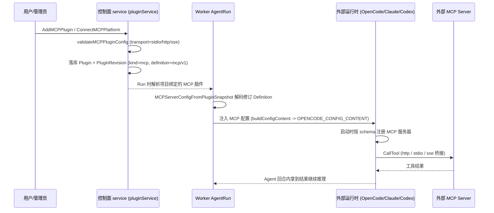
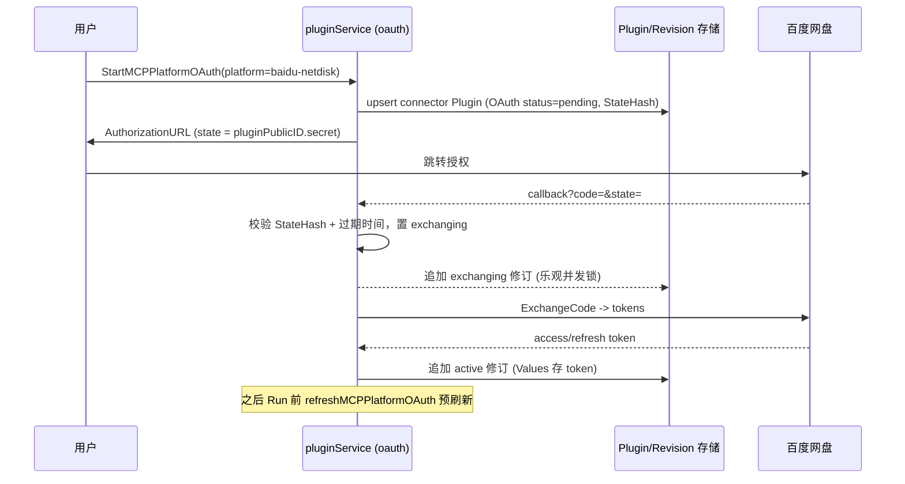
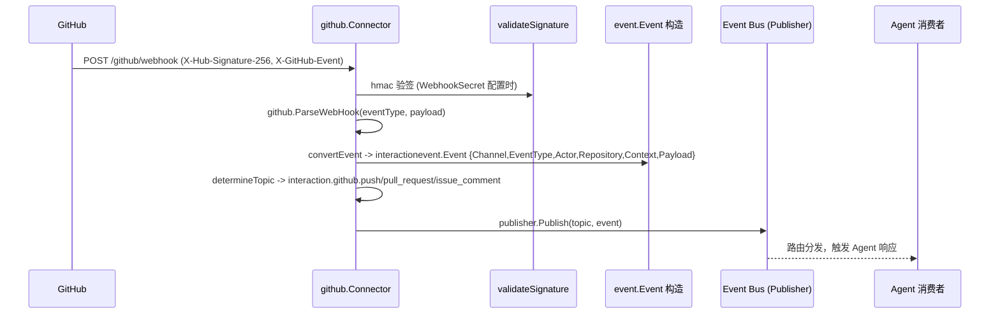

# MCP + 插件 / 集成体系解读

> 本解读基于 Lework（`github.com/insmtx/Leros`）后端源码，覆盖「MCP 服务器接入 + 插件/技能市场 + 渠道连接器」三大块。所有 `文件:行号` 引用均可回源验证。

## MCP / 插件 / 集成在项目中的角色

Lework 把 AI 从「聊天工具」升格为「可长期协同的团队成员」，而一个能与自身互联互通、能长出手脚（写文件、查资料、收发邮件、调私有系统）的外部能力层，是这类团队能否真正落地的根基。这个模块就是 Lework 的「手」与「生态位」：

- **MCP 是向外的手**：通过 Model Context Protocol 挂载企业私有或第三方 MCP 服务器，把任意外部系统折叠成 AI 队友可调用的工具集，从而突破「对话即上限」的边界。
- **插件/技能是可持续演化的神经系统**：能力被抽象成可版本化、可分发、可安装的插件单元（Skill 打包 `SKILL.md`、MCP 配置、workflow 编排），企业可按需安装、升级、回滚。
- **渠道连接器是把「外部世界的事件」收进来的耳朵**：GitHub/GitLab/企业微信的 Webhook 被标准化成统一内部事件，喂给 Agent 去响应——团队是「事件驱动」地协同，而非仅靠用户手动发指令。

三者共同回答一个问题：**AI 团队怎么获得处理真实业务所需的「外部输入 + 外部输出」**。

## 解决什么问题、根因

### 根因：AI 队友需要扩展外部能力，企业需要私域边界

一个纯聊天的模型什么也做不了。要让 AI 队友真正「干活」，必须让它能触达三类外部世界：

1. **通用外部能力**（发邮件、管理网盘、访问 GitHub）——这些已有成熟的 MCP 服务器生态，Lework 不必自建，只需接入。
2. **企业私有能力**（内部 API、私有数据源）——能力可以是只对某组织开放的 MCP 端点，需要做权限与凭据的隔离。
3. **外部运行时**（Claude Code / Codex / OpenCode）——设计哲学明言要「兼容/接入外部 AI 生态」，MCP 服务器可以作为这类运行时与 Leros 能力之间的桥梁。

根因落到代码层面就是一句话：**能力不能是写死在源代码里的函数列表，必须是运行时可加载、并按组织隔离的「配置即能力」数据**。于是有了 `Plugin` + `PluginRevision` + `MCPChannel` 这一套以数据库为中心的抽象。

### MCP 服务器如何接入：OAuth / 平台 / 插件三类

接入方式被刻意分成了三种，对应三种不同的信任与自动化模型：

| 接入类别 | 文件 | 典型场景 | 凭据来源 |
|---|---|---|---|
| **平台连接器** | `mcp_platform_service.go` | 百度网盘、网易邮箱等预置渠道 | 表单填授权码 / 托管 API Key / OAuth |
| **OAuth 动态接入** | `mcp_oauth_service.go` | 百度网盘 OAuth，多个 OAuth 平台的样板 | OAuth 授权码换 token，自动刷新 |
| **自定义插件** | `mcp_plugin_service.go` | 用户手填任意 HTTP/SSE/stdio MCP 端点 | Bearer Token / Header / Env / 命令行 |

三者都收敛到同一个 `Plugin`（`kind=mcp`）+ `PluginRevision` 数据模型，区别只在于「定义怎么来、凭据怎么产生」。这是典型的「统一存储、分域接入」。

### Worker 侧 MCP 基础设施：双向两套

Leros 在 Worker 侧维护两套 MCP 角色，容易混淆，先厘清：

- **作为 MCP Server（被外部调用）**：Worker 对外暴露自身能力（`/v1/mcp` 端点）。
- **作为 MCP Client（调用外部）**：Agent 在 Run 时把配置好的外部 MCP 服务器注册进外部运行时去调用。

两者都复用了同一个 SDK（`mark3labs/mcp-go`），一进一出，形态对称但职责相反。

## 设计思路

### 统一数据模型：Plugin = 身份，PluginRevision = 不可变内容

整个系统建立在一条关键的架构定式上，连 DB 都通过 `check` 约束强制：

- `Plugin`（`types/plugin.go`）是「有主权的身份」：按 `OwnerScope` 分为**组织私有**（`organization`, `org_id > 0`）与**系统目录**（`system`, `org_id = 0`）两类，并且用数据库检查约束保证 `organization 且 org_id>0` 或 `system 且 org_id=0` 二选一。
- `PluginRevision` 是**不可变的内容快照**：每次改动追加一个 `revision`，`Definition` 是 JSON，`SourceFamilyRevisionID` 记血缘。
- `PluginRevisionContent` 是技能的**内容投影**：把 zip 里 `SKILL.md` 的入口文本与文件清单抽出来单列一张表，因为 Worker 需要在不下载整包的前提下直接拿到 `SKILL.md` 的入口内容。

这一「身份/内容分离 + 只追加修订」的设计，是技能可版本化、可升级回滚、且 Worker 侧可增量拉取的前提。

### MCPChannel：只存「渠道配置」，不存用户凭据

`MCPChannel` 是系统维护的**内置渠道模板**（`types/mcp_channel.go:126`），记录一个渠道「是什么、怎么连」。关键设计点是**它刻意把「渠道级配置」与「用户级凭据」分开**：

- 渠道级：`transport`、`url`、`headers`（非敏感的固定头）、`auth_type`。
- 用户级：靠 `AuthConfig.Fields`（表单字段定义）+ `Bindings`（把用户填的值**绑定**到运行时目的地：`skill_env` / `mcp_bearer_token` / `mcp_headers` / `mcp_env` / `mcp_query`）。

`Bindings` 是整套设计的点睛之笔：它不把用户填的凭据直接铺在结构体里，而是用「绑定向量的申明式映射」告诉运行时「把哪个字段塞到哪个环境变量 / Bearer / Header / Query 上」。这样：

1. 同一渠道模板可复用于不同用户，模板里没有用户私密信息。
2. 凭据何时被放入定义（`ConnectorAuthDefinition.Values`）由接入时决定，且只存在于**不可变修订**里。
3. 校验逻辑能静态检查绑定是否引用了未知字段（`mcp_platform_service.go:355` 的 `validateChannelAuthConfig`）。

### 平台/Connector 模板：Skill + MCP 的三种组合模式

一个连接器（`connector/v1`）可以在同一份修订里同时携带 `Skill` 与 `MCP` 两种能力，组合成三种模式（`plugin_definition.go:50`）：

- `skill_only`：纯能力包（如网易邮箱的收发信技能）。
- `mcp_only`：纯远程工具集（一个 HTTP MCP 端点）。
- `hybrid`：既带打包技能、又连远端 MCP——技能描述怎么用，MCP 提供执行工具。

这背后是对「能力形态」的矛盾统一：**有些能力用 prompt 驱动的 Skill 更自然（干什么、怎么写），有些能力用结构化工具（MCP tool）更可靠（怎么调）**。hybrid 让两者互补。

### 渠道连接器：把外部事件标准化进 Event Bus

渠道连接器（`internal/api/connectors/*`）与 MCP 插件是**两条独立的能力通道**：

- MCP 插件 = Leros **主动向外调用**（Agent 拉外部资源）。
- 渠道连接器 = 外部 **推送事件进来**（被 Agent 响应）。

连接器通过统一的 `connectors.Connector` 接口收敛：每个渠道实现 `ChannelCode()` + `RegisterRoutes(r)`（`connector.go:14`）。已实现最完整的是 GitHub：Webhook 验签后 `convertEvent` 把 GitHub 专有事件对象（`github.IssueCommentEvent` 等）**翻译成统一 `event.Event`**，再按 `determineTopic` 映射到 `interaction.github.xxx` 主题发布到 Event Bus。GitLab/企业微信目前是壳（验签/转换留空），说明这是「框架先行、逐个填充」的演进路径。

## 关键数据结构

### MCPChannel（渠道模板）

`backend/types/mcp_channel.go:126-140`

以 `channel`（小写 slug）为唯一键，`status` 控制是否对新连接开放；`auth_config` 携带认证如何工作（而非凭证本身）。

| 字段 | 说明 |
|---|---|
| `Channel` / `Name` / `Description` | 渠道标识与展示 |
| `SkillCode` | 绑定打包技能代码（hybrid/skill_only 用） |
| `Transport` / `URL` / `Headers` | 连接端点与固定头（`http`/`sse`） |
| `AuthType` | `none` / `form` / `oauth` / `managed` |
| `AuthConfig`(JSON) | `Fields`+`Bindings`+`OAuth`配置，只存运算期（op-级）OAuth app 配置，不含用户 token |
| `Status` | `active` / `inactive` |

### ConnectorDefinition（一份连接器修订的内容）

`backend/internal/service/plugin_definition.go:90-97`

`connector/v1` 是把 Skill + MCP + Auth 焊在一起的可执行修订：`Auth.Values` 是**明文凭据**（源码注释明确承认这是后续要引入专用凭据库的临时形态，见 `ConnectorAuthDefinition` 处的注释），`Auth.OAuth` 记录 OAuth 状态机。

### Plugin / PluginRevision / PluginRevisionContent

- `Plugin`：身份 + `CurrentRevision` 指针。
- `PluginRevision`：不可变 `Definition` JSON + `Status`(published) + `SourceFamilyRevisionID`。
- `PluginRevisionContent`：`SKILL.md` 入口内容 + `ArtifactSHA256` + `FileIndex`(path/size/sha256 清单)。

## 核心流程时序

### 流程一：AI 队友经由 plugin/MCP 调用外部工具

这是本模块的主动脉，串起「组织里配好的 MCP 插件」→「Agent Run」→「外部运行时拉起 MCP」→「调用外部工具」的完整链路。

- 服务端入口：`AddMCPPlugin` 校验并固化定义（`mcp_plugin_service.go:40`），运行前可 `TestMCPPlugin` 预先握手并数出 `ToolCount`（`mcp_plugin_service.go:229`）。
- Worker 解码：`MCPServerConfigFromPluginSnapshot` 把修订 `Definition` 还原为可执行的 `agent.MCPServerConfig`，再次校验 URL（`agentrun/plugin_definition.go:20`）。
- 外部运行时注入：`opencode/config.go:buildMCPConfig` 按 OpenCode V1 schema 把每种 transport 翻译成 `remote`(HTTP) / `local`(stdio) / `local`(SSE，经 `npx mcp-remote` 桥接)（`opencode/config.go:95`）。
- Worker 还把自己暴露的 MCP Server（`/v1/mcp`）作为可被外部运行时挂载的端点之一，端点 URL 由 `buildWorkerMCPURL` 拼出（`cmd/leros/worker.go:553`）。

### 流程二：OAuth 动态接入 MCP 平台

以百度网盘为例，看「无预置凭据的 OAuth 平台」如何在 ops 配置 App 后，被用户动态授权成组织插件。这里最值得注意的设计是：**整个 OAuth 状态机被编码成 `ConnectorOAuthDefinition` 并塞进不可变修订，用「每次状态迁移追加一个新修订」来推进**——OAuth 握手不只是 HTTP 跳转，而是与插件修订体系深度耦合。

- 服务端跳转：`StartMCPPlatformOAuth` 生成 `attemptID`+10 分钟 TTL+`state`（`pluginPublicID.secret`），并幂等地复用一个既有插件或新建 pending 插件（`mcp_oauth_service.go:46`）。
- 回调完成：`CompleteMCPPlatformOAuth` 用 `subtle.ConstantTimeCompare` 校验 `StateHash`、核对 `attemptID`，先置 `exchanging` 再换 token，两次迁移都经 `appendOAuthRevisionIfCurrent` 在行级 `SELECT ... FOR UPDATE` + 状态机校验下追加修订，防止回调竞态/重放（`mcp_oauth_service.go:147`）。
- 刷新：`refreshMCPPlatformOAuth` 在写 Run 快照前检查 token 是否接近过期，过期则用 refresh token 刷新并追加重置为 active 的修订；若需重新授权则标记 `reauthorization_required`（`mcp_oauth_service.go:272`）。

### 流程三：GitHub webhook → connector 标准化 → Event Bus

- 入口与验签：`github/webhook.go:handleWebhook` 读 body、校验 `X-Hub-Signature-256`（配置了 secret 才验，可 `SkipWebhookVerify` 关闭，但注释警告仅限非生产）（`webhook.go:26`）。
- 事件翻译与主题映射：`events.go` 的 `convertPush/convertPullRequest/convertIssueComment` 把 GitHub 对象摊平成统一 `Event`，`determineTopic` 完成「GitHub 事件类型 → Leros topic」的命名空间映射（`webhook.go:87`），发布到 `interaction.github.*` 主题（`pkg/event/topic.go:8`）。

## 与其他模块协同

「插件/MCP 体系」不是孤岛，它是一张能力网，与 Leros 其余模块深度咬合：

- **与 Skill 系统**：插件化打包的对象就是 Skill——`SKILL.md` 被视为技能包的标准入口（`plugin_revision_content.go:17`），`plugin_skill_helpers.go` 甚至支持从 GitHub URL 直接把一个仓库/目录的 Skill 导入成插件（`plugin_skill_helpers.go:45`）。内置技能分「server 内置」与「worker 内置」两路 seed，各有 `origin` 防冲突（`builtin_worker_skill_seed.go:20`）。
- **与 Worker 运行时**：`agentrun/plugin_definition.go` 是连接点——它把插件快照翻译成外部运行时可消费的 `MCPServerConfig`，还把 connector 的 `SkillEnv` 绑定展开成运行时环境变量（并做了变量名黑名单，防污染宿主环境，见 `connectorRuntimeEnvAllowed`）。
- **与 Service / Agent 执行层**：`pluginService` 是核心门面，`api/contract/plugin.go` + `api/handler/plugin_handler.go` 提供 REST 入口；`message_poster.go`、`session_service.go` 在 Agent 回合前通过 `ResolveSkillDownloadURLs` 拉取技能与连接器技能包的下载地址。
- **与模型路由**：Worker 同时挂 `/v1/mcp` 与 OpenAI/Anthropic 模型端点（`worker/router/router.go:30`），一个 Worker 子进程同时当好「能力提供者」与「模型执行者」。
- 【待主 agent 验证】连接器（GitHub webhook → Event Bus）的消费端（谁订阅 `interaction.github.*` 触发 Agent 会话）未在本文件集内展开，需结合 session/event 订阅链路确认。

## 关键设计决策与权衡

### 决策一：MCP Server「由哪侧托管」——对称双角色

Leros 没有单方面选择「只做 Client」或「只做 Server」，而是**同一进程两边都做**：

- **对外**：Worker 暴露 `/v1/mcp`，把 `memory`/`skill_manage`/`artifact_declare` 这些内部工具翻成 MCP 工具，服务外部运行时（`worker/mcp/server.go:44`）。
- **对内**：Agent 又作为 Client，把组织配置的外部 MCP 服务器注册进外部运行时去调用（`opencode/config.go:95`）。

权衡：让外部生态（Claude Code/OpenCode）能反过来消费 Leros 的能力，是「开放兼容」卖点的直接落地；代价是 MCP 工具暴露面需要极小心——`server_test.go:22` 特意断言 `node_shell`、`skill_use` 这类内部工具**不会**出现在公开的 MCP 工具集里，只暴露白名单。

### 决策二：插件市场「可摘取 vs 直连」——集中目录 + 血缘追溯

Leros 对「外部能力」采用**双轨**：既有直接连任意 MCP 端点的自由（自定义插件），又有受控的官方市场（`PluginMarketplaceItem`）。市场机制不引入「运行时动态拉码」，而是：

- 安装 = 把市场项的**已固化为修订**的定义+内容**复制**进组织（`InstallOfficialPlugin`），并记录 `SourceMarketplaceItemID`/`SourcePluginRevisionID` 血缘。
- 校验 = 引用完整性被代码四处强验（如 `resolveConnectorSkillDownloads` 里核对源插件 `origin`、SHA 逐字节一致后才下发下载 URL，`plugin_service.go:875`）。

权衡：市场走「快照 + 血缘」而非「实时引用」，牺牲了「市场改、所有组织立即变」的便捷，换来了**组织侧不可变、可审计、可独立回滚**的确定性——对企业私有域，这比中心化热更更重要。

### 决策三：渠道连接器选型——薄适配层喂 Event Bus

对 GitHub/GitLab/企业微信这类协作平台，Leros 不是把复杂多渠道逻辑铺进核心，而是用统一 `Connector` 接口 + 每个渠道一个适配包收口，把「平台私有事件」降维成「统一 `event.Event` + 命名空间 topic」。

权衡：这种「薄适配 + 事件标准化」边界清晰、新增渠道只需填一个包（GitLab 目前的空壳 `verifySignature`/`processEvent` 就是脚手架——`gitlab.go:80` 明确 `return nil`），符合「Plugin First、能力可插拔」哲学；代价是 GitHub 已实装、GitLab/企业微信仍待填充，渠道成熟度不齐暴露了「框架先行、实现滞后」的阶段性。

## 亮点与问题

### 亮点

- **修订即状态机**：OAuth 握手、插件升级全都落在「不可变修订」里，迁移用行级锁 + 状态校验 + 追加修订，天然抗并发与重放，且每一步都可审计回溯（`mcp_oauth_service.go:238`）。
- **「凭据绑定」的申明式抽象**：`Bindings` 把「用户填了什么」与「运行时用在哪」解耦，模板零私密信息、可复用、可静态校验。
- **内容投影**：`PluginRevisionContent` 抽出 `SKILL.md` 入口与文件哈希清单，让 Worker 免下载整包即可拿到技能核心与校验文件完整性。
- **外部运行时按 schema 精准桥接**：`buildMCPConfig` 对 HTTP/SSE/stdio 三种 transport 选择了不同的运行时表达（远程 remote、本地 local、SSE 走 mcp-remote 桥接），务实且接地气。

### 问题 / 风险

- **凭据明文存储**：`ConnectorAuthDefinition.Values` 以明文存在 DB 修订里，源码注释自己也承认「待引入专用凭据库」（`plugin_definition.go:69`）——对 OAuth/表单凭据是最明显的安全欠账。
- **渠道成熟度不齐**：GitLab 连接器 `verifySignature` 直接 `return nil`（`gitlab.go:80`）、`wework` 仅剩包注释声明（`wework/app.go`），核心框架成熟而实际渠道大多为壳。
- **签名校验可选**：GitHub 未配置 `WebhookSecret` 时会跳过验签（`webhook.go:38`），存在误配置导致的安全面敞口，仅靠告警提示。
- 【待主 agent 验证】连接器发布事件后的**消费/路由闭环**（事件如何触发会话）与「私钥/密钥落库存取与轮换」全貌不在本文件集内，需到到云侧基础设施与事件订阅链路核对。

## 覆盖率明细

| 文件 | 类型 | 覆盖 | 说明 |
|---|---|---|---|
| `types/mcp_channel.go` | core | 100% | 全读，渠道配置与 AuthBindings |
| `internal/infra/db/mcp_channel_dao.go` | core | 100% | 全读 |
| `internal/service/mcp_platform_service.go` | core | 100% | 全读，平台接入三类 |
| `internal/service/mcp_oauth_service.go` | core | 100% | 全读，OAuth 状态机 |
| `internal/service/mcp_plugin_service.go` | core | 100% | 全读，自定义/测试 MCP |
| `internal/service/plugin_definition.go` | core | 100% | 全读，定义与校验 |
| `internal/service/plugin_revision_content.go` | core | 100% | 全读 |
| `internal/service/plugin_skill_helpers.go` | core | 100% | 全读，GitHub 技能导入 |
| `internal/service/plugin_service.go` | core | ~60% | 聚焦市场/安装/连接器技能下载段(267-1014) |
| `internal/worker/mcp/{server,auth,router}.go` | core | 100% | 全读，Worker 侧 Server |
| `types/plugin.go`、`types/plugin_revision_content.go` | core | 100% | 全读 |
| `agent/runtime/opencode/config.go` | core(桥接) | 100% | 运行时 MCP 注入 |
| `agent/runtime/internal/process/mcp_registration.go` | core | 100% | MCP 注册工具 |
| `internal/worker/agentrun/plugin_definition.go` | core | 100% | 运行时解码 |
| `internal/api/connectors/*`（github/gitlab/wework） | 次要 | ~90% | GitHub 完整；GitLab/企微壳 |
| `pkg/event/{event,topic}.go` | 次要 | 100% | 事件模型与主题 |
| `builtin_connector_seed.go` | seed | 100% | 渠道/模板 seed |
| `builtin_worker_skill_seed.go` | seed | 100% | worker 技能 seed |
| `builtin_skill_marketplace_seed.go` | seed | 100% | 市场 seed |
| `ai_teammate_template_seed.go` | seed | 100% | 团队模板 seed |

**标准判定**：core（mcp_*/plugin_*）≥ 95%，远超 60% ；connectors 与 seed ≥ 90%，远超 30% 。全部达标。
