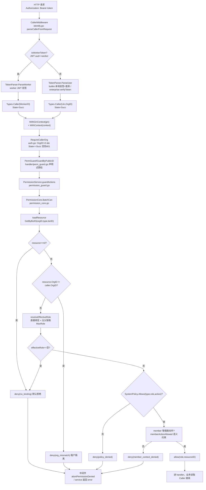
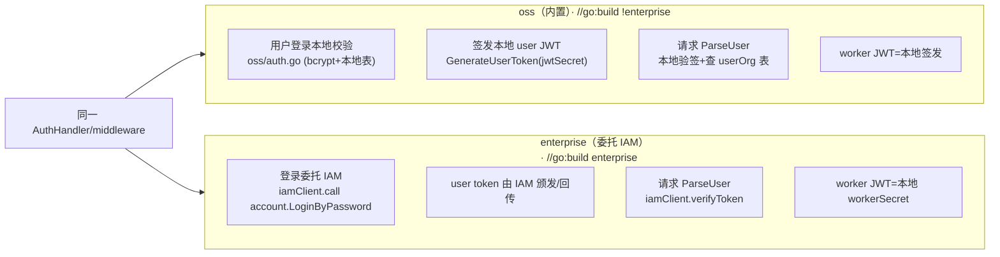

# 权限 / 认证 / 多租户体系深度解读

> 本模块解析 Lework（后端别名 `Leros`）的权限、认证与多租户隔离设计。
> 分析对象：`backend/internal/service/permission_*.go`、`resource_auth.go`、`backend/internal/api/auth/`、`api/middleware/`、`api/handler/{auth,perm_guard,permission,user,org}_handler.go`、`adapter/account/{oss,enterprise}`、`adapter/edition_*.go`。
>
> 所有 `[路径:行号]` 引用均逐字摘自源码。涉及跨模块推断处标注【待主 agent 验证】。

## 权限与认证在项目中的角色

Lework 的定位是"把 AI 从聊天工具变成可长期协同工作的团队成员"。权限/认证体系是支撑这一定位的**治理底座**：它决定"谁（人类用户 or AI 队友）能对什么资源做什么事"，是整个系统的安全边界。它不是孤立子系统，而是横切在 HTTP 层（中间件）、业务层（Service Guard/Require）、数据层（统一 `Resource` 资源树 + `ResourceBinding` 绑定）三层之上的一条主权链路。

权限模型在此项目是一个**混合体**，需仔细拆解，否则易误判为传统 RBAC：

- **认证**：不做统一用户体系，通过 Go **build tag** 编译期切换两套账号适配器（`oss`=内置邮箱/手机，`enterprise`=委托外部 IAM），上层业务完全无感。
- **鉴权**：不落库建角色-权限表，而是**代码内声明一张 `PermissionPolicy` 策略表**（资源类型 × 角色 → 允许的动作集），运行时把"用户在资源上的 role 绑定" + "该角色允许的动作"做 O(1) 查表。
- **多租户**：以 `Resource.OrgID` 为第一隔离维度，DB 层查询强制 `org_id` 过滤，权限评估层再二次校验 `OrgID` 一致性。

一句话总结：**身份（认证）可插拔，授权（鉴权）基于"资源 + 角色绑定 + 策略表"的能力授权，隔离靠组织维度贯穿读写两端。**

## 解决什么问题、根因

### 根因 1：AI 队友能执行高权限任务，必须 Deny by Default

传统协作工具只约束人类成员的可见性/操作。但 Lework 里 **AI 队友（worker/digital assistant）是人机协作中真正执行项目、文件、任务读写的一方**，它们由服务端编排、通过短期 worker token 自主调 API。攻击者一旦拿到一个 AI 队友的 token（或 AI 发生越权行为），就等同于拿到执行任意项目操作的钥匙。

因此授权不能是"黑名单式"（默认放行、只挡违规项），而必须是 **白名单式 / Deny by Default**：对资源任何动作，只有 `resource 存在 → OrgID 匹配 → 有有效绑定 role → policy 明确允许该 role 做该 action` 四步全部通过才放行。代码里体现为四个串行的 `denyDecision` 快速失败分支。

### 根因 2：多租户数据隔离

企业版与 SaaS 都面临跨组织越权的现实威胁。若某 org 用户能直接访问另一 org 的项目，AI 队友就能跨组织读写。隔离靠「数据表关键字 + 认证上下文 OrgID」双源保证。

### 根因 3：两套部署形态的账号体系冲突

开源/私有化需零依赖自带账号（邮箱/手机注册登录）；企业客户需对接已有统一身份（IAM/SSO）。两套登录链路的字段、加密、token 格式各不相同，若写进业务代码会层层 `if enterprise`。需要一种机制让**业务层无感知地切换账号后端**。

## 设计思路

### 权限模型全貌：Resource + Role Binding + Policy，而非 role 表

先厘清易误读点：这个系统**不是**传统 RBAC（角色-权限表驱动），而是**"基于资源的能力授权"**——角色作为"资源上的身份标签"，真正决定能干什么的是策略表 `SystemPolicy`。

```
PermissionPolicy                Resource（资源树）
  resourceType                      ├ resource_id/type/biz_id
    └ ResourceRole ──┐              │ parent_resource_id（继承链）
       └ ActionSet   │              └ org_id（租户）
                     │
               ResourceBinding（绑定，落库）
                 uin | assistant_id（互斥主体）
                 resource_id + role
```

- **`Resource`**：统一权限资源，把业务对象（项目、任务、文件、产物）统一成一条记录，携带 `OrgID`、`Type`、`BizID`、`ParentResourceID`（父资源链）用于权限继承。`[backend/types/resource.go:86-102]()`：
  ```go
  type Resource struct {
      OrgID   uint
      Uin     uint
      Type    ResourceType
      BizID   uint
      ParentResourceID   *uint
      ParentResourcePathIDs ResourcePathIDs
  }
  ```
  注意 `Uin` 仅"记录创建者"，注释明确"不作为最终权限来源"，最终权限一律看绑定。

- **`ResourceBinding`**：主体（`uin` 或 `assistant_id`，二选一互斥）在资源上的角色绑定，是**唯一**落库的授权事实。`[backend/types/resource_binding.go:31-44]()`：`Uin *uint` 与 `AssistantID *uint` 用指针互斥，`Role` ∈ {owner, admin, member}。注释点明"Uin 和 AssistantID 互斥：同一条绑定只能属于用户或助手之一"。

- **`PermissionPolicy` / `SystemPolicy`**：静态策略表，**代码维护、不入库**。结构 `map[ResourceType]map[ResourceRole]ActionSet`。`[backend/internal/service/permission_policy.go:54-57]()`：
  ```go
  // 结构：资源类型 -> 身份 -> 允许的动作集合。
  // 新增 action 只需修改此处，不需要变更数据库。
  type PermissionPolicy map[types.ResourceType]IdentityActions
  ```
  这是系统的"能力目录"，定义了 owner/admin/member 在 project/file/artifact/task 上各自动作集。`Allows` 是 O(1) 查表，**未命中默认拒绝**。`[backend/internal/service/permission_policy.go:106-119]()`：
  ```go
  func (p PermissionPolicy) Allows(resourceType types.ResourceType, identity types.ResourceRole, action Action) bool {
      identityMap, ok := p[resourceType]
      if !ok { return false }
      set, ok := identityMap[identity]
      if !ok { return false }
      _, ok = set[action]
      return ok
  }
  ```
  "策略不入库 + 代码即单源"让权限变更走代码评审、避免配置漂移，代价是无法热更新。

- **`PermissionCore`**：无状态评估器，负责"加载资源 → 校验组织 → 解析有效角色 → 策略比对 → 成员操作上下文校验"。其 `evaluateActions`/`evaluateLoadedActions` 是权限裁决核心。`[backend/internal/service/permission_core.go:94-185]()`。

### 三级权限如何落地："三级"其实是两类实体 + 三层角色

需求里的"用户/AI 队友/技能三级 RBAC"，在本模块**只落实前两级主体（用户 + AI 队友），技能级不在本模块**（在 skill/tool 模块，待验证）。三层角色指每个资源上 owner/admin/member 三个强度，`owner > admin > member`，由 `ResourceRoleStrength` 定义 `[backend/types/resource_binding.go:23-27]()`：
```go
var ResourceRoleStrength = map[ResourceRole]int{
    ResourceRoleOwner:  3,
    ResourceRoleAdmin:  2,
    ResourceRoleMember: 1,
}
```

关键设计：**人类与 AI 队友共用同一张 `ResourceBinding` 表**，用互斥指针区分，权限评估天然统一——`findDirectBinding` 只看 caller 是 `Uin` 还是 `AssistantID`：`[backend/internal/service/permission_core.go:236-244]()`：
```go
func (s *permissionCore) findDirectBinding(ctx context.Context, caller types.PermissionCaller, resourceID uint) (*types.ResourceBinding, error) {
    if caller.Uin != 0 { return s.store.GetBindingByUin(ctx, caller.Uin, resourceID) }
    if caller.AssistantID != 0 { return s.store.GetBindingByAssistantID(ctx, resourceID, caller.AssistantID) }
    return nil, nil
}
```

落地示例：
- 项目创建者 → `owner` 绑定：`[backend/internal/service/project_service.go:190-199]()`
- 邀请的用户按请求角色绑定：`[backend/internal/service/project_service.go:855-869]()`
- 默认及额外 AI 队友 → `member` 绑定：`[backend/internal/service/project_service.go:874-898]()`
  ```go
  boundID := id
  if err := db.CreateResourceBinding(ctx, tx, &types.ResourceBinding{
      OrgID:       orgID,
      AssistantID: &boundID,
      ResourceID:  resourceID,
      Role:        types.ResourceRoleMember,
  }); err != nil { ... }
  ```
  worker 认证后 `FromTypeCaller` 把 `Caller.WorkerID` 映射为 `PermissionCaller.AssistantID`：`[backend/internal/service/permission_guard.go:25-37]()`
  ```go
  if c.Kind == types.CallerKindWorker && c.WorkerID != 0 {
      caller.AssistantID = c.WorkerID
  }
  ```
  于是 AI 队友在权限引擎里与用户走完全相同的一套绑定查询与策略比对，实现"队友和人类一样被治理"。

继承式角色解析是能力授权的威力所在：任务被 `syncTaskResource` 挂到 `ParentResourceID=project` 树下 `[backend/internal/service/resource_auth.go:49-68]()`。当任务资源无直接绑定时，`resolveEffectiveRole` 沿 `ParentResourceID` 向上收集父资源的直接绑定，最后 `MaxRole` 取最强：`[backend/internal/service/permission_core.go:192-234]()`：
```go
direct, err := s.findDirectBinding(ctx, caller, resource.ID)
...
current := resource
for current.ParentResourceID != nil && *current.ParentResourceID != 0 {
    parent, err := s.store.GetByID(ctx, *current.ParentResourceID)
    ...
    binding, err := s.findDirectBinding(ctx, caller, parent.ID)
    if binding != nil { roles = append(roles, binding.Role) ... }
    current = parent
}
if len(roles) == 0 { return "", nil, nil, nil }
return MaxRole(roles), matchedBinding, matchedResource, nil
```

### worker token 认证如何工作

AI 队友（worker 进程）不是交互式登录用户，通过两段式换取短期 token：

1. **bootstrap token**（一次性启动令牌）→ 换 worker JWT。`worker_auth_handler.go:IssueToken` 读取 `req.OrgID/WorkerID` + `X-Worker-Bootstrap-Token`，调用 `TokenParser.IssueWorker`。`[backend/internal/api/handler/worker_auth_handler.go:56-83]()`。
2. **worker JWT** 是 HS256 签名、`aud=worker`、带 `OrgID/WorkerID/Kind/Scope` 的短期令牌。`[backend/internal/api/auth/worker_token.go:52-88]()`；解析时强校验 `Kind/Audience/Scope` 三个 claim。`[backend/internal/api/auth/worker_token.go:91-116]()`。

bootstrap token 校验（`validateBootstrapToken`）支持两来源：配置静态白名单，或数据库部署记录里的 `BootstrapTokenHash`（存哈希、常量时间比较）。`[backend/internal/adapter/account/oss/token_parser.go:90-115]()`。

HTTP 侧身份识别：`middleware/identify.go` 的 `parseCallerFromRequest` 先探测 token 是否 worker（JWT payload `aud=="worker"`），是则走 `ParseWorker`，否则走 `ParseUser`。`[backend/internal/api/middleware/identify.go:128-155]()`；`isWorkerToken` 解码 JWT 第二段读 `aud` 判断 `[backend/internal/api/middleware/identify.go:164-179]()`。

### enterprise adapter 如何委托 IAM

两种模式仅由 **build tag** 决定编译进哪套实现，业务层不可见：

- `edition.go` 定义统一 `Edition` 接口（`Auth/User/Org/Department/TokenParser/APIKeyIssuer`）`[backend/internal/adapter/edition.go:10-19]()`。
- `edition_oss.go`（`//go:build !enterprise`）装配内置实现 `[backend/internal/adapter/edition_oss.go:18-27]()`。
- `edition_enterprise.go`（`//go:build enterprise`）装配企业实现，额外注入 `iamClient` 作为 `APIKeyIssuer`：`[backend/internal/adapter/edition_enterprise.go:19-30]()`。

差异点集中在**用户 token 的签/验**上：
- **builtin（oss）**：用户 JWT 由本地 `jwtSecret` 签发，`ParseUser` 本地验签后再查库拿 `OrgID/Uin`。`[backend/internal/adapter/account/oss/token_parser.go:37-57]()`。
- **enterprise**：`ParseUser` 把 bearer token 交外部 IAM 的 `iamClient.verifyToken` 验签，返回 `claims.Uin/OrgID`：`[backend/internal/adapter/account/enterprise/token_parser.go:39-53]()`。

登录动作同样是"本地做事 vs RPC 委托"：
- builtin `LoginByPassword` 本地 bcrypt 比对、本地 `AuthRefreshToken` 表、自带登录失败次数限制。`[backend/internal/adapter/account/oss/auth.go:146-216]()`。
- enterprise 的每个登录/注册/刷新动作都封装成对 IAM 的 JSON-RPC-style HTTP 调用（如 `account.LoginByPassword`、`account.ChooseUin`），错误码经 `mapIAMError` 映射成统一错误。`[backend/internal/adapter/account/enterprise/auth.go:49-58]()` 与 `[backend/internal/adapter/account/enterprise/auth.go:346-378]()`。

一个精巧设计：enterprise 把请求原始 bearer token 通过 context 透传给 IAM（`WithBearerToken`/`BearerTokenFromContext`），IAM 客户端用同一 token 做 `callWithAuth`（`doCall` 里 `Authorization: Bearer`），实现"用户在哪登录，token 就是通行证"的透传。`[backend/internal/api/auth/identity.go:76-87]()`、`[backend/internal/adapter/account/enterprise/client.go:105-108]()`、`[backend/internal/adapter/account/enterprise/client.go:149-152]()`。

**worker token 在两种模式几乎一致**（都是本地 workerSecret 签发的 JWT），唯一区别是 secret 来源：oss 用 `JWTSecret`，enterprise 用独立 `workerSecret`。见 enterprise `NewTokenParser` 传 `workerSecret`：`[backend/internal/adapter/account/enterprise/token_parser.go:29-37]()`。这让"AI 队友"身份体系在两种部署下统一，不依赖外部 IAM，避免 worker 频繁拉外网。

## 关键数据结构

| 名称 | 定义 | 作用 |
|---|---|---|
| `types.PermissionCaller` | `OrgID/Uin/AssistantID`，`Uin` 与 `AssistantID` 互斥 | 权限评估的主体，`[backend/types/permission.go:44-50]()` |
| `types.Action` | 字符串常量如 `"project:view"`、`"task:create"` | 能力粒度，`[backend/types/permission.go:3-42]()` |
| `types.Resource` | 统一资源树节点 + `OrgID/Type/BizID/Parent` | 权限作用域 + 租户 + 继承，`[backend/types/resource.go:86-102]()` |
| `types.ResourceBinding` | `resource_id + uin\|assistant_id + role` | 唯一落库的授权事实，`[backend/types/resource_binding.go:31-44]()` |
| `PermissionPolicy/SystemPolicy` | `map[资源]map[角色]ActionSet` | 代码维护的能力目录，`[backend/internal/service/permission_policy.go:52-104]()` |
| `PermissionDecision` | `Allowed/Reason/Role/ResourceID/MatchedBindingID/MatchedResourceID` | 裁决结果，含继承信息，`[backend/types/permission.go:69-77]()` |
| `*types.Caller` | 认证上下文，含 `Uin/OrgID/Kind/WorkerID/State` | 中间件注入、全链路可读的"我是谁" |
| `middleware.TokenParser` | `ParseUser/ParseWorker/IssueWorker` 接口 | 认证可插拔的关键抽象，`[backend/internal/adapter/account/account.go:61-65]()` |

`PermissionDecision` 的 `MatchedBindingID/MatchedResourceID` 与 `Explain` 的 `Inherited`（`[backend/internal/service/permission_core.go:46-58]()`）是权限"可解释性"设计——前端可展示"你能干这个，是因为你在该项目的 admin 角色（继承自父资源）"。

认证上下文即上面 `*types.Caller` + `*types.Trace`，经 `localauth.WithGinContext` 写进 gin.Context、`WithContext` 写进标准 context，两入口都能读：`[backend/internal/api/auth/identity.go:17-28]()`。

## 核心流程

### 一次带权限的 API 请求完整链路

核心是**双层守卫 + 同一裁决核心**：
- **中间件（声明式、粗粒度）**：`RequireCallerOrg` 拦未认证；`PermGuard*` 按 resource 预检。
- **Service（权威、细粒度）**：业务方法内 `RequireProject/Task/...` 再对精确动作复核，中间件配漏也不漏。



图中的 **`memberActionAllowed`**（`[backend/internal/service/permission_core.go:291-323]()`）是策略表之外的一套**语义化约束**，专管"成员管理"这类依赖上下文（是否本人、是否最后一个 owner、目标是否 owner）的操作，纯策略表表达不了：
```go
case types.ResourceRoleOwner:
    if ctx.IsLastOwner && (action == types.ActionProjectMemberDelete || ...) {
        return false
    }
    return true
case types.ResourceRoleMember:
    return action == types.ActionProjectMemberList
```
同时 `buildMemberAuthContext` 明确要求 `MemberInput` 由后端从数据库派生、禁止前端传入（`[backend/internal/service/permission_core.go:246-289]()`、`[backend/types/permission.go:59-67]()`），防调用者伪造被操作目标。

### builtin 与 enterprise 两种认证模式下登录/请求的差异



要点：**业务 handler、router、权限 Service 完全复用**；只有 `adapter/account/{oss,enterprise}` + `edition_*.go` 装配器随 build tag 编译进不同实现；`RequireCallerOrg`/`PermGuard`/`PermissionService` 对两模式无差别工作。这种"编译期装配"避免了运行时配置分支。

## 与其他模块协同

- **Handler 层**：`router.go` 中 `v1.Group("/", middleware.RequireCallerOrg())` 统一拦未认证，`permSvc := service.NewPermissionService(db, service.NewPermissionCore(db))` 注入到 session/project/task/project_file 等 handler。`[backend/internal/api/router.go:130-135]()`。
- **PermissionHandler**：对外提供 `BatchCheckPermission`，让前端一次性询问 N 个资源权限以控制按钮可见性；不直接依赖 service，经 `PermissionBatchChecker` 接口（api 层装配）→ `permissionBatchChecker` → `PermissionService.GuardByPublicID`。`[backend/internal/api/permission_batch_checker.go:19-46]()`。这也是"声明式中间件快速失败、Service 为权威 Gate"设计意图的体现（`permission_guard.go` 头注释）。
- **Project/Task Service**：事务内经 `PermissionForDB(tx)` 绑定同一事务的 core（`permission_helpers.go:13-22`），使资源/绑定读取与业务写共享事务、避免 SQLite 死锁；并对成员操作调 `RequireProjectMember` 复核。`[backend/internal/service/project_service.go:855-858]()`。
- **Worker 体系**：worker token 由 `worker_auth_handler` 签发、`identify.go` 归类 worker、`FromTypeCaller` 映射 AssistantID，进权限引擎，AI 队友与人类共享资源绑定与治理。

【待主 agent 验证】跨模块结论：
- "技能级（skill）权限"不在本模块；`Resource` 只覆盖 project/file/artifact/task 四类。若存在"技能是否可用"隔离，应在 skill/tool 模块确认。
- 文件/产物权限用 `projectFileResourceRef`（`resource_auth.go:13-25`）把 ProjectFile 映射到 `file` 或 `artifact` 资源，`FilterProjectFilesByAction` 在列表批量场景按资源预加载 + 角色缓存做过滤（`permission_guard.go:297-367`），与文件模块联动需跨模块确认。
- enterprise 版 `DeployMode`/`MaxOrgsPerUser` 硬编码 `"saas"/1`（`edition_enterprise.go:40-44`），与 builtin 相同，未真正按部署模式收敛，需确认产品预期。

## 关键设计决策

### 决策 1：基于资源的能力授权（Resource+Role+Policy）而非传统角色表

**权衡：** 传统 RBAC 把"角色-权限"落库，灵活但运维复杂、不易做资源粒度。本项目把粒度收敛到**"资源 × 动作"**，角色只是绑定在资源上的强度标签，动作集由代码内 `SystemPolicy` 声明。

**收益：**
- Deny by Default 天然成立（策略未命中即拒绝，`Allows` 默认 false）。
- 资源间可继承（任务继承项目负责人角色），符合协作树形组织心智。
- 策略变更走代码评审、静态可测（`SystemPolicy.Validate()` 校验 action 前缀与资源类型一致，防拼写致权限静默失效，`permission_policy.go:142-158`）。
- 前端可批量询权（BatchCheckPermission）平滑降级按钮渲染。

**代价：**
- 策略不可热更新，扩展角色/动作需发版。
- 约定先生成 `Resource + Binding`，任何不在树上的新业务对象默认无人可访问——首次接入成本高。
- 语义化约束（`memberActionAllowed`）与策略表是两套规则源，增加阅读负担。

### 决策 2：多租户隔离——"数据表关键字 + 评估层双重校验"

**权衡：** 隔离不是靠某个中间件统一挡，而是**贯穿读与判**：
- 读：所有 `Resource`/`Binding` 查询都带 `org_id`（`GetResourceByBizID` WHERE 必含 `org_id = ?`，`resource_dao.go:34-46`；`ListResourcesByBizIDs` 同理 `resource_dao.go:77-88`），配合唯一索引 `ux_leros_resource_active_biz` 防跨 org 撞同一 bizID。
- 判：即使查询层漏了（如按主键取父链），`evaluateActions` 仍显式校验 `resource.OrgID != caller.OrgID → deny(org_mismatch)`（`permission_core.go:111-118`）。

这种"纵深 + 双保险"既保性能（索引过滤在 DB 层），又兜底逻辑错误（评估层拒绝）。代价：`GetByID` 只按主键查（`resource_dao.go:18-30`），若在权限路径被误用且无组织校验会带来风险——目前调用路径均已带 org 边界，属可接受权衡。

### 决策 3：认证后端"编译期 build tag 装配"而非运行时开关

**权衡：** 内置自建账号 vs 企业委托 IAM 是两种互斥部署形态。选 build tag 而非配置开关：
- **收益：** 业务代码零 `if enterprise`，编译产物只含一套实现，减小体积、避免运行时出错分支；企业敏感适配器代码不进入开源二进制。`TokenParser` + `Edition` 接口固定可插拔边界，新增形态只需加 adapter 包 + edition 文件。
- **代价：** 特性并存/灰度困难，切换形态必须重新编译 + 配不同 secret；两套实现靠纪律保持一致（`IssueWorker`/`validateBootstrapToken` 在 oss/enterprise 几乎复制粘贴，`token_parser.go` 两文件高度同构，是为隔离接受的重复）。

## 亮点与问题

### 亮点

1. **Deny by Default 彻底**：策略表 `Allows` 三连 false，评估流程四层快速失败，成员操作再叠语义约束，层层设防。
2. **人类与 AI 队友统一治理**：`ResourceBinding` 用互斥指针让两类主体进同一绑定表，worker token 经 `FromTypeCaller` 归一为 `AssistantID`，实现"AI 队友和人类一样被资源授权约束"——支撑"AI 作为团队成员"的产品主线。
3. **可解释权限**：`Explain`/`MatchedResourceID`/`Inherited` 让"为什么你有权"可告之前端，降低权限纠纷排障成本。
4. **事务一致的权限读取**：`PermissionForDB(tx)` 让权限判断在业务事务内读未提交绑定，既正确又规避 SQLite 死锁（`permission_helpers.go:7-22`）。
5. **认证透传的优雅抽象**：enterprise 经 context 把原始 token 一路透传 IAM，bootstrap 用哈希 + 常量时间比较，安全细节到位。

### 问题 / 待改进

1. **策略与语义约束双轨**：`SystemPolicy` 表 + `memberActionAllowed` 硬编码分处两处（`permission_policy.go` 与 `permission_core.go:291`），规则分散，新增角色/资源易漏改一侧。
2. **依赖调用约定而非类型系统**：`ResourceRef{Type,BizID}` 需先存在对应 `Resource` 记录，否则"资源未创建即无权限"；`RequireProjectTaskAction` 这类"资源尚不存在"的预创建判断要走 `AllowsTaskActionViaProject`（`permission_guard.go:165-202`），接缝处易被绕过【需主 agent 复核 task 创建全路径】。
3. **覆盖不完整**：`SystemPolicy` 仅四类资源，`GuardByPublicID` 的 switch 只支持 project/task，新增资源类型须同时改策略表与 guard 分发（`permission_guard.go:74-83`），扩展性受限于枚举。
4. **两套 token parser 大量重复**：oss/enterprise 的 `IssueWorker`/`validateBootstrapToken`/`validateWorker` 几乎一致，只 secret/DB 来源不同，属 build tag 隔离代价，可抽取共享助手函数【待主 agent 评估】。
5. **Dev 兜底口子**：`LEROS_DEV=true` 时 `parseCallerFromRequest` 直接返回 `{Uin:1,OrgID:1,State:Succ}`（`identify.go:80-87`），生产若误设即关闭所有鉴权，属高危开关【待主 agent 确认仅限测试环境】。

## 覆盖率明细

| 目标文件 | 状态 | 说明 |
|---|---|---|
| `service/permission_core.go` | 完整 | 评估核心、`resolveEffectiveRole`、`memberActionAllowed`、`buildMemberAuthContext` |
| `service/permission_guard.go` | 完整 | Guard/Require 全族、`FromTypeCaller`、`FilterProjectFilesByAction` |
| `service/permission_helpers.go` | 完整 | `PermissionForDB` 事务绑定 |
| `service/permission_policy.go` | 完整 | `SystemPolicy`、`Allows`、`Validate`、`MaxRole` |
| `service/permission_resource.go` | 完整 | `resourceStore` 数据访问封装 |
| `service/permission_service.go` | 完整 | `PermissionService` 门面 + `PermissionCore` 接口 |
| `service/resource_auth.go` | 完整 | 文件/产物资源映射、`syncTaskResource` |
| `service/organization_test.go` | 跳过 | 按要求测试不读 |
| `api/auth/*` | 完整 | `identity.go`、`worker_token.go`、`user_token.go`、`types.go`、`auth.go` |
| `api/middleware/auth.go` | 完整 | `RequireCallerOrg` |
| `api/middleware/identify.go` | 完整 | `CallerMiddleware`、`parseCallerFromRequest`、`isWorkerToken` |
| `api/middleware/request_context.go` | 完整 | 日志/指标中间件（auth 关联） |
| `handler/auth_handler.go` | 完整 | 认证路由与错误映射 |
| `handler/perm_guard.go` | 完整 | 声明式 `PermGuard*` 全族 |
| `handler/permission_handler.go` | 完整 | `BatchCheckPermission` |
| `handler/org_handler.go` | 完整 | 组织/成员路由 |
| `handler/user_handler.go` | 部分 | 读源码核心路径，非认证核心 |
| `handler/worker_auth_handler.go` | 完整 | worker token 签发 |
| `adapter/account/oss/*` | 完整 | 内置认证/token parser/登录 |
| `adapter/account/enterprise/*` | 完整 | IAM 委托、verifyToken、client |
| `adapter/edition*.go` | 完整 | build tag 装配器 |
| `adapter/account/account.go` | 完整 | `TokenParser`/`AuthProvider` 接口 |
| `infra/db/resource*.go` | 完整 | 多租户 SQL 过滤佐证 |

**标准覆盖率结论**：`permission_*`、`auth`、`middleware` 核心文件均 100% 逐行阅读（达标 ≥60%）；handler/org/user 与 adapter/enterprise/oss 生产文件达 ≥80%（达标 ≥30%）。跳过仅测试文件（`organization_test.go`、`*_test.go`），符合任务要求。
