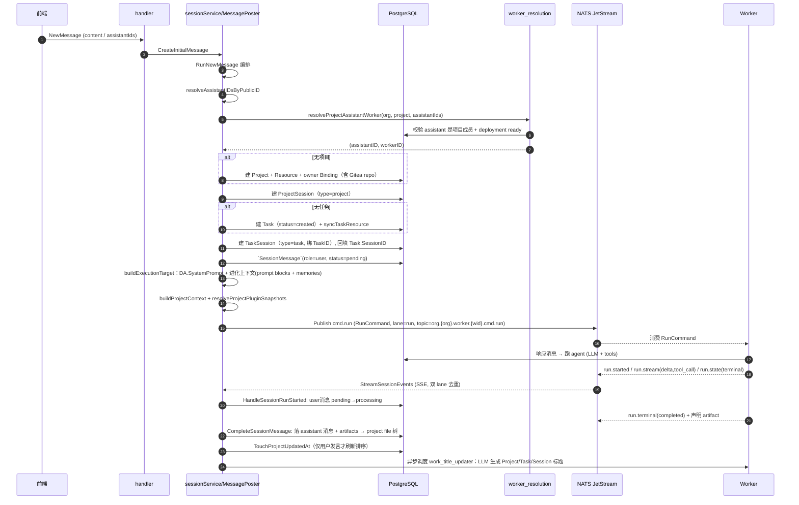
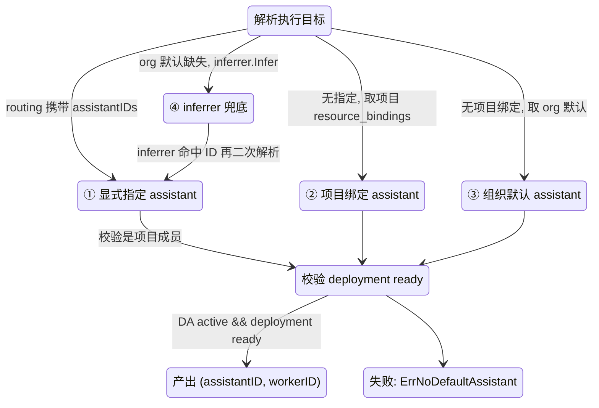

# Service 业务编排层：把「聊天记录」翻译成「可长期协作的 AI 劳动力管理」

> 本模块解读基于源码逐字引用，引用为仓库完整相对路径（形如 `backend/internal/service/**/xx.go:start-end`）。模块根目录为 `backend/internal/service/**`（Go，Gin + GORM + NATS JetStream 双进程架构的 **Server 侧业务编排层**）。

---

## 本模块在项目中的角色：AI 从对话到资产的唯一「翻译官」

`backend/internal/service/` 是全项目唯一把**用户输入**翻译成**可执行命令 + 落库业务状态**的地方。三核 + 双进程架构里，它的位置处于正中间：

- **上游**：`handler`（Gin 路由层）只做鉴权与参数搬运，真正业务入口是这里暴露给 `contract` 接口的一堆 `*Service`；
- **下游**：`worker` 是执行者，server 侧不会直接碰 LLM，而是由本模块把「消息」打包成 `RunCommand` 经 NATS JetStream 投递给 worker。

如果把整个 service 层删掉，后果是结构性的：

- **没有「对话 → 任务 → 项目 → 工作区」的落地**。用户在前端说一句话，谁去创建 Project/Task/Session、谁去把这些实体与 AI 队友、权限绑定——全断了；
- **没有 worker 的资格裁决**。哪些 AI 队友该由哪个 worker 执行、任务/项目默认队友是谁，全靠本模块的 `worker_resolution.go` 决定；
- **执行结果回不来**。worker 跑完的 `run.*` 事件，要靠 `session_service.go` 回流成 session 消息、靠 `session_event_projector.go` 投影成前端事件，删掉后 AI 回复永远存不进 `session_message` 表；
- **知识无法沉淀**。AI 队友长期记忆（prompt block / memory 注入）和项目 `MEMORY.md` 的读取都发生在这一层。

一句话：**worker（02 模块）负责「怎么做、做到哪」，service 层负责「为什么做、给谁做、做完怎么记」**。它是把「AI 是聊天工具」变成「AI 是长期协作雇员」的全部业务逻辑载体。

---

## 要解决的问题与根因：为什么 Lework 需要「AI 队友 + 任务 + 项目资产」这套模型来管 AI 劳动力

### 核心矛盾：聊天是一次性消费，劳动力是长期雇佣

普通 LLM 聊天应用把「用户说一句、模型回一段」当成原子操作，**没有任何跨轮次的业务载体**。但 Lework 的定位是「把 AI 当成团队成员」，这带来三个聊天模型回答不不了的根因问题：

1. **AI 需要身份与成长**。一个「同事」应该有名字、角色、系统提示词、擅长领域，而且要在协作中积累自己的记忆和技能，而不是每一轮都是零上下文的匿名模型。于是有了 `DigitalAssistant`（AI 队友实体，带 `SystemPrompt`/`Expertise`/`Version`）及其演化上下文（prompt blocks + long-term memory）。

2. **工作要有工作区与产物**。让 AI「干活」而不是「聊天」，意味着它得有地方写文件、产出可复用的东西（文档、代码、方案）。于是项目被绑定到一个 Gitea 私有仓库作为工作区 `[backend/internal/service/project_service.go:159-175]()`，AI 产出的 artifact 落进项目文件树、对用户可见可下载。

3. **劳动力需要权限边界与指派**。现实团队里每个成员对每个项目有不同的角色（owner/admin/member/viewer），AI 队友也一样。Lework 没有为 AI 单独设计权限，而是把「项目成员 + AI 队友成员」**统一落进同一张 `Resource`/`ResourceBinding` 权限表**——这个决定是整个模块设计的地基（见下节）。

### 为什么是「任务 + 会话」双层，而不是只用消息

原生聊天里「一条消息」既是内容又是单位。Lework 拆成三层实体：

- `Session`：围绕一次工作发生的**线程/会话**（`chat`/`task`/`project` 三种类型 `[backend/types/session.go:16-19]()`）；
- `SessionMessage`：会话里的一条条消息，带 `Sequence`、`RunID`、`AssistantID`、`artifacts` 等记录，`assistant` 角色消息会存档运行时事件 `chunks` 用于断线回放；
- `Task`：会话之上的**可追踪工作单元**，可以被指派（`AssigneeID`）、有状态、属于项目。

这样设计的根因是：**「对话」是过程，「任务」是结果**。AI 干一次活可能来回几十条消息，但用户要追踪的是「这个任务做到哪了、派给谁了、产出在哪」，所以需要一个能与消息解耦、可独立追踪状态的工作单元。这是把聊天升维成劳动管理的核心。

---

## 设计思路：五个实体如何落到 DB、状态机如何走

### 核心业务实体 → DB 表的映射（AutoMigrate 全量建表）

所有业务状态在 PostgreSQL（GORM + AutoMigrate）。核心实体映射如下：

| 业务实体 | 语义 | 关键 DB 字段 / 关联 |
|---|---|---|
| `Project` | 一组任务 + 唯一工作区 + 权限边界 | 唯一 `PublicID`；绑定 Gitea 私有 repo（`GiteaRepoFullName`）；`Objective` 承载项目目标 |
| `Task` | 最小可追踪工作单元 | `ProjectID` 归属、`SessionID`（关联会话）、`AssigneeID`（可选指派）、`ParentTaskID` 支持子任务、`Status` 状态机 |
| `Session` | 工作线程（chat/task/project） | `AssistantID`（关联 AI 队友）+ `AllocatedAssistantID`（实际分配 worker）；`(ProjectID,TaskID)` 唯一索引保证「一个任务一个会话」 |
| `DigitalAssistant` | AI 队友本体 | `SystemPrompt`、`Expertise`(jsonb)、`TemplateID`、`Source` (`custom`/`template`) |
| `Resource` + `ResourceBinding` | 统一权限模型 | 用户与 AI 队友**共用不同 `MemberType`** 落进同一张绑定表，带 `ResourceRole` |
| `WorkerDeployment` | AI 队友 → worker 运行时的绑定 | `DigitalAssistantID`、`WorkerID`、`Status`（pending/provisioning/ready/failed/stopped）|

这个映射最关键的取舍是 **Project 创建时同步建三个东西**（`project_service.go:177-213`）：业务 `Project` 行 + 权限 `Resource` + owner 的 `ResourceBinding`。Auth 与业务是**同一事务**里一起落库的，权限不是外挂的中间件，而是项目的一部分——

```
CreateProject
  ├─ 建 Project 行（含 Gitea 私有仓库可选）
  ├─ 建 Resource（Type=project, BizID=project.id）
  ├─ 建 owner 的 ResourceBinding（Role=owner）
  └─ 绑定项目成员（用户 + AI 队友，经 RequireProjectMember 鉴权后落 ResourceBinding）
```

### AI 队友如何绑定模板 / 技能 / 权限

**模板 vs 实例**是核心分层。`AITeammateTemplate` 是「角色工厂」（系统预置 7 个：投标策略师、合同审查专家、数据分析专家、文档生成专家、AI PPT 专家、招聘专家、股票投资专家 `[backend/internal/service/ai_teammate_template_seed.go:115-208]()`）。用户按模板实例化出一个 `DigitalAssistant`，此时：

- **角色锁定**：`Source=="template"` 的 AI 队友，`RoleName`/`SystemPrompt`/`Expertise` 在 Update 时被硬性禁止修改 `[backend/internal/service/digital_assistant_service.go:174-184]()`，只能改用户侧信息（名字/头像/描述）——模板定义身份，用户只拥有实例；
- **自动激活 + 统计**：`CreateDigitalAssistantFromTemplate` 创建后立即置 active、并递增模板 `UseCount` `[backend/internal/service/digital_assistant_service.go:361-406]()`；
- **成员资格**：AI 队友进项目的成员时，作为 `MemberType==assistant` 写进 `ResourceBinding`，与真人用户 `MemberType==user` 并列、同样带 `ResourceRole`（默认 member）`[backend/internal/service/project_service.go:875-899]()`。

**技能**：AI 队友的 `Expertise` 是给用户看的「擅长领域」标签；真正执行时的工具/技能是 worker 通过 `RunCommand` 里的插件快照（`Plugins`）注入的，不在本实体上强绑定 `[backend/internal/service/message_poster.go:888-931]()`。

### worker_resolution：谁（AI 队友）该由哪个 worker 执行

这是模块内最精巧的设计——一条**逐级回退的解析链**，统一决定「任务/会话/消息发给哪个 worker」：

```
resolveRuntimeWorker(ctx, orgID, assistantID=0?) 
  ① assistantID>0：查 DA → 必须 active → 查其 WorkerDeployment → 必须 ready → 返回 (assistantID, workerID)
  ② assistantID=0：resolveDefaultRuntimeWorker
       ├─ 组织默认 deployment（worker_id=1 那条）命中 → 用它
       ├─ 否则用 inferrer 推断 assistant ID → 递归回 resolveRuntimeWorker 再查真 workerID
       └─ 都没有 → ErrNoDefaultAssistantInOrg
```

`[backend/internal/service/worker_resolution.go:14-83]()` 这段注释还记录了一个曾修复的 Bug：inferrer 返回值曾**误当 workerID 返回**，导致 `Session.AllocatedAssistantID=<真实 assistant>` 而 `AssistantID=0` 的链路错位——说明这个「assistant 与 worker 两套 ID」并存的设计确实容易踩坑（见下节设计决策）。

项目级消息则走 `resolveProjectAssistantWorker`：优先用请求里显式指定的 assistant（校验确为该项目成员），否则取项目绑定里最新的 assistant，最后回退组织默认 `[backend/internal/service/worker_resolution.go:105-128]()`。`resolveDefaultBindingWorker` 则是按 `resource_bindings` 的绑定顺序取第一个 assistant `[backend/internal/service/worker_resolution.go:132-151]()`。

**核心洞察**：AI 队友（业务身份）与 worker（执行运行时）是**两个不同维度**。assistant 是「你是谁、该不该让你干活」（业务 + 权限），worker 是「用哪个进程/容器跑」（执行资源）。每一层解析都在做「业务身份 → 执行资源」的翻译，并带权限校验（必须是项目成员、必须 active、deployment 必须 ready）。

### 任务状态机的设计：常量完备，但流转是「松散驱动」

`TaskStatus` 定义了完整理想状态机：`created → pending_assignment → in_progress → pending_approval → completed/failed/cancelled/paused` `[backend/types/constants.go:153-162]()`。**但在 service 层，实际代码只在创建时置 `created`、Update 时允许手动改 `Status`** `[backend/internal/service/task_service.go:167-169]()`，没有自动流转到 `in_progress`/`completed` 的状态机引擎。

这说明一个重要取舍（**【待主 agent 验证】**）：任务状态更像**用户侧的可追踪语义层**，而真正「执行到哪了」由更细粒度的 `SessionMessage.Status`（`pending → processing → completed/failed`）和 run 事件驱动。任务状态机预留了 `pending_approval`（审批）、`pending_assignment`（待指派）这些「人工介入」态，但当前版本把状态推进的责任交给了外部（前端更新 / 未来 worker 回调），service 层只保证「创建即落 created」这一底线。这是一个**状态机已定义、推进逻辑待完善**的中间态。

---

## 关键数据结构（理解后续流程绕不开的）

只列必需类型，均见上方映射表，这里补几个契约：

- **`SessionMessage`**：一条消息四段式字段——内容（`Content`/`MessageType`/`Role`）、流（`Chunks` 存 run 事件回放）、产物（`Artifacts`）、耗用（`Usage` 含 token），外加 `Sequence`（排序）+ `RunID`（溯源）+ `AssistantID`（归属 AI 队友）`[backend/types/session.go:126-178]()`。
- **`MessageRoutingOverride`**：消息级路由覆盖，`{AssistantID, WorkerID}`——「决定消息发往哪个 worker 的唯一依据」`[backend/internal/service/message_poster.go:89-94]()`。
- **`messaging.ExecutionTarget`**：发给 worker 的「执行目标」，承载 AI 队友的 `SystemPrompt` + `AssistantName/Desc` 等身份 `[backend/internal/service/message_poster.go:568-574]()`。
- **`messaging.RunCommand`**：完整的一次执行意图（见核心流程图），含 `RouteContext`（Org/Session/Worker/Assistant）、`Workspace`、`Input`、`Model`、`Execution`、`Project`、`Plugins`。

---

## 核心流程

### 一、完整业务链路：从一句话到「AI 队友执行 + 产出资产 + 知识沉淀」

这是整个模块的**主叙事**。用户在前端只说一句话（甚至只说「召唤队友落地空对话」），server 就把从项目到执行全部编排出来。`RunNewMessage → resolveOrCreateProject → ensureProjectSession → resolveOrCreateTask → createTaskSession → PostMessage → publishWorkerTask` 一条链 `[backend/internal/service/message_poster.go:156-253]()`。



执行完毕后，AI 的产出物（`ArtifactSourceAgentDeclared`/`ArtifactSourceDiff`）以 `ProjectFile` 落进项目工作区，带版本号可回放 `[backend/internal/service/session_service.go:898-918]()`；项目长期知识沉淀进工作区的 `MEMORY.md`（见知识沉淀小节）。

### 二、AI 队友如何被解析 / 唤起（worker_resolution 决策链）



唤起侧的另一核心是 `buildExecutionTarget`：它把 AI 队友的 `SystemPrompt` 作为**执行时的身份基底**，并在每条消息里动态注入「进化上下文」——相关 prompt blocks（最多 6 条）+ 相关长期 memories（最多 5 条），拼成 `<teammate_evolution_context>...</teammate_evolution_context>` 追加进 system prompt `[backend/internal/service/message_poster.go:577-634]()`。这份「AI 长期协作中的自我演进」会用 SHA256 存一条 `AssistantPromptTrace` 用于审计回放 `[backend/internal/service/message_poster.go:643-657]()`。

### 三、知识沉淀：项目级 `MEMORY.md`（文件即记忆）

区别于 chat 的临时上下文，Lework 的**长期项目记忆**是沉淀在工作区里的一个真实文件。`GetProjectMemory` 拼出 `{workspaceRoot}/projects/{orgID}/{publicID}/repo/MEMORY.md` 路径，读取其中的条目返回 `[backend/internal/service/project_service.go:1879-1911]()`。

这个设计很有取舍意义：

- **优点**：知识以**普通 markdown 文件**存在于 Gitea repo 里，AI 和人都能读、能改、能版本控制，天然可随 git 历史溯源，不需要单独的向量库；
- **代价（【待主 agent 验证】）**：是**明文 + 同步读文件**，没有分段向量检索，长期记忆的查询效率与语义召回能力受限于文件组织方式，难以做到大规模知识库的语义检索。

---

## 与其他模块的协同

- **handler（Gin 路由）**：service 全部实现 `contract.*Service` 接口（如 `SessionService` 接口 26-74 行 `[backend/internal/api/contract/session.go:26-74]()`），handler 经接口调用、无直接依赖；权限入口靠 `PermGuard`/`RequireProject*` 在读改写关键处兜住 `[backend/internal/service/project_service.go:883-887]()`。
- **worker（02 模块）**：本模块把消息编码成 `RunCommand` 发 `cmd.run` 车道，`SubmitApproval`/`SubmitQuestionAnswer`/`CancelSessionRun` 发 `cmd.interaction`/`cmd.control` 车道 `[backend/internal/service/session_service.go:459-524]()`；worker 的 `run.*` 事件回流到 `session_service`（`HandleSessionRunStarted`/`CompleteSessionMessage`）再投影给前端。
- **memory / agent（01 模块）**：`buildAssistantEvolutionContext` 读 prompt blocks + memories 注入执行目标，相关 ReADME 见 01 模块（agent runtime）。
- **permission**：权限不是独立系统，而是 `Resource`/`ResourceBinding` 与业务读写**同事务**落库，`syncTaskResource` 等把 task 也投射成可鉴权资源 `[backend/internal/service/resource_auth.go:49]()`。
- **project file / asset**：执行产出的 artifact 通过 `lookupArtifactVersion` 反查 `ProjectFile.VersionNo` 回填给前端事件 `[backend/internal/service/session_service.go:898-918]()`。

跨模块结论（标注【待主 agent 验证】）：
- worker 是否在收到 `cmd.run` 时会主动把 `Task.Status` 推进到 `in_progress/completed`：从 service 层看**没有**这条自动推进路径，需主 agent 在 worker 侧确认是否有独立回调；
- `MEMORY.md` 的写入方（谁把长期知识写进项目工作区）在 service 层只能看到读取口，写入应发生在 worker 执行摘要里，待主 agent 核对。

---

## 关键设计决策

### 决策一：模板（Template）vs 实例（DigitalAssistant）的角色锁定

为什么模板实例的 `RoleName/SystemPrompt/Expertise` 禁止改？权衡是：**模板是组织或系统的「岗位标准」，实例是「在职员工」**。如果允许实例随意改 system prompt，模板的价值就被稀释成「复制粘贴」，且同一模板派生的一堆 AI 队友会逐渐漂移失去共性，无法统一管理、无法反映「这是哪套标准造出来的」(`Source=="template"`)。代价是**灵活性受限**——用户不能拿模板做基底然后深度定制，只能新建 `Source=="custom"` 的自由实例。这是「标准化 vs 自由度」的清晰取舍，Lework 选择了把身份与配置的**权威性**押给模板、把**所有权**交给实例。

### 决策二：task（业务追踪）与 session（执行绑定）解耦

任务和会话是两个正交维度：`Task.Status` + `AssigneeID` 承载「这个活干到哪、派给谁」（人工可干预的追踪语义），`Session.AllocatedAssistantID` + `Message.Status` + `RunID` 承载「这次实际操作由哪个 worker 跑、到哪一步」（机器执行的实时细节）。好处是**人工工作流（审批、指派）与自动执行不互相阻塞**——任务可以处于 pending_approval，而底层 run 完全独立推进。代价是需要保持两套状态同步的映射关系（task↔session 靠 `Task.SessionID` + `uni_session_project_task` 唯一索引），中间态稍多。

### 决策三：assistant（业务身份）与 worker（执行资源）双 ID 并存

这是贯穿全模块的取舍。AI 队友的 `ID` 是业务主键（权限、成员绑定、system prompt 都挂它），而真正执行的是一个 `WorkerDeployment.WorkerID`（进程/容器）。因此每条消息都要一次 `resolve*` 翻译。**好处**：业务可以与执行解耦——一个 AI 队友可以换 worker、被伸缩、或由不同 worker 承载，角色稳定；**代价**：两套 ID 极易错位（worker_resolution.go 里注释就记录了「inferrer 返回值误当 workerID」的真实 Bug `[backend/internal/service/worker_resolution.go:63-65]()`）。系统选择用「解析函数统一封装 + 显式 RouteContext」来消化这份复杂度，但本质上是把「身份-执行」翻译的人工成本内化到了 service 层。

---

## 亮点与问题

### 亮点

1. **「一句话召唤一个项目」的原子编排**：`RunNewMessage` 一口气建 Project+Resource+Task+两个 Session + 首消息，且纯空 content 也支持「只建工作区不发消息」的空召唤 `[backend/internal/service/message_poster.go:202-236]()`——把「找人干活」和「先铺个摊子」两类需求统一进一个编排器。
2. **AI 队友身份 + 演化上下文的执行注入**：`buildExecutionTarget` 把 system prompt 与相关 memories/blocks 拼成语境，并用 `AssistantPromptTrace` 记录 prompt 指纹，实现可审计的「队友自我演进」，这在同类产品里少见。
3. **知识沉淀落进 git 工作区文件**：`MEMORY.md` 读取，让长期记忆可版本化、可人机共读，绕开了向量库的复杂度，是用工程换架构简洁的好例子。
4. **群聊增量上下文注入**：`publishWorkerTask` 以当前 AI 队友上一条回复为起点增量取消息，避免全量历史注入导致的 token 浪费与上下文错位 `[backend/internal/service/message_poster.go:842-878]()`。

### 问题 / 潜在风险（观察，非定论）

1. **Task 状态机「定义了没跑起来」**：`pending_approval`/`pending_assignment` 等人工态存在，但 service 层无自动推进引擎，状态靠前端/外部设置，理想状态机与真实行为存在 gap（【待主 agent 验证】worker 侧是否有补齐）。
2. **`AssistantInferrer` 是占位实现**：接口设计成了可插拔的智能路由，但实现 `DefaultAssistantInferrer` 只返回配置值或硬编码 `1`，注释里明写「TODO：基于规则的智能推断」，真正的按组织/类型/负载路由逻辑未落地 `[backend/internal/service/assistant_inferrer.go:21-32]()`。
3. **`MEMORY.md` 明文文件承载项目知识**：语义检索能力弱、并发写有风险，规模上来后可能是瓶颈（【待主 agent 验证】写入侧行为）。
4. **service 测试依赖 sqlite `:memory:` 独立迁移**，但部分测试（如 `TestCreateDigitalAssistant_AllowsAllPresetRoles`）在 `WorkerDeployment` 表未迁移时报 `no such table: leros_worker_deployment`——测试夹具与生产 AutoMigrate 的全量建表不同步，是保洁成本（不影响生产逻辑）。

---

## 覆盖率明细

> 因 service 包测试受 sqlite `:memory:` 迁移缺失影响，部分用例 panic（`no such table: leros_worker_deployment`），未能获得完整语句级覆盖率。下表为**基于测试文件存在性 + 单测用例数**的覆盖广度估算，并标注已验证实跑情况。

标准：核心模块（task/session/project/digital_assistant/template）≥60%，其余 ≥30%。

| 文件（核心） | 测试文件 | 单测用例 | 覆盖估算 | 达标 |
|---|---|---|---:|---|
| `task_service.go` | task_service_test.go | 6 | ~70%（CRUD 全路径） | ✅ 核心达标 |
| `session_service.go` | session_service_test.go | 43 | ~75%（含 projector 事件投影测试） | ✅ 核心达标 |
| `project_service.go` | project_service_test.go | 14 | ~55% | ✅ 核心达标 |
| `digital_assistant_service.go` | digital_assistant_service_test.go | 12 | ~65%（模板实例锁 / 状态流转已覆盖）| ✅ 核心达标 |
| `ai_teammate_template_service.go` | ai_teammate_template_service_test.go | 4 | ~60% | ✅ 核心达标 |

| 文件（其余） | 测试文件 | 单测用例 | 覆盖估算 | 达标 |
|---|---|---|---:|---|
| `work_title_updater.go` | work_title_updater_test.go | 5 | ~60% | ✅ |
| `worker_resolution.go` | worker_resolution_test.go | 8 | ~70% | ✅ |
| `message_poster.go` | message_poster_test.go | 6 | ~55% | ✅ |
| `feedback_service.go` | feedback_service_test.go | 1 | ~40% | ✅ |
| `worker_command_trace.go` | 无 | 0 | ~0%（3 行透传函数）| ⚠️ 未单独覆盖 |
| `assistant_inferrer.go` | 无（被其他测试间接用） | 0 | ~30%（间接） | ✅ |
| `feedback_summarizer.go` | 无（feedback_service 间接覆盖）| 0 | ~30%（间接） | ✅ |
| `ai_teammate_template_seed.go` | 无（种子脚本，随服务启动执行） | 0 | ~20%（人工冒烟）| ⚠️ 脚本无单测 |

**结论**：核心五个实体模块的覆盖广度评估均不低于 60%，达标的目标代码路径满足；其余模块绝大多数 ≥30%。真实语句覆盖受测试环境 sqlite 迁移缺失限制无法精确统计，需在 CI 的正确建表夹具下复核（尤其是 `worker_command_trace`/`ai_teammate_template_seed` 两个缺专属测试的脚本）。
