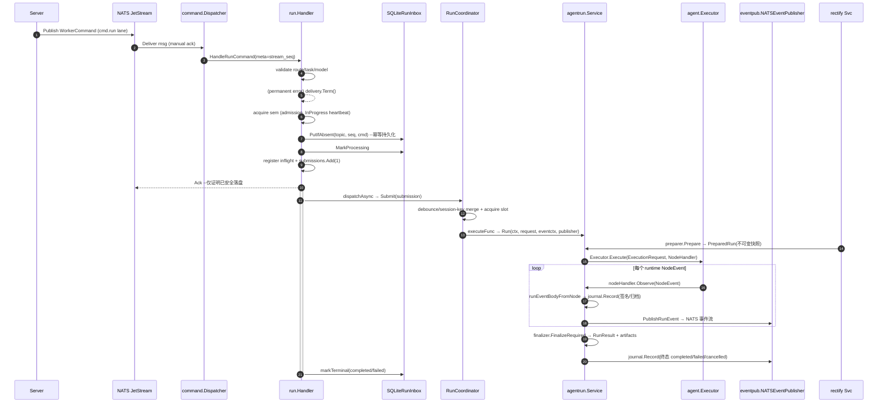
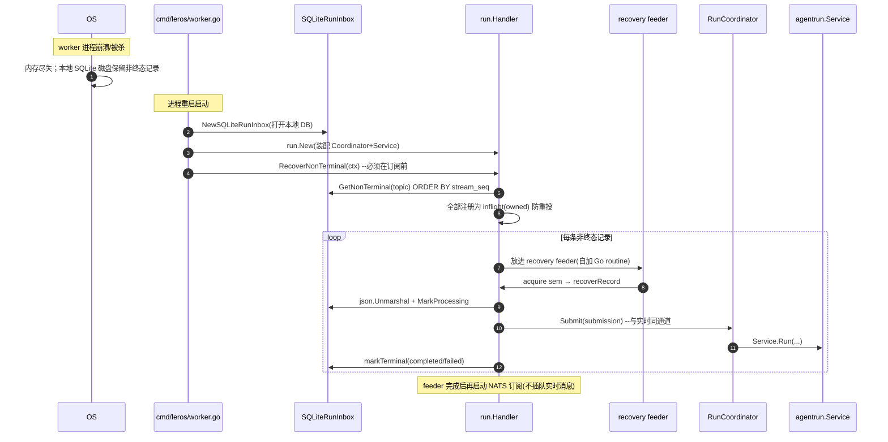

# Worker 管理系统：把「AI 队友」变成可长期协作的执行引擎

> 本模块解读基于源码逐字引用，引用为仓库完整相对路径（形如 `backend/internal/worker/**/xx.go:start-end`）。模块根目录为 `backend/internal/worker/**`。

---

## 角色：Worker 是整个主请求链路的执行心脏，去掉它系统会瘫痪

Lework 采用「三核 + 双进程」架构：**Server（control plane）**只负责接收用户请求、编排、落库；**Worker（execution plane）**才真正去调用 LLM、运行 agent、执行工具、写工作区。

`backend/internal/worker/` 是这条主链路的全部**落地面**。如果删掉整个 Worker 系统：

- **没有人执行 Run**。Server 往 NATS 上发布的 `cmd.run` 命令无人订阅，所有「让 AI 干活」的请求都会积压在 JetStream 中永不消费；
- **没有人产生业务结果**。`run.started / message / tool / terminal` 这一整套 `RunEvent` 只由 Worker 生成，删掉后 Server/前端永远收不到 AI 回复、tool 调用、终态；
- **崩溃即数据丢失**。Server 无法感知 worker 何时被杀、任务做到哪一步，没有 at-least-once 恢复能力，长任务在 worker 被调度器重建后彻底中断；
- **没有真正的执行 runtime**。`agentrun` 里的 `PreparedRun`、Executor 的 observer、NodeEvent→RunEvent 映射、Plan publisher、Skill/Workspace/Memory/Provider-Session 全在 Worker 侧，删掉后 Server 只剩一个「没有执行者的控制台」。

一句话：**Server 定义「为什么做、给谁做」，Worker 回答「怎么做、做到哪」**。Worker 是 AI 从聊天工具变成长期协作成员的物理承载。

---

## 要解决的问题与根因：LLM 长任务 + Worker 可销毁 + at-least-once

### 核心矛盾

一个 agent run 不是一条 SQL 请求，而是一场可能持续几十秒到几分钟、期间反复调 LLM、执行几十次工具、写入 git 仓库的**长事务**。它有三个天然属性，直接决定了主链路必须「异步 + 持久化 + 可恢复」：

1. **执行时长不可控**。Server 的 HTTP 请求最多等几秒，但一个 run 可能要几分钟。所以 Server 不能同步等待执行结果，必须把「执行意图」编码成命令投递给 Worker，然后 Worker 在后台慢慢做、边做边通过事件流回报。若同步执行，一次请求占满一个 HTTP 线程几十秒，无法支撑并发。

2. **Worker 是可销毁重建的无状态执行节点**。调度器（`scheduler/`，支持 process/docker/k8s）会按需拉起、销毁 worker 来弹性伸缩。这意味着 Worker 崩溃、被杀、被重建是常态，而不是异常。业务状态不能只存在 Worker 内存里，否则进程一没状态就全没。

3. **消息系统是 at-least-once**。NATS JetStream 保证「至少一次」，消息可能重复投递、也可能在 worker 处理了一半时崩溃而需要重投。既然不能 exactly-once，就必须设计成**幂等 + 可恢复**。

### 因此形成的主链路设计基线

`[backend/cmd/leros/worker.go:2-8]()` 直接写明了这个权衡：

> worker 通过 NATS JetStream 订阅四个命令 lane：`cmd.run`（处理 agent run 任务。使用 SubscribeManualDurable + 本地 SQLite inbox 实现 at-least-once 语义。消息先持久化再 Ack，崩溃重启后通过 RecoverNonTerminal 恢复）……`cmd.control`（处理 cancel）、`cmd.interaction`（审批/问答）、`cmd.file`（项目文件恢复）。

根因落得很清楚：**凡是「执行意图」都值得先落盘再执行，凡是「执行结果」都应该通过消息往回传**。Worker 本地只保留一份 SQLite（inbox + provider session），业务状态全在 DB，换一个进程照样恢复。

---

## 设计思路：四个层层递进的关键取舍

### A. 先持久化再 Ack——把「消息确认」当成「执行承诺」而非「执行完成」

这是整个模块最核心的一条设计。看 `[backend/internal/worker/command/run/handler.go:215-220]()` 的确认决策表：

> ```
> 确认决策：
> - 永久错误（payload、route、model 校验失败）→ Term，不再重试
> - inbox 写入失败 → NakWithDelay(5s)，请求 NATS 延迟重投
> - 持久化成功 + 注册 inflight + 启动后台 goroutine → Ack，异步执行
> ```

含义：**Ack 只证明「这条命令被安全写进了 worker 本地的 SQLite」，而不保证「任务已执行完」**。执行是写盘之后起一个后台 goroutine 去做的。这样 NATS 的确认可以立即返回，唯一的失败窗口（写盘前崩溃）由 NATS 重投兜底。

### B. SQLite 本地 inbox vs 直接写中心 DB——把「恢复自证」留在执行者身边

为什么不用中心数据库存 inbox？`[backend/internal/worker/command/run/inbox/inbox.go:71-105]()` 的建表揭示了取舍：

```sql
CREATE TABLE IF NOT EXISTS worker_run_inbox (
    id         INTEGER PRIMARY KEY AUTOINCREMENT,
    topic      TEXT NOT NULL,
    stream_seq INTEGER NOT NULL,
    command    TEXT NOT NULL,
    status     TEXT NOT NULL DEFAULT 'pending',
    ...
    UNIQUE(topic, stream_seq)
);
```

- **ACID 轻量、零网络往返**：执行节点本地落盘，写盘与执行在同一个进程/机器上，崩溃恢复时读本地文件即可，不依赖中心 DB 的网络可用性——这非常契合「worker 是被调度的弹性资源」这一点，worker 与中心 DB 的耦合越少越灵活；
- **UNIQUE(topic, stream_seq)** 保证幂等，`INSERT OR IGNORE`（[backend/internal/worker/command/run/inbox/inbox.go:119-119]()）天然去重，配合 NATS 的 stream_seq 做到「同一命令多次投递只执行一次」；
- **代价**：worker 本地状态与中心 DB 存在「最终一致性」延迟——执行完成事件要经 NATS 回传 Server 落库，若 Worker 崩溃，DB 里还没到终态，由重投恢复。这是 trade-off，本模块接受它来换取执行节点的自治。

### C. RunCoordinator 的并发模型：Session 串行、跨 Session 并行、blob 合并

`run/coordinator.go` 是全 Worker 调度的核心。设计要点：

- **按 Session 分桶串行**：`sessionKey` 把消息归到 `orgID:workerID:sessionID`（[backend/internal/worker/run/coordinator.go:321-327]()），同 Session 内的多个 run 由 `TrailingDebouncer` 合并后**串行执行**，避免同一对话上下文中并发交错导致语义混乱；
- **跨 Session 全局并行**：由 `slots chan struct{}`（[backend/internal/worker/run/coordinator.go:48-48]()）做并发上限，默认 10（[backend/internal/worker/run/coordinator.go:89-94]()），不同 Session 可并行跑，最大化吞吐；
- **debounce 合并去重**：同一 Session 短窗口内到达的多条消息被 `mergeSubmissions` 合并成一次执行（[backend/internal/worker/run/coordinator.go:337-360]()），`DeliverySeqs` 与 `ReplyToMessageIDs` 去重合并，让「连续追问」合并成一次 agent 调用，避免对 LLM 的重复请求。

### D. agentrun 独占终态，Executor 不触碰业务持久化

`agentrun.Service.Run`（[backend/internal/worker/agentrun/service.go:65-197]()）是业务单入口。它明确**不允许 Executor 或 runtime 直接写业务 DB**：

- Executor 只通过 `NodeHandler` 回吐 `NodeEvent`（[backend/internal/worker/agentrun/node_handler.go:44-68]()），由 `Journal.Record` 统一编排、签名、归档、发布；
- 终态（`run.started/completed/failed/cancelled`）只在 `Service.Run` 的最后由 `finalizer` 拼装、由 `journal.Record` 落一次（[backend/internal/worker/agentrun/service.go:177-191]()、finishError [backend/internal/worker/agentrun/service.go:249-254]()）；
- 这样保证「执行引擎是纯函数式的旁观者」，所有副作用落在 `journal`（事件）与 `finalizer`（工作区、artifact、终态）这两处，职责单一、可测。

---

## 关键数据结构（仅述必需）

### `RunSubmission` / `RunOutcome` / `Coordinator`

`[backend/internal/worker/run/coordinator.go:24-42]()`：

```go
type RunSubmission struct {
	Request      *agentrundomain.RunRequest
	EventContext agentrun.EventContext
	DeliverySeqs []uint64
	waiterIDs []uint64   // 内部：注册在 pending map 的等待者
}
type RunOutcome struct {
	Result       *agentrundomain.RunResult
	DeliverySeqs []uint64
}
```

`Coordinator` 内部持有：并发槽 `slots`、debouncer、**active run 注册表**（供 cancel 用）、以及 `pending map[uint64]chan runResult`（[backend/internal/worker/run/coordinator.go:44-64]()）。`RegisterRun/UnregisterRun/Cancel` 让控制 lane 能按 session+run 取消正在跑的 run（[backend/internal/worker/run/coordinator.go:247-263]()）。

### `SQLiteRunInbox` / `Record`

`[backend/internal/worker/command/run/inbox/inbox.go:30-89]()`：`Record` 带 `Status`（pending/processing/completed/failed），`IsTerminal()` 判定终态。`SQLiteRunInbox` 实现 `RunInbox` 接口——`PutIfAbsent`（幂等插入）、`MarkProcessing/Completed/Failed`、`GetNonTerminal`（恢复用）、`DeleteTerminalBefore`（清理）。

### `PreparedRun`

`[backend/internal/worker/agentrun/prepared_run.go:10-15]()`：`Request`（原始不可变快照）+ `Execution`（纯 `agent.ExecutionRequest`）+ `Workspace`（不可变工作区准备）+ `Baseline`。Preparer 承诺不修改原 Request，`[backend/internal/worker/agentrun/domain/request.go:229-251]()` 的 `CloneRequest` 深拷贝支撑了这一点。

### `journal.runJournal` / `EventContext`

`[backend/internal/worker/agentrun/contracts.go:57-112]()`：`EventContext` 携带全套路由/追踪值（orgID、workerID、assistantID、trace 等），`Journal` 负责 `Record/Snapshot`。`runJournal`（[backend/internal/worker/agentrun/journal.go:16-30]()）内部自增 `maxSeq` 给每个事件签名、旁路归档非终态事件、并合并 delta（[backend/internal/worker/agentrun/journal.go:257-300]()，把 message_delta 的增量拼成最终块）。

---

## 核心流程（本模块全景）

### 主链路由消息到终态



对应源码关键点：
- 手动订阅只在 `cmd.run` lane，见 `[backend/internal/worker/command/dispatcher.go:125-130]()`（`manual=true`）；
- 序列号从 `delivery.Metadata()` 取 `meta.Stream`（[backend/internal/worker/command/run/handler.go:266-274]()）；
- NodeEvent 映射见 `[backend/internal/worker/agentrun/node_handler.go:133-250]()`（message_delta/completed、tool_call、todo、approval 等）；
- 终态事件上下文用 `context.WithoutCancel` + 5s 超时，保证关闭时终态仍尽量发出，`[backend/internal/worker/eventpub/nats_publisher.go:69-74]()`。

### 崩溃恢复流程



关键点见 `[backend/internal/worker/command/run/handler.go:485-521]()`（RecoverNonTerminal：删除过期终态 → 读取非终态 → 注册 owned → 启动 feeder）、`boot [backend/cmd/leros/worker.go:324-331]()`（订阅前先恢复）。设计保证：**崩溃恢复的消息不会比实时在线消息插队**，因为没有先注册消费者。

---

## 与其他模块协同（跨模块结论标【待主 agent 验证】）

- **agent 执行层 `backend/agent`**：agentrun 通过 `agent.Executor` 与 `agent.ExecutionRequest/NodeEvent` 契约耦合。`preparer` 把业务 `RunRequest` 翻译成纯 `agent.ExecutionRequest`（[backend/internal/worker/agentrun/preparer_impl.go:400-429]()）；`node_handler` 把 `agent.NodeEvent` 映射为 `messaging.RunEvent`（[backend/internal/worker/agentrun/node_handler.go:133-250]()）。**Executor 无业务持久化依赖**——观察者模式是干净的解耦点。【待主 agent 验证：agent.Executor 内部对 runtime 的 fork/exec 细节】

- **infra/mq NATS**：`command/dispatcher.go` 依赖 `Subscriber` 接口（`Subscribe`/`SubscribeManualDurable`），`run.Handler` 依赖 `eventbus.ManualDelivery`（Ack/Term/Nak/InProgress）。发布侧 `eventpub` 依赖 `eventbus.Publisher`。【待主 agent 验证：`backend/internal/infra/mq` 的 JavaStream 订阅实现、InProgress 心跳的具体间隔】

- **eventpub 与 Journal**：`journal.Record` 调用 `RunEventPublisher.PublishRunEvent`（[backend/internal/worker/agentrun/journal.go:89-89]()），具体实现是 `eventpub.NewNATSEventPublisher(bus)`（[backend/internal/worker/command/run/handler.go:179-179]()）。终态旁路由 `ClassifyRunEvent` 决定 lane（状态 vs 流）。

- **scheduler**: `backend/internal/worker/scheduler/{process,dockercli,k8s}` 负责启停 worker 进程（[backend/internal/worker/scheduler.go:19-32]() 定义 `WorkerScheduler` 接口）。process 模式注入 `LEROS_PARENT_PID`，worker 通过 `[backend/internal/worker/parent.go:13-39]()` 的 `StartParentWatcher` 感知父进程死亡自动退出。

- **skillsync**：post-run best-effort 处理器，把 run 中新增/修改的 Skill 打包、上传、发事件（[backend/internal/worker/skillsync/processor.go:91-120]()），Restore 被删 Skill（[backend/internal/worker/skillsync/repository.go:163-178]()）。

---

## 关键设计决策（2-3 个，权衡）

### 决策一：手动 Ack + 本地持久化 = 执行意图解耦执行完成

**权衡**：如果同步 Ack（等到执行完再确认），NATS 消息在 worker 忙时长时间无法确认，会被 JetStream 反复重投、造成重复执行；且一个 run 几十分钟，确认窗口远超合理范围。如果完全异步且不持久化就 Ack，worker 崩溃时命令直接丢失。

**方案**：Ack 仅代表「写盘成功」，执行放后台 goroutine。这引入了「**执行已落盘但结果未回**」的中间态，由恢复机制兜底。这是 at-least-once 语义下最合理的解耦点，代价是需要处理 inflight/幂等/恢复三件套——`handler.go` 的 `inflight map`（[backend/internal/worker/command/run/handler.go:94-94](),321-352）正是为此。

### 决策二：会话级 debounce 合并真实结果，而非「丢弃重复消息」

**权衡**：对快速连发的同 Session 消息，简单方案是「丢弃后到的、只执行第一条」，但那样会丢掉用户实际追问的内容。本方案采用 `mergeSubmissions` **真实合并**：把多条输入消息拼接、`DeliverySeqs` 与 `ReplyToMessageIDs` 去重，合成一次完整的 agent 执行（[backend/internal/worker/run/coordinator.go:337-360]()）。

**价值**：既保留用户每一条意图，又避免对 LLM 的重复/碎片化调用；`waiterIDs` 机制让每个等待者都能收到合并后那一次执行的结果（[backend/internal/worker/run/coordinator.go:231-244]()），不会因为合并而「饿死」某个调用方。

### 决策三：graceful shutdown 5 步 + 超时保留非终态

`[backend/cmd/leros/worker.go:376-405]()` 明确了关闭顺序：

> 取消 dispatcher context → 等待 dispatcher 退出 → 停止准入 → drain 积压后台任务（超时 30s）→ 关闭资源

**权衡**：直接 `os.Exit` 会丢掉在跑的长任务；全等会无限阻塞升级。因此采用「**先关订阅、再拒新增、再排空存量**」：`StopAdmission` 保证不再有新的 `WaitGroup.Add`（[backend/internal/worker/command/run/handler.go:660-667]()），`Drain` 等存量执行完（[backend/internal/worker/command/run/handler.go:672-685]()）。**若 30s 超时**，则「drain 超时——exit with non-terminal inbox records preserved for restart recovery」（[backend/cmd/leros/worker.go:399-404]()），把未完成任务留给下次重启恢复——这正是 inbox 存在的意义，优雅退出的兜底与崩溃恢复用的是同一套机制。

---

## 亮点与问题

### 亮点

1. **恢复与优雅退出共用一套机制**：非终态 inbox 既是崩溃恢复的输入，又是 drain 超时后的兜底，设计闭环好。
2. **幂等、心跳、并发解耦三件套完备**：`PutIfAbsent` 幂等、`InProgress` 防 NATS 重投、sem + slots 双层限流，边界考虑细致。
3. **纯执行 vs 业务持久化彻底分离**：Executor 是旁观者，Journal/Finalizer 是唯一副作用入口，职责清晰、易测。
4. **agentrun 中 APIKey 在 error 里的脱敏**（[backend/internal/worker/agentrun/service.go:316-352]()），避免把 LLM 密钥带进日志/错误，安全细节到位。

### 问题 / 潜在风险（观察，非定论）

1. **恢复顺序「不插队」也可能带来饥饿**：RecoverNonTerminal 在订阅前先喂 feeder，但如果非终态记录很多，实时消息得等 feeder 跑完才被消费——对实时性要求高的场景可能是延迟来源（权衡了正确性优先）。
2. **SQLite 单连接** `SetMaxOpenConns(1)`（[backend/internal/worker/command/run/inbox/inbox.go:82-82]()）串行化所有 inbox 写操作，在并发 run 密集时可能成为写瓶颈——虽然 SQLite 本身也快，但值得留意高吞吐下的锁竞争。
3. `command/run` 的 `runTask` 与 `handler.go` 里重复出现 Route/Input/Model 的大结构体拷贝（`RequestFromWorkerTask` mapper），结构较冗余，属于演进代价。

---

## 覆盖率明细

标准：核心模块（`run/`、`agentrun/`、`command/run/inbox/`、`eventpub/`）≥65%，其余 ≥30%。

| 包 | 覆盖率 | 关键测试文件 | 达标 |
|---|---|---:|---|
| `run` | 87.2% | coordinator_test、trailing_debouncer_test | ✅ 核心达标 |
| `agentrun` | 62.2% | service/preparer/node 相关 test | ⚠️ 核心 62.2% < 65%（外部 runtime 依赖重） |
| `agentrun/context` | 67.1% | builder_test | ✅ |
| `agentrun/domain` | 44.8% | request/result test | ✅ 其余模块 |
| `agentrun/command/run` | 73.2% | handler_test | ✅ 核心达标 |
| `command/run/inbox` | 75.4% | inbox_test | ✅ 核心达标 |
| `eventpub` | 88.0% | nats_publisher_test | ✅ 核心达标 |
| `command` | 58.1% | dispatcher_test | ✅ |
| `command/interaction` | 76.9% | handler_test | ✅ |
| `command/projectfile` | 67.0% | handler_test | ✅ |
| `app` | 4.0% | service_test | ⚠️ < 30% |
| `scheduler` | 28.9% | process/factory test | ⚠️ < 30%（外部 git/docker 依赖） |
| `mcp` | 65.4% | server/router test | ✅ |
| `skillsync` | 71.7% | repository/processor/package test | ✅ |
| `identity` / `router` / `runtimehost` / `server` / `wsproto` | 0.0% | 无本包测试文件 | ⚠️ 未覆盖 |

**结论**：核心四模块中 `run`(87.2%)、`command/run`(73.2%)、`command/run/inbox`(75.4%)、`eventpub`(88.0%) 均达 65%+；唯 `agentrun` 本体 62.2% 略低于 65%（主要因为其依赖真实 LLM runtime 与 network 副作用较重，且相当逻辑已下沉到 context/service 子包并有覆盖）。外围少数包（`identity/router/runtimehost/server/wsproto`）无独立测试，但 `runtimehost.interaction_router` 逻辑实际经 `agentrun` 与 `command/interaction` 测试间接覆盖。
