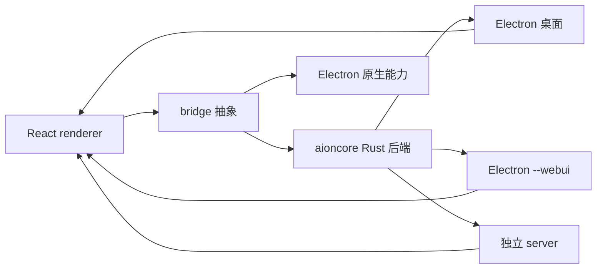

# AionUi —— 多 Agent 桌面 Cowork 平台

> 本解读按 **agent** 类规格产出（主类型 = 智能体产品；副类型 = 桌面/前端抽象）。AionUi 架构上分两个仓库：本解读的源码主体是 **AionUi（Electron 前端 + 编排）**，真正的 Agent 引擎（内置 aionrs / aioncore Rust 后端）在独立仓库 AionCore，凡断言跨到后端的一律标注【待主 agent 验证】。

## 一句话根因

把「让 AI Agent 在你自己电脑上与你并肩工作（Cowork）」从各家派别的单机体验收拢成一个**前端外壳统一编排、后端引擎真正执行**的开源多 Agent 桌面平台：内置 Agent 零配置开箱即用，几十种外部 CLI Agent（Claude Code / Codex / Gemini 等）经 ACP 标准协议收敛成统一会话，并叠加 Cron 24/7 无人值守、WebUI/IM 远程、Team Mode 多 Agent 协作。

## 子文档索引

- [`architecture.md`](architecture.md) — 进程架构与启动链路（app-shell + aioncore 引擎、bridge 传输抽象、多宿主共存）
- [`data-model.md`](data-model.md) — 本地数据模型（SQLite schema + 版本化迁移 + JSON blob 演进）
- [`multi-agent-acp.md`](multi-agent-acp.md) — 多 Agent 集成与 ACP + Team Mode 协作
- [`cron-webui.md`](cron-webui.md) — Cron 定时任务 / WebUI 远程 / IM 渠道接入
- [`mcp.md`](mcp.md) — MCP 统一管理（配置模型 / 按能力注入 / 内置 MCP）

## 核心能力一览

| 能力 | 说明 |
|------|------|
| 内置 Agent | 零配置开箱即用，粘贴任意 API Key 即工作；内置 21 个专业助手（PPT/Word/Excel/论文/财报等） |
| 多 Agent 统一界面 | 经 ACP 协议把 Claude Code、Codex、Gemini CLI、Qwen Code、OpenClaw 等几十种 CLI Agent 收敛为一种会话模型 |
| Team Mode | Leader 拆任务 → Teammate 并行执行，经 Team MCP Server（async mailbox + 共享 task board）编排 |
| 任一 API Key | 支持 30+ AI 平台（Gemini/OpenAI/Anthropic/Dashscope/DeepSeek 等 + Ollama/LM Studio 本地）；NewAPI 网关聚合 |
| Office 文档生成 | 内置 PPT(Morph)/Word(.docx)/Excel(.xlsx) 助手，经 OfficeCLI 产出可编辑文件 |
| Cron 定时任务 | 自然语言建任务、三种调度（cron 表达式带时区/固定间隔/单次）、绑定会话保留上下文、保持唤醒 + 错过恢复，24/7 无人值守 |
| WebUI / 远程 | 浏览器控制 Agent，QR 码/密码登录，可 LAN / 跨网 / 服务器部署 |
| IM 渠道接入 | Telegram / Lark(飞书) / DingTalk / WeChat 机器人，在 IM 里 Cowork Agent |
| MCP 统一管理 | 一处管理全部 MCP server，按各 agent 能力注入/同步兼容 transport |
| 多会话并行 | 每会话独立上下文，多任务并行不串台 |

## 技术栈一览

| 层面 | 技术 |
|------|------|
| 桌面壳 | Electron（main/preload/renderer 三进程）+ electron-vite 打包 |
| 本地引擎 | Rust 后端二进制 `aioncore`（独立仓库 AionCore，前端启动时拉起为子进程） |
| 前端框架 | React 19 + TypeScript（strict）+ UnoCSS 原子样式 + Arco Design |
| 本地存储 | SQLite（better-sqlite3 驱动；运行期由后端持有） |
| 进程通信 | 自研 bridge 抽象：Electron IPC 与 HTTP/WS 双实现同构 |
| 测试 | vitest（单测）+ Playwright（e2e）+ contract/integration |
| 构建/质量 | bun 包管理、prek(pre-commit)、oxlint/oxfmt、Sentry 反馈 |

## 架构总览

核心思想：**前端是"壳 + 门面"，后端（aioncore/aionrs）是"大脑"**。调度、鉴权、MCP 注入、IM 桥接、会话执行全部下沉到常驻 Rust 进程；前端只做配置 UI、状态订阅与生命周期编排，通过统一 bridge 抽象让渲染层代码横跨 Electron 桌面与浏览器 WebUI 两种宿主而几乎零差异（[`architecture.md`](architecture.md)）。

## 核心模块导读

| 模块 | 一句话定位 | 深读文档 |
|------|-----------|----------|
| 进程模型 & bridge | app-shell 守护外部 aioncore 引擎；一套 bridge 抽象同构对接 IPC 与 HTTP/WS | [`architecture.md`](architecture.md) |
| 本地数据层 | Electron 进程侧把遗留 SQLite `aionui.db` 升级到 v26 基线后移交给后端；迁移含 backup/rollback 与 JSON blob 演进 | [`data-model.md`](data-model.md) |
| 多 Agent + ACP + Team | 几十种 CLI Agent 经 ACP 收敛成统一会话；Team Mode 在 ACP 上叠 Leader↔Teammate 编排状态机 | [`multi-agent-acp.md`](multi-agent-acp.md) |
| Cron / WebUI / IM | 24/7 无人值守调度、浏览器远程访问、IM 机器人桥接；执行逻辑全在后端，前端只做契约与 UI | [`cron-webui.md`](cron-webui.md) |
| MCP 统一管理 | 集中管理 MCP server，按 agent 能力注入 transport；内置图片/浏览器 MCP 资源 | [`mcp.md`](mcp.md) |

## 项目规模

| 指标 | 数值 |
|------|------|
| 语言主体 | TypeScript（前端）+ Rust（后端 aioncore，外仓） |
| 仓库 TS 总行数 | ~253K 行（`packages/desktop` ~137K 为主力） |
| 协议 | Apache-2.0 |
| 平台 | macOS / Windows / Linux（+ WebUI 无头 server） |
| 关键子包 | `desktop`（Electron 主程序）、`web-host`（独立 server 宿主）、`web-cli`、`shared-scripts`、`mobile` |

## 一个贯穿全局的设计哲学

把「可靠执行」收敛到后端、把「表达能力」留在前端。证据链条贯穿五个子文档：
- 引擎生命周期、崩溃重启在 `web-host/backend-launcher.ts`，UI 崩溃不拖垮引擎（[`architecture.md`](architecture.md)）；
- Cron 到点触发、missed 补跑、keepAwake 全在 aioncore，前端只在系统 resume 时补发一次内网通知（[`cron-webui.md`](cron-webui.md)）；
- MCP 的注入/同步算法与 `loaded/failed/unsupported` 判定在后端，前端只消费 `conversation.extra.mcp_statuses`（[`mcp.md`](mcp.md)）；
- ACP 收敛成的统一会话模型，让新增一个 CLI agent 无需改动 UI（[`multi-agent-acp.md`](multi-agent-acp.md)）；
- 连本地 SQLite 也由 Electron 侧升级到基线后「一次性关闭，交还后端」（[`data-model.md`](data-model.md)）。

代价是明显的——跨进程协议序列化、启动难度大幅上升（定位二进制/健康轮询/崩溃恢复/端口竞态），逼出一套基于 stderr 正则 + 边界码的失败分类器。对这个要"24/7 常驻 + 浏览器远程 + 多 Agent 并发"的产品，解耦和多宿主收益远大于复杂度成本。

## 可借鉴的设计

- **同一套 bridge 抽象对接两套传输**：`buildProvider`/`buildEmitter` 既有 IPC 实现又有 HTTP/WS 实现，渲染层只依赖类型化 `ipcBridge.*`，从而桌面与 WebUI 几乎零差异（[`architecture.md`](architecture.md)）。
- **可靠性下沉后端、前端只翻译契约**：把调度/鉴权/注入全放到常驻引擎进程，让"窗口关了任务照样跑"，是无人值守类产品的通用解法（[`cron-webui.md`](cron-webui.md)）。
- **标准协议 + 后门字段双写**：ACP 统一语义，但对各家私有字段（`raw_output`/`codex_model_info`）保留兼容垫片，避免 100% 消灭"某家专属"的过度抽象（[`multi-agent-acp.md`](multi-agent-acp.md)）。
- **transport 宽进窄出**：前端支持 4 种 MCP transport，但提交后端前把 `streamable_http` 归一为 `http`，兼容性在边界收敛（[`mcp.md`](mcp.md)）。
- **JSON blob + 表达式索引 + 只增不改的 DDL 演进**：不确定的演进字段存 blob 而非频繁重建表；v22 反思掉 type CHECK 约束后加 agent 类型不再动库（[`data-model.md`](data-model.md)）。

## 不足 / 风险

- **引擎在独立仓库（AionCore）**：本仓库（AionUi）无法独立形成闭环，许多 agent 硬规格（主 Agent 循环、记忆分区、Skill 定义等）的真实实现都在外仓。这是架构使然，但阅读本仓库无法取得全貌。
- **双仓库 + 跨进程诊断成本高**：启动失败跨进程难以归因，被迫维护 `backendStartupFailure.ts` 那套 stderr/边界码分类器；一旦后端不在 PATH 或损坏即需人工折腾（[`architecture.md`](architecture.md)）。
- **部分承诺与源码不符**：根 `package.json` 声明了 `debug:mcp`/`debug:mcp:list`/`debug:mcp:validate` 三个命令，但仓库内找不到 `scripts/debug-mcp.ts`，属于悬空引用（[`mcp.md`](mcp.md)）。
- **远程/IM 暴露即安全面**：WebUI 可对公网、IM 机器人需公开 webhook/长轮询，鉴权虽统一委托 aioncore 的 aionui-auth，但整体攻击面较桌面纯本地形态更大（[`cron-webui.md`](cron-webui.md)）。

## 总结

AionUi 的根因不是一个聊天客户端，而是把「多 Agent 与你并肩工作」定义成一个**可编排、可远程、可无人值守**的桌面基础设施。它用可迁移的分层（前端门面 / bridge 抽象 / 后端大脑）吸收了「几十种 CLI Agent + 内置引擎 + Team 协作 + Cron + 远程 + IM」的全部复杂度，代价是用工程复杂度换取了解耦与多宿主复用。想在 Node/Electron 侧设计"外壳 + 外部引擎"架构、或在 agent 前端做多运行时收敛的，这套桥接与编排模式很值得借鉴。
