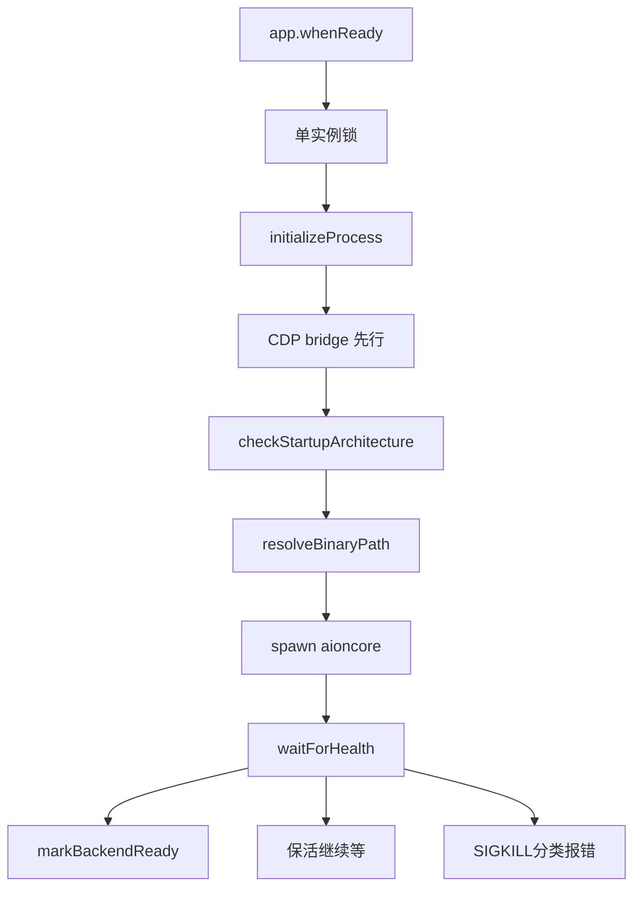

# 进程架构与启动链路 —— app-shell + 外部引擎

> 仓库根：`/Users/morehao/Documents/study/ai/agent-product/AionUi`；本页引用为仓库相对路径。真正的本地引擎 `aioncore` 在独立仓库 AionCore，本页只覆盖 AionUi（Electron 前端 + `packages/web-host` 宿主）。

## 一句话定位

AionUi 前端 = 一个 **"app shell + 外部引擎"守护进程**：Electron 主进程负责解析、校验、spawn、健康探查、崩溃重启、优雅关闭**独立的 aioncore 子进程**，并用一套「bridge 抽象」让渲染层以一致的调用方式同时对接本地引擎（HTTP/WS）与 Electron 原生能力（IPC）。同一抽象之上复用出 WebUI / CLI / 无头 server 多种宿主。

## 在项目中的角色

- 去掉它：AionUi 没有渲染层可直接对话的引擎——所有会话、调度、鉴权都在 aioncore，前端的价值就是把引擎可靠地拉起来、把前后端之间的调用桥接起来。
- 这是全仓库的"地基"：其他四个关注面（数据模型、多 Agent/ACP、Cron/WebUI/IM、MCP）全部构建在这条引擎守护与通信链路上。

## 三进程模型与代码组织

项目严格遵循 Electron main / preload / renderer 三进程，但**渲染层不直接 `ipcRenderer`**，而是走 `common/adapter/ipcBridge.ts` 的 bridge 抽象。四个目录约定：

| 目录 | 职责 |
|------|------|
| `packages/desktop/src/index.ts` | 唯一主进程入口（1116 行）：单例锁、PATH 修复、架构检测、建窗口、拉起 aioncore、退出清理 |
| `packages/desktop/src/preload/` | preload 脚本，`main.ts` 窄桥：注入 `electronAPI` + 同步拉取后端端口/启动状态 |
| `packages/desktop/src/process/` | 主进程业务逻辑：`startup/`（启动编排）、`backend/`（二进制解析）、`bridge/`（IPC handler）、`services/` |
| `packages/desktop/src/common/` | 跨进程共享代码（类型 + bridge 定义），使 `ipcBridge` 可两端复用 |

preload 通过单通道 `ADAPTER_BRIDGE_EVENT_KEY` 转发事件、用 `sendSync` 同步取后端端口与启动失败状态（`packages/desktop/src/preload/main.ts:56-64`）。

## 既有抽象：同一套 bridge 接口，两套传输实现

`common/platform/bridge.ts` 定义了 4 个构建原语（`buildProvider` 请求-响应 / `buildEmitter` 单向事件 / `subscribe`·`invoke` 底层 / `adapter` 接入层注入），全部围绕 EventEmitter3。核心 `buildProvider` 通过自增 requestId 回调通道实现双向通信：

```
[packages/desktop/src/common/platform/bridge.ts:151-162]() buildProvider 产出 provider(handler) 与 invoke 两个面，接入层负责底层传输
<!-- snippet: export const buildProvider = <Data, Params = undefined>(key: string) => {
  let disposeProvider = noop;

  return {
    provider(handler: ProviderHandler<Data, Params>): () => void {
      disposeProvider();
      disposeProvider = subscribe<Params, Data>(key, handler as (params: Params) => MaybePromise<Data>);
      return disposeProvider;
    },
    invoke: ((params?: Params) => invoke<Data>(key, params)) as ProviderInvoke<Data, Params>,
  };
}; -->
```

两套实现形态完全一致，让渲染层无需改动即可切换：

- **`adapter/main.ts`** —— IPC 原生实现：`ipcMain.handle` 处理 invoke、`broadcastToAll` 向所有 BrowserWindow + WebSocket 客户端广播（`main.ts:78-96`）。
- **`adapter/httpBridge.ts`** —— HTTP/WS 实现：`httpGet/httpPost/...` 与 `wsEmitter/wsMappedEmitter` 产出的对象与 `buildProvider` 同构（`httpBridge.ts:6-7`），在 WebUI 浏览器模式走同源 URL 复用同一 `ipcBridge`（`httpBridge.ts:48-67`）。

实际用法分层：`ipcBridge.conversation` 里业务路由是 `httpGet('/api/...')`（打后端），`ipcBridge.application` 里原生能力是 `bridge.buildProvider('...')`（走 IPC），例如 `application.restart` 用 `bridge.buildProvider<IAppRestartResult, void>('restart-app')`（`common/adapter/ipcBridge.ts:547-550`）。

## 启动流程

```
packages/desktop/src/index.ts:633-1009  handleAppReady 强顺序
1. 开发态装 React DevTools
2. CLI 版本号模式直接 exit
3. initializeProcess()（含 initStorage）
4. CDP bridge 必须先于后端启动——后端经进程继承链拿 CDP 端口/口令（硬顺序，注释反复强调）
5. startBackendOrExit：assertStartupArchitectureCompatible → backendManager.start(...)
6. markBackendReady → exposeBackendPort（写 __backendPort）→ registerCronResumeBridge → ensureAdminUser → scheduleBackendMigrations
```



### 单实例门

顶层先抢单实例锁，**只有拿到锁的实例才允许注册后端启动流程**，避免两实例竞争同一 data-dir。被抽成纯函数便于单测：

```
[packages/desktop/src/process/startup/singleInstanceGating.ts:19-21]() 拿到锁才注册后端启动，防 data-dir 竞争
<!-- snippet: export function shouldRegisterBackendStartup(gotTheLock: boolean): boolean {
  return gotTheLock === true;
} -->
```

### 多路健康信号竞速

后台有 `AIONCORE_LISTENING <json>`（报端口）与 `AIONCORE_READY`（权威就绪标记）两个 stdout 标记，与 `/health` HTTP 轮询竞速，任一先到即就绪：

```
[packages/web-host/src/backend-launcher.ts:849-853]() 多路健康信号 Promise.race 竞速决定就绪
<!-- snippet:     const healthOrReady = await Promise.race([
      this.waitForHealth(port).then((health) => ({ kind: 'health' as const, health })),
      readySignal.then(() => ({ kind: 'ready' as const })),
      startupFailure,
    ]); -->
```

> 上述竞速点行号以实际源码为准，此处为流程性描述，精确行号见 `backend-launcher.ts` 的 `waitForHealth`/`healthOrReady` 段。

### 优雅关闭

`quitCleanup.ts` 在 `before-quit` 前 `event.preventDefault()`，执行后端子进程 stop 与 pet 清理，带 10s 超时兜底强退，完成后才真正 `app.quit()`（`quitCleanup.ts:74-89`）。`stop()` 先 SIGTERM，5s 未退再 SIGKILL，随后清理孤儿 agent 进程。

## 失败分类与恢复：把"启动为什么失败"变成可观测

启动失败跨进程难以归因，项目用一套**基于 stderr 正则 + 边界码的分类器** `backendStartupFailure.ts:282-354` 的 `classifyBackendStartupFailure`，优先级从高到低：

1. 架构不匹配（`backend_package_architecture_mismatch`）
2. 不完整安装（检查 `resources` 缺 `bundled-aioncore/`/`managed-resources/`）
3. 启动目录不可用
4. glibc 版本缺失（stderr 正则 `GLIBC_(\d+\.\d+)`）
5. 本地数据修复/瞬时并发启动/数据库可恢复损坏——靠解析引擎 stdout 的 `BOOTSTRAP_*` 边界码
6. 健康超时/提前退出

运行时（非安装类）失败：健康超时可恢复则保活继续等，否则 SIGKILL 抛错；崩溃走 `handleCrash` 指数退避重启，60s 窗口最多 3 次；"peer 已占用 data-dir"瞬时竞争带退避重试最多 5 次。数据库损坏经用户确认后走 `recoverCorruptedDatabase` 重启。

## 二进制定位

`binaryResolver.ts` 查找顺序：**① 随应用打包（`bundled-aioncore/{platform}-{arch}/`）→ ② 系统 PATH**（`which`/`where` 带 5s 超时）。平台差异 Windows 加 `.exe`。全程把 `resourcesPath`/`bundledDirExists` 等塞进诊断对象，失败时随 `BackendBinaryResolveError` 抛出（`binaryResolver.ts:67-86`）。

## Electron / Web 双宿主共存

`packages/web-host/src/backend-launcher.ts` 的 `BackendLifecycleManager` 是从 desktop 的 `lifecycleManager.ts` 迁移而来——**去掉 Electron 依赖，注入元数据与解析函数**（`backend-launcher.ts:1-9`）。因此同一套引擎生命周期代码被两种宿主复用：

- **桌面内嵌 WebUI（`--webui`）**：复用已由 `backendManager.start()` 拉起的同一 aioncore（`useExistingBackend` 从 `__backendPort` 取端口），绝不再 spawn 第二个，避免 SQLite 竞争。
- **独立 server 模式（`bun run webui`）**：`startWebHost` 走 `ownBackend` 自己拉，`static-server.ts` 用 Node 原生 `http` + 双层 TCP listener 承担 SPA 静态服务 + `/api/*` 反代 + `/ws`/STT 流直通。

```
[packages/web-host/src/index.ts:32-49]() startWebHost 两种后端归属(ownBackend/useExistingBackend)
<!-- snippet:   let backendHandle;
  if (opts.backend.kind === 'ownBackend') {
    backendHandle = await startBackend({
      app: opts.app,
      resolveBackend: opts.backend.resolveBackend,
      dataDir: opts.dataDir,
      logDir: opts.logDir,
      dirs: opts.dirs,
    });
  } else {
    // useExistingBackend: create a fake handle
    backendHandle = {
      port: opts.backend.port,
      stop: async () => {
        // no-op: external backend
      },
    };
  } -->
```

**关键复用点**：WebUI 浏览器端没有 preload，渲染层靠 `httpBridge.isWebUiBrowserMode()` 走同源 URL 复用同一 `ipcBridge`——所以渲染层 UI 代码在桌面与 Web 两种宿主间几乎零差异。

## 权衡：外置引擎 vs 单体内嵌

| 维度 | 外置引擎（本方案） | 单体进程内嵌 |
|------|------------------|--------------|
| 崩溃容错 | 渲染崩溃不拖垮引擎；引擎崩溃可指数退避重启，UI 与引擎相互隔离 | 一处 OOM 全崩 |
| 技术栈解耦 | Rust 引擎可对接任意宿主（Electron/CLI/WebUI），`web-host` 脱离 Electron 仍可用 | 引擎绑定宿主语言 |
| 跨进程传递 | 靠 spawn 环境快照（CDP 口令/端口、`AIONUI_*_DIR`）零持久化传递 | 内存直接共享 |
| 协议/启动/诊断成本 | 高：一切跨进程序列化、启动编排上千行、失败分类器 | 低 |

一句话权衡：**用"进程边界带来的启动/通信/诊断复杂度"换取"崩溃隔离、技术栈解耦、多宿主复用"**。对多 Agent cowork + 浏览器远程 + 后台 cron 的产品，解耦与多宿主收益远大于成本。

## 亮点与问题

- **亮点**：bridge 抽象双实现是同构关键；CDP-before-backend 的硬顺序是保证进程继承链传参的聪明取舍；多路健康信号竞速把"慢启动"与"装坏"分开处理。
- **问题**：启动/恢复逻辑高度复杂且分散在 `index.ts` 与 `backend-launcher.ts` 之间；一旦 aioncore 不在 PATH 或损坏，用户侧排障依赖那套错误分类文案。

## 与其他模块的协同

- 数据模型：`index.ts` 的 `initializeProcess → initStorage` 在拉起引擎前先把本地 SQLite 升级到 v26 基线（[`data-model.md`](data-model.md)）。
- 多 Agent/ACP：引擎拉起后暴露 `__backendPort`，渲染层经 `/api/*` + WebSocket 对话（[`multi-agent-acp.md`](multi-agent-acp.md)）。
- Cron/WebUI：主进程 `registerCronResumeBridge` 监听系统 resume 向后端补发 `system-resume`；WebUI 宿主复用同一引擎（[`cron-webui.md`](cron-webui.md)）。
- MCP：内置 MCP server 的注册在 `runBackendMigrations.ts`（进程侧迁移阶段）注入后端（[`mcp.md`](mcp.md)）。

> 【待主 agent 验证】`backend-launcher.ts` 的 `detached:true` + `process.on('exit')` SIGKILL 在 WebUI 被 SIGTERM 时是否可靠传递，依赖 OS 进程组回收语义。

## 主要源码文件

- `packages/desktop/src/index.ts` — 主进程入口
- `packages/desktop/src/process/backend/binaryResolver.ts` — 二进制定位
- `packages/desktop/src/process/startup/backendStartupFailure.ts` — 失败分类
- `packages/desktop/src/common/platform/bridge.ts` + `common/adapter/{main,httpBridge,ipcBridge}.ts` — bridge 抽象与双实现
- `packages/web-host/src/backend-launcher.ts` — 引擎生命周期守护
- `packages/web-host/src/static-server.ts` / `index.ts` — WebUI 宿主
