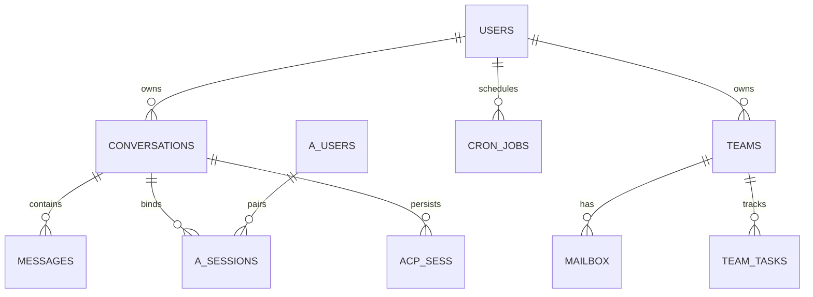
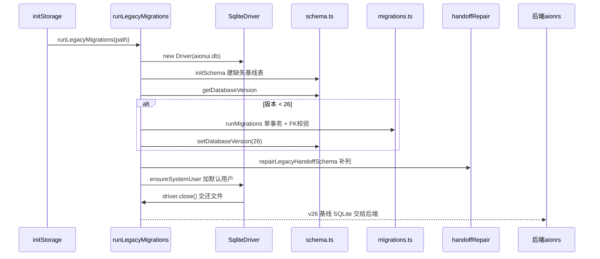

# 本地数据模型 —— SQLite 升级移交引导层

> 仓库根：`/Users/morehao/Documents/study/ai/agent-product/AionUi`；引用为仓库相对路径。本层是 Electron 进程侧的「旧式 SQLite 升级/移交引导层」，运行期读写由后端（Rust）接管。

## 一句话定位

AionUi 在桌面 Electron 进程保留一份自管的 SQLite 引导/升级层（better-sqlite3 驱动 + schema 基线 + 版本化迁移 + 列修复），启动时把遗留 `aionui.db` 一次性升级到后端能识别的 v26 基线后**立即关闭交还**；运行期真正的会话/消息/团队数据读写由后端持有，本层只做交接前的最后打点。

## 存储选型：为什么 SQLite + better-sqlite3

- **本地优先是产品承诺**。README 明言 "All data is stored locally in a SQLite database"，桌面 Cowork 应用的设置/会话/团队数据需要零外部依赖、随目录走、可备份的单文件存储。
- **better-sqlite3 的关键取舍 = 同步 API**。驱动接口刻意全部同步，服务层 async 是为"将来迁移到别的后端"预留：

```
[packages/desktop/src/process/services/database/IConversationRepository.ts:8-9]() 同步驱动、async 服务层，为迁移留口
<!-- snippet: // All methods are synchronous (better-sqlite3 driver).
// The service layer is async to allow future migration. -->
```

同步选择是权衡：better-sqlite3 以牺牲异步事件循环为代价换最快吞吐；桌面单用户本地库、无并发高写压力，同步足够，且能直接在事务里跑迁移循环。驱动还抽象为 `ISqliteDriver` 接口（`drivers/ISqliteDriver.ts:9-14`），把 better-sqlite3 锁死在最内层，为换驱动或移交后端留口。

- **Pragma 调优**：开启 `foreign_keys` + `busy_timeout=5000`（多进程/多 startup 任务并发防 "database is locked"）+ WAL（日志写性能），WAL 失败仅告警降级不阻断启动（健壮性 > 强一致性）：

```
[packages/desktop/src/process/services/database/schema.ts:17-24]() 连接 pragma：FK + busy_timeout + WAL
<!-- snippet:   db.pragma('foreign_keys = ON');
  // Wait up to 5 seconds when the database is locked by another connection
  db.pragma('busy_timeout = 5000');
  // Enable Write-Ahead Logging for better performance
  try {
    db.pragma('journal_mode = WAL');
  } catch (error) {
    console.warn('[Database] Failed to enable WAL mode, using default journal mode:', error); -->
```

## Schema 覆盖的实体

`schema.ts` 只建 6 张"核心基线表"（v1），其余表随各自迁移版本逐批补建。按职责分组：



- **账户层**：`users` 单一本地用户，核心是 `password_hash`（哈希非明文）+ `jwt_secret`（每用户独立 JWT 密钥）。启动时 `ensureSystemUser` 注入 `system_default_user`（`runLegacyDatabaseMigrations.ts:37-43`）。
- **会话/消息层（核心）**：`conversations`（`type` 为 agent 后端类型、`status` 三态 `pending→running→finished`、`extra` JSON blob、FK→users CASCADE）；`messages`（`position` 气泡方位、`status` 四态、`hidden` 软隐藏、FK→conversations CASCADE）。
- **团队模式层**：`teams`（`workspace` + `workspace_mode`、`agents` JSON 数组、`lead_agent_id`）；`mailbox`（agent 间消息邮箱，`to_agent_id`/`from_agent_id` 定向，v25 加 `files`）；`team_tasks`（`blocked_by`/`blocks` JSON 依赖图、`owner`、`status`）。
- **定时任务层**：`cron_jobs`（`schedule_kind` at/every/cron + `schedule_value`、`payload_message`、`next_run_at`/`last_run_at`/`last_status`，v22 补 `execution_mode`/`agent_config`）。
- **个人助理/远程（IM 渠道）**：`assistant_plugins`（Telegram/Lark/DingTalk 等 Plugin 配置）、`assistant_users`（平台用户白名单 UNIQUE）、`assistant_sessions`（远端用户↔本地会话绑定）、`assistant_pairing_codes`（扫码配对码）。
- **其他运行时**：`remote_agents`（远程 Agent 身份）、`acp_session`（ACP 会话状态持久化，支持 suspend/resume 跨重启）。

> 注意：SQLite 侧没有 `settings` 表——应用设置走 `clientSettings.ts`/`configService` 独立路径，与核心数据分离。

## 核心表字段要点

### users（schema.ts:31-41）

| 字段 | 类型 | 约束 | 说明 |
|------|------|------|------|
| id | TEXT | PK | UUID |
| username | TEXT | UNIQUE NOT NULL | 登录名 |
| email | TEXT | UNIQUE 可空 | 邮箱 |
| password_hash | TEXT | NOT NULL | 密码哈希 |
| jwt_secret | TEXT | 可空(v6) | 每用户 JWT 密钥 |
| created_at/updated_at/last_login | INTEGER | NN/NN/可空 | 时间戳(ms) |

### conversations（schema.ts:46-61；演进 v11-v16/v21/v22）

| 字段 | 类型 | 约束 | 说明 |
|------|------|------|------|
| id | TEXT | PK | UUID |
| user_id | TEXT | NOT NULL, FK→users CASCADE | 属主 |
| type | TEXT | NOT NULL（v22 移除 CHECK） | agent 类型，演化靠 TS 层 |
| extra | TEXT | NOT NULL DEFAULT '{}' | JSON blob 扩展，含 cron_job_id |
| model/status/source | TEXT | status CHECK(三态) | 模型、生命周期、来源 |
| pinned/pinned_at | INTEGER/TEXT | DEFAULT 0/可空 | 置顶 |
| created_at/updated_at | INTEGER | NOT NULL | ms |

### messages（schema.ts:68-78）

| 字段 | 类型 | 约束 | 说明 |
|------|------|------|------|
| id/conversation_id | TEXT | PK / FK→conversations CASCADE | 主外键 |
| msg_id/type/content | TEXT | NOT NULL | 消息 id、类型、正文 |
| position | TEXT | CHECK(4 值 可空) | 气泡方位 |
| status | TEXT | CHECK(4 值) | 生命周期 |
| hidden | INTEGER | v22 加 DEFAULT 0 | 软隐藏 |
| created_at | INTEGER | NOT NULL | ms |

### teams / mailbox / team_tasks（schema.ts:86-133）

- `teams`：`workspace`(NOT NULL)、`workspace_mode`(DEFAULT 'shared')、`agents`(JSON DEFAULT '[]')、`lead_agent_id`(v20)、`agents_version`。FK user_id→users CASCADE。
- `mailbox`：`to_agent_id`/`from_agent_id`(NOT NULL 定向)、`read`、`files`(v25 TEXT JSON)、FK team_id→teams CASCADE；索引 `(team_id,to_agent_id,read)` 供未读拉取。
- `team_tasks`：`status`(DEFAULT 'pending')、`owner`、`blocked_by`/`blocks`(JSON)、FK team_id→teams CASCADE；索引 `(team_id,status)`。

## 迁移策略：migrations.ts 机制

### 版本号管理

版本存 SQLite 内置 `user_version` pragma（`schema.ts:142-163`，`CURRENT_DB_VERSION = 26`）。迁移以 `IMigration { version, name, up, down }` 描述，`version` 是应用后的目标版本（`migrations.ts:12-17`）。v1 是"无操作"——初始表由 `initSchema()` 建，这是 schema 与 migrations 的分工起点。

### schema.ts 与 migrations.ts 分工

`initSchema()` 用 `CREATE TABLE IF NOT EXISTS` 只保证**新库**有 v26-era 基线表，头部注释明确它不修复已存在的表，修复交给 handoff repair 路径（`schema.ts:9-14`）。老库的列/表演进由 migrations 承担；列缺失修复另由 `repairLegacyHandoffSchema` 兜底。三者在启动管线串行执行。

### 幂等性 + backup/rollback

- 列迁移用 `PRAGMA table_info` 探测列是否存在，存在即跳过（重复跑不炸）（`migrations.ts:124-134`）。
- SQLite 不支持改 CHECK/删列，整表重建通用手法：create `_new`/`_old`/`_rollback` 影子表 → `INSERT SELECT` 拷数 → `DROP` 原表 → `RENAME` 影子表（`migrations.ts:138-144`）。`down` 明确"仅测试/应急"，相当多 down 直接跳过，诚实反映 SQLite 回滚固有限制。

### runMigrations：单事务 + FK 校验

迁移全塞进一个 `db.transaction`，任一步失败整体回滚，事务后跑 `foreign_key_check` 强校验（`migrations.ts:1280-1299`）。关键细节：**`foreign_keys` 在事务外用 `OFF` 先关**——事务内改 PRAGMA 会被 SQLite 静默忽略，而整表重建必须有 FK 关闭避免意外级联删 messages；结束时无条件重开 `ON`（`migrations.ts:1273-1277, 1307-1310`）。

### 版本演进的分水岭 v22

v22 反思性地**删掉 `conversations.type` 的 CHECK 约束**——此前每新增一个 agent 类型（v10/v11/v14/v15/v16/v21）都触发一次整表重建；删掉后加类型只动 TS 层、不再动库（`migrations.ts:1053-1059`）。

### JSON blob + 表达式索引

演进快、不查的扩展数据用 JSON blob 存 TEXT 列，避免频繁 DDL（`conversations.extra`、`teams.agents`、`team_tasks.blocked_by`）。v22 甚至对 JSON 建表达式索引，在 blob 上直接查：

```
[packages/desktop/src/process/services/database/migrations.ts:1093-1095]() 对 JSON blob 建表达式索引
<!-- snippet:     db.exec(
      `CREATE INDEX IF NOT EXISTS idx_conversations_cron_job_id ON conversations(json_extract(extra, '$.cron_job_id'))`
    ); -->
```

生产禁止降级，`rollbackMigrations` 限定测试用途（`migrations.ts:1260-1262`）。

## 读写路径

起点在启动的存储初始化管线 `initStorage.ts`，DB 层只在这个一次性窗口被打开：

```
[packages/desktop/src/process/services/database/runLegacyDatabaseMigrations.ts:70-77]() 一次性迁移窗口：initSchema→runMigrations→repair→ensureSystemUser→close
<!-- snippet:     initSchema(driver);
    const currentVersion = getDatabaseVersion(driver);
    if (currentVersion < CURRENT_DB_VERSION) {
      runMigrations(driver, currentVersion, CURRENT_DB_VERSION);
      setDatabaseVersion(driver, CURRENT_DB_VERSION);
    }
    const handoffRepair = repairLegacyHandoffSchema(driver);
    ensureSystemUser(driver); -->
```



- **谁写**：本层只在迁移窗口写 schema；运行期消息/会话写入由后端负责。
- **何时写**：启动初始化阶段，一次执行、幂等、关库。
- **谁读**：`getDatabaseVersion`/`isMigrationApplied` 用于迁移决策；运行期读在后端。
- **接口契约**：`IConversationRepository` 定义了前端期望的仓库 API（`getConversation`/`createConversation`/`getMessages`/`searchMessages`/`getConversationsByCronJob`…），是层对外的契约声明，具体实现由后端满足（`IConversationRepository.ts:21-38`）。

### 演进策略（Schema 演进安全性）

- 基线只增列/增表，靠 `IF NOT EXISTS` + `PRAGMA table_info` 探测达成幂等。
- 结构演进灵活性靠 JSON blob + 表达式索引承载，减少整表重建。
- `repairLegacyHandoffSchema` 把遗留工程修复抽成契约表 `LEGACY_HANDOFF_COLUMNS`，逐表逐列 `ALTER TABLE ADD COLUMN`，缺表记入跳过表，避免一次性 migration 覆盖不到的历史手改（`legacyHandoffContract.ts:7-13`）。
- WAL + busy_timeout 容错并发；迁移事务失败整体回滚 + FK 校验，保证演进原子性。

> 【待主 agent 验证】本地加密边界：SQLite 层未见字段级/AES 加密；密码哈希与密钥/传输安全的真实落点（后端或 electron safeStorage）不在本层。

## 亮点与问题

- **亮点**：v22 删 CHECK 的分水岭是"让 schema 演进成本与 agent 类型解耦"的教科书案例；FK 事务外 OFF/ON + 单事务 + FK 校验的组合既安全又原子；契约表驱动的手工补列修复能兜住历史手改。
- **问题 / 权衡**：同步 API 换来吞吐但阻塞事件循环；down 脚本多数跳过的现实反映了 SQLite 回滚能力的边界；`settings` 不入 SQLite 让"应用配置"与"会话数据"两套持久化并存，增加心智负担。

## 与其他模块的协同

- 迁移里的 `cron_jobs`、`assistant_plugins`、`acp_session` 建表直接支撑后续的定时任务（[`cron-webui.md`](cron-webui.md)）、IM 渠道（[`cron-webui.md`](cron-webui.md)）与 ACP 会话恢复（[`multi-agent-acp.md`](multi-agent-acp.md)）。
- schema 的 `conversations.extra` 承载 MCP 装载结果 `mcp_servers`/`mcp_statuses`（[`mcp.md`](mcp.md)）。
- 本层在引擎拉起前（architecture 的 `initStorage` 步骤）完成，为后端准备一份基线库（[`architecture.md`](architecture.md)）。

## 主要源码文件

- `packages/desktop/src/process/services/database/schema.ts`
- `packages/desktop/src/process/services/database/migrations.ts`
- `packages/desktop/src/process/services/database/IConversationRepository.ts`
- `packages/desktop/src/process/services/database/runLegacyDatabaseMigrations.ts`
- `packages/desktop/src/process/services/database/repairLegacyHandoffSchema.ts` + `legacyHandoffContract.ts`
- `packages/desktop/src/process/services/database/drivers/{ISqliteDriver,BetterSqlite3Driver}.ts`
