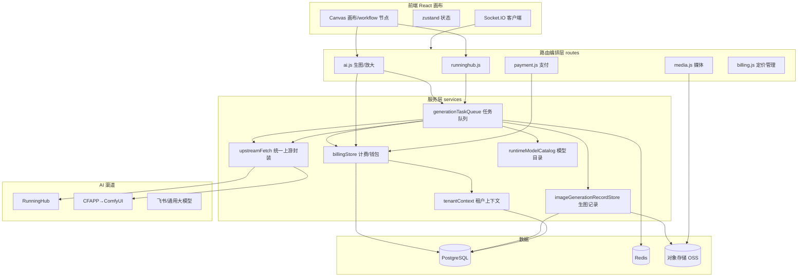

# Canvas2 —— 面向花型设计的 AI 生图画布 SaaS

> 本解读按 **Agent 产品** 类规格产出（AI 原生产品的工程解构）。

Canvas2 是一套面向纺织/图案（花型）设计师的 AI 生图 SaaS：用交互式画布把设计师的一次次生图请求，跨多个 AI 渠道（RunningHub、ComfyUI/CFAPP、飞书、通用大模型）提交、轮询、计价并可信记账。商业模式是「会员订阅 + 积分消耗 + 积分充值」。

## 根因

把两个本不相干的系统拼成一个可商业运营的产品，是整套工程的核心张力：

- 上游 AI 能力（生图、放大、视频）形态差异极大且成本可变——同一个动作在不同渠道可能是同步/异步、按次/按秒/按输出像素计价；
- 下游需要做成一个**多租户、先充值后消费、账本可对账**的付费 SaaS。

因此 Canvas2 的根本问题可一句写死：**让「渠道差异」与「计费与租户边界」互不污染**——渠道的复杂性被逐层消化在调度层，用户永远只面对「画布→出图→扣积分」这一稳定契约。围绕这一根因，整个仓库演化出四条贯穿性的设计主线，也是本解读的四个深挖关注面：

| 关注面 | 一句话 | 子文档 |
|--------|--------|--------|
| 多租户与身份（UIN） | 用户只管登录，租户管数据/权限/计费边界，Token 绑定身份换签切空间 | [`multitenant.md`](multitenant.md) |
| 计费积分系统 | 用订单状态机 + 幂等账本把「异步生图」翻译成「不会重复扣费的可对账钱包」 | [`billing.md`](billing.md) |
| AI 生图渠道抽象 | 用任务队列 + 适配器 + 统一上游封装逐级消化渠道差异 | [`ai-channels.md`](ai-channels.md) |
| 数据模型 | 租户边界 + 积分账本 + 生图流水三条主线的强一致建模 | [`data-model.md`](data-model.md) |

## 核心能力

| 能力 | 说明 |
|------|------|
| 多渠道生图 | 对接 RunningHub、CFAPP(本地 ComfyUI)、飞书、GPT/Gemini 通用生图、AI Studio 等，画布节点统一提交 |
| 交互式画布 | React 前端，拖拽式工作流编排，节点连接多个 AI 应用 |
| 会员订阅 + 积分 | 套餐赠积分、积分充值、按次/按秒/按像素计价，套餐与充值积分分不同有效期 |
| 多租户 | 个人空间 + 组织空间，成员角色分级，组织资金池向成员分配积分额度 |
| 放大(Upscale) | 含 TopazLabs 按输出像素阶梯计价的专用放大渠道 |
| 飞书问卷活动 | 把飞书多维表格答卷匹配用户并发放积分奖励 |
| 结构化可观测日志 | Pino 结构化日志 + 统一上游封装脱敏 + 请求 ID 贯穿 |

## 技术栈

| 层 | 选型 |
|----|------|
| 前端 | React 19 + TypeScript + Vite + three.js + zustand + @xyflow/react + antd |
| 后端 | Node.js ESM + Express 5 + Socket.IO + WebSocket |
| 存储 | PostgreSQL + pgcrypto，Redis(可选会话/队列) + 内存降级 |
| 渠道接入 | RunningHub、ComfyUI/CFAPP、飞书(OpenAPI)、阿里云短信、邮箱、COS/七牛 OSS |
| 计费/支付 | 自研积分钱包账本 + 微信支付(wechatpay-node-v3) |
| 部署 | Docker 三阶段镜像 + k3s，PM2，GitLab CI |

## 同类定位

Canvas2 并非通用开源项目，而是业务见长的私有 SaaS。若与同类生图平台对比，它的差异化在于：**把「渠道适配」和「计费账本」两件最难的事做成了可信基础设施**——多数同类产品会优先堆模型数量，而 Canvas2 优先解决了「调用幂等」「分租户对账」「渠道可替换」（CFAPP 即把 RunningHub 整体替换为本地 ComfyUI 的活证据）。

## 架构总览



架构层级：路由层负责「编排 + 计费预占 + 记录建档」，服务层负责「调度 + 结算 + 规范化结果 + 上传落库」，渠道差异全部消化在服务层的任务队列与适配器中，不泄漏到画布。

## 启动流程

```text
server.js 启动（1330 行单文件装配）
  ├─ 加载 server.config.js（渠道密钥）→ 初始化 logger（Pino 结构化）
  ├─ initBillingStore → 建表/连接池
  ├─ initGenerationTaskQueue → 启动 worker tick（setInterval 1s）
  ├─ initStorage → 初始化 OSS/本地存储
  ├─ 挂载 30+ 路由（auth/ai/runninghub/billing/payment/media/...）
  ├─ 初始化 Socket.IO + WebSocket(ASR)
  └─ listen HTTP → 启动完成
```

装配集中在 `server.js`，通过 `initXxxRouter`/`initXxxStore` 模式把依赖注入到各模块（[server.js:13-95]() 的路由导入即见一斑）。

## 核心模块导读

| 模块 | 职责 | 深读 |
|------|------|------|
| 多租户/身份 | UIN 身份模型、换签切空间、AsyncLocalStorage 隔离、三维钱包 | [`multitenant.md`](multitenant.md) |
| 计费积分 | 订单状态机、幂等账本、批次 FEFO、计价数量解析 | [`billing.md`](billing.md) |
| 渠道抽象 | 任务队列、渠道适配器、统一上游封装、CFAPP 伪 RH | [`ai-channels.md`](ai-channels.md) |
| 数据模型 | 强一致账本、JSONB 灵活结构、边演进边收口 | [`data-model.md`](data-model.md) |

## 可观察的工程弱点（不吹不黑）

- `services/billingStore.js` 单文件 9000+ 行，报价/钱包/批次/订阅全塞一处，维护成本高（设计文档也建议拆未拆）。
- 设计蓝图（001 迁移的 `tenants`/`tenant_id`）与运行时真源（`company`/`company_id`/`uin`）两套命名并存，读代码必须认清运行时为准。
- 渠道适配层存在「字符串黑魔」（URL 路径段手工拼接去重），脆弱且难测。
- 多租户的 `visibility` 可见性语义缺统一中间层，隔离部分靠各 Store 自己的 WHERE 约定维系。

## 可借鉴的设计

1. **多渠道「多层滑梯」消化差异**：模型目录→适配器→统一上游→任务队列→结果规整，每层只消化一种差异，上游永远看统一语义。这是把「渠道不断增长」的复杂度收敛到一处的通用范式。
2. **计费的幂等三重防御 + 赢者通吃结算**：请求级 `request_id` 查重、账本级 `idempotency_key` 唯一索引、任务级 `upstream_task_id` 唯一 + `FOR UPDATE`，配合「只有赢得终态写入的 worker 才结算」——让数据库约束兜底而非依赖代码自律。
3. **CFAPP 的「接口即契约」**：把第三方 RunningHub 用本地 ComfyUI 完全侧信道替换，反向证明渠道层没写死在上游，值得所有对接外部 API 的系统借鉴。
4. **先加可空列 → SQL 回填 → 再 SET NOT NULL** 的渐进迁移三步走，让存量数据安全收敛为强约束。

## 总结

Canvas2 的价值不在堆了多少模型，而在把 **渠道适配、多租户隔离、幂等计费** 这三件最容易「糊」的事情做成了可信基础设施。它的根因锚——让渠道复杂度与计费/租户边界互不污染——贯穿了从 API 数据结构到数据库约束的每一层，这也是它区别于「接几个模型就能跑」的同类产品的地方。

## 子文档索引

- [`multitenant.md`](multitenant.md) — UIN 身份模型与多租户隔离
- [`billing.md`](billing.md) — 计费积分系统的状态机与幂等账本
- [`ai-channels.md`](ai-channels.md) — AI 生图渠道抽象与调度
- [`data-model.md`](data-model.md) — 数据模型五要素（ER/选型/演进/读写路径）

> **备注**：本解读针对的是 `/Users/morehao/Documents/works/yangu/muting/canvas2` 源码快照（非公开 GitHub 仓库），`文件:行号` 引用以该仓库相对路径为锚。
