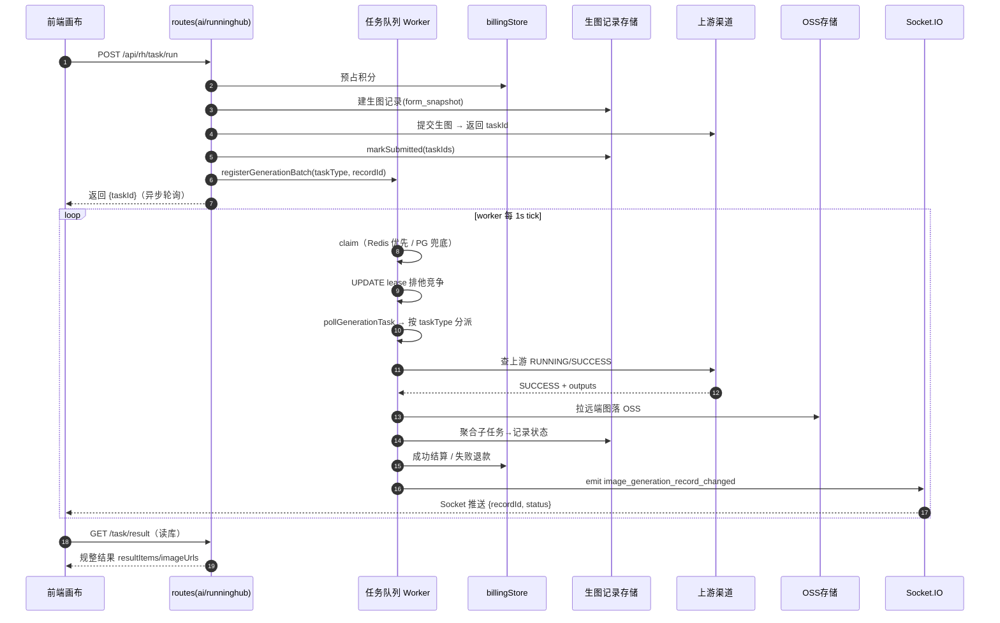
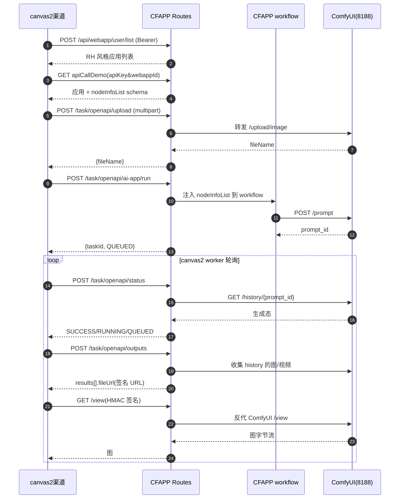

# Canvas2 AI 生图渠道抽象与调度

> 面向纺织/图案设计 AI 生图 SaaS Canvas2 的「AI 生图渠道抽象与调度」关注面深读。这是生图主链路的脊梁。

## 在项目中的角色（去掉它会怎样）

这是 Canvas2 生图主链路的「脊梁」。前端画布提交一次 AI 生图，从提交到回传入库、积分计价、Socket 推送，几乎全部走这一模块。去掉它：

- **画布彻底失能**：`/api/rh/task/run`、`/api/ai/image/generate`、`/api/ai/upscale` 等生图入口全部消失（[routes/ai.js:2030]()、[routes/runninghub.js:762]()）。
- **异步结果永远等不到**：生图多是非阻塞的（提交即返回 taskId，结果靠后台轮询）。去掉 worker，所有已提交任务永久卡在 pending/running。
- **计费/积分失序**：预占积分无法在终态结算、失败任务无法自动退款（[services/generationTaskQueue.js:262-288]()）。
- **多渠道退化为手写**：去掉 `upstreamFetch` 的脱敏封装，API Key/Token 明文进日志；去掉渠道适配器，RunningHub 与 CFAPP 的差异每处手工分叉。
- **结果无法持久化回看**：去掉 `imageGenerationRecordStore`，历史记录、收藏、案例全部无家可归。

## 根因：为什么一定要抽一层

**一个面向真实用户的设计 SaaS，必然要同时对接多个差异巨大的 AI 供应商**，它们在调用形态（同步/异步）、鉴权（Bearer/apiKey/双轨）、计费（按次/按输出尺寸/按 MP/按耗时）、限流、结果格式（URL/b64/嵌套/数组）上各不相同，而这些差异**绝不能泄漏到 workflow 画布层**。

渠道多样性与差异：

- **RunningHub**：V2 用 `Authorization: Bearer`，提交返回 `taskId`，需轮询 `/status` 再取 `/outputs` 两步走，结果嵌套在 `results[].fileUrl`（[routes/runninghub.js:1183-1275]()）。
- **CFAPP** 是本地把 ComfyUI 包装成「伪 RunningHub」的服务，刻意复刻 RunningHub 接口形状，让 Canvas2 一字不改、把渠道 Base URL 指过来即可切流量（[CFAPP/README.md:1-15]()、[CFAPP/routes/rhApi.js:2-17]()）——这本身是「接口差异可作为东西被包装」的极端例证。
- **放大(Upscale)**：模型名带 `topazlabs/` 前缀走 V2，否则走通用 `/v1`，同一放大语义、两套完全不同的 URL 与动词（[services/upscaleChannelAdapter.js:38-52]()）。

### 根因锚定

> 核心哲学：**渠道差异被「多层滑梯」逐级消化，任何一层都不暴露给上游。** 运行期模型目录（`runtimeModelCatalog`）消化「可选模型从哪来」；渠道适配器消化「同一放大任务怎么在不同渠道 URL/动词间翻译」；统一上游封装（`upstreamFetch`）消化「第三方请求怎么安全可观测地发出」；任务队列（`generationTaskQueue`）消化「提交后怎么编排轮询/结算」；生图记录存储消化「结果怎么落成持久化记录并回传」。

## 设计思路（分层 + 核心模式）

```
前端画布 / workflow 节点
   │  (submit)
routes: ai.js / runninghub.js      ← 路由编排、计费预占、记录建档
   │
services: generationTaskQueue.js   ← 任务队列：登记/入队/轮询/结算
   │         │                          发 pollGenerationTask 回调（按 taskType 分派）
   │         v
services: upscaleChannelAdapter · runtimeModelCatalog · imageTaskResult
services: upstreamFetch · billingStore · storage · routes/toolRegistry
   │
第三方渠道（RunningHub / CFAPP→ComfyUI / Gemini / AI Studio ...） + OSS
```

核心模式：**适配器模式**（渠道 URL/动词翻译）、**注册表模式**（模型目录/工具注册）、**任务队列 + 注入回调**（主循环只管 lease/重试/超时/结算/通知，查渠道交给注入的 `pollGenerationTask`）、**统一上游网关**（脱敏 + 请求关联）、**结果规整化**（各家散落结构归一为 `{status, imageUrls, resultItems, expectedCount}`）。

## 关键数据结构

### `image_generation_records`（生图记录：用户侧视图）

由 `imageGenerationRecordStore.js` 建表，一次提交（可能多个上游任务）承载一条记录（[services/imageGenerationRecordStore.js:128-152]()）：

| 字段 | 类型 | 说明 |
|------|------|------|
| id | UUID PK | 记录 ID |
| uin / company_id / created_by_uin | BIGINT | 多租户归属 |
| request_id | TEXT UNIQUE | 请求幂等键 |
| app_key / app_id | TEXT | 来自哪个应用 |
| record_type | TEXT | generation / upscale |
| form_snapshot | JSONB | 输入参数快照（模型/分辨率/提示词全收这里） |
| result_images | JSONB | 成功图 URL 数组 |
| task_ids / primary_task_id / parent_task_id | JSONB/TEXT | 底层任务 ID 层级 |
| status | TEXT | pending/running/success/partial_success/failed/cancelled |
| is_favorite / is_case | BOOL | 收藏与案例标记 |

设计要点：几乎所有业务字段被剥进 `form_snapshot` JSONB，表只留结构化生命周期字段——典型的读写分离 schema，换来 schema 免 DDL，代价是 JSONB 内字段无法独立走索引。

### `media_generation_tasks`（底层任务：worker 真正调度的行）

由 `ensureGenerationTaskSchema` 保证列存在（[services/generationTaskQueue.js:36-55]()），是 worker 工作单元。关键字段：`task_id`、`task_type`(分派键)、`task_role`(parent/child/standalone)、`parent_task_id`、`status`、`provider`、`next_poll_at`/`poll_attempts`、`lease_owner`/`lease_expires_at`(worker lease 防并发)、`result_payload`(JSONB)、`generation_record_id`。

**parent/child 是一大亮点**：一次批量生成会有 parent + 多个 child，父任务 status 由子任务聚合推导（`updateParentState`，[services/generationTaskQueue.js:174-211]()），支持 `partial_success`。worker 只处理 `task_role <> 'parent'` 的子任务。

### `runtimeModelCatalog` 的模型条目

目录按 endpoint 分桶，每个条目是 `{value, label, description, apiType, isDefault, icon, ...能力字段}`。合并静态 `nodeConfig`（`buildStaticEndpointBuckets`，[services/runtimeModelCatalog.js:29-58]()）与运行期渠道绑定（`mergeBoundModelsWithStatic`，[services/runtimeModelCatalog.js:60-79]()）。**关键：DB 渠道绑定为权威来源、静态配置是降级兜底**（`preferBoundOnly` 时只取绑定）。

## 核心流程：画布提交一次生图 → 回传入库



## 核心流程：CFAPP 把 ComfyUI 包装成 RH 兼容接口



**关键安全设计**：CFAPP 是 ComfyUI 文件的唯一前门（[CFAPP/README.md:88]() 明确「不要把 ComfyUI 8188 端口对外开放」），`/view` 用 HMAC 签名 + 24h 过期挡住无鉴权的 ComfyUI `/view`（[CFAPP/routes/rhApi.js:281-315]()）。

## 与其他模块的协同

- **计费结算（赢者通吃）**：结算是「赢者通吃」——用条件 UPDATE + rowCount 判断，**只有真正赢得终态写入的 worker 才结算**，与用户取消互斥，避免取消后又被写入/退款覆盖（[services/generationTaskQueue.js:224-251]()）。成功→`settleBillingOrder`/`chargeAsyncCallLog`，失败→`failAsyncCallLog`+退款。
- **存储**：上游远端 URL 必须下载落 OSS 才安全：`downloadAndSaveMedia`（[routes/ai.js:2402-2407]()）；CFAPP 场景 worker 去签名 `/view` 拉图再落 OSS。
- **多租户隔离**：路由层用 `req.auth.uin/companyId`；后台任务不经过 HTTP，**必须显式传 uin 上下文**（`getActiveUin()` 托底，[services/generationTaskQueue.js:472-480]()）。「定时任务/非 HTTP 链路需显式注入 uin」正是 `docs/uin-架构改造方案.md:460` 点名的易漏点。
- **工具注册表**：`routes/toolRegistry.js` 把画布操作固化成 Agent 可调用的工具定义，模型列表来自 nodeConfig（[routes/toolRegistry.js:25-28]()），与运行期模型目录同哲学。

## 关键设计决策（权衡）

### 决策一：统一任务队列 + taskType 分派，而不是每渠道一套调度

所有渠道结果写同一张 `media_generation_tasks`，单一 worker tick（1s）轮询，`queryGenerationTask` 按 `taskType`（standard-ai/runninghub/ai-studio/textile-effect/channel-upscale）分派（[server.js:691-705]()）。

换来统一能力：lease 续租（过期租约可被其它 worker 接管，[services/generationTaskQueue.js:340-347]()）、超时终止（`MAX_POLL_ATTEMPTS`，[services/generationTaskQueue.js:360-367]()）、Redis zset 优先 + PG 扫描兜底双队列（[services/generationTaskQueue.js:413-470]()）、失败退款、通知。代价是新增渠道要改三处（白名单、分派、可能的 schema）。**替代方案（每渠道独立 worker）代价更大**：会带出 N 套 lease/心跳/超时/退款代码。对渠道不断增长的 SaaS，单一调度器把复杂度收敛到一处横向切面。

### 决策二：统一上游封装（脱敏 + 请求响应关联）

`fetchUpstream` 包装原生 fetch、`createLoggedAxios` 用 interceptor 封装 axios，统一记录请求/响应报文，用 `upstreamCallId`（randomUUID）串起一次第三方调用的请求与响应（[services/upstreamFetch.js:103-198]()）。敏感 query（token/secret/apikey）正则脱敏（[services/upstreamFetch.js:5]()），二进制 body 只记大小（[services/upstreamFetch.js:20-40]()），响应体在调用方读时才记（`wrapResponseBodyLogging` 猴子补丁，[services/upstreamFetch.js:52-97]()）。

代价：猴子补丁覆盖 `response.json/text/blob/arrayBuffer`，调用方绕过这些方法（直接用 `response.body` 流）时日志残缺。文档也坦承「流式响应只记录握手信息」（[services/upstreamFetch.js:100-102]()）。但替代方案代价更大——不统一封装，第三方泄密风险像筛子。

### 决策三：渠道适配器把背向的 URL/动词收敛成纯函数

Topaz 走 RunningHub V2（POST `/openapi/v2/{model}` + `/openapi/v2/query`），其它走通用 `/v1/images/upscale` + `/v1/tasks/{taskId}`（GET）。封装成 `buildUpscaleSubmitRequest`/`buildUpscaleQueryRequest`/`parseUpscaleTaskResult` 纯函数（[services/upscaleChannelAdapter.js:22-52]()、[services/upscaleChannelAdapter.js:87-101]()），路由层同步 + worker 异步两条路径复用。

代价：`joinUpscaleUrl`（[services/upscaleChannelAdapter.js:9-20]()）对 `/v1` 与 `/openapi/v2` 的路径段做「去重拼接」字符串处理，脆弱。替代方案把 Topaz 特判撒在路由层会在 handleUpscale 与 queryChannelUpscaleTask 两处重复；独立适配器把渠道协议知识集中，长期更省。

## 亮点

1. **渠道差异被「多层滑梯」逐级消化**：模型目录→协议适配→请求发出与脱敏→任务编排→结果规整→持久化，每层只管一件事。这是本项目最值得抄的架构骨架。
2. **parent/child 任务聚合 + `partial_success`**：一次多张批量生成建模成父子两级，部分成功也能向用户展示「3/4 张成功」，正对「AI 出图常有废图」的现实痛点。
3. **「赢者通吃」终态结算与取消互斥**：条件 UPDATE + rowCount 判断，杜绝重复扣款/退款（[services/generationTaskQueue.js:224-251]()）。
4. **日志脱敏 + upstreamCallId 关联**：第三方请求/响应用同一 callId 串起，敏感字段与二进制只记元信息。
5. **CFAPP 的「接口即契约」**：能完全侧信道把 RunningHub 替换为自建 ComfyUI 后端，反向证明渠道层没写死在上游。

## 问题 / 风险

1. **适配层有「字符串黑魔」**：`joinUpscaleUrl` 路径段去重、`rhV2Video.buildRHV2VideoEndpoint` 手工防 `..` 路径穿越（[shared/rhV2Video.js:23-29]()）都依赖字符串约定，脆弱难测，建议用 URL 构造器替换。
2. **猴子补丁盲区**：`wrapResponseBodyLogging` 只覆盖 json/text/blob/arrayBuffer，绕过时日志残缺，需在测试/文档里明确边界。
3. **JSONB 化的代价**：`image_generation_records` 把 model/prompt 收进 form_snapshot、历史列被 drop，换来 schema 稳定，但「按模型统计」「按提示词搜索」只能扫 JSONB，若出运营报表需 generated columns 或物化视图。
4. **worker 依赖进程内 setInterval + 可选 Redis**：多副本部署靠 PG lease 互斥兜底，无 Redis 时退化为纯 `recoverDueTasks` 扫 PG（[services/generationTaskQueue.js:700-717]()），多实例高可用语义需验证。

## 真源引用汇总

| 论断 | 位置 |
|------|------|
| taskType 分派 | [server.js:691-705]() |
| parent/child 聚合 + partial_success | [services/generationTaskQueue.js:174-211]() |
| 赢者通吃结算 | [services/generationTaskQueue.js:224-251]() |
| lease/超时/双队列 | [services/generationTaskQueue.js:340-347,360-367,413-470]() |
| 后台任务显式带 uin | [services/generationTaskQueue.js:472-480]() |
| 生图记录 schema | [services/imageGenerationRecordStore.js:128-152]() |
| 生图任务 schema | [services/generationTaskQueue.js:36-55]() |
| 模型目录合并 | [services/runtimeModelCatalog.js:29-79]() |
| 统一上游封装/脱敏 | [services/upstreamFetch.js:5,20-40,52-97,103-198]() |
| 渠道适配器 | [services/upscaleChannelAdapter.js:9-52,87-101]() |
| CFAPP 协议层 | [CFAPP/routes/rhApi.js:2-17,281-315]()、[CFAPP/README.md:1-15,88]() |
| 工具注册表 | [routes/toolRegistry.js:25-28]() |
