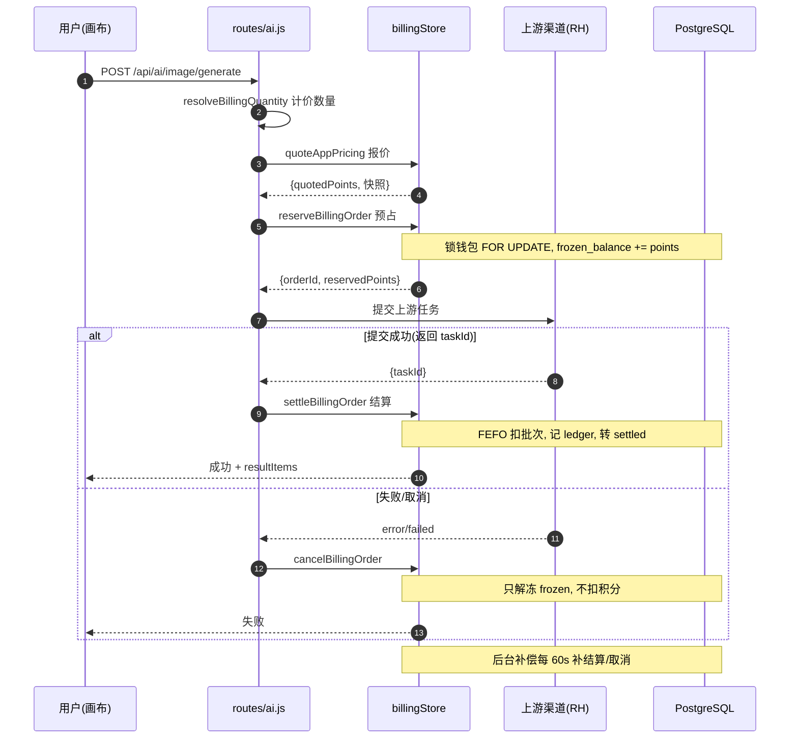

# Canvas2 计费积分系统

> 面向纺织/图案设计 AI 生图 SaaS Canvas2 的「计费积分」关注面深读。聚焦「会员订阅 + 积分消耗 + 积分充值」的商业闭环如何做成可信账本。

## 在项目中的角色

`services/billingStore.js` 是平台唯一被信任的「收银台」：

- **向下**被所有产生 AI 用量的生图链路调用。`quoteBilling`/`reserveBillingOrder`(预占)/`settleBillingOrder`(结算)/`cancelBillingOrder`(取消) 这一套计价状态机，被 `routes/ai.js`、`routes/workflow.js`、`routes/runninghub.js` 在每次生图/视频/对话中调用。图像生成主入口提交前先报价再预占（[routes/ai.js:1500-1517]()），成功后结算（[routes/ai.js:1279]()）、失败取消（[routes/ai.js:1867]()）。
- **向上**被经营侧消费：`routes/billing.js` 是 Admin 定价/钱包/渠道管理，`routes/payment.js` 是支付入口，回调最终调 `completePaymentOrder` 落积分账。

**去掉它**：所有生图接口失去「谁用了多少、该扣多少、账对得上」的约束——免费极客烧穿成本、账目失控、并发重复扣费、无法按量计费。

一句话：它是把「AI 能力的使用」翻译成「用户钱包里的钱」的单向翻译器兼账房。

## 根因：为什么用积分经济学，而不是直接按次付费

直接按次付费对**面向设计行业的 AI 平台**是错的模型，根因有五：

1. **上游成本极不均匀可变**：一次 1K 图、一次 8K 图、一次 5 秒视频成本差一个数量级。积分作为「复合计量单位」把成本、分辨率、时长统一折算成一个可加减的抽象量——**积分扣用户，成本（人民币）仅供经营统计**（`docs/积分计费规则与运维手册.md:11`），价格与成本分离。
2. **需要先充值后消费的现金流预收**：AI 生图成本后置发生，平台要预收款才有现金流垫付上游。
3. **需要按源区分有效期做玩法**：套餐赠分 30 天、充值积分 365 天（`point_batches` 落地）。按次付费做不了「积分会过期促消费」。
4. **需要可追溯防作弊账本**：「所有积分变化必须记录流水、禁止直接改余额」（`docs/AI设计平台会员积分系统需求文档.md:583-587`）。AI 调用是异步的（提交→轮询→回调），天然容易重复扣费或漏扣，需要以幂等键为唯一约束的账本保证每笔只记一次。
5. **需要可插拔经营统计口径**：积分和成本分离才能算「毛利率 = 收入 − 成本」（`docs/积分系统优化设计方案.md:14`）。

## 设计思路：从「直扣」演进到订单状态机

旧流程是 `checkBalance → 调上游 → tracker.finish() → adjustWalletBalance 直扣`，存在并发/异步/规则变更一致性风险（`docs/积分系统优化设计方案.md:2.3-2.4`），所以演进为带 `billing_orders` 的四态状态机：

```text
created → reserved → submitted → settled
                    \→ cancelled / failed / expired
```

核心原子动作：**预占只增 `frozen_balance`、结算同减 `balance + frozen`、取消只减 `frozen`**（`docs/积分系统优化设计方案.md:5.1.4`）。支付宝/微信钱包式的「冻结可用余额」模型，保证并发不超扣、失败能释放。

### 幂等与退出/失败处理（防重复扣费的地基）

三处幂等环环相扣：

1. **请求级幂等**：`reserveBillingOrder` 开头在 `billing_orders.request_id` 上查重（[services/billingStore.js:3936-3948]()），重复 requestId 直接返回已有订单 `idempotent:true`。
2. **账本级幂等**：`point_ledger.idempotency_key` 有唯一索引 `uq_point_ledger_wallet_idempotency`（[scripts/database/migrations/001_multi_tenant_foundation.sql:297-300]()）；结算写流水键 `'billing-settle:' + order.id`（[services/billingStore.js:4212]()）。任何重复 settle 都被唯一约束拦下。
3. **任务级幂等**：`billing_orders.upstream_task_id` 唯一（[services/billingStore.js:459-461]()），settle/cancel 都 `SELECT ... FOR UPDATE` 锁行后再判状态（[services/billingStore.js:4159-4166]()）。

**失败/退出**：失败走 `cancelBillingOrder` 只解冻（[services/billingStore.js:4277-4289]()），**失败不扣积分**；长期无终态的任务不凭本地超时误判失败，靠后台补偿任务 `reconcileCompletedBillingOrders` 每 60s 扫一次，把已到终态的补结算/补取消（[services/billingStore.js:997-1004,1572-1635]()）。

### 计价数量解析：谁决定「算几张 / 算几秒」

这是花型设计场景最易出 bug 的地方——「请求几张图」≠「成本几张图」：

- **RH V2 多模型打包**：某些模型一次 task 固定返回 N 张，但计费只按 1 个 task 收。`resolveBillingQuantity` 命中则 `billingQuantity=1`，否则用 `requestedCount`（[services/imageModelOutput.js:40-42]()）。
- **视频时长**：`per_second` 分支算 `billableDuration = max(generationDuration + inputVideoDuration, minimumBillingDuration)`（[services/billingStore.js:3444-3460]()），由 `006_video_input_duration_billing.sql`/`007_sparkvideo_minimum_duration_matrix.sql` 两个迁移写入。
- **TopazLabs 放大**：按实际输出百万像素的 24MP 阶梯递增（[services/billingStore.js:3404-3434]()），因为放大成本跟输出像素走，不由预设档位决定。
- **多图批次**：`registerImageBatchTasks`（[services/billingStore.js:4037]()）把多图请求拆成多个 task、每个 task 建 `billing_order_items` 子项独立结算。

### 精度演进

积分从不引入浮点误差：`POINT_PRECISION_FACTOR=100`，`roundPoints` 统一按符号进 1 到两位（[services/billingStore.js:49-68]()）。这是从六位（005 迁移）收敛回两位（011 迁移）后的唯一规约，保证展示精度等于结算精度。

## 关键数据结构

### `billing_orders`（计费订单——四态状态机载体）

来源 [services/billingStore.js:428-458]()：

| 字段 | 类型 | 说明 |
|------|------|------|
| `request_id` | TEXT UNIQUE | 请求级幂等键 |
| `wallet_id` | UUID FK | 定位扣谁的积分 |
| `app_type / app_id` | TEXT | 应用计价上下文 |
| `upstream_task_id` | TEXT | 上游任务 ID，唯一索引做任务级幂等 |
| `status` | TEXT | reserved → submitted → settled / cancelled / failed |
| `unit_points / quoted_points` | NUMERIC(24,2) | 单价 / 报价 |
| `reserved_points / charged_points / refunded_points` | NUMERIC(24,2) | 预占/实扣/退款，三段式对账 |
| `rule_id / rule_version / quote_snapshot` | UUID/INT/JSONB | 锁定的定价快照 |
| `expires_at` | TIMESTAMPTZ | 预占过期时间 |

**报价快照锁定价格**：结算不再重新匹配最新价，管理员运行中改价不影响已提交任务，避免「提交时 8 分、结算时变 10 分」的纠纷。

### `point_wallets`（钱包——三维模型）

来源 [services/billingStore.js:151-168]()、[scripts/database/migrations/001_multi_tenant_foundation.sql:181-190]()。`wallet_type` 分 `MEMBER`(成员, uin 非空) 与 `POOL`(组织资金池, 按 company 唯一)。`available = balance - frozen`，检查余额看可用而非总量（[services/billingStore.js:3935]()），这是防并发超扣的语义基础。

### `point_ledger`（积分账本——幂等记事本）

来源 [services/billingStore.js:188-204]()。`change_amount`(正增负减)、`balance_after`(变动后余额，可精确回放)、`idempotency_key`(唯一约束防重复记账)、`ref_type/ref_id`(api_call/billing_order/point_recharge/member_subscribe/point_expire 等追溯来源)。

### `point_batches` + `point_batch_movements`（批次有效期——FEFO 地基）

来源 [services/billingStore.js:209-233]()。每笔入账一个批次，记录 `source_type`(MEMBER/RECHARGE/LEGACY)、`original_points`、`remaining_points`、`expire_at`。**关键：这是一条「积分会过期」需求的数据化身**。消费按 `ORDER BY expire_at ASC NULLS LAST`（FEFO，先过期先消耗）（[services/billingStore.js:2018-2029]()），到期批次清零并写 `point_expire` 流水。套餐积分 30 天到期（MEMBER 批次 expire_at=订阅到期日），充值积分 365 天（RECHARGE 批次）。

## 核心流程：一次生图从发起到扣积分



各环节落库关键点（`文件:行号`）：
- 计价数量：多模型打包则 `billingQuantity=1`（[services/imageModelOutput.js:40-42]()）。
- 报价→预占接入：[routes/ai.js:1500-1517]()。
- 预占锁钱包行 + 查可用余额 = balance-frozen：[services/billingStore.js:3927-3935]()。
- 结算 FEFO 扣批次：`ORDER BY expire_at ASC NULLS LAST`（[services/billingStore.js:2018-2029]()）。
- 账本幂等键 `billing-settle:{order.id}`：[services/billingStore.js:4212]()。
- 失败只解冻：[services/billingStore.js:4277-4289]()。
- 补偿任务：[services/billingStore.js:1572-1635]()。

**结算在同一个 BEGIN...COMMIT 里**：FEFO 逐批扣（写 remaining_after）+ 钱包扣减 + 记带 balance_after 的 ledger + 订单转 settled，中途 ROLLBACK 全部撤销，保证强一致。

## 与其他模块的协同

- **生图链路**：`routes/ai.js` 是最大消费者，进入上游前完成「报价→预占」，成功/失败分别 settle/cancel。视频/对话走 `settleChatTokenBilling` 用真实 Token 结算。`routes/workflow.js`、`routes/runninghub.js` 同构接入。
- **多租户钱包**：`001_multi_tenant_foundation.sql` 把钱包升级成 POOL/MEMBER 双模型；`ensureCreditWalletWithClient` 区分个人/企业——只有企业才能走 POOL，且只有 OWNER/ADMIN/BILLING_ADMIN 能买组织积分（[services/billingStore.js:1891-1934]()），防止个人套餐积分被误记入公司资金池。
- **支付入账**：微信回调走 `completePaymentOrder`：`MEMBER_SUBSCRIBE` 发套餐积分+MEMBER 批次；`POINT_RECHARGE` 校验有有效订阅后才发 RECHARGE 批次（[services/billingStore.js:8491-8555]()）。后台人工发放 `grantMembership`/`adminRechargePoints` 复用同一套激活内核，行为一致。
- **缓存**：`billingCache.js` 提供报价/定价/规则三套缓存，Redis 版本号失效广播，不可用时降级内存 Map（[services/billingCache.js:8-21]()）。

## 关键设计决策（权衡）

### 决策一：幂等账本 + 状态机如何防重复扣费

AI 调用「提交→异步轮询→回调」，同一笔钱随时可能因重复轮询/回调重放被扣多次。方案是 `point_ledger.idempotency_key` 唯一约束 + `billing_orders` 状态机 + `FOR UPDATE` 三重防护。

替代方案「提交前查余额够就扣、失败退款」是旧案的温床：并发提交每请求都过检查，最终余额扣成负数；扣款/日志/流水不同事务不一致（`docs/积分系统优化设计方案.md:2.4`）。改用「预占冻结」后，并发任务因同锁钱包行串行化，先到的冻结、后到的看到 available 不足直接拒绝。

代价：**可用余额语义从「有多少」变成「减掉冻结后有多少」**，前端展示要同步改（`docs/积分系统优化设计方案.md:10.4`），还要处理「预占后长期无终态」的卡单风险（补偿任务兜底）。本质是**以数据库唯一约束为最终防线的确定性方案**——比代码层 if 判断更可靠，因为唯一约束跨进程、跨重启都不失效。

### 决策二：积分精度从六位收敛回两位（带符号进 1）

005 扩到 6 位按 Token/按秒精确计量，011 又收敛回 2 位并用 `CEIL(v*100)/100` **进 1** 圆整（[scripts/database/migrations/011_point_precision_two_decimals.sql:14-54]()）。

6 位精度造成「页面显示 12 分，账本 12.000001 分」的体验混乱，对账/CSV 都要处理超长小数。收敛到 2 位的代价是丢失每笔不足一分钱的精度，但用**进 1（CEIL）而非四舍五入**吸收——扣费方向永远向上取整，保证钱包不会因精度累计出现「虚增可用额」。替代「保留 6 位仅展示取 2 位」会引入展示数与账本数不一致的审计难题。

> 注意：进 1 会给快照价格带来累计盈余，设计文档要求每日对账「期初+充值-成功扣费+退款=期末」。

### 决策三：批次有效期 + 续费结转（FEFO 与「过期≠清零」的博弈）

积分必须按来源区分有效期（套餐 30 天/充值 365 天），用 `point_batches` 每笔独立一批，消费按 `expire_at` 从近到远（FEFO）扣。

替代「钱包只存总额+一个全局到期日」无法区分不同来源。批次的代价是额外一张 `point_batch_movements` 明细表、每笔消费做批次级分摊，写路径更重。

最精细的博弈在**续费/升级时的结转**：`rolloverMemberPointBatchesWithClient` 把「到期日早于新到期日、尚未过期」的 MEMBER 批次统一顺延到新订阅到期日（[services/billingStore.js:8267-8312]()），且**只有存在当前有效订阅才结转**，新开通不结转以免「复活」已过期批次（[services/billingStore.js:8356-8367]()）。若不做结转，「续费时上月积分立即清零」引发投诉；无脑全结转又破坏「到期清积分」的促消费设计。

## 亮点

1. **幂等是数据库强制的，不是代码自律**：`point_ledger.idempotency_key` 和 `billing_orders.upstream_task_id` 都有唯一索引，重复调用被 DB 拒绝而非靠 if 判断。
2. **报价快照锁定价格**：结算用提交时的价，运行中改价不影响已提交任务。
3. **退出/失败处理克制**：失败只解冻不扣分；长期无终态不凭本地超时误判，靠补偿任务按上游终态补算。「宁可冻结等待也不错误结算」。
4. **可观测性闭环**：`api_call_logs` 同时记录 `model` 和 `actual_model`（渠道重定向）、`estimated_cost`（人民币，仅经营统计）。积分归积分、成本归成本，两套口径互不污染。
5. **前台/后台同一激活内核**：`completePaymentOrder`（用户支付）与 `grantMembership`/`adminRechargePoints`（后台人工）复用 `activateMembershipWithClient`，结转/幂等/批次两边一致。

## 问题 / 风险

1. **`billingStore.js` 单文件 9228 行**：报价/钱包/批次/订阅全塞一处，设计文档建议拆未拆（`docs/积分系统优化设计方案.md:275-282`）。计费高敏感，超大文件放大维护与并行开发风险。
2. **进 1 引入累计盈余**：大量 0.01 级小额 Token 计费会产生向上取整累计盈余，需确认真实对账脚本是否跑通，否则「多扣」被静默累积。
3. **异步卡单存冻结死角**：`reconcileCompletedBillingOrders` 只处理已到终态的任务，长期无终态任务保持 reserved 冻结不释放，需运营排查。
4. **双路径并存**：`quoteBilling` 同时维护 APP 路径与 legacy 路径两套计价，`allowLegacyFallback` 让新表无规则时回退旧 `pricing_rules`（[services/billingStore.js:3648-3657]()）。长期双源并存一旦不一致会出隐蔽换算 bug，设计文档列了清理旧表为第三阶段（`docs/积分系统优化设计方案.md:945`）。
5. **免费边界**：`reserveBillingOrder` 对 `quotedPoints<=0` 且无 uin 直接放行匿名（[services/billingStore.js:3912-3918]()），靠 `BILLING_MISSING_RULE_POLICY=deny` 堵漏配规则的洞（`docs/积分系统优化设计方案.md:180-188`）。

## 真源引用汇总

| 论断 | 位置 |
|------|------|
| 报价→预占→结算/取消调用的完整状态机接入 | [routes/ai.js:1279,1500-1517,1867]() |
| 请求级幂等查重 | [services/billingStore.js:3936-3948]() |
| 账本级幂等唯一索引 | [scripts/database/migrations/001_multi_tenant_foundation.sql:297-300]() |
| settle 锁行 + 状态机 | [services/billingStore.js:4159-4166]() |
| 补偿任务每 60s | [services/billingStore.js:1572-1635]() |
| 计价数量（多模型打包=1） | [services/imageModelOutput.js:40-42]() |
| 视频 billableDuration | [services/billingStore.js:3444-3460]() |
| TopazLabs 按 MP 阶梯 | [services/billingStore.js:3404-3434]() |
| FEFO 扣批次 | [services/billingStore.js:2018-2029]() |
| 精度进 1 | [services/billingStore.js:49-68]()、[scripts/database/migrations/011_point_precision_two_decimals.sql:14-54]() |
| 钱包三维 + CHECK | [services/billingStore.js:151-168]() |
| 续费结转 | [services/billingStore.js:8267-8312,8356-8367]() |
| completePaymentOrder 入账 | [services/billingStore.js:8432,8491-8555]() |
