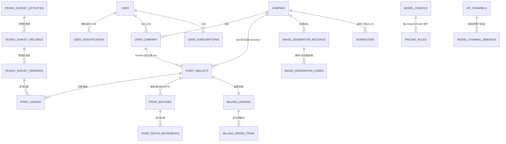
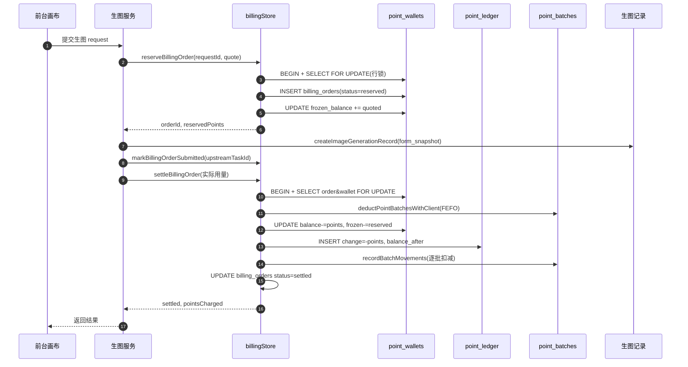

# Canvas2 数据模型

> 面向纺织/图案设计 AI 生图 SaaS Canvas2 的数据模型关注面深读。按五要素展开：实体关系总览 / 存储选型 / 核心表设计 / Schema 演进策略 / 读写路径。

## 概述

Canvas2 的数据模型骨架不是用户表，而是三条主线：**租户边界 + 积分账本 + 生图流水**。它把「用户画布的一次次生图请求」可靠地映射成「跨多个 AI 渠道的可计费调用」，并在多租户边界内对积分余额、订阅、媒体资产做一致性记账。

> **演进结论先行**：001 迁移的 `DO $$ FOREACH ... ALTER TABLE` 批量回填、以及 013/014 之间把「`tenant_id,user_id` 维度」整体改挂到「`company_id,uin` 维度」的大版本迁移，证明这是跑量的存量系统边演进边收口，不是绿字段设计。请把迁移目录当「决策史」而非「最终 schema」。

## 实体关系总览

命名注意：迁移 001〜012 是多租户 UIN 前的 schema（`tenants`/`tenant_members`、业务表挂 `tenant_id`+`user_id`）；013 起引入 UIN 体系，014 从业务表原地删掉 `tenant_id`/`user_id` 改用 `company_id`/`uin`。下图给「当前（014 后）」的实体关系。

## 存储选型与理由

| 维度 | 选型 | 理由 / 不选其他 |
|------|------|-----------------|
| 关系型核心 | PostgreSQL + `pgcrypto` | 计费/钱包/账本是强一致+强约束场景，必须事务、外键、CHECK、唯一约束兜底；`pgcrypto` 提供 `gen_random_uuid()`（[scripts/database/migrations/001_multi_tenant_foundation.sql:11]()）。选文档库无法用 `point_wallets ... FOR UPDATE` + 同事务多表记账做余额强一致。 |
| 动态结构 | JSONB | 定价能力维度、工作流 `content`、生图 `form_snapshot` 高度多变，JSONB 免迁移即可加分辨率价目；可建 GIN 索引（008 对 `task_ids` 建 `USING GIN`，[scripts/database/migrations/008_image_generation_cases.sql:45-46]()）。纯关系列会让定价表因加一个分辨率档就要迁移。 |
| 精度与金额 | `NUMERIC` 而非 float | 积分为钱，`NUMERIC(24,2)` + 应用层「向上取整进 1」；`point_ledger.balance_after` 记账必须可精确回放。用 FLOAT8 会有余额累积误差无法对账。 |
| 会话态 | Redis（可选）+ 内存降级 | JWT 会话存 Redis、无 Redis 回落内存 Map（[services/authStore.js:138-153]()），业务持久数据不交给 Redis。 |
| 为何不选其他 | 混合 | 不选 MySQL：缺 JSONB 与部分索引；不选纯 NoSQL：计费强一致不可让步；不选 JSON 全库：FK/复合唯一/部分唯一索引（008 的 `deleted_at IS NULL` 用例唯一）是防重复的核心护栏。 |

一句话：**强一致的账本和租户边界放关系型，格式易变的画布/定价能力放 JSONB**。

## 核心表设计

### `point_wallets` —— 积分钱包（余额快照）

职责：区分成员钱包（按 uin）与组织积分池（按 company_id），带乐观锁 version 与冻结余额；`FOR UPDATE` 行锁是余额一致性核心护栏。schema 见 [services/billingStore.js:151-168]()。

| 字段 | 类型 | 约束 | 说明 |
|------|------|------|------|
| id | UUID | PK | |
| uin | BIGINT | 成员钱包非空 | 014 后替代 user_id |
| company_id | BIGINT | | 组织 POOL 钱包归属 |
| wallet_type | TEXT | DEFAULT 'MEMBER', CHECK(POOL→uin NULL, MEMBER→uin NOT NULL) | 归属键 |
| balance / frozen_balance | NUMERIC(24,2) | NOT NULL DEFAULT 0 | 可用/冻结；精度 005(6位)→011(2位) 收敛 |
| version | BIGINT | NOT NULL DEFAULT 0 | 乐观锁 |

部分唯一索引：`uq_point_wallet_uin_member`(按 uin)、`uq_point_wallet_company_pool`(按 company, POOL)（[services/billingStore.js:163-167]()）。

### `point_ledger` —— 积分账本（只追加流水）

职责：每笔积分变动落一条不可变 change 流水，是对账真相源；`idempotency_key` 保证同一操作只记一次。schema 见 [services/billingStore.js:188-204]()；前身 [scripts/database/migrations/001_multi_tenant_foundation.sql:273-302]()。

| 字段 | 类型 | 约束 | 说明 |
|------|------|------|------|
| id | UUID | PK | |
| uin / company_id | BIGINT | | 记账归属 |
| wallet_id | UUID | FK→point_wallets RESTRICT | 记账到哪个钱包 |
| change_amount | NUMERIC(24,2) | NOT NULL | 正=转入/负=扣减 |
| balance_after | NUMERIC(24,2) | NOT NULL | 变动后余额，可精确回放 |
| reason / ref_type / ref_id | TEXT | NOT NULL(reason) | 业务来源，如 billing_order/point_recharge/feishu_survey_reward |
| idempotency_key | TEXT | 部分唯一 (wallet_id,idempotency_key) | 幂等去重 |

### `point_batches` + `point_batch_movements` —— 分批 FEFO 扣减

职责：把钱包余额拆成按充值/发放来源一批批，消费按 `expire_at` 从近到远逐批扣，使过期批次独立失效。schema [services/billingStore.js:209-233]()；扣减 `deductPointBatchesWithClient` 见 [services/billingStore.js:2018-2040]()。

| 字段 | 类型 | 约束 | 说明 |
|------|------|------|------|
| id | UUID | PK | |
| wallet_id | UUID | FK→point_wallets RESTRICT | 所属钱包 |
| source_type / source_id | TEXT | | 来源如 RECHARGE/FEISHU_SURVEY/LEGACY |
| original_points / remaining_points | NUMERIC(24,2) | NOT NULL, CHECK>=0 | 每批初始/剩余 |
| expire_at | TIMESTAMPTZ | 可空 | NULL=不过期批次 |
| status | TEXT | DEFAULT 'active' | active/expired |

`point_batch_movements`：`batch_id/ledger_id` + `change_amount/remaining_after`，把「某批扣几分、剩几分」与账本行对齐。

### `billing_orders` + `billing_order_items` —— 计费订单

职责：把一次上游调用映射为「报价→冻结→提交→结算/取消」订单，request_id 幂等。schema [services/billingStore.js:428-483]()。

| 字段 | 类型 | 约束 | 说明 |
|------|------|------|------|
| id | UUID | PK | |
| request_id | TEXT | UNIQUE NOT NULL | 幂等主键 |
| uin / company_id / operator_uin | BIGINT | | 归属/操作人 |
| wallet_id | UUID | FK→point_wallets | 从哪个钱包结算 |
| status | TEXT | DEFAULT 'created' | 状态机 |
| rule_id / rule_version / unit_type | UUID/INT/TEXT | | 命中哪条定价规则（版本快照） |
| reserved_points / charged_points / refunded_points | NUMERIC(24,2) | | 冻结/结算/退款额 |
| quote_snapshot | JSONB | | 报价快照，用于精确重算 |
| upstream_task_id | TEXT | 部分唯一 | 上游任务归属 |
| expires_at | TIMESTAMPTZ | | 预占过期 |

`billing_order_items`：多图请求被 `registerImageBatchTasks`（[services/billingStore.js:4037-4144]()）展开为多 item，每 item 独立结算。

### `image_generation_records` —— 生图流水（领域主实体）

职责：镜像一次「从画布到上游多任务」的生成请求，含输入快照与输出；request_id 全局唯一、多任务经 task_ids/parent_task_id 归并。schema [services/imageGenerationRecordStore.js:128-160]()。

| 字段 | 类型 | 约束 | 说明 |
|------|------|------|------|
| id | UUID | PK | |
| uin / company_id / created_by_uin | BIGINT | | 归属与创建人 |
| request_id | TEXT | UNIQUE NOT NULL | 一次请求唯一键 |
| app_id / app_key | TEXT | | 触发哪个创作应用 |
| form_snapshot | JSONB | DEFAULT '{}' | 输入参数快照 |
| result_images | JSONB | DEFAULT '[]' | 输出图 URL 数组 |
| task_ids / primary_task_id / parent_task_id | JSONB/TEXT | | 上游任务归并；008 对 task_ids 建 GIN |
| status / error_code / error_message | TEXT | DEFAULT 'pending' | 生命周期与失败 |
| is_favorite / is_case | BOOL | DEFAULT FALSE | 收藏/入选案例 |

### `workflows` —— 画布工程（JSONB content 主表）

职责：设计师个性化生成画布，content 是全量 JSONB 图配置；列表页靠 thumbnail 避免全量读 content。主键 `(uin, id)`。schema [services/authStore.js:76-103]()；缩略图 [scripts/database/migrations/010_workflow_thumbnail.sql:10-38]()。

| 字段 | 类型 | 约束 | 说明 |
|------|------|------|------|
| uin / id | BIGINT/TEXT | 复合 PK | 归属/画布 ID |
| name | TEXT | NOT NULL | 画布名 |
| content | JSONB | | 全量节点配置（数十 MB 级） |
| thumbnail | TEXT | | 列表缩略图 |
| visibility | TEXT | DEFAULT 'PRIVATE' | 私有/公开 |
| created_by_uin / company_id | BIGINT | | 创建人/归属 |

### 其他领域表

- **identify/租户**：`user`(登录身份)、`company`(租户，`company_type`=`personal`/`enterprise`)、`user_identification`(UIN 身份)、`user_company`(成员关系+角色)。见 [`multitenant.md`](multitenant.md)。
- **支付/订阅**：`subscription_plans`/`point_recharge_packages`/`payment_orders`/`user_subscriptions`（[services/billingStore.js:7707-7804]()）。payment_orders 区分 MEMBER_SUBSCRIBE/ADMIN_RECHARGE 等 order_type。
- **定价/渠道**：`model_configs`(PK (endpoint,model)，[scripts/database/migrations/003_model_configs.sql:3-16]())、`pricing_rules`/`app_pricing_rules`(JSONB 分辨率/时长价目，`002_unified_billing_pricing.sql`)、`api_channels`/`api_channel_keys`/`model_channel_bindings`。
- **飞书问卷**：`feishu_survey_activities`/`feishu_survey_records`/`feishu_survey_rewards`（[scripts/database/migrations/012_feishu_survey_activities.sql:4-35]()），dedupe_key 跨表唯一防重复发奖。
- **邀请码**：`invitation_codes`（[scripts/database/migrations/009_invitation_codes.sql:4-15]()）。

## Schema 演进策略

从迁移目录读出四条可迁移的演进思路：

### JSONB 兜底免迁移

工作流 content、定价 resolution_points、form_snapshot、settings 一开始就走 JSONB，让「视频从 per_call 改 per_second、再加输入时长计费矩阵」这类能力变化只改 JSONB 内容、不改 schema（[scripts/database/migrations/006_video_input_duration_billing.sql:3-5]()）。JSONB 承担 NoSQL 式灵活，关系列保住计费强一致。

### 加列 + 回填的渐进式演进

001 对存量表批量 `ADD COLUMN IF NOT EXISTS tenant_id`，002/003/006/009/010 持续加列，几乎都带 IF NOT EXISTS 幂等重跑。配合「**先加空列 → SQL 回填 → 再 SET NOT NULL**」三步走，把存量缺失归属安全收敛为强约束。典型：001 里 point_wallets「先加列、后回填、再 SET NOT NULL」（[scripts/database/migrations/001_multi_tenant_foundation.sql:195-229]()）。

### 精度演进：6 位 → 2 位（005 → 011）附「进 1」归一

005 把钱包/记账放宽到 NUMERIC(24,6) 以允许分块计费小数，011 又收敛到 2 位。011 关键不只是 ALTER COLUMN，而是**先做数据归一**：存量余额 `CEIL(v*100)/100`（进 1），方向性字段 `CEIL(ABS(x)*100)/100*SIGN(x)`，保证「扣减方向向上取整」（[scripts/database/migrations/011_point_precision_two_decimals.sql:14-54]()），并注释明确「成本/金额列不属于积分，保持不变」（`011:9-11`）。应用层同步 roundPoints 进 1。

### 激进迁移：复合主键改型 + 一次性回填大量存量表

- **workflows 主键 (tenant_id,id)→(uin,id)**：014 在确认 uin 无 NULL 行后才 DROP + ADD PRIMARY KEY(uin,id)，否则跳过并提示补归属（[scripts/database/migrations/014_drop_legacy_user_tenant_columns.sql:288-295]()）——「有条件的主键重建」，避免残留 NULL 建不回主键。
- **一次性 `DO $$ FOREACH ALTER TABLE` 回填 14 张表**：001 用过程式块对 workflows/agent_sessions/media_*/image_generation_records/notifications/billing_orders/payment_orders/user_subscriptions 批量挂 tenant_id，再以 user_id 反查回填（[scripts/database/migrations/001_multi_tenant_foundation.sql:72-178]()）。风险：依赖 to_regclass 探测表是否已建，新/旧库结果不同；回填只认 user_id，表无 user_id 列或其 owner 无个人租户会漏挂 → 后续 SET NOT NULL 直接失败。
- **018 通用结构自愈**：[scripts/database/migrations/018_ensure_uin_columns.sql:22-74]() 动态扫 information_schema.tables，凡存在旧列 user_id/tenant_id 即自动补 uin/company_id/created_by_uin。先新旧并存、代码双写，后置迁移收敛列名。

### 迁移机制

`schema_migrations(version, applied_at)` 记录已应用版本，事务执行、可重跑、失败整体回滚（[scripts/database/README.md:20-23]()）。发布顺序：停旧服务写 → 备份 → 迁移 → 校验(db:verify-tenants) → 部署，并警告「不要先部署带 NOT NULL 写入逻辑的新服务」（[scripts/database/README.md:22-23]()）。

## 读写路径

### 主链路：一次生图「报价→冻结→结算扣账→媒体入库」

主线按 `reserveBillingOrder`（[services/billingStore.js:3908]()）+ `settleBillingOrder`（[services/billingStore.js:4146]()）+ `deductPointBatchesWithClient`（[services/billingStore.js:2018]()）+ `createImageGenerationRecord`（[services/imageGenerationRecordStore.js:280]()）+ `syncGenerationRecordToMediaHistory`（[services/imageGenerationRecordStore.js:374-386]()）。

**关键机制**：预占（frozen）与结算（deduct）双阶段——请求到达先冻结锁定余额，上游完成按实际用量多退少补；结算在同一个 BEGIN...COMMIT 里完成 FEFO 逐批扣 + 钱包扣减 + 记带 balance_after 的 ledger + 订单转 settled。中途 ROLLBACK 全部撤销，保证强一致。

### 充值入账 / 飞书问卷发奖

充值在同一事务里 INSERT payment_orders → UPDATE point_wallets balance+=points → createPointBatchWithClient(source_type=RECHARGE) → INSERT point_ledger(+points)（[services/billingStore.js:8860-8920]()）。飞书问卷发奖走同一 `adjustWalletBalance`（[services/feishuSurveyStore.js:572-596]()），dedupe_key 跨表唯一保证同一答卷不放两次积分。

### 读路径

- 钱包余额/明细：point_wallets + point_ledger 对账，前端余额=balance-frozen_balance，可用来源由 point_batches 按 source_type 分组。
- 生图历史：image_generation_records 按 uin 查，task_ids GIN 索引按任务检索，列表不读 form_snapshot 全量（[services/imageGenerationRecordStore.js:117-120]()）。
- 工作流列表：走 thumbnail 而非 content（010 迁移动机）。
- 会员/权益：user_subscriptions 决定配额；定价匹配先查 pricing_rules 走 billingCache 内存缓存降 DB 压力。

## 全表清单

| # | 表名 | 所属领域 | 建表位置 |
|---|------|---------|----------|
| 1 | tenants | 租户 | 001_multi_tenant_foundation.sql |
| 2 | tenant_members | 租户/成员 | 001_multi_tenant_foundation.sql |
| 3 | tenant_settings | 租户配置(JSONB) | 001_multi_tenant_foundation.sql |
| 4 | point_wallets | 积分钱包 | 001 + billingStore.js |
| 5 | point_transfers | 积分划拨 | 001_multi_tenant_foundation.sql |
| 6 | point_ledger | 积分账本 | 001(加列) + billingStore.js |
| 7 | point_batches | 积分分批(FEFO) | billingStore.js |
| 8 | point_batch_movements | 批次扣减流水 | billingStore.js |
| 9 | workflows | 画布工程 | authStore.js + 001/010/014 |
| 10 | image_generation_records | 生图流水 | imageGenerationRecordStore.js |
| 11 | image_generation_cases | 案例库 | 008_image_generation_cases.sql |
| 12 | media_history / media_folders / media_assets | 媒体 | billingStore.js / mediaAssetService.js |
| 13 | agent_sessions | AI 会话 | 001(挂租户) |
| 14 | notifications | 站内通知 | notificationStore.js + 001 |
| 15 | api_call_logs | 调用计费日志 | billingStore.js |
| 16 | billing_orders / billing_order_items | 计费订单 | billingStore.js |
| 17 | pricing_rules / app_pricing_rules / app_billing_policies | 定价策略 | 002 + billingStore.js |
| 18 | payment_orders / subscription_plans / point_recharge_packages / user_subscriptions | 支付订阅 | billingStore.js + 001 |
| 19 | model_configs / model_channel_bindings / api_channels / api_channel_keys | 模型渠道 | 003 + billingStore.js |
| 20 | admin_audit_logs | 审计日志 | billingStore.js |
| 21 | invitation_codes | 邀请码 | 009_invitation_codes.sql |
| 22 | feishu_survey_activities / records / rewards | 飞书问卷 | 012_feishu_survey_activities.sql |
| 23 | user_prompts / user_prompt_categories | 提示词 | billingStore.js |
| 24 | system_settings / tenant_settings / user_settings | 配置(JSONB) | settingsStore.js |
| 25 | "user" / company / user_identification / user_company | UIN 身份 | 013_uin_identity_tables.sql |

## 真源引用汇总

| 论断 | 位置 |
|------|------|
| 钱包三维 + 幂等流水 + 主键 | [services/billingStore.js:151-168,188-204,209-233]() |
| 001 批量回填与渐进收敛 | [scripts/database/migrations/001_multi_tenant_foundation.sql:72-178,195-229,273-302,357-360]() |
| UIN 身份四表 | [scripts/database/migrations/013_uin_identity_tables.sql:9-88]() |
| workflows 主键改型 | [scripts/database/migrations/014_drop_legacy_user_tenant_columns.sql:288-295]() |
| 精度 6→2 位进 1 | [scripts/database/migrations/011_point_precision_two_decimals.sql:14-54]() |
| 通用结构自愈 | [scripts/database/migrations/018_ensure_uin_columns.sql:22-74]() |
| 迁移机制 | [scripts/database/README.md:20-23]() |
| 计费主链路 | [services/billingStore.js:3908,4146,2018]()、[services/imageGenerationRecordStore.js:280,374-386]() |
| 生图记录 schema | [services/imageGenerationRecordStore.js:128-160]() |
| 充值入账 | [services/billingStore.js:8860-8920]() |
| 飞书发奖 | [services/feishuSurveyStore.js:572-596]() |
