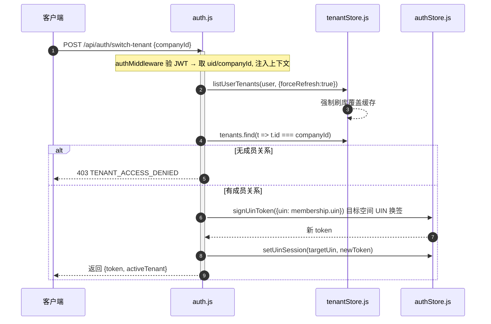
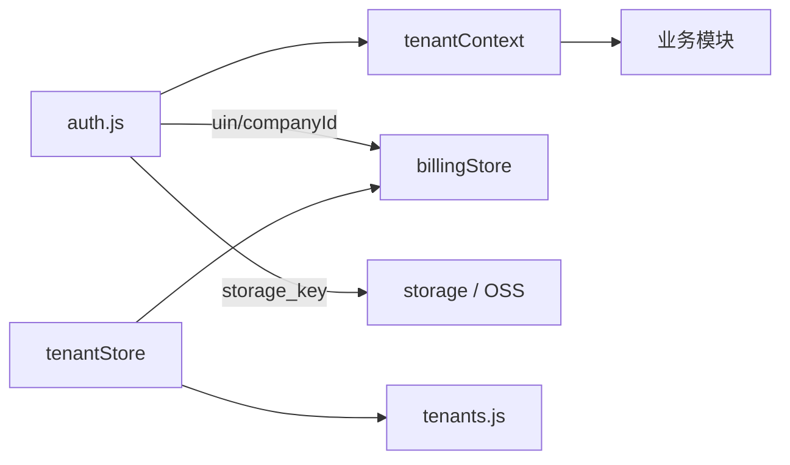

# Canvas2 多租户与身份（UIN）

> 面向纺织/图案设计 AI 生图 SaaS Canvas2 的「多租户与身份」关注面深读。

## 根因：为什么从 user 维度迁到租户维度

Canvas2 早期模型只认 `user`：画布、生成记录、提示词、钱包、订阅全挂在一个 `user_id` 名下。当产品从「个人工具」往「组织成员各自独立配置、公司统一承担费用」演进时，单维模型暴露四类硬伤：

| 硬伤 | 表现 | 迁移后解法 |
|------|------|-----------|
| 隔离粒度到人 | 组织成员数据混在一起无法拆分 | 数据按租户隔离，成员只读组织内相关行 |
| 计费没有边界 | 组织买了积分，分不清谁在用谁的额度 | 钱包三维模型 POOL/MEMBER，成员只扣自己的 MEMBER |
| 协作无语义 | 没有「谁属于哪个公司」显式关系 | 成员表记录角色 OWNER/ADMIN/BILLING_ADMIN/MEMBER |
| 无生命周期 | 离职/禁用/邀请状态无落点 | 成员状态 INVITED/ACTIVE/DISABLED/LEFT |

设计文档的核心哲学一句话（`docs/多租户改造实施说明.md:5`）：用户（User）只负责登录身份；租户（Tenant）负责数据、权限和计费边界。

## 关键事实：设计蓝图与运行时真源两套命名并存

读这个模块最容易踩坑的是命名不一致，必须先认清：

- **001 迁移（蓝图）**定义了 `tenants`/`tenant_members`/`tenant_settings`，业务表挂 `tenant_id` + `created_by_user_id`（[scripts/database/migrations/001_multi_tenant_foundation.sql:10-46]()）。
- **运行时真源（013/014 迁移后的现状）**实际落成 **UIN 身份模型**：`company`（个人=`company_type='personal'`，组织=`enterprise`）+ `user_identification` + `user_company` 三张表承载身份，业务表隔离列是 `uin` + `company_id` + `created_by_uin`。014 直接把 001 加的 `tenant_id`/`user_id` 列整套删掉。

因此**本解读以运行时真源为准**：代码里的「租户」落地是企业表 `company`，"tenantId"就是 `company_id`，"业务隔离键"就是 `uin`。001 迁移保留为设计蓝图的演进史。详见 [`data-model.md`](data-model.md) 的迁移演进。

## 设计思路（方案、放弃的替代方案）

### Token 绑定身份、换签切空间

JWT 只签 `uin`，租户由 `uin → user_company` 反查得到唯一 `companyId`。空间切换不是改 header，而是**换签**——用目标空间的 UIN 重新签一个 token。切换逻辑收敛在 `routes/auth.js` 的换签接口（[routes/auth.js:458-503]()）。

**放弃 `X-Tenant-Id` 请求头**：这是常见做法（一个 token 管多个空间），但这里主动拒绝，客户端真传该头直接 `400`（[routes/auth.js:221-227]()）。根因：租户是安全边界，不能允许客户端自选作用域，否则「切租户」绕过 `resolveTenantMembership` 校验就成了越权通道。换签把作用域选择收敛到服务端一个接口。

**放弃 token 内直接携带 tenantId + 角色**：JWT 只放 `uin`，租户/角色从 DB 现算。成员被改权限后立即生效，无需等 token 过期，也避免 JWT 失效管理。

### AsyncLocalStorage 注入租户上下文

中间件验完 token 后 `runWithTenantContext(auth, next)`，业务 store 用 `getActiveUin()`/`getActiveCompanyId()` 从异步上下文取隔离键，避免每个函数手传参数（[services/tenantContext.js:5-24]()）。

```js
// services/tenantContext.js:18-24
export function getActiveUin() {
  return getTenantContext()?.uin || null;
}

export function getActiveCompanyId(explicitCompanyId = null) {
  return explicitCompanyId || getTenantContext()?.companyId || null;
}
```

### 成员关系缓存而非 token 内嵌

权限真源是数据库，内存/Redis 只做短缓存并精确失效；Redis 异常时放弃副本、直接回源 DB。

## 核心流程：换签



换签的关键：token 只绑 `uin`，租户由 `uin→user_company` 反查；切空间 = 拿到目标空间的**公司域 UIN** 重新签 token（[routes/auth.js:458-503]()）。

## 关键数据结构：钱包三维模型

痛点：组织买了积分，成员消费必须区分「用谁的额度」，又不能自动透支资金池。解法是 `point_wallets` 的 `wallet_type` 三维：`POOL`（组织资金池，`uin IS NULL`）+ `MEMBER`（成员个人钱包，`uin` 非空）。

```sql
-- services/billingStore.js:159-168
CHECK (
  (wallet_type = 'POOL' AND uin IS NULL)
  OR (wallet_type = 'MEMBER' AND uin IS NOT NULL)
);
CREATE UNIQUE INDEX IF NOT EXISTS uq_point_wallet_company_pool
  ON point_wallets(company_id) WHERE wallet_type='POOL';
CREATE UNIQUE INDEX IF NOT EXISTS uq_point_wallet_uin_member
  ON point_wallets(uin) WHERE wallet_type='MEMBER';
```

- 余额含 `balance`(总余额) 与 `frozen_balance`(冻结)，可用 = balance - frozen。
- `version` 乐观锁防并发覆盖。
- 划拨走 `point_transfers`（`from_wallet_id != to_wallet_id`）+ 双条目 `point_ledger`，靠 `idempotency_key` 去重，保证组织向成员分配积分可重试不重复扣账。

## 与其他模块的协同



- **计费**：成员钱包/组织资金池都挂 `company_id`+`uin`；组织额度划拨在 `routes/tenants.js` 入口先做 `resolveTenantMembership + canManageBilling` 校验（[routes/tenants.js:155-167]()）。
- **存储**：OSS key 前缀 `tenants/{companyStorageKey}/users/{userStorageKey}/...`（[services/mediaAssetService.js:86]()），媒体浏览按租户前缀收窄（[routes/media.js:353-354]()）。
- **后台任务**：不经过 HTTP，任务队列必须从记录中显式带 `uin/companyId` 扣款，不依赖 AsyncLocalStorage（[services/generationTaskQueue.js:268-274]()）——这是「上下文只服务请求内同步、避免异步泄漏」的硬约束。
- **WebSocket**：按 `company:{companyId}:user:{uin}` 房间定向推送，天然多租户隔离（[routes/auth.js:944-948]()）。

## 关键设计决策（权衡）

### 决策一：换签 vs `X-Tenant-Id` 头

| 维度 | 换签（本方案） | `X-Tenant-Id` 请求头 |
|------|---------------|---------------------|
| 作用域选择权 | 服务端单一换签接口，先校验成员关系 | 任意请求自选，易越权 |
| token 状态 | 每空间一个 UIN token，session 按 UIN 隔离 | token 与空间解耦，撤销复杂 |
| 客户端成本 | 切空间多一次 round-trip | 无额外往返 |
| 安全性 | 高：作用域收敛到服务端 | 中低：依赖每路由校验 |

代价值：换签让 WebSocket 也随 token 切换（换签时会踢掉旧公司 socket 并重建），切空间时连接抖动一次，换取了「服务端独占作用域判定权」这一更强不变量。

### 决策二：复合主键 `(uin, id)` —— 把隔离提升到主键层

001 蓝图把 `workflows` 主键从 `id` 改成 `(tenant_id, id)`（[scripts/database/migrations/001_multi_tenant_foundation.sql:357-360]()），014 实际落地为 `(uin, id)`。好处是 DB 层面强制「任何行都不能脱离租户存在」，`WHERE` 必带隔离键。

代价：所有依赖原 `id` 主键的外键、查询、分页都要重排；014 专门处理「存在 `uin IS NULL` 的行时保留原主键」的降级分支（`014_drop_legacy_user_tenant_columns.sql`），说明对存量脏数据不友好。**用非空业务键 `uin` 做复合主键比用可空的 `tenant_id` 更稳**（001 初版 tenant_id 可空，靠回填后才 `SET NOT NULL`）。

值得商榷：替代方案「不碰主键、仅靠租户索引 + 规范」迁移更友好，坏处是隔离靠开发者遵守而非 DB 强制。这个团队选了更硬、更贵的 DB 强制路径，用大迁移成本换长期不变量。

## 亮点

1. **作用域收敛到服务端**：换签 + 拒绝 `X-Tenant-Id`，把「用哪个空间干活」变成服务端唯一判定。
2. **AsyncLocalStorage 注租户上下文**：业务代码免传参，且硬约束后台任务显式带归属，避免异步泄漏。
3. **三维钱包 + 幂等划拨**：POOL/MEMBER + 乐观锁 + idempotency_key + 双边账本，把组织充钱→分额度→消费→回收做成熟重试不重复扣账。
4. **缓存有明确真源与失效**：DB 是权限真源，Redis/内存仅短缓存，关键操作精确失效，Redis 故障降级不读脏副本。

## 问题 / 风险

1. **设计蓝图与运行时两套表名**（tenants vs company/uin）：文档通篇谈 `tenant_id`，代码落 `company_id`，读者按文档对照会踩空。
2. **复合主键迁移留脏数据降级尾巴**：主键形态取决于存量数据，不同库真源可能不一致。
3. **`visibility` 可见性没有统一中间层**：靠各 Store 自己的 WHERE 条件，隔离靠约定维系易漏。
4. **权限校验分散**：路由内 `resolveTenantMembership` 与 Store 内派生隔离键是两套机制，一个管「能否操作该租户」、一个管「读写哪租户」，边界靠自觉对齐。
5. **换签踢旧 socket，对多设备多空间场景**过于强横，若需求是 App+Web 同时在线会撞车。

## 真源引用汇总

| 论断 | 位置 |
|------|------|
| 设计哲学：用户只负责登录身份 | `docs/多租户改造实施说明.md:5,10-11` |
| AsyncLocalStorage 上下文 + 派生键 | [services/tenantContext.js:5-24]() |
| 拒绝 X-Tenant-Id / buildUinAuth 推 companyId | [routes/auth.js:119-134,221-227]() |
| 换签接口 | [routes/auth.js:458-503]() |
| 组织/成员/积分路由 + 校验 | [routes/tenants.js:155-167]() |
| 钱包三维 CHECK + POOL/MEMBER 唯一索引 | [services/billingStore.js:159-168]() |
| OSS 命名空间 | [services/mediaAssetService.js:86]()、[routes/media.js:353-354]() |
| 后台任务显式带 uin/companyId | [services/generationTaskQueue.js:268-274]() |
| 001 蓝图 tenants 三表 + 批量补列回填 | [scripts/database/migrations/001_multi_tenant_foundation.sql:10-46,72-178,357-360]() |
| 运行时真源 company/user_identification/user_company | [scripts/database/migrations/013_uin_identity_tables.sql:33,54,72]() |
| 删 legacy 列、workflows 落 (uin,id) 主键 | `scripts/database/migrations/014_drop_legacy_user_tenant_columns.sql` |
