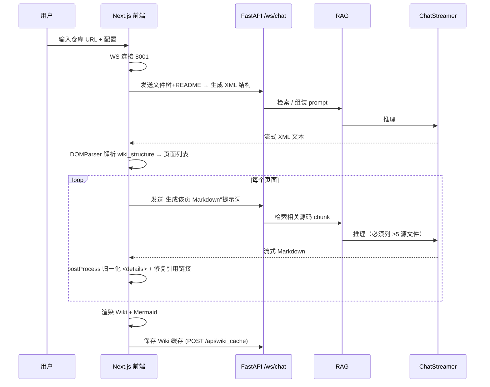

# DeepWiki-Open (Grok-Wiki) — 开源代码仓库 Wiki 自动生成平台深度解读

> **GitHub:** [github.com/AsyncFuncAI/deepwiki-open](https://github.com/AsyncFuncAI/deepwiki-open)
>
> **作者:** sheing（个人项目，隶属于 AsyncFuncAI 组织）
>
> **关联文档:** [RAG 与 Deep Research 管线](./rag-pipeline.md) · [多 Provider 流式架构](./provider-streaming.md) · [Codemap 两阶段生成](./codemap-design.md)

---

## 一、项目概览

### 这是什么

DeepWiki-Open（商业版命名为 Grok-Wiki）是 **DeepWiki 的开源复刻实现**。输入任意一个 GitHub / GitLab / Bitbucket 仓库（甚至本地目录），它会自动完成：分析代码结构 → 生成结构化 Wiki 页面 → 绘制 Mermaid 架构图 → 组织成可导航的侧边栏 Wiki → 额外生成面向"如何使用"类问题的 Codemap 引导。

它与官方 DeepWiki 的最大差异在于 **完全开源、支持本地部署、可插拔任意 LLM Provider**（官方深度绑定其 Gemini 基础设施）。

### 解决的痛点

1. **代码文档缺失/过时**：开源仓库普遍缺乏活文档，新人理解成本高。DeepWiki 用 AI 自动把代码库变成可持续生成的 Wiki。
2. **LLM 幻觉**：生成内容必须**严格锚定真实源码**，因此引入了 RAG 检索 + 带行号的引用（citation）、源码级 Codemap 落点校验。
3. **打通私有仓库**：需要支持 access token 克隆私有仓库，以及本地文件夹分析。
4. **多语言 / 多 Provider 绑定**：官方版绑定单一云服务，本地化部署需要可替换模型后端。这也是本项目多 Provider 架构的由来——面向从云端到完全离线（Ollama）的连续谱系。

### 核心能力清单

| 能力 | 说明 |
|------|------|
| **仓库接入** | GitHub / GitLab / Bitbucket / 本地目录，支持私有仓库 access token |
| **自动 Wiki 生成** | 两阶段：LLM 分析文件树+README 产出 XML 结构 → 逐页生成 Markdown |
| **两种模式** | Comprehensive（8-12 页、分 section）与 Concise（4-6 页） |
| **多语言** | 10 种语言（en/ja/zh/zh-tw/kr/vi/pt-br/es/fr/ru），响应语言强约束 |
| **RAG 问答** | 基于源码的向量检索 + 多轮对话，支持 Deep Research 多轮深挖 |
| **Codemap** | 针对"如何使用/怎么改"问题的分步骤源码引导，含真实行号引用 |
| **Mermaid 图表** | Wiki 页内自动生成架构流、时序图、类图等可视化 |
| **多 Provider** | OpenAI / Anthropic(Bedrock) / Google / Ollama / OpenRouter / LiteLLM / AWS Bedrock / Azure / DashScope |
| **Wiki 导出** | Markdown / JSON 两种格式下载 |
| **缓存** | 索引库（pkl Embedding DB）与 Wiki 页双层缓存，避免重复计算 |
| **认证** | 可选访问码（`DEEPWIKI_AUTH_CODE`）保护 Wiki 删除等操作 |

### 技术栈一览

| 层面 | 技术 |
|------|------|
| 后端 Runtime | Python 3.11, FastAPI + Uvicorn, Pydantic v2 |
| AI 编排框架 | **AdalFlow**（`adalflow`，RAG/Embedder/DataComponent 核心） |
| 向量检索 | FAISS（`FAISSRetriever`）+ 本地 pkl 数据库（`LocalDB`） |
| Embedding | 多后端（OpenAI/Google/Ollama/Bedrock），tiktoken 计 token |
| 前端 | Next.js 15, React 19, TypeScript 5, Tailwind v4, next-intl |
| 图表渲染 | Mermaid 11, react-markdown, rehype-katex |
| 实时传输 | WebSocket（`/ws/chat`、`/ws/codemap`）+ SSE / NDJSON fallback |
| 部署 | Docker（单镜像同时跑前后端）、docker-compose（Litellm/Ollama 变体） |
| 认证 | 简单访问码（非 OAuth） |

### 项目规模

| 类别 | 数量 |
|------|------|
| 后端 | `api/` 下 FastAPI 路由 7+、ModelClient 9+ 个、服务层多模块 |
| 前端 | `src/` 下核心组件 15+、动态路由 `[owner]/[repo]` |
| 测试 | `tests/` 分 unit / integration / api / backend 四类 |
| 语言文件 | `src/messages/*.json` 10 种 + `api/config/lang.json` |
| 许可证 | MIT |

---

## 二、架构总览

DeepWiki-Open 采用 **前后端分离、共享内存状态** 的单容器架构：Next.js 前端负责交互与渲染，FastAPI 后端负责所有重活（克隆、向量化、RAG、LLM 流式）。二者通过 HTTP REST（配置/缓存/导出）与 WebSocket（流式生成）通信。

```mermaid
graph TB
    subgraph "前端 Next.js (React 19)"
        Home[首页 / 仓库输入]
        Wiki[Wiki 页面 [owner]/[repo]]
        Ask[Ask 问答组件]
        CodeMap[CodeMap 引导]
        Mermaid[Mermaid 图表渲染]
    end

    subgraph "FastAPI 后端"
        Auth[认证 router]
        System[模型/语言配置]
        Repo[仓库准备 /prepare 索引]
        WikiS[Wiki 缓存/导出]
        ChatWS[WS chat 流式]
        CodeMapS[Codemap 生成]
    end

    subgraph "AdalFlow AI 管线"
        RAG[RAG 引擎]
        DB[LocalDB pkl 索引]
        Retriever[FAISS 检索]
        Streamer[ChatStreamer 抽象]
    end

    Home --> Wiki
    Wiki --> WikiS
    Wiki --> ChatWS
    Wiki --> CodeMapS
    ChatWS --> RAG
    CodeMapS --> RAG
    RAG --> Retriever
    Retriever --> DB
    RAG --> Streamer
    Streamer --> |LLM| Cloud[(Google/OpenAI/Anthropic)]
    Streamer --> |LLM| Local[(Ollama 本地)]

    Repo --> RAG
```

### 启动流程

```
1. Uvicorn 拉起 FastAPI (api/main.py:110)，加载所有 router
     ├─ system / auth / repo / wiki / chat / codemap
     └─ 初始化各 JSON 配置 → configs 全局字典 (api/config.py)
2. Next.js (port 3000) 提供服务端渲染，开发模式 NODE_ENV!=production 时
   FastAPI 开启 watchfiles 热重载（monkey-patch 排除 logs 目录）
3. 前端首页解析用户输入 → URL 判断 github/gitlab/bitbucket/local
4. 跳转到 /[owner]/[repo] 动态路由，携带 token/provider/model/语言等 query 参数
5. Docker 单镜像：start.sh 先后台启动 API (8001) 再前台 node server.js (3000)
```

### 核心请求链路 ① — 生成 Wiki

Wiki 生成是一个**前后端协同的两阶段流程**，前端承担大量提示词与结构化解析工作：



### 核心请求链路 ② — 仓库索引 / Chat

```
/repo/prepare  (SSE)                     /ws/chat  (WebSocket)
    │                                        │
    ▼                                        ▼
Repo.clone() 或本地路径 → RepoInfo   prepare_repo_index() — 信号量限并发(4)
    │                                        │
    ▼ read_all_documents()                  ▼
按扩展名 + include/exclude 过滤读取源码   RAG.aprepare_retriever()
    │                                        │  ├─ 命中 pkl 缓存 → 校验 embedding 维度
    ▼ pkl 索引持久化 (LocalDB)              │  └─ 未命中 → 执行索引
    │                                        ▼
    └─── 心跳(10s)防代理超时 ───────►  FAISS 检索 → 组装上下文 → Streamer 流式回复
```

---

## 三、核心实现

### 1. 配置驱动的多 Provider 体系（`api/config.py`）

后端不使用硬编码 if-else 分发模型，而是**用 JSON 配置 + 客户端类映射表**统一管理：

- `api/config/*.json`（generator / embedder / repo / lang）被加载进全局 `configs` 字典。
- `CLIENT_CLASSES` 与 `_DEFAULT_PROVIDER_MAP` 把 `provider_id` 解析成具体的 `ModelClient` 类（`api/config.py:71-95`）。
- `replace_env_placeholders()`（`api/config.py:98`）递归地把配置里的 `${ENV_VAR}` 替换为环境变量，实现密钥零落盘。

嵌入器（Embedder）做了**异构 embedding 维度兜底**：RAG 聚合每个文档的向量维度，取出现最多的维度为目标，过滤掉维度不一致的文档（`api/rag/rag.py:184`），避免 FAISS "All embeddings should be of the same size" 崩溃。

### 2. 双层缓存策略

| 缓存层 | 位置 | 命中路径 |
|--------|------|----------|
| 向量索引 | `~/.adalflow/repos/{owner}_{repo}/databases/{name}.pkl` | `/repo/prepare` 秒返回 `already indexed`；RAG 直接加载 |
| Wiki 页缓存 | `~/.adalflow/wikicache/deepwiki_cache_{type}_{owner}_{repo}_{lang}.json` | 前端读 `GET /api/wiki_cache` 免重生成 |

Wiki 缓存文件名即"处理过项目"的登记表——`list_processed_projects()`（`api/services/wiki.py:91`）扫描该目录解析 owner/repo/language，用于首页展示已生成项目。

### 3. 多语言响应约束

每个 System prompt 都内嵌 `IMPORTANT:You MUST respond in {language_name} language.`（如 `api/prompts.py` 多处），`repo.json` + `lang.json` 双向配置：后端做最终兜底校验，前端也把语言写进每个结构化请求。

### 4. 流式降级（resilience）

`stream_and_fallback`（`api/services/research.py:282`）对 token 溢出做两级降级：先检测 `is_token_limit_error`，命中则用 `simplify=True` 的无上下文精简提示词重试，仍失败再返回友好错误。前端对 WebSocket 连接失败也有 HTTP fallback（`page.tsx` 的 `fetch(/api/chat/stream)`）。

---

## 四、设计亮点

### 1. 引用（Citation）真源落点

这是对抗 LLM 幻觉最突出的设计，分两层：

- **Wiki 页**：提示词强制要求"至少 5 个真实源文件"，前端 `postProcessWikiContent`（`page.tsx:340`）用**正则按已知文件路径列表**（最长优先）解析空引用 `[path:10-20]()`，并转成各托管平台的行锚点（GitHub `#L10-L20`、GitLab `#L10-20`、Bitbucket `#lines-10:20`）。
- **Codemap**：`_ground_citations`（`api/services/codemap.py:201`）直接重读克隆源码，对 LLM 回填的 snippet 做子串查找，**用真实行号覆盖模型猜测的行号**。

### 2. 结构化生成 + 容错解析

前端让 LLM 返回 XML（wiki_structure），再以 `DOMParser` 解析；途中自动**转义裸 `&`**，针对 LLM 常见的 `"  "key":`、`[Sources: x:1-2]()`、尾部多余 `()` 等污染做多层正则修复（`page.tsx:421-473`、`api/services/codemap.py:69`）。

### 3. 安全实践

- **Token 消毒**：仓库克隆错误信息里同时清除原始与 URL 编码 token（`api/repository.py:420`），日志只打 URL 不打 key。
- **路径穿越防护**：`read_repo_file` 用 `realpath` + `commonpath` 校验目标仍在仓库目录内（`codemap.py:166-175`）。
- **WordPress 风格的配置注入**：embedding 用 OpenAI/key 从环境变量读取，绝不写配置落盘。

### 4. 线程化并发限流

`RAG` 的同步检索（git clone / 文件 IO / embedding）通过 `asyncio.to_thread` 扔到工作线程，避免阻塞事件循环，并用模块级 `asyncio.Semaphore`（`DEEPWIKI_MAX_CONCURRENT_RAG`，默认 4）限并（`api/rag/rag.py:344`）。

---

## 五、同类对比

| 项目 | 语言 | 定位 | 开源 | RAG | 部署 | 多 Provider |
|------|------|------|------|-----|------|-------------|
| **DeepWiki-Open** | Python+TS | 仓库 Wiki 自动生成 | ✅ MIT | ✅ 本地向量库 | ✅ 自托管 | ✅ 9 个 |
| **官方 DeepWiki** | 专有 | 同上（SaaS） | ❌ | ✅ | ❌ 托管 | ❌ 绑定 Gemini |
| **gitingest** | Python | 仓库提取为单文档送 LLM | ✅ | ❌（一次性打包） | ✅ | 依赖调用方 |
| **docsify / VuePress** | JS | 静态 Wiki 骨架 | ✅ | ❌ | ✅ | — |

**核心差异：** DeepWiki-Open 不是文档脚手架（docsify 类），也不是把仓库压缩成一个提示词（gitingest 类），而是构建了**可持久化向量索引 + 生成式多页结构化 Wiki + 带行号引用**的完整闭环，且强调本地可部署、模型可替换。

---

## 六、不足

- **同步核心**：RAG 引擎本质是同步组件，依赖 `to_thread` 包装，超大规模仓库命中/编排存在调度压力。
- **前端过重**：大量提示词与结构化解析逻辑写在 `page.tsx`（wiki 部分约千行），可维护性和复用性偏弱，后端只承担"透传"。
- **缓存一致性弱**：仓库更新后不能自动失效 pkl 索引，需手动清除，容易给旧内容。
- **认证简单**：仅访问码保护删除/查看，无细粒度 RBAC、无 token 集中管理。
- **测试偏回归**：以 client 层与 API 层为主，缺少针对 RAG 编排与前端提示词逻辑的系统性测试。
- **配置散布**：模型配置靠 JSON + 环境变量，多部署场景下缺少统一 schema 校验与默认值兜底。

---

## 七、可借鉴的设计

1. **Provider 用配置 + 类映射解耦**：JSON 声明 provider → `ModelClient`，新增模型零改代码。
2. **双层缓存（索引库 + 产物）**：把"计算成本高的中间态"与"最终产物"分开缓存，命中即可秒回。
3. **引用真源落点**：与其相信 LLM 给的行号，不如**用回显的 snippet 在真实文件里做子串定位**——这是提高 AI 内容可信度的高性价比手段。
4. **结构化输出的容错管线**：让 LLM 产 XML/JSON，前端做"转义→解析→脏数据修复"的多层校验，显著提升健壮性。
5. **SSE 心跳防代理超时**：长耗时任务用每 10s 心跳保活 + `asyncio.shield` 防超时误取消任务。

---

> **关联文档:** [RAG 与 Deep Research 管线](./rag-pipeline.md) · [多 Provider 流式架构](./provider-streaming.md) · [Codemap 两阶段生成](./codemap-design.md)
