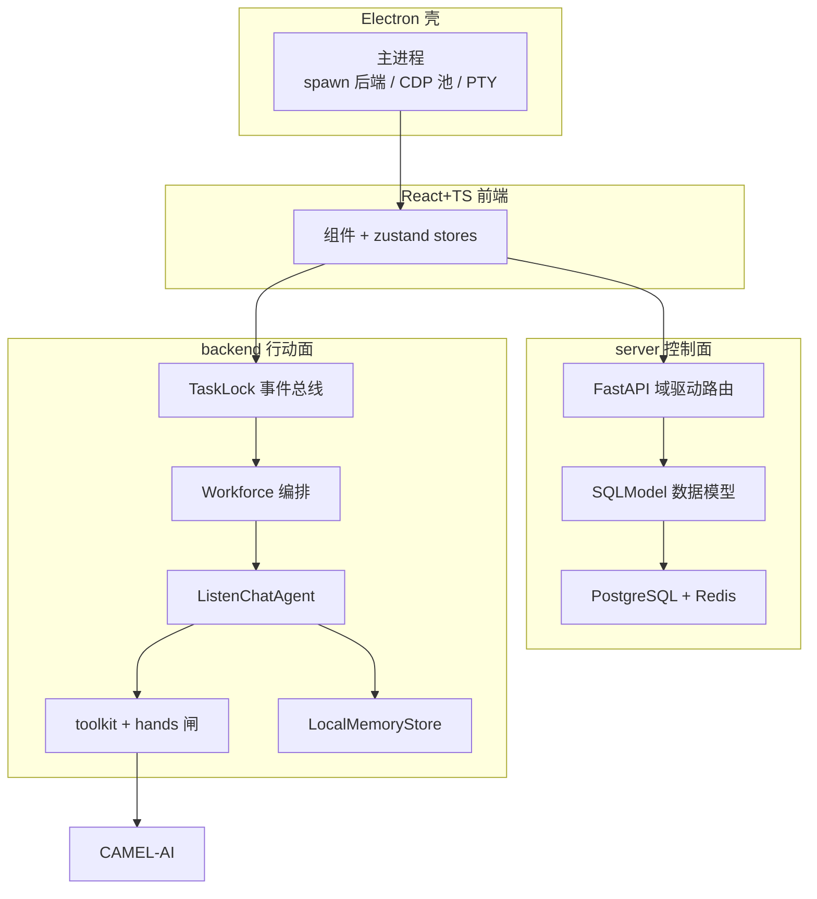

# Eigent——开源 Cowork Desktop（Multi-Agent Workforce）

> 本解读按 **agent** 类规格产出（主类型 = 智能体产品；副类型 = 基于 CAMEL-AI 的扩展，含桌面/前后端抽象）。源码仓库：Eigent（EigenAI 出品），主体为本地私有镜像（git HEAD `d2ed6345`，README 自述基于 CAMEL-AI）。所有 `文件:行号` 引用均经真源重定位校验。

## 一句话根因

把「让多个 AI Agent 在你自己电脑上与你并肩工作（Cowork）」从"单轮问答"收拢成一个**可构建、管理、部署自研 AI 劳动力（Workforce）的本地桌面平台**：前端一次提问，后端按任务复杂度自适应路由——简单问题单个 question agent 直接答，复杂任务升级为多 Agent Workforce（继承 CAMEL `BaseWorkforce` 做任务分解 + 并行执行），全程本地优先、模型无关、支持 MCP/Skill/浏览器终端工具，零技术配置。

## 子文档索引

- [`architecture.md`](architecture.md) — 三端分层架构（Electron 壳 / React 前端 / 双 Python 后端「控制面 server + 行动面 backend」）、启动链路、请求链路
- [`workforce.md`](workforce.md) — Multi-Agent Workforce 编排：单 agent vs Workforce 三车道路由、CAMEL 编排队列与 SSE 事件流
- [`memory.md`](memory.md) — 记忆与上下文：三层层级、预算投影、跨重启磁盘档案
- [`tool-calling.md`](tool-calling.md) — 工具调用与 Hands 执行层：FunctionTool 抽象、能力分层闸、浏览器/终端工具
- [`mcp.md`](mcp.md) — MCP 集成：控制面/行动面分离、双写总线、stdio + streamable HTTP
- [`data-model.md`](data-model.md) — 数据模型：SQLModel + PostgreSQL、space/project 分层、Alembic 迁移演进
- [`supporting.md`](supporting.md) — 认证/OAuth、定时自动化(Trigger)、远程控制、Electron 壳、前端组织

## 核心能力一览

| 能力 | 说明 |
|------|------|
| Multi-Agent Coordination | 复杂任务由多个专精 agent 分工并行执行（CAMEL `BaseWorkforce` 任务分解 + `SingleAgentWorker` 并发池） |
| Single-Agent Harness | `session_mode="single-agent"` 单 agent 直驱通道，低延迟处理直接任务 |
| 复杂度自适应路由 | `question_confirm` 用一次 LLM 判定在"简单问答 / Workforce / single-agent"三车道间运行时分流 |
| 本地优先部署 | agent 跑在本机，文件/凭据/上下文留本地；Electron 壳拉起 Python 后端 |
| 模型无关 | `agent_model` 统一装配，可跑 OpenAI/Azure/Bedrock/Anthropic/本地 vLLM/Ollama |
| MCP 集成 | 经 stdio + streamable HTTP 接入任意 MCP server，工具动态装入 agent |
| Skill / 内置工具包 | 内置浏览器（外部 CDP + WebSocket 桥）与终端（PTY）Toolkit |
| 定时自动化 (Automation) | Celery beat/worker 轮询 DB，将到点 trigger 经 Redis + WebSocket 推给在线桌面执行 |
| 远程控制 | 桌面桥(WS) + Redis `rc:cmd:` 命令通道，手机/网页远程驱动本机桌面 |
| 企业级 | server 端 JWT 双 token 会话 + OAuth adapter 工厂（SSO 在 server 成型，CAMEL Runtime 层 Brain 鉴权仍为 NoneAuth） |

## 技术栈一览

| 层面 | 技术 |
|------|------|
| 桌面壳 | Electron（main/preload/renderer 三进程）+ electron-builder 打包 |
| 前端 | React + TypeScript + Tailwind CSS + Radix UI + Zustand（状态）+ React Flow（流程编辑） |
| 控制面后端 | Python FastAPI + SQLModel(SQLAlchemy) + uvicorn + PostgreSQL(默认) + redis + alembic + Celery |
| 行动面后端 | Python + CAMEL-AI（multi-agent 框架，主 `camel-ai[eigent]==0.2.91a5`）+ `camel.app.workforce` |
| 进程通信 | HTTP + SSE（任务流）+ WebSocket（触发执行订阅/远程桥）+ Redis pub/sub |
| 本地配置总线 | `~/.eigent/mcp.json`、`~/.eigent/memory`，Electron/backend/前端三方共用文件级契约 |

## 架构总览

三端分层 + 控制面/行动面分离（详见 [`architecture.md`](architecture.md)）。核心模块图：

## 核心模块导读

| 模块 | 关注面 | 深读 |
|------|--------|------|
| 进程与数据流 | 三端分层、控制面/行动面分离、启动与请求链路 | [`architecture.md`](architecture.md) |
| Multi-Agent 编排 | 三车道路由、Workforce 分解 + 并行、TaskLock 队列 + SSE 事件流 | [`workforce.md`](workforce.md) |
| 记忆与上下文 | 三层层级、预算投影、跨重启磁盘档案、compaction 取舍 | [`memory.md`](memory.md) |
| 工具与 Hands | FunctionTool 抽象、能力分层闸、浏览器 CDP / 终端 PTY | [`tool-calling.md`](tool-calling.md) |
| MCP 介入 | 控制面/行动面双写、文件契约总线、transport 治理 | [`mcp.md`](mcp.md) |
| 数据模型 | SQLModel + PostgreSQL、space/project 分层、Alembic 迁移与回填 | [`data-model.md`](data-model.md) |
| 外围闭环 | 认证/OAuth、定时自动化、远程控制、Electron 壳、前端组织 | [`supporting.md`](supporting.md) |

## 设计亮点

- **控制面/行动面分离**：`server`(FastAPI 域驱动 + SQLModel) 管状态与调度，`backend`(CAMEL) 管执行且尽量无状态，二者由 `TaskLock.queue` + `Action` 枚举这一条**异步消息总线**解耦（`workforce.md`）。前端不直连 agent，只看 SSE 事件流。
- **复杂度自适应三车道路由**：不"永远多 agent"（贵、慢）也不"永远单 agent"（弱），用一次 `question_confirm` LLM 判定换取简单/复杂任务的最优路径（`workforce.md` 决策一）。
- **继承 CAMEL 而非重写**：`Workforce(BaseWorkforce)` 只覆盖事件钩子（node↔agent 映射 + 旁路 SSE），并发/依赖拓扑/重试交给框架——复用稳定性，代价是对 CAMEL 升级敏感（`workforce.md` 决策二）。
- **"档案=真值、上下文=瞬时投影"的记忆**：磁盘 append-only 转录永不萎缩，每次注入用 token 预算贪心截断，删的是"本轮注入副本"而非档案（`memory.md` 决策二）。
- **hands 能力闸**：`BrainCapabilities` 启动时探测部署环境（本地/沙箱/远端），装配期统一决定工具可见性，三种部署复用同一 agent 代码（`tool-calling.md` 决策一）。
- **控制面状态全集中 + JSON blob 吸收演进**：身份/关系用关系列、动态载荷塞 JSON，`schema_version` 指导解释；Alembic 迁移含程序化数据回填与冲突消解（`data-model.md`）。

## 不足与风险

- **文件系统边界基本只在装配期声明，未被执行期强制**：`can_access_filesystem` 唯一调用在 workspace 绑定兜底，真正文件读写（`LocalFileAccess.write_file`）直接写任意路径，砂箱的 `workspace_only` 是"声明"而非"强制"（`tool-calling.md` 风险一）。
- **并行与崩溃恢复依赖 CAMEL 黑盒**：worker 并发、依赖拓扑、重试都在 `BaseWorkforce.start()` 内，Eigent 未接管，升级敏感（`workforce.md` 问题一）。
- **记忆"写入面厚、提炼面薄"**：落盘完整，但 facts/todos 提炼近空转（`open_todos=[]` 硬编码、worker 侧渲染是 skeleton），项目级长期知识实际很弱（`memory.md` 问题二）。
- **RMMC 的唯一状态源不唯一**：MCP 配置在 `mcp.json`(文件)、`McpUser`(DB)、`installed_mcp`(内存) 三处，靠前端"双写"近似同步，密钥明文落盘（`mcp.md` 问题）。
- **自动化依赖"在线才执行"**：Trigger 真用 Celery 调度，但 agent 执行靠在线桌面前端认领，离线会被标 missed/failed（`supporting.md` 验证与遗留）。README 的"Enterprise SSO/access control"在 server 端成型，但 CAMEL Runtime 层 Brain 鉴权仍 `NoneAuth`。

## 值得借鉴（可迁移）

- 「控制面状态 / 行动面执行」分离 + 队列化消息总线：大型异步 agent 产品的通用骨架。
- 运行时复杂度自适应路由：简单问答与复杂工作流共用一套 UI，靠低成本判定分流。
- 记忆档案与上下文投影解耦：长期保留与 token 预算两难的低维护解法。
- 部署环境探测式能力闸：一套 agent 代码在不同部署形态自动长出不同工具集。
- 用文件级配置总线解耦多进程（Electron / backend / 前端共用 `~/.eigent` 配置）。

## 总结

Eigent 的价值不在"又一个 agent"，而在**把多 agent 编排的骨架与状态分离做成了可自托管桌面产品**：`server` 把"状态总账"管好（SQLModel + Alembic 迁移支撑演进），`backend` 把"执行"交给 CAMEL 并只做编排包装，前端用 SSE 事件流实时可视化。它在"多 Agent Workforce"这个卖点的落地、记忆/工具的取舍上都给出了可学但亦有代价的设计——是理解 CAMEL 系多 agent 产品如何落地到桌面形态的一个高密度样本。
