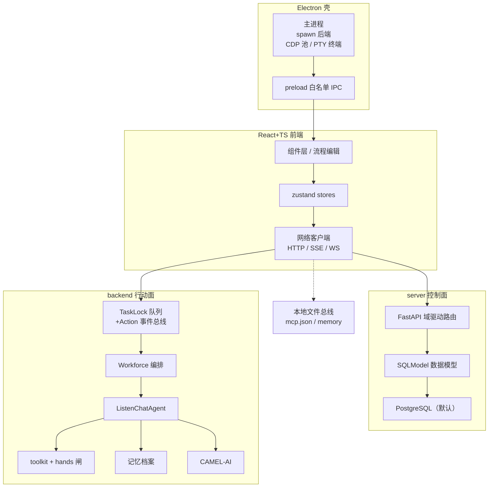
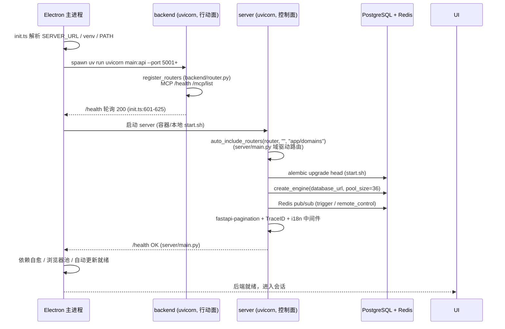
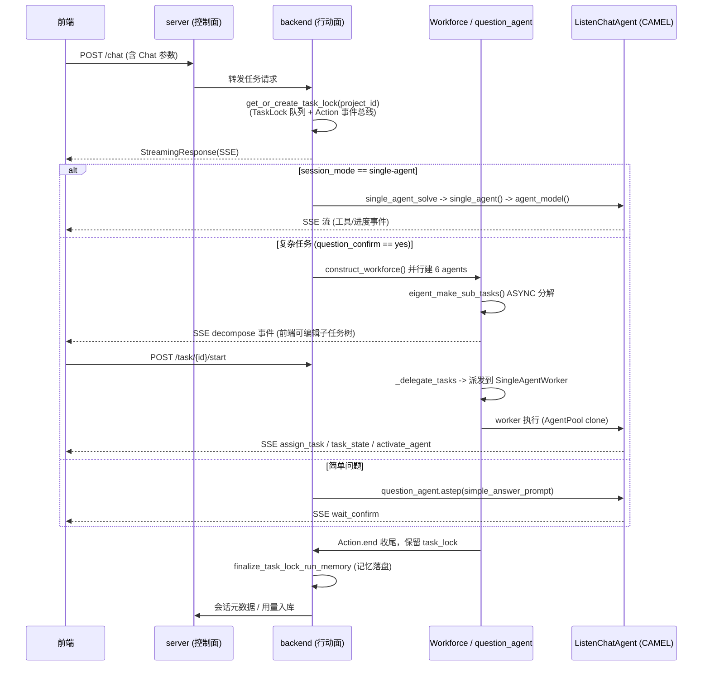

# 三端分层架构

> 本解读按 **agent** 类规格产出（主类型 = 智能体产品，Multi-Agent Workforce）。本文回答：Eigent 的三端到底怎么分层、数据流怎么走、启动链路怎么串联。

## 一句话架构

Eigent 是**「壳—面—脑」三层分离**的桌面 Cowork 产品：

- **壳**：Electron 桌面壳（`electron/`）——负责拉起后端进程、提供原生能力（终端/文件/CDP 浏览器/自动更新/订阅鉴权）。
- **面**：React + TS 前端（`src/`）——交互界面与状态管理（zustand），通过 SSE/WS/HTTP 对接后端。
- **脑**：双 Python 后端——`server/`（FastAPI，控制面）与 `backend/`（基于 CAMEL-AI，行动面）。

核心是**「控制面 / 行动面」分离**：`server` 管所有需要跨任务存活的**状态与调度**（用户/工作区/会话/MCP 登记/定时自动化/账单），`backend` 管**实际执行 agent**（CAMEL runtime、工具、记忆），且被刻意做成"对每个任务尽量无状态"。

## 架构总览

关于 `server` 与 `backend` 的边界，一处与直觉相反的落点值得注意：**MCP 配置与记忆档案并不通过 `server` 的 DB 共享**，而是落到本地文件系统（`~/.eigent/mcp.json`、`~/.eigent/memory`），`server` 只在 DB 里登记元数据——这是"控制面管状态、行动面产物贴本地"的务实妥协（详见 `mcp.md` 与 `memory.md` 的"决策一/决策二"）。

## 启动链路

Electron 壳先拉起后端，再做健康轮询；`server` 与 `backend` 是**两个独立进程**，由壳共同管理。

`server` 启动的核心是 `auto_include_routers` 自动扫描 `server/app/domains` 与 `server/app/api`（`server/main.py`），实现**领域驱动路由**——新增一个域即新增一个目录，无需改主路由。`backend` 启动见 `backend/main.py`，入口在 `register_routers(api, prefix)`（`backend/app/router.py`）。

## 核心请求链路（一次提问）

前端一次提问 → server/backend 协同 → 按复杂度三车道路由。完整的多车道路由与 Workforce 执行链路见 `workforce.md`，此处给跨模块总览：

## 与各子文档的衔接

- 架构上壳（Electron）与桌面外围的细节见 `supporting.md` 的「Electron 桌面壳」与「前端组织」章节。
- 一次提问如何被路由到 Workforce / single-agent / question_agent，以及队列与 SSE 机制，见 `workforce.md`。
- 记忆档案何时落盘、如何回注上下文，见 `memory.md`。
- 工具怎么被装上、hands 能力闸怎么放行，见 `tool-calling.md`。
- 外部 MCP server 怎么接进来，见 `mcp.md`。
- 所有跨任务状态（space/project/chat/trigger/user）如何建模，见 `data-model.md`。
