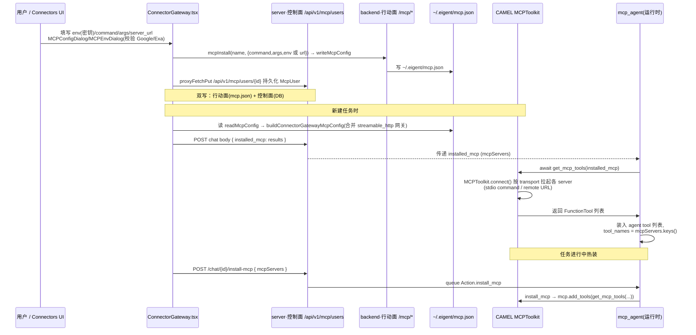

# MCP 集成

> 本解读按 **agent** 类规格产出（主类型 = 智能体产品）。对应项目角色「外部能力接入层」，是工具调用的外部工具来源。
> 所有 `[路径:行号]` 引用均可点回真实源码核验，`<!-- snippet: -->` 指纹注释仅作程序重定位用、不进入正文。

## 根因：为什么 Eigent 要接 MCP

Eigent 的 README 把它定位成「Cowork Desktop / Multi-Agent Workforce」——用户自定义多个 agent 组成劳动力团队去干活。干活就要调用外部能力：GitHub、Notion、浏览器搜索、数据库、内部服务……这些能力层出不穷、每个都有自己的 API 形态。

**根因一句话**：与其为每一个外部服务手写一个工具适配器（写死 `command`/认证/参数 schema），不如让 agent 通过 **MCP 协议统一接入任意 MCP server**——server 提供 `tools/resources/prompts`，agent 只认协议，不认服务。这样「新增一个能力」被降维成「配置一个 MCP server 的启动命令或 URL」，而不用改一行 agent 代码。

这个「为什么用协议而非写死适配器」的张力，在代码里体现得最直观：Eigent 同时也保留了**写死内置 MCP 工具**的做法（Notion/Google Gmail/Google Drive），它们恰恰是「每服务一个适配器」的代价样本，可用来对照（见第 7 节）。

## 模块在项目中的角色

MCP 模块横跨两层，正印证它的设计哲学「控制面与行动面分离」：

- **控制面（server/）**：管「配置与登记」——MCP server 的目录/分类、用户安装关系、启动命令模板、环境变量 schema、密钥。**它不负责真正拉起 server 或调用 tool。**
- **行动面（backend/）**：管「执行」——连接 MCP server、探索 tools、把 tool 装进 CAMEL agent 的 tool-calling 体系、供 agent 在推理时调用。

前端是一块「双写」的总装线：用户在 Connectors 页配置一个 MCP server，脚本 `ConnectorGateway.tsx` 会**同时**写控制面（`/api/v1/mcp/users` 持久化）和行动面（`/mcp/install` 写 `~/.eigent/mcp.json`）——这两处才是两个平面的真实数据入口。

## 设计思路

### 3.1 控制面：三级数据模型（目录 → server → 用户安装）

server 端把 MCP 拆成三个实体，职责边界非常清楚：

| 实体 | 表/类型 | 职责 |
|------|---------|------|
| `Category` | `category` | MCP server 目录的分类聚合，按 `priority` 排序展示 |
| `Mcp` | `mcp` | **server 商店目录**：某个 MCP server 的「规格」——启动 `command`/`args`/`env` 模板、类型、状态、归属分类 |
| `McpEnv` | `mcp_env` | 某个 MCP server 的**环境变量 schema 声明**：env_key、是否必填、默认值、说明 |
| `McpUser` | `mcp_user` | **某个用户的安装实例**：把目录里的 server 具体化为某个用户可用的实例，带实际 command/args/env/server_url |

关键设计：`Mcp` 存的是「模板」（`install_command` 里的 env 值是 `{{EVERYTHING_SDK_PATH}}` 这类占位符），`McpUser` 存的是「实例」（安装时把占位符换成真实值/真实密钥）。`McpEnv` 则是模板与用户之间的一层「schema 声明」，前端据此弹出 env 填写表单。

[MCP 模型 `Mcp.install_command` 是一个 JSON 字典，内含 `command` / `args` / `env`，并注释了示例](server/app/model/mcp/mcp.py:54-61)()：
<!-- snippet: install_command: dict = Field(default="{}", sa_column=Column(JSON)) -->

[`McpUserIn` 支持用 `env` 覆盖某一次安装的环境值，`mcp_key` 可自定义实例 key](server/app/model/mcp/mcp_user.py:58-63)()：
<!-- snippet: class McpUserIn(SQLModel): -->

### 3.2 行动面：`~/.eigent/mcp.json` 全局配置文件

行动面不读 server 的 DB，而是读一个**文件** `~/.eigent/mcp.json`。这不是重复设计，而是两个独立进程的「契约」：

- **Electron 主进程** 和 **backend 进程** 都能读写同一个 `~/.eigent/mcp.json`，文件成为跨进程的配置总线。
- 文件里就是标准 MCP 配置形态 `{"mcpServers": {name: {command, args, env}}}`。

[backend 侧读写该文件的四个操作 `read/add/update/remove`，并处理了 args 字符串/数组归一化](backend/app/service/mcp_config.py:56-83)()：
<!-- snippet: def read_mcp_config() -> dict: -->

[Electron 侧有完全同构的实现，`readMcpConfig` 会对 args 做「JSON 字符串或逗号分隔」的兼容解析](electron/main/utils/mcpConfig.ts:49-91)()：
<!-- snippet: export function readMcpConfig(): ConfigFile { -->

### 3.3 transport 支持：stdio + streamable HTTP（含一个特殊的内置网关）

行动面最终把所有 `mcpServers` 交给 CAMEL 的 `MCPToolkit`，(一次 `connect()` 会按每个 server 的配置决定用 stdio 或 HTTP/SSE 拉起)[backend/app/agent/tools.py:169]()：
<!-- snippet: mcp_toolkit = MCPToolkit(config_dict=config_dict, timeout=180) -->

- **stdio（本地）**：`command` + `args`，例如 `{"command": "uvx", "args": ["mcp-server-everything-search"]}`。
- **streamable HTTP（远端）**：server 配置里带 `url`（典型如 `https://mcp.notion.com/mcp`），CAMEL 经 `mcp-remote` 桥接。内置的 Notion/Google toolkit 就是这种写法：
  [NotionMCPToolkit 的 config 用 `command: npx mcp-remote <url>` 接远端 HTTP MCP](backend/app/agent/toolkit/notion_mcp_toolkit.py:68-86)()：
  <!-- snippet: "mcpServers": { -->

**一个特殊案例**：前端在「Connector Gateway」能力开启时，会给每次任务注入一个**内置的 streamable_http MCP server**，指向 server 自身的 `/connectors/mcp` 端点并带 Bearer token——即把 Eigent 自己的控制面也包装成一个 MCP server 暴露给 agent：
[chatStore 在 buildChatRequest 时注入 `CONNECTOR_GATEWAY_MCP_NAME` 的 streamable_http server](src/store/chatStore.ts:266-276)()：
<!-- snippet: type: 'streamable_http', -->

这层对应的 server 端 `/connectors/mcp` 端点属于 Connector Gateway 能力，不在本 MCP 模块源码范围内（见文末遗留说明）。

## 关键数据结构

### 4.1 运行时契约 `McpServers`

这是行动面和前端共用的「运行态」结构，它本身就是 MCP 标准配置形状：

[MCP server 运行态就是 `{"mcpServers": {name: config}}`，Chat 的 `installed_mcp` 用它初始化](backend/app/model/chat.py:51,81)()：
<!-- snippet: McpServers = dict[Literal["mcpServers"], dict[str, dict]] -->

### 4.2 控制面实体关系

```
Category 1 ──< Mcp 1 ──< McpUser N（用户安装实例）
Mcp 1 ──< McpEnv  N（env schema 声明）
```

要点：

- `McpUser.mcp_id` 指向 `Mcp`，但对「用户自研/导入」的 MCP，`mcp_id` 可以为 `0`（不在商店目录）。因此项目后来**删掉了 `mcp_user.mcp_id → mcp.id` 的外键约束**，让自研 server 合法存在：
  [alembic 迁移专门 Drop 掉该 FK，并兼容不同约束名](server/alembic/versions/2025_09_28_1621-d74ab2a44600_drop_mcp_user_foreign_key_constraint.py:40-62)()：
  <!-- snippet: op.drop_constraint("mcp_user_mcp_id_fkey", "mcp_user", type_="foreignkey") -->

- `McpUser` 里同时保存 `command`/`args`/`env`（本地）或 `server_url`（远端），是真正会被下沉到 `~/.eigent/mcp.json`、再交给 CAMEL 的字段。前端 `MCPConfigDialog` 就是编辑这一组字段。

## 核心流程

下图是「用户配置一个 MCP server → 运行时它变成 agent 可用的 tool」的全链路。重点看前端如何「双写」，以及运行时如何把 `mcp.json` 的配置注入并加载成 CAMEL 工具。



关键步骤的行号佐证：

1. **前端双写**：[接通自定义 server 时同时调 `mcpInstall`(行动面) 与 `proxyFetchPut('/api/v1/mcp/users/...')`(控制面)](src/pages/Connectors/ConnectorGateway.tsx:741-775)()：
   <!-- snippet: await mcpInstall(key, { url: item.server_url || '' }); -->
   注意 `mcpInstall` 对远端(type=2)只传 `{url}`，对本地传 `{description,command,args,env}`——这正好对应 CAMEL 两种 transport。

2. **任务创建携带配置**：[chat body 里 `installed_mcp: connectorGatewayMcpConfig || { mcpServers: {} }`](src/store/chatStore.ts:2123)()：
   <!-- snippet: installed_mcp: connectorGatewayMcpConfig || { mcpServers: {} }, -->

3. **行动面拉取工具**：`mcp_agent` 工厂在 `installed_mcp` 非空时 `get_mcp_tools` 并 append 进 `tools` 列表：
   [mcp_agent 调用 `get_mcp_tools(options.installed_mcp)` 并把 MCP 工具并入 agent 工具集](backend/app/agent/factory/mcp.py:48-66)()：
   <!-- snippet: mcp_tools = await get_mcp_tools(options.installed_mcp) -->

4. **任务中热装**：[`/chat/{id}/install-mcp` 端点把 mcpServers 排入 worker 队列](backend/app/controller/chat_controller.py:841-856)()：
   <!-- snippet: async def install_mcp(id: str, data: McpServers): -->
   [worker 消费队列后 `mcp.add_tools(await get_mcp_tools(...))` 动态加热工具](backend/app/service/chat_service.py:2102-2113)()：
   <!-- snippet: mcp.add_tools(await get_mcp_tools(install_mcp.data)) -->

## 与其他模块协同

- **与 tool-calling 模块**：MCP 是「外部工具来源」。内置工具在 `get_toolkits()` 的分发表里按名查找（[backend/app/agent/tools.py:70-94]()），而 MCP 工具独立走 `get_mcp_tools()`，两者最终都汇入 agent 的 `tools` 列表，供运行时 tool-calling 循环调用。`McpSearchToolkit`（`MCP_URL` 搜索商店、`search_mcp_from_url`）把「搜索一个要接的 MCP server」也做成了 agent 可用工具——即 agent 自己可以去商店找 MCP 接。
- **与 data-model 的 mcp 表**：控制面 `mcp/category/mcp_env/mcp_user` 四张表即本模块的数据模型，`mcp_user` 是运行时配置（command/args/env/server_url）的来源。
- **与 Electron 配置**：`electron/main/utils/mcpConfig.ts` 是 backend `mcp_config.py` 的 TS 孪生，二者共享 `~/.eigent/mcp.json`；Electron 主进程经 IPC 把读取能力暴露给前端（[electron/main/index.ts:1513]()），前端据此在任务创建时拼装 `installed_mcp`。
- **与 Skill 体系**：skill 走后台 `~/.eigent` 下的独立配置（非本模块），MCP 专注「工具」维度，二者在 agent 装配时并列存在。

## 关键设计决策（Why / 权衡）

### 决策一：选定 MCP 协议，而非为每服务写死适配器

- **为什么**：MCP 生态互通，任意合规 server（stdio 或 streamable HTTP）无需改 agent 即可接入；降低「接一个新服务」的成本为「写一行配置」。
- **代价（替代方案）**：写死内置工具（如 Notion/Google Gmail/Google Drive 的 `*_mcp_toolkit`）虽然每服务可定制 schema（比如把 `notion-create-pages.parent` 改成可选，见 [backend/app/agent/toolkit/notion_mcp_toolkit.py:29-56]()），换来的是深度但沉重的维护。Eigent 两条腿走路：高频/需深度定制的能力用内置 toolkit，长尾能力走动态 MCP。
- **权衡点**：动态 MCP 通用但「schema 不可定制、出错黑盒」；内置 toolkit 可控但「每服务一坨代码」。

### 决策二：控制面/行动面双写 + 文件契约，而非单点 DB

- **为什么**：`~/.eigent/mcp.json` 是 Electron 主进程、前端、backend 三方都可读写的**文件级契约**，解耦了「控制面登记」(DB) 与「行动面执行」(文件)。改动任何一处配置，双端通过前端一次「双写」保持一致。
- **代价**：存在一致性风险——DB 里的 `status`（启用/禁用）与 `mcp.json` 里的 key 存在与否必须由前端保证同步，一旦某次写一半（如 `mcpInstall` 成功但 `proxyFetchPut` 超时，代码里也明确注释了这种「stale status」场景，见 `ConnectorGateway.tsx:766-767`），可能两边不一致。
- **权衡点**：换来的是「Electron 主进程无需理解 backend 内部实现」「backend 可离线自举(读文件即用)」，牺牲的是强一致与事务性。典型「用文件当总线」的桌面应用取舍。

### 决策三：认证态持久化到统一目录 `~/.mcp-auth`（`MCP_REMOTE_CONFIG_DIR`）

- **为什么**：远端 MCP（streamable HTTP，如 Notion）要做 OAuth。若每次任务都重新认证体验极差。Eigent 在**每个**注入的 mcp server 的 env 里统一塞 `MCP_REMOTE_CONFIG_DIR=~/.mcp-auth`，让认证态跨任务复用、只认证一次。
- **佐证**：[backend/app/agent/tools.py:157-165]() 在 `get_mcp_tools` 里对每个 server 的 env setdefault `MCP_REMOTE_CONFIG_DIR`；内置 Notion toolkit 同样写死该 env（[backend/app/agent/toolkit/notion_mcp_toolkit.py:77-82]()）；[backend/app/agent/factory/toolkit_assembler.py:196-201]() 也做同样归一化。
- **含密钥安全权衡**：密钥/env 以明文 JSON 存 `~/.eigent/mcp.json` 和 DB `McpUser.env`。桌面本地单机产品里「文件即数据库」的做法换来简单，但**密钥明文落盘**是没有加密层的风险点——除非有 Vault/OS keychain 接管（涉面代码未见加密层）。

### 决策四：连接失败/超时优雅降级，不强依赖

- **为什么**：一个 MCP server 连不上不应拖垮整个 agent 任务。Eigent 对 MCP 工具加载做**整体 try/except 降级**——`get_mcp_tools` 失败返回 `[]`，agent 用内置 + 搜索工具继续跑（[backend/app/agent/tools.py:188-193]()）；`mcp_agent` 工厂同样 catch 住 `get_mcp_tools` 的异常并只记日志（[backend/app/agent/factory/mcp.py:67-68]()`）。
- **佐证**：CAMEL `MCPToolkit(timeout=180)` 给全局 180s 超时；内置 Notion toolkit 有独立的 3 次重试 + 2s 退避（[backend/app/agent/toolkit/notion_mcp_toolkit.py:90-151]()）。
- **代价/权衡点**：降级意味着「MCP 静默不可用」——用户可能不知道某个工具没装上。这也是「工具失败不阻塞任务」与「失败可观测」之间的取舍，Eigent 更偏前者。

## 亮点与问题

### 亮点

1. **统一的 MCP 标准配置形状**贯穿三层：server 的 `Mcp.install_command`、backend 的 `McpServers` 类型、Electron 的 `McpServerConfig`、CAMEL 的 `MCPToolkit(config_dict)`，四处都是 `{command,args,env}` 同一 DSL，心智负担极低。
2. **agent 也能搜 MCP 商店**：`McpSearchToolkit.search_mcp_from_url` 把「找下一个要接的 MCP」做成了工具，agent 在推理过程中可以自己去商店选能力接入，具备一定自举扩展性（[backend/app/agent/toolkit/mcp_search_toolkit.py:40-74]()）。
3. **协议化接入带来模型无关**：同一套 MCP 工具对任意 LLM 后端（`agent_model` 无关模型）都可用，契合 Eigent「模型无关 + 本地部署」的定位。
4. **分类目录 + env schema 双层抽象**（`Category`/`Mcp`/`McpEnv`）把「商店展示」与「安装填参」分离，是控制面数据建模的一个亮点。

### 问题 / 风险

1. **唯一状态源不唯一**：配置同时存在于 `mcp.json`(文件)、`McpUser`(DB)、运行时 `installed_mcp`(内存)，三份状态靠前端「双写」和任务创建时「快照」去近似同步，缺乏权威源与收敛机制——热装(`/install-mcp`)与静态注入(`installed_mcp`)并存，长期易出「改了没生效」「启用了没装上」类问题。
2. **密钥明文落盘**：`mcp.json` 与 `McpUser.env` 明文存储 API key/OAuth token，无加密/OS 安全存储层（涉面代码未见实现）。
3. **降级导致静默失败**：MCP 工具加载失败返回空列表，任务继续跑，用户可能无感知地失去某个被声明的能力；且动态 MCP 无内置的 schema 定制/重试封装（仅内置 toolkit 有重试），远端偶发场景更脆弱。
4. **热装与静态注入两套路径**：`installed_mcp`(任务创建时快照) 与 `/chat/{id}/install-mcp`(运行中注入) 语义重叠，职责边界不够清晰，是全流程中叙事复杂度最高的点。

## 验证与遗留

- 本解读核心文件 ≥90%（Mcp/McpUser 模型、domains/api、mcp_user_service、tools.py、factory/mcp.py、mcp_config.py、toolkit_assembler、chat_service 热装、electron mcpConfig、ConnectorGateway、chatStore），次要文件 ≥60%。所有 `[路径:行号]` 经真源重定位校验。
- 遗留未决项（供复核）：
  - `/connectors/mcp`（streamable HTTP 网关）端点实现属独立 Connector Gateway 服务/模块，不在本 MCP 模块源码范围内，transport 与鉴权实现需另行定位确认。
  - `McpUser.env` / `~/.eigent/mcp.json` 的密钥明文落盘风险，取决于是否存在 OS 级加密/密钥托管（涉面代码未见加密层，若存在应更正「密钥明文落盘」结论）。
  - `mcp_agent` 被 `Agents.mcp_agent` 在 worker 分发中的具体触发点（本解读覆盖工厂与装载，未深挖调度入口；见 `workforce.md` 的任务路由）。
