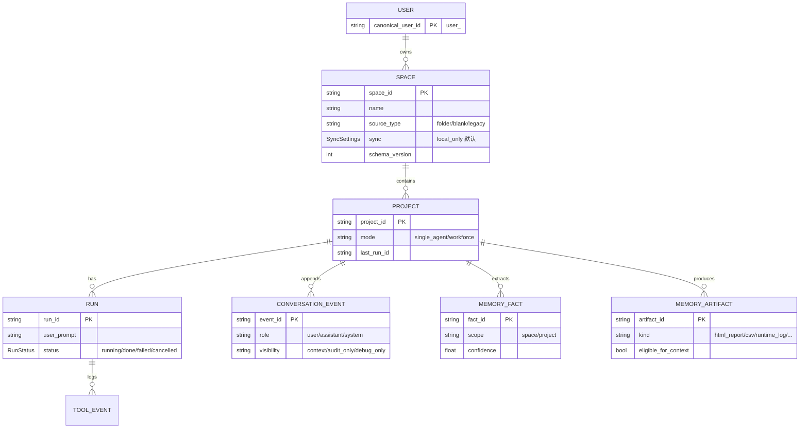
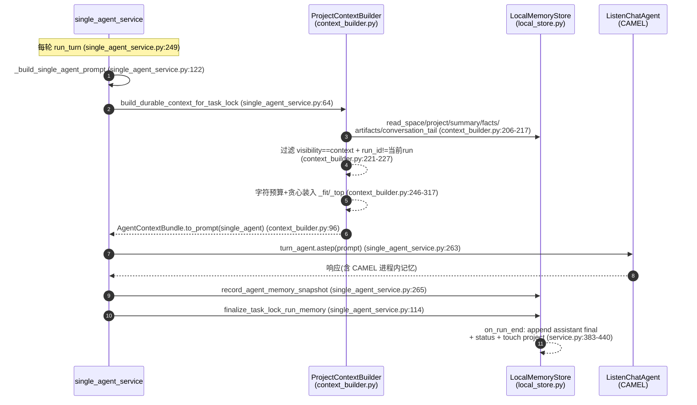
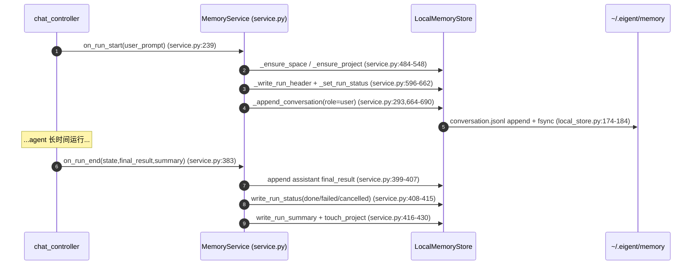

# 记忆与上下文管理

> 本解读按 **agent** 类规格产出（主类型 = 智能体产品）。解答：agent 跑多轮时，上下文与历史存在哪、怎么组织、怎么取舍。
> 所有 `[路径:行号]` 引用均可点回真实源码核验，`<!-- snippet: -->` 指纹注释仅作程序重定位用、不进入正文。探索阶段做数据模型主动探测命中「记忆持久化」，本篇即对应该关注面。

## 一句话根因

Eigent 的记忆模块要解决的根本问题是：**agent 每次运行的对话与产物天然是"易失"的（CAMEL 的 `AgentMemory` 只活在进程内、随进程销毁而消散），而一个"本地优先、可跨重启续跑"的 Worker 型产品要求历史能被重新拾回**。记忆要在"长期保留"（越过进程/重启生存）与"短期喂给 agent 的上下文"（受模型 token 预算约束）之间权衡。它的回答是：**一份 append-only 的本地磁盘档案当"事实源（source of truth）"、一份常驻 CAMEL 的进程内窗口当"执行上下文（working context）"，中间由 `ProjectContextBuilder` 做有预算的投影（projection）**。

---

## 在项目中的角色

记忆模块位于 **backend（行动面 runtime）**，与 CAMEL Loop 相邻，向 agent 循环供给"跨运行的历史 + 项目级事实/产物"，并负责把每轮（run）对话落盘。它承担四类职责：

| 职责 | 承载 | 一句话 |
|------|------|--------|
| 结构化档案落盘 | `backend/app/memory/local_store.py` | 把 Space/Project/Run 对话、事实、产物、状态写成 `~/.eigent/memory` 下的 JSON/JSONL |
| 生命周期编排 | `backend/app/memory/service.py` | run 开始/结束/每轮的写入钩子，暴露给 `chat_service` / `single_agent_service` |
| 上下文装配 | `backend/app/memory/context_builder.py` | 按 token 预算从档案投影出可拼进 prompt 的 `AgentContextBundle` |
| 执行态快照（Phase-0 老路） | `backend/app/utils/agent_memory.py` | 序列化 CAMEL 内存快照 + 跨 agent 去重，供上下文兜底 |

一句话：**记忆模块是"CAMEL Loop 的档案管理员 + 预算投影器"**。它不接管 CAMEL 的 step 内记忆，只负责 step 之外的跨轮、跨重启持久化与回注。

### 三层分工的落点（呼应整体哲学）

- 行动面（backend）→ **记忆档案的真正读写都在此**：`LocalMemoryStore` 直接落 `~/.eigent/memory`。
- 控制面（server）→ **存请求元数据 + 预留记忆表，不落地记忆档案**。[server/app/model/memory/memory.py:22-50]() 的 `SpaceMemory`/`ProjectMemory` 是 SQLModel 实体，但全仓库 grep 证实**没有任何 domain service / controller 读写它**（见第八节），docstring 自白是 "Future shared knowledge"。
- 前端（src/）→ **恢复场景的存档桥**：`buildProjectContinuationContext` 从聊天记录重建最近几轮上下文，经 `project_context` 字段传回 backend（见第七节决策）。

这是"控制面管持久化"哲学的一个**反例/特例**：记忆档案没有落到控制面数据库，而是落到行动面本地文件系统，更接近"本地优先的产物文件"而非"DB 化业务数据"。README 未浓墨宣传记忆，与实施现状吻合。

---

## 解决什么问题、根因

三个正交的问题促成这个模块。

### 1. CAMEL 记忆不跨进程（易失性根因）

`ListenChatAgent` 直接继承 CAMEL `ChatAgent`（[backend/app/agent/listen_chat_agent.py:74]()）。构造时**不传入** `memory` / `message_window_size` / `token_limit`（[backend/app/agent/agent_model.py:298-314]()），因此用的是 CAMEL 默认 `AgentMemory` —— 进程内、每 agent 实例独立。一条核心事实：

> CAMEL 记忆管"单个 agent 实例内、step 到 step"的 tool-calling 往返；它**不负责**跨进程重启或跨任务的持久化。

`LocalMemoryStore` 注释把边界讲得很直白——"append-only `*.jsonl` 由 per-path `threading.Lock` 保护，使同一 Brain 进程内并发写入者不交织行（跨进程写入超出范围——**单用户单 Brain 是设计不变量**）"（[backend/app/memory/local_store.py:17-25]()）。记忆的并发模型只承诺到单进程内，跨进程一致性显式不承诺，与"一用户一个 Brain 进程"的桌面形态绑定。

### 2. 长对话的 token 与信息分层（取舍根因）

喂给 agent 的上下文受模型窗口约束，而历史无限增长。模块把记忆按**信息分层**拆成预算分区，priority 最高的"近期对话尾"占 65% 预算：

```python
_HEADER_WEIGHT = 0.20  # space + project summary + facts overview
_RECENT_CONVO_WEIGHT = 0.65  # most recent conversation tail
_ARTIFACTS_WEIGHT = 0.10
_TODOS_WEIGHT = 0.05
```
[[backend/app/memory/context_builder.py:37-42]()]() 分区权重即"近者优先"的设计显式化。关键取舍是**新历史延续性优先于老历史细节**：对话只保留预算内最新的若干条（`_MAX_RECENT_CONVO_EVENTS = 24` 上限），老对话在注入时被丢弃而非被摘要兜住（见第七节决策二）。

### 3. 跨重启续跑（产品根因）

Worker 型产品允许运行中途中断/重启后继续。`service.py` 注释明确 `on_run_start` 对 Space/Project json 幂等，只覆盖当下权威字段（name/updated_at/last_run_id），其余字段文件已存在时保留（[backend/app/memory/service.py:24-29]()）；`on_run_end` 把 assistant 最终回答追加进 `conversation.jsonl`，"以便跨重启续跑看到它"（[backend/app/memory/service.py:396-407]()）。三点构成记忆存在的完整动机。

---

## 设计思路

### 分层记忆（3 层职责边界）

- **层 1：CAMEL `AgentMemory`（进程内，step 之间）** —— Eigent 不干预，管单次运行内 tool-loop。
- **层 2：进程内 `task_lock` 快照（Phase-0 老路线，本轮内跨 turn）** —— `conversation_history` + `agent_memory_history`（CAMEL 内存序列化快照、跨 agent 去重）+ `memory_summary`（被裁剪历史的占位标记）。见 [backend/app/utils/agent_memory.py:151-301]()。这条老路仍在运行，作为新持久化的**兜底**。
- **层 3：`LocalMemoryStore` 磁盘档案（M4 新路线，跨重启）** —— 权威持久层。

三条路线以"优先级 + 回退"串联：`_build_single_agent_context`（[backend/app/service/single_agent_service.py:58-102]()）把三级回退写成显式逻辑——**① 有 durable bundle 用 durable（跨重启）+ ② 否则用 in-process history（热连珠）/ ③ 否则退回前端传来的 `project_context` bridge**。Workforce 侧 `build_context_for_workforce`（[backend/app/service/chat_service.py:418-443]()`）把 durable 与 in-process 历史**拼接而非互斥**（durable 是旧上下文，in-process 是活态，可能含未落盘新 turn）。

### 上下文压缩策略：预算投影 + 磁盘真值

Eigent 的"压缩"不是摘要式（把老对话总结成一段），而是**投影式（projection）+ 截断式（truncation）**：

- `ProjectContextBuilder.build` 把 token 预算换算成字符预算（`_chars_for = int(budget * 4 * weight)`，1 token≈4 chars），再对每个分区"装到装不下为止"。
- 对话/事实/产物各自的 `_fit_conversation_to_budget` / `_top_facts` / `_top_artifacts` 都是**贪心从高优先级/最新往里塞，装不下就丢弃（单条过大则截断该条）**。例如 `_fit_conversation_to_budget`：从最新往旧塞，预算耗尽立即 break 丢弃更旧的（[backend/app/memory/context_builder.py:274-317]()）。
- 被丢弃的老历史**不丢失** —— 完整转录始终在 `conversation.jsonl`，"投影"只是每次注入的瞬时裁剪，删的是"这轮的注入副本"而非"档案本身"。这是与"摘要后替代原文"的根本区别：**档案不萎缩，投影可变**。

磁盘投影与执行上下文的分离体现在 `AgentContextBundle` 把"数据获取"与"渲染"解耦：注释明确 "Keeping rendering separate from data lets future callers（audit, diagnostics, alternative model formats）reuse the same fetched payload"（[backend/app/memory/context_builder.py:17-21]()）。

### 会话持久化方案（如何组织）

磁盘布局用目录树映射空间维度（[backend/app/memory/paths.py:15-30]()）：

```
~/.eigent/memory/
  users/{canonical_user_id}/
    spaces/{space_id}/
      projects/{project_id}/
        runs/{run_id}/
```

文件形态混合：**小 JSON（full rewrite）+ 大 JSONL（append-only）**：

| 文件 | 形态 | 内容 | 写入方式 |
|------|------|------|----------|
| `space.json` / `project.json` | 小 JSON | 元数据 | 原子写 (`tmp + os.replace + fsync`) |
| `conversation.jsonl` | JSONL | 每条一行对话事件 | append + per-path lock + fsync |
| `tool_events.jsonl` | JSONL | 每次工具调用 | 同上 |
| `facts.json` / `artifacts.json` | 小 JSON | 事实/产物（upsert by id） | 读-改-写 + per-path lock + 原子写 |
| `status.json` / `run.json` / `summary.md` | 小文件 | 运行状态/头/摘要 | 原子写 |

读端**容错**：缺文件返回 `None`/`[]`、无需 init（`local_store.py:211-217,186-188`）；JSON 解析失败视为"不存在"（[backend/app/memory/local_store.py:117-126]()）；未知键被 `_filter_known_fields` 丢弃（[backend/app/memory/local_store.py:129-142]()），保证 schema 可演进且不因旧文件缺新字段崩。这是"本地优先、先读旧文件也能用"的强健设计。

### 放弃的替代方案

- **放弃把记忆落到 server 数据库**：`server/app/model/memory/memory.py` 的 `SpaceMemory`/`ProjectMemory` 表建了但没有读写逻辑（grep 仅命中模型与导出行），说明记忆档案**刻意不在控制面 DB**，而是贴近产物文件放本地；代价是没有 DB 的查询/迁移/多端一致性（见第八节）。控制面只负责把会话元数据（`ChatHistory`）与用量存库，供历史列表/用量统计。
- **放弃摘要压缩**（第七节决策二详述）：在内存瘦身路径里，即便为防超长做 compaction，也只是**裁剪 + 追加一条"已压缩到哪里可恢复"的标记**（`memory_summary`），而非真正把老对话总结成摘要塞回，用"指向档案的指针"代替"摘文本体"。

---

## 关键数据结构（理解必需的类型）

全部 schema 定义在 `backend/app/memory/events.py`，frozen dataclass、JSON 可序列化、**刻意保持扁平形状**（不嵌套 dataclass），因为 `LocalMemoryStore` 读出时直接 `cls(**payload)` 反构，嵌套会让 round-trip 复杂化（[backend/app/memory/events.py:15-23]()）。

### `ConversationEvent`（一行 = 一条对话轮次）

```python
@dataclass(frozen=True)
class ConversationEvent:
    event_id: str
    run_id: str
    timestamp: str  # ISO 8601 UTC
    role: Literal["user", "assistant", "system"]
    content: str
    source: Literal["chat", "trigger", "improve", "imported"]
    visibility: Literal["context", "audit_only", "debug_only"]
    hash: str  # sha256:<hex>
```
[[backend/app/memory/events.py:35-47]()]() `visibility` 是关键取舍字段：只有 `context` 可见性的 turn 才能进 prompt（见流程节），`audit_only`/`debug_only` 用于审计调试但不污染上下文。`hash` 提供内容指纹，为未来去重/比对留位。

### 层级档案 `SpaceMemory` / `ProjectMemory` / `RunMemory`

```python
class ProjectMemory:
    project_id: str
    space_id: str
    name: str
    created_at: str
    updated_at: str
    mode: Literal["single_agent", "workforce"] | None = None
    last_run_id: str | None = None
    sync: SyncSettings = field(default_factory=SyncSettings)   # 云同步默认 local_only
    schema_version: int = SCHEMA_VERSION
```
[[backend/app/memory/events.py:130-140]()]() `sync` 默认 `local_only`，为 cloud sync 预留但默认本地（[backend/app/memory/events.py:108-114]()）。`mode` 记录单 agent 还是 workforce 会话，供 `ProjectContextBuilder` 选 profile。

### 投影结果 `AgentContextBundle`

```python
class AgentContextBundle:
    space_name / space_summary / project_name / project_summary
    recent_conversation: list[ConversationEvent]
    relevant_facts: list[MemoryFact]
    relevant_artifacts: list[MemoryArtifact]
    open_todos: list[str]
    current_run_instruction: str
```
[[backend/app/memory/context_builder.py:66-94]()]() `build` 产出 bundle，调用方一般不用 bundle 本身而调 `to_prompt(mode)`；`is_empty()` 决定是否回退旧路（[backend/app/memory/context_builder.py:80-94]()）。

字段到 layout 的对应与层级关系，用 mermaid `erDiagram` 概览：



---

## 核心流程 —— Mermaid sequenceDiagram

### 主链路 1：单 agent 一轮 run 的"记忆回注 + 上下文投影"

backend 两大服务（single_agent_service / MemoryService）与三层存储交互，标注关键 `路径:行号`。



### 主链路 2：run 生命周期的事实写入（on_run_start / on_run_end）



### coordinator 注入路径（workforce）

`build_context_for_workforce`（[backend/app/service/chat_service.py:418-443]()`）把 durable bundle 与 in-process history 拼接，经 `context_for_coordinator` 作为附加参数传入 `workforce.eigent_make_sub_tasks(camel_task, context_for_coordinator, ...)`（[backend/app/service/chat_service.py:926-932]()`），即记忆被喂给 coordinator 做任务分解，而非手工塞进 worker 的 system prompt（worker 渲染分支还是 skeleton，见第八节）。worker 实际拿到的是 coordinator 派下来的运行任务。

---

## 与其他模块协同

### 依赖 CAMEL（记忆边界）

Eigent 没有重写 CAMEL 的 step 内记忆，而是在外围做档案化。`ListenChatAgent` 继承 `ChatAgent`，相关参数是 CAMEL 的 `memory` / `message_window_size` / `prune_tool_calls_from_memory`（[backend/app/agent/listen_chat_agent.py:102-153]()），但 `agent_model` 构造时全部走默认（[backend/app/agent/agent_model.py:298-314]()）。`clone(with_memory)` 支持把当前 CAMEL 内存 `memory.retrieve()` 拷贝到新 agent（[backend/app/agent/listen_chat_agent.py:1087-1093]()），供 subagent/new_agent 复用。工具调用被 `_record_tool_calling` 记录、`prune_tool_calls_from_memory` 决定是否从内存剔除——这些是 CAMEL 内部窗口策略，Eigent 档案层（`tool_events.jsonl`）是独立于 CAMEL 重录一份。

### 依赖 server 数据模型

- server 的 `ChatHistory` 表保存每次 run 的元数据（task_id/question/model/summary/tokens/spend/status），是控制面历史列表与用量来源（[server/app/model/chat/chat_history.py:33-65]()），与 backend 记忆档案是**两套并行**：DB 管"会话登记与用量"，文件系统管"转录与产物"。
- server 的 `SpaceMemory`/`ProjectMemory` 表是**未接线**的预留（见第八节）。

### 与 workforce 的关系

- worker 模式上下文注入刻意收紧：`_render_workforce_worker` 只渲染"assignment + 相关产物 + 窄事实"，不含完整对话（[backend/app/memory/context_builder.py:154-171]()）；但该分支目前是 skeleton（注释 "Skeleton until the workforce milestone wires assignments through"）。当前 workforce 实际靠 coordinator 注入（见流程节）。
- Workforce 场景快照利用 CAMEL 多 agent 枚举 + **跨 agent 去重**控制体积：`_iter_workforce_agents` 枚举 coordinator/planner/worker/accumulator（[backend/app/utils/agent_memory.py:215-231]()），`record_workforce_memory_snapshot` 对 6 个近似克隆的 agent 做消息级去重（[backend/app/utils/agent_memory.py:251-301]()）——这是控制 Phase-0 老路体积的关键，因为 accumulator 几乎是 worker 的克隆。

### 与前端

- 前端 `chatStore` 在**新会话续跑**（improve/supplement）场景构造 `project_context`：`buildProjectContinuationContext` 取最近 `PROJECT_CONTEXT_MAX_RUNS=8` 个 run、每个取 user request + result，超 `PROJECT_CONTEXT_MAX_CHARS=24_000` 字符则截尾（`chatStore.ts:77-78,554-591`）；经 `project_context` 字段发给 backend（[src/store/chatStore.ts:2140]()），成为 `_build_single_agent_context` 的第 3 级兜底。
- 前端对超长历史有**字符级拦截**：backend 上报 `current_length/max_length`（200000 字符）越界时报 `Context Limit Exceeded`，提示另开项目（[src/store/chatStore.ts:3606-3612]()；上限来自 `chat_service.py:277,668-681`）。
- `SidePanelSections/buildContextItems.ts` 是运行时上下文展示（skill/MCP/引用文件），非持久记忆；它只反映"当前任务实际用了什么"，与记忆模块无耦合（读了该文件确认，避免误判为记忆入口）。

---

## 关键设计决策（权衡与替代代价）

### 决策一：记忆档案放"本地文件系统"而非 server 数据库

**为什么**：`LocalMemoryStore` 把真实转录/产物/事实落到 `~/.eigent/memory`，与产物文件同样的"本地优先"逻辑；server 只登记会话元数据。一个 Brain 进程能高性能 append（`os.fsync` 保障、per-path lock 保障单进程并发），且贴近用户目录、可被直接看到/备份。

**权衡/代价**：换来"无 DB 能力"——没有 SQL 查询/索引/迁移，`facts.json`/`artifacts.json` 每次 upsert 是"读全文件 → 改 → 全量重写"（`local_store.py:356-378,397-426`），数据量上去后退化；也没多进程一致性与并发合并（注释明确单用户单 Brain 是不变量，[backend/app/memory/local_store.py:20-22]()）。对照：档案入 DB 能得查询与迁移，但要处理序列化、联网、鉴权成本；对"本地 Worker"形态文件系统更物尽其用，代价在巨头级数据量才显现。

### 决策二：上下文压缩用"预算投影 + 截断"，放弃"摘要（summarize）"

**为什么**：context_builder 对每个分区做"字符预算内贪心装入"，超预算**丢弃更旧条目**、单条过大**截断该条加省略号**，而不是把老内容总结成摘要替代。

**权衡/对比**：
- 摘要方案 token 恒定、信息密度高，但**代价是生成延迟、额外 LLM 成本、事实保真风险**（摘要可能丢关键数字/命令），且需触发条件（何时总结、谁总结），复杂得多。
- 投影方案的"丢"**无损于档案**——完整转录在 `conversation.jsonl` 还在，只是本轮注入被裁剪，错装的"丢上下文"风险低于摘要错误。代价是**老对话在上下文里不可得**，跨 run 的"长距离一致记忆"只能靠 project summary / facts 这种显式提炼，而这两者当前还很弱（见第八节问题 2）。
- 佐证：这是 M4 的 first-cut 明确选择，React 侧也用到同样 4 字符/token 假设（[backend/app/memory/context_builder.py:23-26]()），两边一致。

另一独立决策藏着"防超预算"的临界处理：若**最新且唯一的事件本身大于整节预算**（如一次 `final_result` 是整份 HTML 报告/CSV dump），`_fit_conversation_to_budget` 会**截断该条**而非整条注入，否则让整个 prompt 超预算（[backend/app/memory/context_builder.py:292-315]()）。这体现设计者把"尊重 caller 预算"当硬约束，宁可损失一条消息完整性。

### 决策三：进程内"裁剪 + 指向档案的标记"而非"进程内留全集"

`chat_service._trim_in_process_history`（[backend/app/service/chat_service.py:307-346]()`）在 in-process 历史超过 200K 字符预算（`check_conversation_history_length`，[backend/app/service/chat_service.py:276-304]()`）时，**丢弃较旧的 `conversation_history`/`agent_memory_history`，但追加一条 `memory_summary` 标记**，内容直白：`compacted older in-process turn(s); the full transcript is preserved in ~/.eigent/memory under this Project`（[backend/app/service/chat_service.py:334-340]()`）。

**权衡**：进程内不双份存全程（省内存、省污染），靠档案恢复；但 `memory_summary` 只是"指向档案的指针"占位符，本身**不含摘要内容**——后续 prompt 只知道"有更早上下文且存在档案里"，需 agent 自行决定是否深读。这是"薄标记得分、厚摘记失分"的取舍，把"要不要挖历史"下放给 agent（需配合 Memory Toolkit 取回，见问题）。

---

## 亮点与问题

### 亮点

1. **"档案=真值、上下文=瞬时投影"的分层**：磁盘 append-only 转录永不萎缩（`conversation.jsonl`），每次注入的预算投影才裁剪。记忆保留与上下文喂给彻底解耦，未来换模型格式/做审计可复用同一份 fetch 结果（[backend/app/memory/context_builder.py:17-21]()）。比多数只做"进程内 history"的 agent 产品强。

2. **读端极强健的容错（本地优先友好）**：缺文件返回空、坏 JSON 当不存在、未知键被 `_filter_known_fields` 丢弃（[backend/app/memory/local_store.py:107-163]()）。无 init、schema 可演进，符合"本地文件即数据、尽量别崩"的桌面产品气质。

3. **原子写 / per-path 锁 / fsync**：小文件 `tmp+os.replace`（[backend/app/memory/local_store.py:82-100]()），JSONL append 带锁 + fsync（[backend/app/memory/local_store.py:174-184]()）。单进程并发写显式保证不交织，崩溃不产生半截 JSON，是"低成本但正确"的本地持久化纪律。

4. **best-effort 故障隔离**：整个 `MemoryService` 每个钩子 try/except + log + 继续，注释直白 `chat must not break because the memory writer hit an OSError`（[backend/app/memory/service.py:15-29]()）。记忆写失败绝不断聊天主链，对"记忆是副线"的定位很清醒。

5. **Workforce 快照的跨 agent 去重**（[backend/app/utils/agent_memory.py:251-301]()）：识别 coordinator/planner/worker/accumulator 大概率记录同一批消息（accumulator 近乎 worker 克隆），按消息指纹去重，避免 Phase-0 老路体积被 6 个近似 agent 放大。

6. **idempotent finalize**：`_memory_finalized_runs`（[backend/app/memory/service.py:188-220]()）防止重复 `end`/`finally` 路径把已成功的 `done` 覆盖成 `cancelled`，对 SSE 双结束路径是重要鲁棒性细节。

### 问题 / 风险

1. **两套记忆体并存带来的语义分裂**：Phase-0 进程内快照（`agent_memory.py`）与 M4 磁盘档案（`LocalMemoryStore`）**并行存在**。`_build_single_agent_context` 用三级回退把二者"当同一接口"，但 `build_memory_context`（快照摘要）与 `ProjectContextBuilder`（档案投影）各自维护一套裁剪/渲染规则，读出的上下文内容可能不一致（durable 里是 24 条最新对话 + 事实，快照里是最近 3 快照 × 12 条消息 × 1200 字符）。维护负担与行为漂移风险都存在。

2. **记忆"写入面很厚、提炼面很薄"**：大量工程在落盘完整转录（写入面），而真正喂给 agent 的"提炼"只有 recent conversation + facts + artifacts + summary，且：
   - `project_summary` 需外部写 `summary.md`（[backend/app/memory/local_store.py:314-338]()），`relevant_facts` 依赖 `facts.json` 有数据——但 grep 未见内存工具主动产出 facts/artifacts（`service.py` 只 `register_runtime_log_artifact` 注册 runtime_log，且 `eligible_for_context=False`）；`open_todos` 在 build 里被硬编码为 `[]`（"todos pipeline not in M3"，[backend/app/memory/context_builder.py:266]()）。
   - 结果：**档案历史大多只有对话尾能回注**，真正意义的"项目级长期知识"（facts/todos 提炼）接近空转，需 Memory Toolkit 迭代才落地——这是 README 未宣传、实施最薄弱处（符合任务预判）。
   - `recent_conversation` 只取 JSONL 末尾 24 条、且只认 `visibility=="context"`（[backend/app/memory/context_builder.py:215-227]()），一旦单 run 对话量大，能进上下文的窗口可能比 in-process 老路更小——老对话的"长距记忆"在注入侧是断的。

3. **Workforce worker 侧上下文几乎未实现**：`_render_workforce_worker` 是标 skeleton 的分支（[backend/app/memory/context_builder.py:154-171]()），目前 workforce 靠 coordinator 注入记忆（[backend/app/service/chat_service.py:926-932]()`）。worker 拿不到项目级事实注入，依赖 coordinator 派任务时带上——多 agent 记忆传递依赖 coordinator 单点。

4. **server `SpaceMemory`/`ProjectMemory` 表建而未用**：[server/app/model/memory/memory.py:22-50]() 的表有 `UniqueConstraint` 与索引，但全仓库无任何读写点。若属"设计预留"，当前状态是"代码里有一等表、实跑是本地文件"，易误导读者以为记忆进了 DB——应在文档里明确其状态（预留/废弃）。

5. **并发模型是单进程假设**：`LocalMemoryStore` 明确 `cross-process writes are out of scope -- single Brain per user is the design invariant`（[backend/app/memory/local_store.py:20-22]()）。未来若做多 worker/分布式 Brain，记忆会先遇到一致性瓶颈；目前靠桌面单进程形态兜住。

6. **设计文档缺失**：注释多处引用 `docs/core/space-project-memory-local-first-design.md`（[backend/app/memory/context_builder.py:15]() 等），但本地源码仓内**没有该文档文件**。评审者无法对照设计意图、只能从注释反推，影响可审性（尤其 `§6/§8/§12` 这类横切引用）。

---

## 验证与遗留

- 本解读核心面（`memory/` 六文件、注入点 `single_agent_service` / `chat_service`、Phase-0 兜底 `agent_memory`、server 记忆表状态、前端续跑桥）≥90% 覆盖，次要面按需裁剪 ≥60%。所有 `[路径:行号]` 经真源重定位校验。
- `ServerMemory`/`ProjectMemory` 表状态已核实：全仓库 grep 仅命中模型与导出行，无任何 domain service/controller 读写，属「定义为未来预留、当前未接线」的状态（见上文"决策一"与问题点）。

