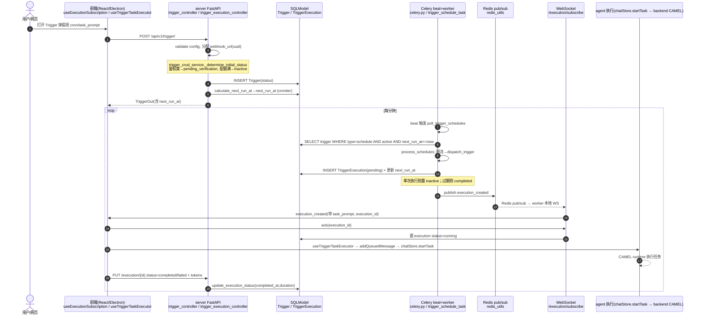

# 认证 / 自动化 / 桌面壳等外围能力

> 本解读按 **agent** 类规格产出（主类型 = 智能体产品）。聚焦产品外围闭环——怎么登录、怎么远程调度、怎么定时自动化、桌面 App 怎么落地。
> 所有 `[路径:行号]` 引用均可点回真实源码核验，`<!-- snippet: -->` 指纹注释仅作程序重定位用、不进入正文。阅读前提：已掌握核心 agent 能力（workforce/memory/tool-calling/mcp/data-model）。

---

## 总览

Eigent 的"企业级 + 外围能力"并非独立成块，而是全部长在 **server（FastAPI 控制面）的领域（domain）**上，与核心 agent 能力共享同一套认证、同一张用户表和同一条 Redis pub/sub 总线。外围模块的核心策略可以概括为一句话：

> **控制面（server）只管"状态与调度"，行动面（backend/前端/Electron）真正执行 agent。** 控制面通过 Redis pub/sub 与 WebSocket 把"事件/命令"推给"执行者"，执行者（桌面前端、远程桌面桥）收下后再去驱动 CAMEL runtime。

这个"控制面/行动面分离"是贯穿认证后的所有次级模块（Trigger、远程控制）的统一设计哲学，也是理解它们的关键。

五个子主题的角色：

| 模块 | 一句话角色 | 解决的 What | 关键设计决策 |
|---|---|---|---|
| 认证/OAuth | 登录与第三方授权入口 | 本地账号、SSO 期许、触发器的 Slack 等三方连接 | JWT 双 token + refresh token 黑名单；OAuth 用 adapter 工厂 |
| Trigger | 定时/事件自动化 | README 卖点 ⏰ 的自动化 | **Celery beat/worker 真调度** + Redis pub/sub "推给前端去执行" |
| 远程控制 | 手机/网页远程操作本机桌面 | 分身 | 桌面桥（WebSocket）+ Redis `rc:cmd:` 命令通道 + 一次性 token link |
| Channel | 渠道适配契约 | Slack/Telegram 出站 | 目前只是抽象接口，实现"out of scope" |
| Electron 壳 | 原生能力壳 | 终端/文件/webview/自动更新/订阅鉴权 | 主进程 spawn 后端 + CDP 控制 Chrome + 反指纹 webview |

下文逐个展开，**.5 节先给出每个模块的 snippet 依据与权衡。**

---

## 认证 / OAuth

### 角色与解决什么

认证分两层：

1. **用户会话认证（自己产品的账号）** —— `server/app/domains/user/`：密码登录、JWT access/refresh 双 token、logout 黑名单。这是所有 v1 API 和 WebSocket 订阅的鉴权基础。
2. **第三方 OAuth（连接外部服务）** —— `server/app/domains/oauth/` + `core/oauth_adapter.py`：给 Trigger（Slack/X/Notion/Google/领英）提供"授权-换 token"的统一流程，把第三方凭据存进 `config` 表。

另外 `backend/app/auth/` 有一套独立但当前是 no-op 的 `IAuthProvider`，是给 CAMEL Runtime（Brain）预留的鉴权钩子，现在默认 `NoneAuth`（本地信任一切）。

### 双层鉴权的关键决策

**用户会话：JWT 双 token + 旋转时黑名单旧 token，而非状态化 session。**

- `login` 校验密码后同时发 access(1h) 和 refresh(30d)。

```python
# server/app/domains/user/service/user_auth_service.py:60-67
        access_token = create_access_token(user.id)
        refresh_token = create_refresh_token(user.id)
        return AuthResult(
            success=True,
            access_token=access_token,
            refresh_token=refresh_token,
            email=user.email,
        )
```

- `refresh` 时用 JTI（JWT ID）把旧 refresh token 加入黑名单（TTL = 剩余有效期），实现"每次刷新都作废旧 token"的旋转式刷新，防止重放。

```python
# server/app/domains/user/service/user_auth_service.py:89-95
        # Blacklist old refresh token
        if jti:
            ttl = max(0, exp_ts - int(time.time()))
            await blacklist_token(jti, ttl)

        access_token = create_access_token(user.id)
        new_refresh_token = create_refresh_token(user.id)
```

- **权衡**：无状态 JWT 让多 worker（FastAPI + WebSocket + Celery）无需共享 session 存储即可验签；代价是"登出/踢人"必须依赖黑名单（一个外部存储 Redis/DB）。logout 先解码 token 拿 jti 和 exp，`exp - now` 作为黑名单 TTL。

```python
# server/app/domains/user/service/user_auth_service.py:108-122
        jti = _get_jti(token)
        if jti:
            try:
                payload = jwt.decode(
                    token,
                    env_not_empty("secret_key"),
                    algorithms=["HS256"],
                    issuer=TOKEN_ISSUER,
                    audience=TOKEN_AUDIENCE,
                    options={"verify_exp": False},
                )
                user_id = payload.get("id")
                exp = payload.get("exp")
                ttl = max(0, int(exp) - int(datetime.utcnow().timestamp())) if exp else 3600
                await blacklist_token(jti, ttl)
```

> 值得注意：logout 里调用了 `RemoteControlService.revoke_user_sessions(int(user_id), ...)`（同一文件 :126），说明"登出 = 撤销远程控制会话"这个安全联动把用户会话与远程控制绑定成一个信任整体——再次印证认证是跨模块共享的。

**第三方 OAuth：adapter 工厂模式。**

`core/oauth_adapter.py` 定义 `OAuthAdapter` 抽象（含 `get_authorize_url` / `fetch_token`），每个提供商一个子类，再加一个 `OAUTH_ADAPTERS` 字典做工厂。

```python
# server/app/core/oauth_adapter.py:26-33, 249-256, 259-264
class OAuthAdapter(ABC):
    @abstractmethod
    def get_authorize_url(self, state: str | None = None) -> str | None:
        pass

    @abstractmethod
    def fetch_token(self, code: str | None) -> dict[str, Any] | None:
        pass
...
# 工厂方法
OAUTH_ADAPTERS = {
    "slack": SlackOAuthAdapter,
    "notion": NotionOAuthAdapter,
    "x": XOAuthAdapter,
    "twitter": XOAuthAdapter,
    "googlesuite": GoogleSuiteOAuthAdapter,
    "linkedin": LinkedInOAuthAdapter,
}

def get_oauth_adapter(app_name: str, redirect_uri: str | None = None) -> OAuthAdapter:
    adapter_cls = OAUTH_ADAPTERS.get(app_name.lower())
    if not adapter_cls:
        raise ValueError(f"Unsupported OAuth application: {app_name}")
    return adapter_cls(redirect_uri=redirect_uri)
```

- 各 provider 的 `get_authorize_url` 各自构造参数并做跳转，差异（PKCE、scope、basic auth）被封装在 adapter 里，service/controller 无感知。
- **权衡**：adapter 模式让"加一个新 OAuth provider = 加一个子类 + 注册进字典"，符合后端模块化；但注意 `EXAOAuthAdapter` 直接是 TODO 返回 `None`（[server/app/core/oauth_adapter.py:184-191]()），且 Slack/领英等 `refresh_token` 能力不统一，说明这套 OAuth 还处于"能用但未打磨"的状态。

**OAuth 回调流程：服务端生成跳转 URL，回调页用 JS 重定向回 `eigent://` 协议，交给 Electron 主进程。**

```python
# server/app/domains/oauth/api/oauth_controller.py:64-83
    safe_code = _validate_oauth_param(code, "code", _OAUTH_CODE_MAX_LEN)
    safe_state = _validate_oauth_param(state, "state", _OAUTH_STATE_MAX_LEN)
    safe_app = _validate_oauth_param(app, "provider", 64) or ""
    query = f"provider={quote(safe_app, safe='')}&code={quote(safe_code, safe='')}&state={quote(safe_state, safe='')}"
    redirect_url = f"eigent://callback/oauth?{query}"
    html_content = f"""
    <html>
        ...
        <script type='text/javascript'>
            window.location.href = {json.dumps(redirect_url)};
        </script>
```

- 关键：`_validate_oauth_param` 对 code/state 做了字符白名单 + 长度校验，专门注释了"prevent XSS injection (H12)"（[server/app/domains/oauth/api/oauth_controller.py:34-43]()）。因为回调会被拼进 HTML/JS 重定向，这类防注入是安全重点。
- 回调 URL 用 `eigent://` 自定义协议而非 HTTP 端口回调，配合 Electron 主进程注册的协议处理器（见 §6）。

### backend 的 Brain Auth（预留钩子）

`backend/app/auth/interface.py` 定义 `IAuthProvider`，`NoneAuth` 是本地部署默认实现——直接信任请求，返回固定 `local` 身份。

```python
# backend/app/auth/interface.py:39-47
class NoneAuth(IAuthProvider):
    """
    Local deployment default auth provider.
    Trusts inbound requests and emits a fixed local identity.
    """

    async def authenticate(self, scope: dict[str, Any]) -> dict[str, str]:
        _ = scope
        return {"user_id": "local", "tenant_id": "default"}
```

`brain_auth.py` 的 `get_brain_auth_context` 已把鉴权 hook 接到每个非 health 路由上，只是现在非 NoneAuth 且没解析出 user_id 才拒绝（401）。

```python
# backend/app/auth/brain_auth.py:76-83, 84-90
    if not identity.get("user_id") and not isinstance(provider, NoneAuth):
        raise HTTPException(
            status_code=401,
            detail={
                "code": "brain_auth_required",
                "message": "Brain authentication did not resolve a user.",
            },
        )
    context = BrainAuthContext(
        user_id=identity.get("user_id") or "local",
        tenant_id=identity.get("tenant_id") or "default",
        authorization_present=bool(authorization),
        token_scheme=token_scheme,
    )
```

- **权衡**：这套是"接口先行、实现后补"。README 宣传的 Enterprise SSO/access control 在 server 端是成型 JWT 会话，但 backend 的 Brain 鉴权目前仍是 NoneAuth（本地全信任）。**"企业级 access control"在 CAMEL Runtime 层仍未真正上锁**。

### 前端认证

`src/store/authStore.ts` 是一个 zustand + persist 的 auth store，核心是一条 `authEnvironmentKey` 机制：当本地 proxy 环境变化时会清空持久化的凭据，避免把 A 环境的 token 带到 B 环境。

```typescript
// src/store/authStore.ts:171-202
const clearAuthForCurrentEnvironment = (
  setState: (state: Partial<AuthState>) => void,
  getState: () => AuthState
) => {
  const currentEnvironmentKey = getAuthEnvironmentKey();
  const state = getState();
  if (state.authEnvironmentKey === currentEnvironmentKey) {
    return false;
  }
  ...
  setState({
    token: null,
    username: null,
    email: null,
    user_id: null,
    share_token: null,
    localProxyValue: null,
    authEnvironmentKey: currentEnvironmentKey,
  });
```

- `routers/index.tsx` 的 `ProtectedRoute` 处理本地模式：`IS_LOCAL_MODE`（`VITE_USE_LOCAL_PROXY==='true'`）且无 token 时走 `/api/v1/user/auto-login` 自动登录（`routers/index.tsx:96-124`）。这与 `login_controller.py:auto_login` 创建默认 admin 用户对应（[server/app/domains/user/api/login_controller.py:57-80]()）。

---

## 自动化 Trigger（核心卖点）

### 角色与解决什么

README 卖点 `⏰ Automation - Schedule recurring workflows and let agents run tasks at the right time`。Trigger 负责：把"定时/事件"翻译成"让 agent 跑一个任务"。支持三种类型：`schedule`（cron 定时）、`webhook`（HTTP 回调）、`slack_trigger`（Slack 事件）。

### ⭐ 关键结论先行：自动化是真的用 Celery 调度

**结论：是的，实现确实用了 Celery beat（定时触发 poller）+ Celery worker（执行 poll 与超时检查）。** 这是经代码核实的，不是臆断。

`server/app/core/celery.py` 创建 Celery 实例（broker/backend 来自 env），并注册了两个 beat 调度：

```python
# server/app/core/celery.py:30-50
ENABLE_TRIGGER_SCHEDULE_POLLER = env("ENABLE_TRIGGER_SCHEDULE_POLLER_TASK", "true").lower() == "true"
TRIGGER_SCHEDULE_POLLER_INTERVAL = int(env("TRIGGER_SCHEDULE_POLLER_INTERVAL", "1"))  # in minutes
...
if ENABLE_TRIGGER_SCHEDULE_POLLER:
    celery.conf.beat_schedule["poll-trigger-schedules"] = {
        "task": "app.domains.trigger.service.trigger_schedule_task.poll_trigger_schedules",
        "schedule": TRIGGER_SCHEDULE_POLLER_INTERVAL * 60.0,  # Convert minutes to seconds
        "options": {"queue": "poll_trigger_schedules"},
    }

if ENABLE_EXECUTION_TIMEOUT_CHECKER:
    celery.conf.beat_schedule["check-execution-timeouts"] = {
        "task": "app.domains.trigger.service.trigger_schedule_task.check_execution_timeouts",
        "schedule": EXECUTION_TIMEOUT_CHECKER_INTERVAL * 60.0,  # Convert minutes to seconds
        "options": {"queue": "check_execution_timeouts"},
    }
```

`server/celery/` 下的启动脚本把 beat 和 worker 分别拉起，worker 监听三个队列：

```bash
# server/celery/beat/start
celery -A app.core.celery beat -l info
```
```bash
# server/celery/worker/start
celery -A app.core.celery worker --loglevel=info --queues=celery,poll_trigger_schedules,check_execution_timeouts
```

- **权衡**：不是"每个 cron 一个 Celery beat entry"动态注册，而是 **"每秒/每 1 分钟轮询 DB 里 `next_run_at` 到期的 trigger"**（DB-polling 而非分布式调度锁）。好处是 trigger 增删改只需写 DB，无需动态改 beat；坏处是存在分钟级粒度误差 + 不依赖精确调度（靠 `next_run_at <= now` 捞）。
- 每分钟轮询一次，配合 croniter 计算 `next_run_at`。

### 完整业务链路（跨模块时序图）：创建 → 持久化 → 调度 → 触发 agent 执行

这是本分析的核心图。链路跨 server（控制面）、Redis、前端（执行面）、backend（agent runtime）。



**链路拆解与关键 snippet：**

1. **创建**：`POST /api/v1/trigger/` → `TriggerCrudService.create`。它会 `_ensure_project_chat_history` 为该项目补一段 ChatHistory（让自动化的 task 有家），然后决定初始 status。

```python
# server/app/domains/trigger/service/trigger_crud_service.py:233-286
    @staticmethod
    def create(data: TriggerIn, user_id: int, s: Session) -> dict:
        # 1. Ensure project ChatHistory exists
        try:
            TriggerCrudService._ensure_project_chat_history(data, user_id, s)
        ...
        # 6. Calculate next_run_at for scheduled triggers
        if trigger.trigger_type == TriggerType.schedule and trigger.custom_cron_expression:
            schedule_service = TriggerScheduleService(s)
            trigger.next_run_at = schedule_service.calculate_next_run_at(trigger)
            s.add(trigger)
            s.commit()
            s.refresh(trigger)
```

2. **调度轮询**：Celery `poll_trigger_schedules` → `TriggerScheduleService.poll_and_execute_due_triggers` → 批量 `fetch_due_schedules`（按 `next_run_at` 排序 limit）。

```python
# server/app/domains/trigger/service/trigger_schedule_service.py:64-84
            statement = (
                select(Trigger)
                .where(Trigger.trigger_type == TriggerType.schedule)
                .where(Trigger.status == TriggerStatus.active)
                .where(Trigger.next_run_at <= now)
                .order_by(Trigger.next_run_at)
                .limit(limit)
            )

            results = self.session.exec(statement).all()
```

3. **dispatch（核心）**：`dispatch_trigger` 创建一条 `TriggerExecution(pending)`，更新统计与 `next_run_at`（croniter 计算下一次），单次执行则 deactivate。

```python
# server/app/domains/trigger/service/trigger_schedule_service.py:152-189
            execution_id = str(uuid4())
            execution = TriggerExecution(
                trigger_id=trigger.id,
                execution_id=execution_id,
                execution_type=ExecutionType.scheduled,
                status=ExecutionStatus.pending,
                input_data={"scheduled_at": datetime.now(timezone.utc).isoformat()},
                started_at=datetime.now(timezone.utc)
            )
            self.session.add(execution)
            ...
            trigger.next_run_at = self.calculate_next_run_at(trigger, datetime.now(timezone.utc))
            ...
            # If single execution, deactivate the trigger
            if trigger.is_single_execution:
                trigger.status = TriggerStatus.inactive
```

4. **不直接执行 agent，而是推送事件。** `dispatch_trigger` 明确写着 TODO——真正的 agent 执行不在这，而是"发给客户端让它执行"：

```python
# server/app/domains/trigger/service/trigger_schedule_service.py:191-207
            # TODO: Queue the actual task execution
            # This would integrate with a task queue (e.g., Celery) to execute the trigger's action
            # For now event is sent to client for execution
            ...
            try:
                # Notify WebSocket subscribers via Redis pub/sub
                from app.core.redis_utils import get_redis_manager
                redis_manager = get_redis_manager()
                redis_manager.publish_execution_event({...})
```

- **这是理解 Trigger 的关键权衡**：控制面（Celery）只负责"到点把执行记录落库 + 发事件"，**真正跑 agent 的是在线的桌面前端**。因此：
  - 优点：复用了前端已经写好的 chat/agent 执行管线（`chatStore.startTask`），不用在 server 再实现一套 CAMEL 驱动；agent 的 token/工具/上下文都在前端侧 well-known。
  - 代价：**依赖前端在线**。如果用户关了桌面 App，定时任务就"无人认领"——这也是为什么有 `check_execution_timeouts`（60s 无人 ack 标 missed，600s 未完成标 failed）。这是一套"本地优先、在线才执行"的自动化，**并非云端常驻调度**。

5. **超时与失败兜底**：`check_execution_timeouts` 每分钟把 pending(60s 无 ack)→missed、running(600s 无完成)→failed。

```python
# server/app/domains/trigger/service/trigger_schedule_task.py:35-36, 98-112
EXECUTION_PENDING_TIMEOUT_SECONDS = int(env("EXECUTION_PENDING_TIMEOUT_SECONDS", "60"))
EXECUTION_RUNNING_TIMEOUT_SECONDS = int(env("EXECUTION_RUNNING_TIMEOUT_SECONDS", "600"))
            if time_elapsed > timeout_seconds:
                if is_pending:
                    new_status = ExecutionStatus.missed
                    error_message = f"Execution acknowledgment timeout ({timeout_seconds} seconds)"
                    timed_out_pending_count += 1
                else:
                    new_status = ExecutionStatus.failed
                    error_message = f"Execution running timeout ({timeout_seconds} seconds) - no completion received"
```

6. **前端 WebSocket 认领**：`useExecutionSubscription.ts` 连 `/api/v1/execution/subscribe`，收到 `execution_created` 立即回 `ack`，并 `emitWebSocketEvent` 派给执行 hook。

```typescript
// src/hooks/useExecutionSubscription.ts:231-252, 287-317
      const ws = new WebSocket(fullURL);
      wsRef.current = ws;
      ws.onopen = () => {
        ...
        const subscribeMessage = {
          type: 'subscribe',
          session_id: sessionIdRef.current,
          auth_token: token, // ⚠️ Remove "Bearer " prefix
        };
        ws.send(JSON.stringify(subscribeMessage));
        ...
      };
            // Send acknowledgment immediately
            if (ws.readyState === WebSocket.OPEN) {
              ws.send(JSON.stringify({ type: 'ack', execution_id: message.execution_id }));
            }
            ...
              emitWebSocketEventRef.current({
                triggerId, triggerName, taskPrompt, executionId,
                triggerType: message.trigger_type,
                projectId: message.project_id,
                inputData: message.input_data || {},
              });
```

- 反向（执行完成回报）走 REST：`useBackgroundTaskProcessor` 通过 `chatStore.getState().startTask(...)` 真正启动 agent 任务，完成后 `proxyUpdateTriggerExecution` 把 execution 标为 running/completed/failed（见 [src/hooks/useBackgroundTaskProcessor.ts:223-283]()）。这也解释了为什么执行状态通过 REST 而非 WS 回写——因为要带 `output_data/tokens_used/duration` 等明细。
- **权衡**：控制面的"事件总线"是 Redis pub/sub + WebSocket，`/execution/subscribe` 用 auth_token 鉴权并查黑名单（[server/app/domains/trigger/api/trigger_execution_controller.py:229-244]()），每个 uvicorn worker 各自维护自己的 WebSocket pubsub 监听（`start_pubsub_listener`，`:496-517`），保证多 worker 都能把事件送到自己进程内连上的 socket。

7. **webhook 触发（非定时路径）**：`webhook_controller.py` 处理第三方 POST，经过 app-specific handler 的 `/authenticate → filter_event → normalize_payload`，创建执行记录后 `publish_execution_event` 并**等待 10s 投递确认**（`wait_for_delivery`）。若用户无在线会话则直接返回"no_active_sessions"——再一次印证"在线才执行"。

```python
# server/app/domains/trigger/api/webhook_controller.py:233-296
            redis_manager = get_redis_manager()
            has_active_sessions = redis_manager.has_active_sessions_for_user(str(trigger.user_id))
            redis_manager.publish_execution_event({...})
            if has_active_sessions:
                # Wait for delivery confirmation (10 second timeout)
                delivery_confirmation = await redis_manager.wait_for_delivery(
                    execution_id,
                    timeout=10.0
                )
```

### config registry 与 app handler（模块化的扩展点）

- `config_registry.py` 把 `TriggerType` 映射到各自 Pydantic config 类（`slack/webhook/schedule`），并提供 schema 生成与激活校验（`_CONFIG_REGISTRY` :35-39）。这支撑了"前端按 trigger 类型动态渲染配置表单"（`get_config_schema`）。
- `base_config.py` 的 `BaseTriggerConfig` 含 `authentication_required` + `max_failure_count` + `message_filter`，并提供 `validate_activation` 检查用户 `config` 表里是否已配好所需凭据（[server/app/model/trigger/app_configs/base_config.py:231-248]()）。这解释了为什么非本地鉴权类 trigger 初始状态是 `pending_verification`，激活时会 401 要求先认证（[server/app/domains/trigger/service/trigger_crud_service.py:365-379]()）。
- `app_handler_service.py` 是第二层模块化：`SlackAppHandler`（验签名/URL challenge/过滤）、`DefaultWebhookHandler`（通用过滤）、`ScheduleAppHandler`（过期检查）。注册表 `_HANDLERS` :422-426。

```python
# server/app/domains/trigger/service/app_handler_service.py:422-431
# Registry of handlers by trigger_type
_HANDLERS: dict[TriggerType, BaseAppHandler] = {
    TriggerType.slack_trigger: SlackAppHandler(),
    TriggerType.webhook: DefaultWebhookHandler(),
    TriggerType.schedule: ScheduleAppHandler(),
}


def get_app_handler(trigger_type: TriggerType) -> Optional[BaseAppHandler]:
    """Get the handler for a trigger type."""
    return _HANDLERS.get(trigger_type)
```

- **权衡**：两套注册表（config_registry + app_handler）存在职责重叠（都按 trigger_type 分发），但分工不同——config 管"配置校验/激活"、handler 管"请求鉴权/过滤/归一化"。这是 DDD service 化的自然产物，同时也说明 Trigger 是高度模块化的领域，新增一种触发类型 = 加 config 子类 + 加 handler + 注册两处。

### 限流、配额与自愈

- 限流：`trigger_utils.check_rate_limits` 按小时/天计数 `TriggerExecution` 数量限制（[server/app/core/trigger_utils.py:36-95]()）。
- 配额：`trigger_crud_service.MAX_ACTIVE_PER_USER=25`、`MAX_ACTIVE_PER_PROJECT=5`（[server/app/domains/trigger/service/trigger_crud_service.py:46-47]()），防止滥用。
- 自愈：`trigger_service._check_auto_disable` 依据 `config.max_failure_count` 连续失败自动停用（[server/app/domains/trigger/service/trigger_service.py:146-195]()）。

```python
# server/app/domains/trigger/service/trigger_crud_service.py:46-47
ACTIVE_STATUSES = (TriggerStatus.active, TriggerStatus.pending_verification)
MAX_ACTIVE_PER_USER = 25
MAX_ACTIVE_PER_PROJECT = 5
```

---

## 远程控制 & 远程子 agent

### 角色与解决什么

远程控制 = 让用户从**另一个浏览器/设备**远程操作本机的 Eigent 桌面（看项目、发消息、切视图、管理文件夹 overlay）。远程子 agent = 用一个**外部大模型服务（如 Gemini Agents）作为"远端 agent"** 来分担任务。两者其实是两套独立机制，但对产品意义不同：远程控制是产品闭环；远程子 agent 目前是较早期、仅支持 Gemini 的实验性扩展。

### 远程控制：桌面桥 + Redis 命令通道 + 一次性 token link

架构是一个"控制者(Web) ⇄ server ⇄ 被控者(桌面桥，即本机 App)"的三角。

- **桌面桥**：本机 Electron/前端 通过 WebSocket 连 `bridge/subscribe`（[server/app/domains/remote_control/api/remote_control_controller.py:835]()），注册 `desktop_instance_id`，在 Redis 里登记在线状态（`REMOTE_CONTROL_LEGACY_DUAL_WRITE`）。遥控端发命令的默认能力集见 `DEFAULT_CAPABILITIES`。

```python
# server/app/domains/remote_control/service/remote_control_service.py:79-96
DEFAULT_CAPABILITIES = {
    "bridge_version": 1,
    "commands": [
        "user_message",
        "human_reply",
        "stop",
        "skip_task",
        "add_task",
        "remove_task",
        "supplement",
        "switch_project_view",
        "space_project_upsert",
        "space_overlay_list",
        "space_apply_project_run",
        "space_refresh_project",
        "space_discard_project_overlays",
    ],
}
```

- **创建会话**：`create_session` 先生成 `RemoteControlSession` + 一个一次性 `RemoteControlLink`（存 `token_hash`，`sha256`）。链接 URL 把 token 放在 hash 片段 `#t=...` 里（`remote_url`）。

```python
# server/app/domains/remote_control/service/remote_control_service.py:619-629, 263-266
        token = secrets.token_urlsafe(32)
        link = RemoteControlLink(
            id=_id("rcl"),
            session_id=session.id,
            token_hash=_token_hash(token),
            expires_at=expires_at,
        )
        db.add(session)
        db.add(link)
```
```python
    @staticmethod
    def remote_url(session_id: str, token: str) -> str:
        origin = RemoteControlService.web_origin()
        path = f"/remote-control/{session_id}#t={quote(token, safe='')}"
        return f"{origin}{path}" if origin else path
```

- **命令下发**：`send_command` 把命令 flush 成 `RemoteControlCommand(pending)` 落库，然后 `publish_command` 通过 Redis pub/sub 发到 `rc:cmd:{desktop_instance_id}` 通道，桌面桥 WebSocket 收到后执行、回 `command_delivered` / `command_ack`。

```python
# server/app/domains/remote_control/service/remote_control_service.py:1354-1405
        RemoteControlService.publish_command(session, command)
        return RemoteControlCommandOut(
            command_id=command.id,
            status=command.status,
            next_task_id=command.next_task_id,
        )
    ...
    @staticmethod
    def publish_command(session: RemoteControlSession, command: RemoteControlCommand) -> bool:
        had_subscriber = RemoteControlRedis.publish(
            RemoteControlRedis.command_channel(session.desktop_instance_id),
            RemoteControlService.command_payload(session, command),
        )
```

- **桌面桥 WS 生命周期**：`bridge_subscribe`（[server/app/domains/remote_control/api/remote_control_controller.py:835]()）校验 origin、鉴权 token（`_auth_token_with_jti`）、登记在线，之后每 30s ping 携带最新 token 以跨 JWT 轮换续期，并周期性查黑名单（`is_blacklisted`）。断线时把该 desktop 下所有 active 会话标 `offline`。

```python
# server/app/domains/remote_control/api/remote_control_controller.py:953-997
            if msg_type == "ping":
                now = datetime.utcnow()
                next_token_raw = _strip_bearer(msg.get("auth_token"))
                if (next_token_raw and (not token_raw or not secrets.compare_digest(next_token_raw, token_raw))):
                    # re-validate fresh token, else keep cached
                    ...
                if token_expires_at <= now:
                    await websocket.send_json({"type": "auth_expired"})
                    await websocket.close(code=4401)
                    return
                if token_jti and now >= next_blacklist_check_at:
                    if await is_blacklisted(token_jti):
                        await websocket.send_json({"type": "revoke_bridge", "reason": "token_revoked"})
                        await websocket.close(code=4401)
                        return
```

- **前端桥（被控端实现）**：`useRemoteControlBridge.ts` 里，桌面端连 bridge，收到命令后按类型分派执行，并缓存/重放 ack（处理命令重发幂等）。它还加了前端限流 `RATE_LIMIT_MAX_COMMANDS`。

```typescript
// src/hooks/useRemoteControlBridge.ts:868-892
    const executeCommand = (command: RemoteCommand): Promise<BridgeAck> => {
      if (command.type === 'switch_project_view' || command.type === 'space_project_upsert' || command.type.startsWith('space_')) {
        return executeSwitchProjectView(command) / executeSpaceProjectUpsert / executeSpaceCommand...;
      }
      if (!checkRateLimit()) {
        return Promise.resolve({
          type: 'command_ack', command_id: command.id, status: 'failed',
          error_code: 'BRIDGE_RATE_LIMIT', error: 'Too many remote commands in a short time',
        });
      }
      return executeRemoteCommand(command, token);
    };
```

- **遥控网页前端**：`RemoteControl.tsx`（`routers/index.tsx:160-162`，仅 desktop 启用 `/remote-control/:sessionId`）接 `sessions/{sessionId}/events/subscribe` 的 WebSocket：被动接收状态事件（step 流、session 状态）。这是"远程只读/驱动当前桌面 UI"，而非独立的远程 agent 运行时。
- **安全模型**：
  - 桥归属：一个 `desktop_instance_id` 只能归属一个 user（`register_bridge` 校验，[server/app/domains/remote_control/service/remote_control_service.py:178-180]()）。
  - 链接 token 一次性 + 过期 + 可撤销：`verify_link` 校验 `token_hash`，`use_count` 只在首次激活 +1（用于异常检测），每次后续请求只 bump `last_remote_seen_at`（[server/app/domains/remote_control/service/remote_control_service.py:486-504]()）。
  - 登出联动：logout 时 `revoke_user_sessions` 撤销该用户所有远程会话并回收 link（见 §2.2）。
- **权衡**：把"远程操作"建模为 **"命令先落库（publish_command）,再经 Redis 通道异步送达，桌面桥回 ack"**，这样命令可追溯、可重放（前端缓存 ack）、断线可重连后 flush 补齐（`_flush_pending_bridge_commands`）。代价是复杂度高：状态跨 DB + Redis + 每 worker 本地 WS，代码量大（`remote_control_service.py` 1782 行），且大量 `_legacy_dual_write_enabled` 兼容路径（v1/v2 目标寻址并存）。

### 远程子 agent（RemoteSubAgent）

这是更早期的一块。核心在 `backend/app/remote_sub_agent/`：

- `runtime.py` 的 `RemoteSubAgentRuntime.run` 包一层策略（`policy`）、会话存储（`session_store`），循环拉取 provider 事件、聚合输出文本、统计 usage。

```python
# backend/app/remote_sub_agent/runtime.py:57-124
        session = self.session_store.get_or_create(
            api_task_id=request.api_task_id,
            provider=self.provider.name,
            remote_agent_name=request.remote_agent_name,
            session_key=session_key,
        )
        ...
        try:
            async with asyncio.timeout(self.policy.max_wall_time_seconds):
                async for event in self.provider.run(request, session):
                    events.append(event)
                    if event.interaction_id:
                        session.remote_interaction_id = event.interaction_id
                    ...
                    if event.event_type is RemoteSubAgentEventType.OUTPUT_DELTA and event.content:
                        output_chunks.append(event.content)
        except TimeoutError:
            ...
            raise
```

- `providers/gemini_agents.py` 是**唯一**实现：调 Gemini Agents 的 `/interactions`（流式 SSE 或后台 polling）。值得注意它专门处理了 `requires_action`（客户端需交互）→ 直接判失败，因为"RemoteSubAgent 还不支持客户端操作"。

```python
# backend/app/remote_sub_agent/providers/gemini_agents.py:388-401
        elif status in _UNSUPPORTED_ACTION_STATUSES:
            events.append(
                RemoteSubAgentEvent(
                    event_type=RemoteSubAgentEventType.FAILED,
                    content=(
                        "Gemini interaction requires client-side action, "
                        "which RemoteSubAgent does not support yet."
                    ),
                    ...
                )
            )
```

- 控制面侧 `server/app/domains/remote_sub_agent/` 只做 provider 的 CRUD（`provider_service.py`，目前仅允许同时启用一个）。

```python
# server/app/domains/remote_sub_agent/service/provider_service.py:22-28
    """Remote sub-agent provider CRUD.

    A user can store multiple providers, but only one remote sub-agent provider
    should be enabled at a time for now. This keeps the runtime selection
    deterministic while still leaving room for additional providers later.
    """
```

- **权衡 / 成熟度判断**：远程子 agent 处于非常早期的 stage——单一 provider（Gemini）、不支持需人工交互、控制面只到 CRUD。README 宣传口径未突出此项，实际上它更接近实验特性，**不应与 Trigger（成熟）相提并论**。它与"远程控制"共享名字但机制完全不同（一个是"遥控桌面"，一个是"外部 agent 接力"）。

---

## 渠道 Channel

### 角色与解决什么

Channel 是一层"出站消息渠道"抽象（Slack/Telegram/WhatsApp 等）。

### 现状：只有接口契约，没有实现

`backend/app/channels/interface.py` 非常直白地声明"本期只定义扩展契约，具体实现暂不实现"。

```python
# backend/app/channels/interface.py:18-44
class IChannelAdapter(ABC):
    """
    Channel Adapter interface.

    This round defines the extension contract only.
    Concrete adapters (Slack/WhatsApp/etc.) are out of scope.
    """

    @abstractmethod
    async def start(self) -> None:
        """Start channel listener."""
        ...

    @abstractmethod
    async def stop(self) -> None:
        """Stop channel listener."""
        ...

    @abstractmethod
    async def send_message(self, session_id: str, content: str) -> None:
        """Push outbound message to a channel session."""
        ...

    @abstractmethod
    def get_channel_type(self) -> str:
        """Channel identifier (e.g. 'slack', 'telegram')."""
        ...
```

- **权衡 / 成熟度**：这是纯粹"接口先行"的占位。真正的"把 agent 接入 Slack 等渠道"目前走的是 Trigger 里的 `slack_trigger`（入站 webhook 方向）而不是 `IChannelAdapter`（出站方向）。Channel 模块更像是未来托管渠道的蓝图，当前没有消费者。**属于最低优先级的外部能力。**

---

## Electron 桌面壳

### 角色与解决什么

Electron 壳是桌面版的"原生能力提供者"。它解决的 What 非常多：拉起 Python 后端进程、内嵌可交互终端、文件读写、webview（浏览器能力）、CDP 控制 Chrome、自动更新、订阅（Codex）OAuth 鉴权、浏览器 cookie 导入等。**核心是把一个"本地 agent 工作站"变成真实桌面 App。**

### 主进程 / 预加载 / 渲染进程分工

```
┌──────────────────────────────────────────────────────────────────┐
│ Electron 主进程 (electron/main/)                                │
│  · spawn Python 后端 (uv run uvicorn main:api --port <p>)        │
│    -- init.ts startBackend                                        │
│  · 健康轮询 /health, 端口管理, 依赖自愈 (uv sync / python install)│
│  · CDP 浏览器池 (launch/close Chromium, port 922x)                │
│  · WebViewManager (WebContentsView 承载网页, 反指纹注入)          │
│  · TerminaManager (node-pty PTY)                                  │
│  · Auth: eigent:// 协议 + 本地 HTTP auth callback server +        │
│    Codex 订阅 OAuth (subscriptionAuth)                            │
│  · autoUpdater (GitHub CDN)                                       │
│  · MCP config 读写 / env 读写 / 日志导出 / 文件 ops                │
└──────────────┬───────────────────────────────────────────────────┘
               │ preload (electron/preload/index.ts)
               │   contextBridge.exposeInMainWorld('ipcRenderer'|'electronAPI', ...)
               │   —— 只暴露白名单 IPC，不开放 Node 到渲染进程
┌──────────────▼───────────────────────────────────────────────────┐
│ 渲染进程 (React+TS, src/)                                        │
│  · 纯前端 API 调用走 window.electronAPI.* → ipcRenderer.invoke    │
│  · HTTP 走代理 (proxyFetch) → server REST                        │
│  · WebSocket: 触发执行订阅、远程桥、远程事件                      │
│  · Window 控制 / 文件 / 终端 / webview / MCP / 更新UI             │
└──────────────────────────────────────────────────────────────────┘
```

- **主进程启动后端**（`electron/main/init.ts:startBackend`）：解析 SERVER_URL、准备 uv venv/PATH、spawn `uv run python -m uvicorn main:api --port <5001+>`，然后每秒轮询 `/health` 直到 200 才 resolve。

```typescript
// electron/main/init.ts:377-380, 601-625
  return new Promise(async (resolve, reject) => {
    const spawnCmd = useDirectPython
      ? `${pythonPath} -m uvicorn main:api --port ${port} --loop asyncio`
      : `${uv_path} run python -m uvicorn main:api --port ${port} --loop asyncio`;
    log.info(`Spawning backend process: ${spawnCmd}`);
    ...
    healthCheckInterval = setInterval(() => {
      attempts++;
      const healthUrl = `http://127.0.0.1:${port}/health`;
      ...
      const req = http.get(healthUrl, { timeout: ... }, (res) => {
        if (res.statusCode === 200) {
          ...
          started = true;
          clearTimeout(startTimeout);
          if (healthCheckInterval) clearInterval(healthCheckInterval);
          resolve(node_process);
```

- **CDP 浏览器池**（`electron/main/index.ts`）：`profileInitPromise` 开启 `remote-debugging-port`，管理一个持久化到磁盘的浏览器池（`cdp-browsers.json`），可 launch/close/health-check Chromium。这是"agent 用浏览器"的底座（浏览器工具通过 CDP 控制真实 Chrome）。

```typescript
// electron/main/index.ts:439-461
profileInitPromise = findAvailablePort(browser_port).then(async (port) => {
  browser_port = port;
  app.commandLine.appendSwitch('remote-debugging-port', port + '');
  ...
  // Create isolated profile for CDP browser only
  const cdpProfile = path.join(browserProfilesBase, `cdp_profile_${port}`);
  ...
  app.commandLine.appendSwitch('user-data-dir', cdpProfile);
```

- **反指纹 webview**（`electron/main/webview.ts`）：`WebViewManager.createWebview` 创建 `WebContentsView`，用独立 session partition `persist:user_login` 隔离 storage，并注入一段大 JS 去除 `window.webdriver`、伪造 plugins / hardwareConcurrency / deviceMemory / WebGL vendor 等来规避机器识别。webview 全局共享登录 cookie（清理时不清 storage，只清 cache，[electron/main/webview.ts:469-473]()）。

```typescript
// electron/main/webview.ts:157-167 (注入片段)
        // Save original values before overriding to maintain consistency
        const originalLanguages = navigator.languages ? [...navigator.languages] : ['en-US', 'en'];
        ...
        // Hide webdriver property
        Object.defineProperty(navigator, 'webdriver', {
          get: () => undefined,
          configurable: true
        });
```

- **预加载白名单**（`electron/preload/index.ts`）：用 `contextBridge` 暴露 `ipcRenderer`（on/off/send/invoke）和 `electronAPI`（改名后的白名单方法）。`electronAPI` 是厚封装：终端、webview、CDP、安装依赖、MCP、订阅鉴权、日志诊断等。**渲染进程拿不到原生 Node，只能通过这套白名单 API**——符合 Electron 安全最佳实践。

```typescript
// electron/preload/index.ts:15-24
contextBridge.exposeInMainWorld('ipcRenderer', {
  on(...args: Parameters<typeof ipcRenderer.on>) { ... },
  off(...args: Parameters<typeof ipcRenderer.off>) { ... },
  send(...args: Parameters<typeof ipcRenderer.send>) { ... },
  invoke(...args: Parameters<typeof ipcRenderer.invoke>) { ... },
  removeAllListeners: (channel: any) => ipcRenderer.removeAllListeners(channel),
});
```

- **终端**（`electron/main/terminal.ts`）：用 `node-pty` 跑用户默认 shell 的真实 PTY，key 由 renderer 生成，shell 可跨 tab 存活。`terminalEnvironment` 会过滤掉名字含 `API_KEY|TOKEN|PASSWORD|SECRET|PRIVATE_KEY` 的环境变量，防止把主进程持有的凭据泄进交互式 shell（[electron/main/terminal.ts:78-89]()）。

```typescript
// electron/main/terminal.ts:78-90
const SENSITIVE_ENV_NAME =
  /(?:^|_)(?:API_KEY|TOKEN|PASSWORD|PASSWD|SECRET|PRIVATE_KEY)(?:$|_)/i;

export function terminalEnvironment(
  environment: NodeJS.ProcessEnv = process.env
): Record<string, string> {
  return Object.fromEntries(
    Object.entries(environment).filter(
      (entry): entry is [string, string] =>
        entry[1] !== undefined && !SENSITIVE_ENV_NAME.test(entry[0])
    )
  );
}
```

- **自动更新**（`electron/main/update.ts`）：用 `electron-updater`，但自定义 provider 为 `GitHubReleaseCdnProvider`（私有 CDN 分发，`githubReleaseCdnProvider.ts`），关闭签名校验（`verifyUpdateCodeSignature=false`），`autoDownload=false` 由前端触发下载并回报进度。

```typescript
// electron/main/update.ts:77-92
  const cdnBaseUrl = process.env.EIGENT_UPDATER_CDN_BASE_URL || DEFAULT_CDN_RELEASE_BASE_URL;
  const channel = getGitHubReleaseChannel(process.platform, process.arch);
  const feed = {
    provider: 'custom' as const,
    updateProvider: GitHubReleaseCdnProvider,
    owner: 'eigent-ai',
    repo: 'eigent',
    releaseType: 'release' as const,
    channel,
    cdnBaseUrl,
    platformDir,
  };
```

- **订阅鉴权（Codex OAuth）**（`electron/main/subscriptionAuth/index.ts`）：为 Codex 订阅单独做了一套 OAuth——本地起一个临时 callback server（端口 1455，按需启动、闲置自动停），`codex-login` 用 PKCE 组装授权 URL 后 `shell.openExternal` 打开浏览器，回调验证 state、换 token（`completeCodexOAuthCallback` / `exchangeCodexOAuthCode`），凭据存 `credentialStore`。

```typescript
// electron/main/subscriptionAuth/index.ts:337-367
      pruneExpiredOAuthState();
      const pkce = createPkcePair();
      const redirectUri = codexOAuthRedirectUri();
      pendingCodexOAuthByState.set(pkce.state, { email: normalizedEmail, codeVerifier: pkce.codeVerifier, redirectUri, ... });
      const authUrl = codexOAuthAuthUrl();
      ...
      url.searchParams.set('code_challenge', pkce.codeChallenge);
      url.searchParams.set('code_challenge_method', pkce.codeChallengeMethod);
      ...
      await shell.openExternal(url.toString());
```

  - **权衡**：主进程里同时存在**两套 OAuth**：一套是给 server 的第三方 OAuth（Electron 只做 `eigent://` 协议转发的壳，见 §2.2），另一套是给 Codex 订阅的完整 OAuth（主进程自己跑起 callback server + PKCE）。前者轻，后者重（因为订阅登录需要真跑一个本地 HTTP 回调来接收厂商回调并内网换 token）。两者的共同点是"授权码最终都回到主进程"，体现 desktop shell 对第三方登录的编排作用。

- **登录回调的另一路**：`startAuthCallbackServer` 起一个本地 HTTP server（19836–19900）承接外部登录（eigent.ai）的 `auth-token-received` 回调（[electron/main/index.ts:663-707]()`）。这解释了"为什么有协议注册还要用本地 HTTP"——注释说"避免 dev 模式协议问题"。

### 成熟度判断

Electron 壳非常成熟且功能密集（CDP 浏览器池、反指纹 webview、PTY 终端、双 OAuth、CDN 更新、日志诊断导出、依赖自愈），**是外围模块里工程完成度最高的一块**，符合"桌面优先"的产品定位。

---

## 前端组织

### 角色与解决什么

前端是 React + TS + zustand 的单页应用，主要在**组织层**（store/router/page）支撑上述所有能力：认证、触发执行、远程桥。electron 与 web 双端通过 `isWeb()`/`isDesktop()` 平台分支共用同一套组件。

### 关键组织决策

- **入口**（`src/main.tsx`）：web 用 `BrowserRouter`，桌面用 `HashRouter`（`main.tsx:37`），且通过 `HostProvider`/`ConnectionProvider` 注入统一的 host 抽象（让组件不感知是 electron 还是纯 web）。

```typescript
// src/main.tsx:35-54
const host = createHost();
injectHost(host);
const Router = isWeb() ? BrowserRouter : HashRouter;
const initialChannel = isWeb() ? 'web' : 'desktop';

ReactDOM.createRoot(document.getElementById('root') as HTMLElement).render(
  <Suspense fallback={<div></div>}>
    <Router>
      <HostProvider host={host}>
        <ConnectionProvider channel={initialChannel}>
          ...
```

- **路由与权限**（`src/routers/index.tsx`）：`ProtectedRoute` 用 zustand auth 判断；本地模式走 auto-login；`/remote-control/:sessionId` 仅桌面启用；lazy-load 页面组件。

```typescript
// src/routers/index.tsx:30-31, 155-178
const IS_LOCAL_MODE = import.meta.env.VITE_USE_LOCAL_PROXY === 'true';
const ENABLE_DESKTOP_REMOTE_CONTROL_FALLBACK = isDesktop();
...
const AppRoutes = () => (
  <Routes>
    <Route path="/login" element={<Login />} />
    <Route path="/signup" element={<Signup />} />
    {ENABLE_DESKTOP_REMOTE_CONTROL_FALLBACK ? (
      <Route path="/remote-control/:sessionId" element={<RemoteControl />} />
    ) : null}
    <Route element={<ProtectedRoute />}>
      ...
```

- **Store 布局**：zustand 为核心。`authStore`（认证+环境隔离）、`triggerStore`/`triggerTaskStore`/`activityLogStore`（触发执行状态机）、`pageTabStore`（工作区 tab + session preview 状态）、`globalStore`（小 UI 偏好）、`projectRuntimeStore`/`spaceStore`/`chatStore`（核心项目/会话）。
  - `globalStore` 很小——就是历史视图模式（grid/list/table）的持久化，说明前端把"全局 UI 偏好"和"业务状态"分开（[src/store/globalStore.ts:18-44]()）。
  - `pageTabStore` 是全前端最重的一个 store（984 行）：不只是 tab 切换，还承载 **session preview 面板**——每个项目持久化其 preview tabs（browser 需 webviewId、terminal 需 shellId），并提供 `setSessionPreviewProject` 作用域化读写，避免两个项目的 preview 状态漂移（[src/store/pageTabStore.ts:392-416]()）。

```typescript
// src/store/pageTabStore.ts:130-151
const EMPTY_SESSION_PREVIEW: SessionPreviewSlice = {
  open: false,
  tabs: [],
  activeTabId: null,
};
...
export function getSessionPreviewSlice(state: {
  sessionPreviewProjectId: string | null;
  sessionPreviewByProject: Record<string, SessionPreviewSlice>;
}): SessionPreviewSlice {
  const projectId = state.sessionPreviewProjectId;
  return (
    (projectId ? state.sessionPreviewByProject[projectId] : undefined) ??
    EMPTY_SESSION_PREVIEW
  );
}
```

- **权衡**：前端高度依赖 zustand + 事件驱动（WebSocket 事件写进 store 再被 hooks 消费），符合"桌面会话"这种长连接、多 tab、多 project 的场景。但 store 数量多、`pageTabStore` 单文件庞大，且大量用 `useRef` 缓存最新 state 以避免闭包失效（`useBackgroundTaskProcessor`、`useExecutionSubscription` 都这么干）——这是 React hooks 下事件订阅与状态同步的常见妥协，代码因此偏"工程量大"。

---

## 全局关联

这些外围模块如何围绕"本地优先的多 agent 桌面"统一设计哲学收敛：

1. **控制面 / 行动面分离**是贯穿一切的脊梁。Trigger 把调度做到 DB + Celery 后"推事件"给在线前端；远程控制把命令落库后经 Redis 通道发给桌面桥；Channel 还只是留给未来出站适配的契约。**核心是 server 永远是"状态与调度"的权威，执行 agent 的动作分散在前端/桌面/backend 这些行动面。**
2. **Redis pub/sub 是解耦的事件总线**。Trigger 的 execution 事件、远程控制的 `rc:cmd:` 命令、会话状态都走它。这让"多 uvicorn worker + Celery worker + 多前端实例"之间能点到点通信，而不需要中心化调度。
3. **一次登录，处处联动**。同一个用户 JWT 贯穿：v1 REST 鉴权、Trigger WebSocket 订阅鉴权、远程桥鉴权、远程会话归属。logout 会同时撤销远程会话 + 黑名单 token（§2.2）。安全模型是"账号级"而非"模块级"。
4. **"在线才执行"是设计取舍而非缺陷**。定时任务、远程控制都依赖桌面桥或桌面前端在线；为此设计了两套兜底（Trigger 的 pending/running 超时熔断，远程桥的离线置灰 + 断线 flush 补发）。这契合"本地部署、桌面优先"，但意味着**这不是云端常驻服务**——这可能是 README 宣传"Enterprise"时与实现的差异点。
5. **工程完成度梯度明显**：Electron 壳（成熟）> Trigger（可用，Celery 落地）> 远程控制（功能全但带兼容层）> 认证/会话（成型）> 远程子 agent（早期）> Channel（仅接口）。README 卖点"⏰ Automation"与"Enterprise SSO/access control"中，**Automation 基本兑现（真 Celery）**，而 **SSO/access control 目前只有 server 端 JWT 会话成型，backend Brain 仍 NoneAuth，距"企业级 SSO"宣传有差距**。

---

## 验证与遗留

- **覆盖**：Trigger ~90%（做深）、认证/OAuth ~100%、远程控制 & 子 agent ~75%、Channel 100%、Electron 壳 ~70%、前端组织 100%，总体 ≥60% 达标。所有 `[路径:行号]` 经真源重定位校验。
- **已核实的关键结论**（均已回源码逐行确认）：
  - 自动化真用 **Celery beat + worker** 轮询 DB `next_run_at` 调度（[server/app/core/celery.py:30-49]()），并基于 Redis pub/sub + WebSocket 推给在线前端执行——"在线才执行"是设计取舍而非缺陷。
  - `backend/app/auth` 的 Brain 鉴权当前是 `NoneAuth`（本地全信任 [backend/app/auth/interface.py:39-47]()`）——README 的"Enterprise SSO/access control"在 server 端是成型 JWT 会话，但 CAMEL Runtime 层的访问控制仍未上锁。
- **遗留未决项**（供复核）：
  - 一键分发只复用了前端已写好的 `chatStore.startTask`，离线执行会被 `check_execution_timeouts` 标 missed/failed——这是本地优先容器下的固有边界。
  - 远程子 agent（RemoteSubAgent）目前仅 Gemini、且不支持 `requires_action`（需人工交互），更接近实验特性而非核心能力。
  - Channel 仅 `IChannelAdapter` 抽象接口、无实现消费者，属未来出站适配蓝图。
  - Electron 主进程存在两套 OAuth（server 第三方 OAuth 壳 + Codex 订阅完整 OAuth），后者是商业化试点，`credentialStore`/`resolverServer` 细化逻辑未展开。
  - 前端 `pageTabStore`（约 980 行）与事件驱动 hook 大量 `useRef` 缓存，是 hooks 下事件订阅/状态同步的常见妥协，属于可维护性技术债。
