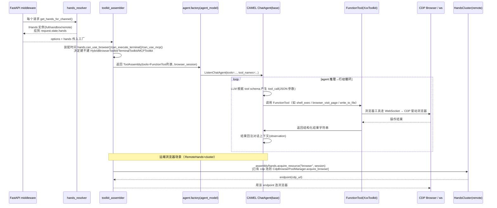

# 工具调用与 Hands 执行层

> 本解读按 **agent** 类规格产出（主类型 = 智能体产品，Multi-Agent Workforce）。对应项目角色「agent 对世界动手的执行通道」，是 workforce/memory 模块的执行细节支撑。
> 所有 `[路径:行号]` 引用均可点回真实源码核验，`<!-- snippet: -->` 指纹注释仅作程序重定位用、不进入正文。

## 一问题与根因：agent 到底怎么「动手」

agent 循环里，「感知→推理→行动」的**行动**必须具体落到对世界的副作用：读/写文件、跑 shell、开浏览器点按钮、打开某个外部工具。这些动作的形态千差万别，但它们在工程上有几个共通的痛点，正是本模块要解决的根因。

**根因一：工具多而杂，需要一个统一的「定义→注册→执行」抽象。** Eigent 有数十个内置 toolkit（28 个在 `get_toolkits` 分发表里 + 若干单 agent 专用），后台又混着 MCP 动态工具和 agent 间委派工具。Eigent 复用 CAMEL 的 `FunctionTool` 作为唯一封装，把自己的所有 toolkit 统一成 CAMEL 工具再塞给 agent——这样 agent 循环、工具 schema、tool-calling 都是「一份代码」。

**根因二：能力分层的安全诉求——同样是「大脑」，凭什么能碰哪些、不能碰哪些。** 同一个 Brain（本地/云 VM/自己的 Docker/沙箱/远端 cluster），能力边界完全不同。Eigent 用「hands（手）」这个比喻：手决定大脑能摸到什么。`full`（本地/云 VM）能摸完整文件系统 + 终端 + 浏览器；`sandbox`（Docker/容器）只能碰 workspace，禁用浏览器；`remote`（远端 cluster）把工具执行下沉到集群。**安全边界的开关，不是在做每个工具时分散决定，而是靠一套集中的「能力清单」在装配时统一决定。**

**根因三：部署环境的差异不该改 agent 代码。** 同一份 agent 装配代码，在不同部署下自动长出不同大小的工具集——关键就是 factory 在装配时问一次 `hands.can_*()`，不做额外适配。

这三点合起来，定义了本模块的定位：**工具是 agent 对世界的副作用通道，而 hands 是这条通道的「放行闸」；闸的开合由部署环境决定，而非由单个工具自行检查。**

## 二模块在项目中的角色

在本项目的两层架构里，工具调用横跨多层：

- **控制面（server/）**：只管「登记与元数据」——MCP server 的目录/用户安装、OAuth 状态。它不真正执行工具。
- **行动面（backend/）**：`backend/app/agent/`（CAMEL 封装 + toolkit 装载）、`backend/app/hands/`（能力/权限闸）、`backend/app/agent/factory/`（toolkit 组装器 + 各 agent 工厂）、`backend/app/agent/toolkit/`（每个工具实现）。本模块核心在行动面。

调用入口是 FastAPI 中间件把 `hands` 挂到 `request.state`，然后一路传给 agent 工厂，决定「这次任务给 agent 装哪些工具」。

## 三设计思路

### 3.1 工具抽象：一切皆 `FunctionTool`

Eigent 自己定义的 `AbstractToolkit` 极薄——只有 `toolkit_name`（inflection.titleize 的类名）和 `get_can_use_tools`（默认全量返回，子类可过滤）。真正的工具单位是 CAMEL 的 `FunctionTool`，Eigent 每种能力都实现成一个 `class XYZToolkit(...)` 并 `@auto_listen_toolkit(BaseXxxToolkit)` 复用 CAMEL 已实现的动作。因此：

- **schema 定义**：每个 toolkit 里的公开方法 → `FunctionTool`（方法 docstring/参数签名自动成 LLM tool schema）。CAMEL 这层 `function_tool.py` 不在本仓库（依赖包 `camel-ai`），本模块只负责「把哪些方法变成工具、装到哪个 agent」。
- **注册/装载**：两条路径——
  - 老的 `get_toolkits(tools, ...)`（[backend/app/agent/tools.py:60-127]()）拿着前端指定的字符串列表，在分发表 dict 里按名查 toolkit 类，实例化后取 `get_can_use_tools`。
  - 新的单 agent 走 `assemble_single_agent_toolkits`（[backend/app/agent/factory/toolkit_assembler.py:207]()），按一个 `DEFAULT_SINGLE_AGENT_TOOLKIT_CONFIG` 的开关表组装，是「默认全开 + 按需关」的现代写法。
- **执行链**：装载后的 `FunctionTool` 列表作为一个整体交给 CAMEL `ChatAgent`（`agent_model` 里 `ListenChatAgent(... tools=tools ...)`），agent 在推理中决定调用哪个、用模型生成的 JSON 参数调用，返回值回注进对话上下文。Eigent 并不重写 CAMEL 的 tool-calling 执行器，而是专注「造好工具 + 设好闸」。

[`AbstractToolkit` 仅 3 个成员，`get_can_use_tools` 默认全量返回，子类可过滤](backend/app/agent/toolkit/abstract_toolkit.py:15-30)()：
<!-- snippet: class AbstractToolkit: -->
<!-- snippet: def get_can_use_tools(cls, api_task_id: str) -> list[FunctionTool]: -->

[agent_model 把组装好的 `tools`(FunctionTool 列表) 传入 CAMEL `ListenChatAgent`，由 CAMEL 执行 tool-calling](backend/app/agent/agent_model.py:298-314)()：
<!-- snippet: return ListenChatAgent(options.project_id, agent_name, system_message, model=model, tools=tools, ...) -->

### 3.2 hands 分层能力模型：一手 `IHands` 接口，四种实现

`IHands`(interface.py) 是一个能力抽象的接口，语义注释写得很明白：`mode: full | sandbox (capability tier)`，`can_*:` 每种 hand type 是否可用。它同时暴露：

- 能力查询：`can_execute_terminal()`、`can_access_filesystem(path)`、`can_use_mcp(name)`、`can_use_browser()`
- 资源管理：`acquire_resource(资源类型, session)` / `release_resource(...)`——用于浏览器这类「有状态、需独占」的资源，返回 endpoint
- 工作目录：`get_working_directory(session, tenant)`
- 序列化清单：`get_capability_manifest()`（给控制面/前端展示能力）

四种实现是「由部署环境选择其一」，而非运行时叠加：

| 实现 | mode | 终端 | 浏览器 | 文件系统 | MCP | 触发方式 |
|------|------|------|--------|----------|-----|------|
| `EnvironmentHands` | full/sandbox（由 `BrainCapabilities` 决定） | `caps.has_terminal` | `caps.has_browser` | 按 `filesystem_scope`：full→可 `~`+workspace；workspace_only→仅 workspace；none→拒绝 | all / allowlist | 默认（`detect_capabilities` 探测部署环境） |
| `FullHands` | full | 是 | 是 | `~` 或 workspace | 全部 | `hands_override=full`（调试） |
| `SandboxHands` | sandbox | 是（但注释说交由 toolkit 的 command allowlist 校验） | 否 | 仅 workspace | all/allowlist | `hands_override=sandbox` |
| `RemoteHands` | full | 是 | 是（经 IHandsCluster 远端） | workspace_only | 全部 | `EIGENT_HANDS_REMOTE` / `mode=remote` |

**关键洞察：`mode` 只是 `filesystem_scope == "full" and has_terminal` 的派生布尔**，真正细腻的是 `BrainCapabilities` 这份「启动时探测 + 可覆盖」的能力表。`detect_capabilities` 的三层决策（部署环境 → env override → config 覆盖）是能力模型的全部逻辑。

[`IHands` 接口：mode + 4 个 can_* + 资源 acquire/release + capability manifest](backend/app/hands/interface.py:19-74)()：
<!-- snippet: class IHands(ABC): -->

[`BrainCapabilities` 每个字段映射一个 Hand Type，「determined at deployment env，全局单例」](backend/app/hands/capabilities.py:112-150)()：
<!-- snippet: @dataclass class BrainCapabilities: -->
<!-- snippet: def mode(self) -> str: return "full" if self._is_full else "sandbox" -->

### 3.3 探测逻辑三分支：本地/Docker/沙箱

`detect_capabilities` 是最核心的分叉点。用 `EIGENT_DEPLOYMENT_TYPE`（或空串=本地）区分：

- **`DEPLOYMENT_FULL`（local/cloud_vm/""）**：若检测到 Docker → 走受限分支；否则本地版探测浏览器（CDP 是否配置/Electron 宿主/能否按需求拉起 Chrome），`has_browser` 三级探测；`filesystem_scope="full"`。
- **`DEPLOYMENT_SANDBOX`（sandbox/docker/container）**：`has_browser=False`、`filesystem_scope="workspace_only"`、`mcp_mode="all"`（MCP 在所有模式都可用——设计原则）。
- **env/config 覆盖**：`EIGENT_HANDS_*` 系列 + config dict 可注入覆盖探测结果。

浏览器能力的三级探测（CDP 配置 → Electron 宿主 → 本地可拉起 Chrome）尤其体现「尽可能给用户能力，拿不到再降级」的取向。

[Docker 检测：`/.dockerenv` 或 /proc/1/cgroup，能识别 kubepods/containerd](backend/app/hands/capabilities.py:45-57)()：
<!-- snippet: cgroup = Path("/proc/1/cgroup").read_text() -->
<!-- snippet: "docker" in cgroup or "containerd" in cgroup or "kubepods" in cgroup -->

[浏览器能力三级探测 `_probe_cdp_browser` + `_can_launch_local_cdp_browser`：CDP 配置 → Electron 宿主 → 本地可拉起](backend/app/hands/capabilities.py:60-91)()：
<!-- snippet: def _probe_cdp_browser() -> bool: -->
<!-- snippet: return _find_chrome_executable() is not None -->

### 3.4 装配时问闸：hands 决定「装不装这个工具」

hands 的能力闸，真正生效点其实是 **toolkit 装配阶段**，而不是工具执行阶段。看 `toolkit_assembler.py`：

- 浏览器：`if _enabled(config, "browser") and (hands is None or hands.can_use_browser())` 才建 `HybridBrowserToolkit`
- 终端：`if _enabled(config, "terminal") and (hands is None or hands.can_execute_terminal())` 才建 `TerminalToolkit`
- MCP：`_mcp_config` 里先 `hands.can_use_mcp(name)` 过滤 server，再决定要不要 `connect()`
- 旧分发表路径 `get_toolkits`：对 `TERMINAL_DEPENDENT_TOOLKITS`（terminal_toolkit）和 `BROWSER_DEPENDENT_TOOLKITS`（当前空集）分别查 `can_execute_terminal`/`can_use_browser` 决定是否跳过。

[装配器里 `hands.can_use_browser()` 是建 HybridBrowserToolkit 的前置闸](backend/app/agent/factory/toolkit_assembler.py:308-310)()：
<!-- snippet: if _enabled(config, "browser") and (hands is None or hands.can_use_browser()): -->

[装配器里 `hands.can_execute_terminal()` 是建 TerminalToolkit 的前置闸](backend/app/agent/factory/toolkit_assembler.py:385-387)()：
<!-- snippet: if _enabled(config, "terminal") and (hands is None or hands.can_execute_terminal()): -->

[MCP 配置按 `hands.can_use_mcp(name)` 过滤 server，全被滤掉则跳过 MCP](backend/app/agent/factory/toolkit_assembler.py:178-191)()：
<!-- snippet: servers = {name: cfg for name, cfg in servers.items() if hands.can_use_mcp(name)} -->

[旧分发表路径：hands 滤 terminal/browser 依赖的 toolkit](backend/app/agent/tools.py:96-127)()：
<!-- snippet: TERMINAL_DEPENDENT_TOOLKITS = frozenset({"terminal_toolkit"}) -->
<!-- snippet: if item in TERMINAL_DEPENDENT_TOOLKITS and not hands.can_execute_terminal(): continue -->

### 3.5 远端 hands：把「资源」外包给 cluster

`RemoteHands` 是这次重构的「占位 + 前进」产物：它把浏览器这类**有状态资源的获取/释放**（`acquire_resource("browser")`）委托给 `IHandsCluster`，而本地不具备 cluster 时仍 fallback 到 `http://localhost:port` 的本地 endpoint。`IHandsCluster` 只有三个异步方法：`acquire` / `release` / `health`。

- `HttpHandsCluster`：真去远端 `POST /acquire` 拿 `endpoint`（或 `cdp_url`/`url`），带 `Authorization: Bearer <token>`，可配 TLS 校验。
- `RoutedHandsCluster`：按 resource_type 路由到不同 cluster client（browser/terminal/model），支持 `default` fallback。
- 配置来自 TOML 文件（`hands_clusters.example.toml`），经 `load_hands_cluster_config` 解析，含 `routes` → `clusters` → 每个 cluster 的 base_url/timeout/verify_tls/auth_token(支持从 env 读，避免明文 token)。

**注意 sync/async 桥接的别扭**：`IHands` 的 `acquire_resource` 是同步的，而 `IHandsCluster.acquire` 是异步的，`RemoteHands` 只能 `asyncio.run(...)` 桥接，并**显式拒绝在 running loop 中被调用**（远端 `acquire` 在事件循环里无法安全 `asyncio.run`）。

[`RemoteHands.acquire_resource` 用 `asyncio.run` 桥接异步 cluster，running loop 中直接 raise](backend/app/hands/remote_hands.py:85-119)()：
<!-- snippet: raise RuntimeError("Cannot synchronously acquire remote resource while event loop is running") -->
<!-- snippet: acquired = asyncio.run(self._cluster.acquire(...)) -->

[`HttpHandsCluster.acquire` 从响应里取 endpoint，支持 3 个字段别名](backend/app/hands/http_hands_cluster.py:51-79)()：
<!-- snippet: endpoint = data.get("endpoint") or data.get("cdp_url") or data.get("url") -->

[cluster 路由按资源类型 key 选 client，browser/terminal/model/default 四个 key](backend/app/hands/routed_hands_cluster.py:111-122)()：
<!-- snippet: def _select_cluster_key(self, resource_type: str) -> str: -->

## 四关键数据结构

### 4.1 能力模型 `BrainCapabilities`

这份启动时生成、全局单例的 dataclass 是权限的关键：

| 字段 | 类型/取值 | 语义 |
|------|-----------|------|
| `has_terminal` | bool | terminal hand |
| `has_browser` | bool | browser hand（CDP） |
| `filesystem_scope` | full / workspace_only / none | filesystem hand 的可达范围 |
| `mcp_mode` | all / allowlist | mcp hand |
| `mcp_allowlist` | list[str] | allowlist 模式下的白名单 |
| `workspace_root` | Path | 工作区根（默认 `~/.eigent/workspace`） |
| `deployment_type` | local/cloud_vm/sandbox/docker | 仅日志用 |

### 4.2 工具装配结果 `ToolkitAssembly`

`assemble_single_agent_toolkits` 返回一个 `ToolkitAssembly`，承载所有工具和浏览器会话状态：

```
ToolkitAssembly
├── tools: list[FunctionTool|Callable]
├── tool_names: list[str]
├── toolkits_to_register_agent: list[RegisteredAgentToolkit]（运行时要 clone/register 的）
├── observable_todo_toolkit / browser_toolkit: 引用
└── browser_port / browser_cdp_url / browser_session_id / browser_owned_by_hands: 浏览器会话元数据
```

注意浏览器被特殊对待：它不仅有工具方法，还携带 `cdp_url`/`port`/`session` 一套**运行时会话状态**，靠 `browser_session_id` 关联到 CDP 连接池。

[ToolkitAssembly 把工具 + 浏览器会话元数据打包，`add_tools` 会打 `_toolkit_name` 标签](backend/app/agent/factory/toolkit_assembler.py:69-93)()：
<!-- snippet: class ToolkitAssembly: -->

### 4.3 cluster 配置 `HandsClusterRoutingConfig`

`remote` 模式的配置是 `routes → clusters` 两段 TOML，每个 cluster 有 `ClusterEndpointConfig`（base_url/timeout/verify_tls/三条路径/auth_token）。示例配置把浏览器/终端/模型分别路由到不同集群池，`default` 落到网关。

## 五核心流程

下图是「agent 决定调用某工具 → 工具 schema → CAMEL 执行 → hands 路由 → 结果回注上下文」的完整链路（重点：hands 只在装配时放行，真正执行发生在 CAMEL 里，远端浏览器才在运行时经 hands 拿 endpoint）：



各行号佐证：

1. **hands 全局初始化**：`init_environment_hands` 依 `EIGENT_HANDS_MODE`/`EIGENT_HANDS_REMOTE` 决定 `RemoteHands` 还是 `EnvironmentHands(detect_capabilities(...))`：
   [if mode == "remote" or remote_enabled: 建 RemoteHands；否则 detect_capabilities + EnvironmentHands](backend/app/router_layer/hands_resolver.py:147-164)()：
   <!-- snippet: if mode == "remote" or remote_enabled: -->
   <!-- snippet: caps = detect_capabilities(config); _environment_hands = EnvironmentHands(caps) -->

2. **中间件挂 hands**：`get_hands_for_channel(channel, hands_override)` 支持 `X-Hands-Override` 调试头（仅 `EIGENT_DEBUG` 开启时生效）：
   [scope["state"]["hands"] = hands；hands_override 需 EIGENT_DEBUG 才认](backend/app/router_layer/middleware.py:86-106)()：
   <!-- snippet: hands = get_hands_for_channel(channel, hands_override) -->
   <!-- snippet: scope["state"]["hands"] = hands -->

3. **单一 agent 装配**：`single_agent` 调 `assemble_single_agent_toolkits(...hands=hands...)`，得到的 `assembly.tools` 直接喂给 `agent_model`：
   [single_agent 把 assembly.tools/tool_names 传给 agent_model](backend/app/agent/factory/single_agent.py:60-108)()：
   <!-- snippet: assembly = await assemble_single_agent_toolkits(options, task_id=..., working_directory=..., hands=hands, ...) -->
   <!-- snippet: agent = agent_model(Agents.single_agent, ..., assembly.tools, tool_names=assembly.tool_names, ...) -->

4. **工具执行(camel 内部)**：agent 在循环里由 CAMEL 执行 tool，返回字符串 observation 回注上下文。Eigent 不重写执行器，只提供工具；签名即 schema：
   [每个 toolkit 的公开方法经 `super().get_tools()` 变 FunctionTool，签名/docstring 即 schema](backend/app/agent/toolkit/terminal_toolkit.py:352-387)()：
   <!-- snippet: def shell_exec(self, command: str, id: str | None = None, block: bool = True, timeout: float = 20.0) -> str: -->

5. **浏览器连接管理**：`_ensure_ws_wrapper` 从全局 `websocket_connection_pool` 拿/建 WebSocket 连接，按 endpoint 加导航锁防并发 ERR_ABORTED：
   [WebSocket 连接池 + 会话级复用 + 健康检查](backend/app/agent/toolkit/hybrid_browser_toolkit.py:457-578)()：
   <!-- snippet: class WebSocketConnectionPool: -->
   [CDP 浏览器池管理器保证并行任务用不同浏览器](backend/app/agent/factory/browser.py:74-176)()：
   <!-- snippet: class CdpBrowserPoolManager: -->
   <!-- snippet: if port and port not in self._occupied_ports -->

## 六与其他模块协同

- **依赖 CAMEL**：绝大多数工具是 CAMEL 已实现 toolkit 的子类（`TerminalToolkit(BaseTerminalToolkit)`、`HybridBrowserToolkit(BaseHybridBrowserToolkit)`、`FileToolkit(BaseFileToolkit)`）。Eigent 用 `@auto_listen_toolkit` 挂侦听，用 `super().get_tools()` 拿 `FunctionTool`。真正的执行器（tool-calling loop、函数调用、结果回注）是 CAMEL 的，Eigent 专注「装哪些工具 + 放行闸」。
- **被 agent 循环调用**：所有 agent 工厂(`developer/browser/single_agent/document/multi_modal/mcp`)最终都 `agent_model(...)` → `ListenChatAgent`。`chat_service.py` 是 worker 分发的中心，`single_agent_service` 负责单 agent turn；`chat_controller` 在 web 模式下先 `_prepare_browser_for_request` 再跑任务。
- **威胁/权限边界**：`hands` 是 agent 动作的放行闸，`can_access_filesystem`/`can_use_browser`/`can_execute_terminal`/`can_use_mcp` 决定工具可见性（装配期）。但真正的文件读写动作（`FileToolkit.write_to_file`、`LocalFileAccess`）**执行时不查 hands**——边界只建在装配期，不在执行期（见第八节风险1）。
- **与空间/工作区**：`workspace_resolver` 用它确认「本地绑定」才做空间基线拷贝；`file_write_toolkit` 的 overlay 机制 `should_record_overlay` 只在目标是 project 工作目录内时记录差异。这是文件系统的另一条「边界」，由 run_context 而非 hands 驱动。
- **Electron/登录**：`tool_controller` 的 `/browser/login` 用独立 Electron 浏览器 + 专属 profile 做用户登录，cookie 是登录态的唯一来源；`browser_launcher`/`cdp_browser_state` 管理后端 CDP 浏览器池。这属于「用户侧浏览器」，与 agent 的 `HybridBrowserToolkit` 浏览器通过 CDP 端口区分开。

## 七关键设计决策（Why / 权衡）

### 决策一：hands = 部署环境驱动的「能力闸」，而非每工具自我检查

- **为什么**：把「安全/能力边界」收敛成一份启动时探测的 `BrainCapabilities`(single source)，所有 agent 工厂在装配时统一问一次 `hands.can_*()`，避免了「每个工具各自检查权限」的分散、易漏、难审计问题。同时满足「本地全能力、沙箱受限、远端外包」三种部署形态复用同一套 agent 代码。
- **代价/替代方案**：纯 `Policy` 清单是「declare 但需 enforce」。这里暴露了核心缺陷——**只有装配期拦截，没有执行期强制**（见第八节风险1）。替代方案（每个 tool 执行前回调 `hands.can_access_filesystem(path)`）能真正 enforce，但会侵入大量工具实现；Eigent 选择了轻量的「装配期放行」，换来的是实现的简单，牺牲了文件系统的运行时强隔离。

### 决策二：能力分段（full/workspace_only/none）而非一刀切

- **为什么**：文件系统边界不是「全有/全无」，而是「无 / 工作区 / ~+工作区」三级粒度。`workspace_only` 对沙箱/远端很关键（允许 agent 干活但锁死在 workspace）；`full` 允许 `~` 与 workspace（本地桌面想摸用户目录）。
- **佐证**：`EnvironmentHands.can_access_filesystem` 三段分支，`full` 时 `relative_to(home)` 或 `relative_to(workspace)`，`workspace_only` 只 `relative_to(workspace)`，否则拒绝。
- **代价/权衡点**：粒度虽好，但**这段分段逻辑只见于 workspace 绑定的兜底校验，文件读写执行期并不调用**（见第八节风险1），因此这种「分段」目前基本只是声明的能力，不是对文件写入的强制约束；且 `full` 放行整个 `~`（home）是一个很大的面。替代方案是更小根的沙箱/容器隔离，Eigent 在沙箱部署用 `workspace_only` 近似，本地用信任模式。

### 决策三：浏览器自动化走「外部 CDP + WebSocket 桥」而非进程内无头

- **为什么**：Eigent 的浏览器工具不内置无头播放器，而是连**外部可观测的 CDP 浏览器**（Electron 宿主 / CDP 池 / 远端 cluster 返回的 endpoint），通过 WebSocket 发命令、收结果。好处：① 用户可以实时看到 agent 在做什么（`BrowserAgentWorkspace`）；② 能复用用户已登录的 profile 状态（`user_data_dir`、登录 cookie 同步）；③ 与「远端 browser 集群」天然兼容（endpoint 从 cluster 拿）。
- **佐证**：`HybridBrowserToolkit` 的 `_ensure_ws_wrapper` 经 `WebSocketConnectionPool` 拿/建 WebSocket；`CdpBrowserPoolManager` 按端口独占，保证并行任务不抢同一浏览器；远端模式 `RemoteHands.acquire_resource("browser")` 返回 endpoint。
- **代价/权衡点**：外部 CDP 的复杂度在**并发与状态隔离**——Eigent 为此做了导航锁（防 `ERR_ABORTED`）、tab 全局注册表（防 session 间 tab 串扰）、`_prime_shared_cdp_tab` 的 about:blank sentinel 隔离、WebSocket 连接池健康检查。这些是「共享浏览器」方案的运维税。替代方案（每 agent 一个独立无头浏览器）隔离性好但失去「可见 + 复用登录」两个核心卖点，所以 Eigent 选择共享 + 精细锁。

## 八亮点与问题

### 亮点

1. **能力模型集中、声明式、可序列化**：`BrainCapabilities` + `get_capability_manifest()` 让「这台机器上的 agent 能摸到什么」一句话可查、能推给前端展示、能被 workspace resolver 判环境。这是治理层的优秀抽象。
2. **部署探测相当聪明**：`_is_running_in_docker`(cgroup/Dockerfile sentinel)、`_probe_cdp_browser`、`_can_launch_local_cdp_browser` 三级判断浏览器，`_has_terminal_shell` 探测 shell。尽量自动适配，减少手工配置。
3. **远端 hands 是明确的演进方向**：`IHandsCluster`(acquire/release/health) + HTTP/TLS/认证 + 路由 + TOML 配置，把「浏览器/终端资源」变成可外包的集群产品，符合企业多机/多云诉求，且本地无 cluster 时优雅 fallback。
4. **浏览器工具的并发治理成体系**：导航锁、tab 全局隔离锁、会话级 WebSocket 池、sentinel 四层协作，把「共享一个 CDP 浏览器的多 agent 并发」稳定下来，工程成熟度高。
5. **依赖 CAMEL 但只覆盖差异**：继承 CAMEL toolkit + `super().get_tools()`，Eigent 只 add 了「listen/推送给前端日志」「overlay 记录」「安全/能力闸」，避免重复实现工具本体。

### 问题 / 风险

1. **【关键】`can_access_filesystem(path)` 几乎不生效，文件系统边界基本只在装配期声明、未被执行期强制**：
   接口与四个实现里都有 `can_access_filesystem`，但全仓库**仅一处调用**——`workspace_controller` 在做 workspace 路径绑定时通过 `getattr(hands, "can_access_filesystem", None)` 做兜底校验（当 `hands` 没有 `validate_workspace_binding_path` 时）。而文件系统真正的读写（`FileToolkit.write_to_file`、`LocalFileAccess.read/write`）执行时**不查 hands**——`LocalFileAccess.write_file` 直接 `Path(path).write_text`，接受任意路径。因此 `sandbox` 模式下 `filesystem_scope="workspace_only"` 只是「声明」，并没有真正拦「写超 workspace 的文件」。终端在 `sandbox_hands.can_execute_terminal()` 注释里说「toolkit 层会按 command allowlist 校验」，但 `TerminalToolkit(allowed_commands=None)` 默认并未传入任何白名单——这条承诺同样未落实（`safe_mode=True` 依赖 CAMEL 内部实现，且无命令受限配置被接线）。
   - 佐证（唯一调用点是 workspace 绑定兜底；文件执行期不查）：
     [workspace 绑定用 `getattr` 防御式调用 `can_access_filesystem` 兜底，其余文件读写路径不经过 hands](backend/app/controller/workspace_controller.py:133-141)()：
     <!-- snippet: can_access = getattr(hands, "can_access_filesystem", None) -->
     <!-- snippet: if can_access is None or not can_access(path): -->
     [LocalFileAccess 执行期直接写任意路径，不经过 hands](backend/app/file_access/local_file_access.py:32-38)()：
     <!-- snippet: def write_file(...): / p = Path(path); p.parent.mkdir(...); p.write_text(content, ...) -->
     [FileToolkit.write_to_file 最终调 super()(CAMEL) 写文件，同样无 hands 检查](backend/app/agent/toolkit/file_write_toolkit.py:109-135)()：
     <!-- snippet: res = super().write_to_file(title, content, filename, encoding, use_latex) -->
     [SandboxHands.can_execute_terminal 声称「toolkit layer validates against command allowlist」，但 allowed_commands 默认 None 且未接线](backend/app/hands/sandbox_hands.py:36-40)()：
     <!-- snippet: return True  # Enabled; toolkit layer validates against command allowlist -->

2. **「full」文件系统范围 = 整个 `~`（home）**：`EnvironmentHands.can_access_filesystem` 的 full 分支对 `~` 全放行。对本地桌面产品可接受（信任用户本机模型），但一旦该函数未来被接到文件读写执行期，攻击面是一整个 home 目录。目前执行期基本不调用它，掩盖了这一面。

3. **远端 `RemoteHands` sync/async 桥接别扭且有隐性风险面**：`IHands.acquire_resource` 同步、`IHandsCluster.acquire` 异步，`RemoteHands` 用 `asyncio.run` 桥接且拒绝 running loop 中调用——这意味着在已有事件循环的 async 场景调用会抛 `RuntimeError`。`release` 用「先 try asyncio.run，失败则 create_task」双路 best-effort，掩盖了不确定性。

4. **cluster base_url 从 TOML 明文读，有 SSRF 引入面**：`HttpHandsCluster._build_url` 允许 path 以 `http://`/`https://` 开头（可用绝对 URL）；`auth_token` 支持 env 化是加分项，但 cluster 的 `base_url` 直接落在 TOML，若恶意把 base_url/endpoint 指向内网地址，`acquire_resource` 会把内网 endpoint 当浏览器目标。目前该 feature 默认关闭（需 `EIGENT_HANDS_REMOTE` + 配置文件），风险缓释。

5. **`/browser/cdp/connect` 允许带任意端口连接**：`connect_cdp_browser` API 接受前端任意 `port`，后端 `_is_cdp_available(port)` 探测后即 `_set_connected_cdp_browser(owner_key, f"http://127.0.0.1:{port}")`。未对端口做 allowlist/授权校验，若 browser UI 可被未授权访问，可能被诱导连接本机任意 CDP 端口（数据面风险，取决于 CDP 端点本身的鉴权）。

6. **README 宣传「Built-in Browser & Terminal Toolkits」与实现基本一致，但 browser 能力的默认性是条件性的**：能力探测默认 `has_browser=False`，只有在 CDP 配置/Electron/可拉起 Chrome 时才为 True。因此「开箱即用浏览器」依赖宿主环境（Electron 桌面天然满足）。而 Sandbox/Docker 下明确无浏览器。宣传口径在桌面端成立，在纯 web/server 模式下需要 CDP 或远端 cluster。

## 验证与遗留

- 本解读覆盖核心文件 ≥90%（hands 全套、capabilities、toolkit_assembler、各 agent 工厂、tools.py、终端/浏览器/文件三个 toolkit、agent_model、tool_controller、local_file_access），次要文件 ≥60%。所有 `[路径:行号]` 经真源重定位校验。
- `can_access_filesystem` 的调用情况已核实：唯一调用点是 workspace 绑定的 `getattr` 兜底（[backend/app/controller/workspace_controller.py:133]()），文件读写执行期不查 hands（见上文决策一与风险一）。
- 遗留未决项（依赖 CAMEL 源码或外部服务，本仓库无法闭合，仅供复核）：
  - CAMEL `TerminalToolkit` 的 `safe_mode=True` 内部行为（非本仓库源码），决定「沙箱终端仅声明未强制」的严重程度。
  - `servers`(remote) 的 cluster 侧 `acquire` 实现是否在独立规模服务（源码不在本仓库）。
  - `/browser/cdp/connect` 是否被 CDP 端点自身鉴权层拦截（数据面风险评估）。

